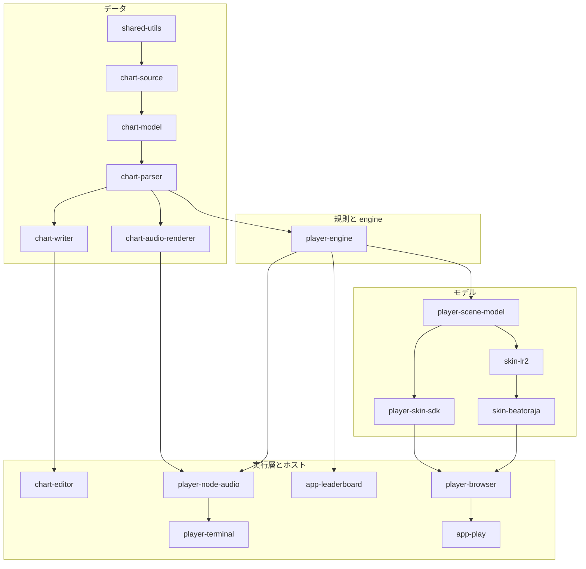
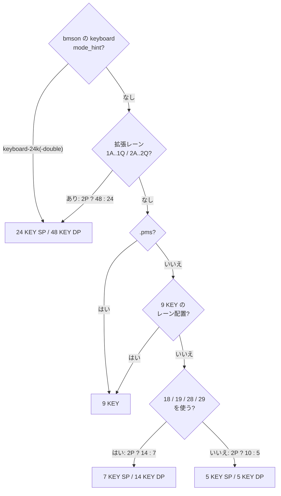

[English version](./README.md)

# be-music

[パッケージの命名と移行](./docs/packages.ja.md)

TypeScript + pnpm workspaces で構成した BMS/bmson ツールチェーンです。

## パッケージ

- `@be-music/chart-source`: Be-Music 内部処理専用の BMS/bmson 中間表現 (JSON互換) の pure IR
- `@be-music/chart-model`: beat 解決、イベント順序、ロングノート解決などの譜面意味論 helper
- `@be-music/shared-utils`: 全パッケージで再利用する汎用ユーティリティ。browser-safe な core helper と Node 向け helper は狭い subpath export で分けています
- `@be-music/chart-parser`: `.bms` / `.bme` / `.bml` / `.pms` / `.bmson` / JSON のパーサ
- `@be-music/chart-writer`: JSON から `.bms` / `.bmson` への文字列化
- `@be-music/chart-audio-renderer`: 譜面をレンダリングして `.wav` / `.aiff` を出力
- `@be-music/player-engine`: 規則と再生 engine を共有する package。1 つのプレイループ（手動・AUTO・リプレイ）、判定、score、gauge とクリアランプ、自己ベスト、コースの実行と NONSTOP、リプレイの形式、ホストが差し込む runtime 契約
- `@be-music/player-terminal`: autoplay、keyboard play、Music Select、BGA、SEA build を扱う terminal UI と `bms-player` CLI frontend、およびリプレイ再シミュレータ `bms-replay`
- `@be-music/player-scene-model`: ライブラリの項目・一覧・プレイオプション・プレイ状態と結果・コース・効果音など、スキンの種類によらず共有する実行環境非依存のシーンモデル
- `@be-music/skin-lr2`: Lunatic Rave 2 skin parser、asset resolver、theme loader を renderer 非依存で提供する package
- `@be-music/skin-beatoraja`: beatoraja JSON/Lua skin parser、normalizer、theme loader を renderer 非依存で提供する package
- `@be-music/player-skin-sdk`: browser player 向け be-music スキンを書くための描画フレームワーク非依存の SDK
- `@be-music/player-ui`, `@be-music/player-ui-react`, `@be-music/player-ui-vue`: [再利用可能な Lit 製 Web Components と、型付き React・Vue ラッパー](./packages/player-ui/README.ja.md)
- `@be-music/player-browser`: browser の PixiJS 実行層。選曲・決定・プレイ・リザルトの各画面を、built-in・LR2・beatoraja のファミリービューが描くシーンセッションとして 1 つのホスト向け API から作る。音のサービス、譜面のコレクション、スキンの読み込み、gameplay の録画も持つ
- `@be-music/app-play`: folder / ZIP drop、LR2 / beatoraja theme、Debug Menu、browser 再生を、1 つのシーンルーターの下のサービスとして接続する private Vite demo
- `@be-music/app-leaderboard`: Cloudflare Workers で動く private な Leaderboard API。リプレイの投稿、再シミュレーションによる検証、ランキング
- `@be-music/chart-editor`: CLI エディタ (インポート・編集・エクスポート)

パッケージは層を成して積み上がっています。矢印は、パッケージからそれに依存するパッケージへ向かいます。ほかの矢印を通じて既に届く依存は重ねて描いていません（`@be-music/shared-utils` はほぼすべてのパッケージの下にあります）。パッケージの内側の同じ層は [アーキテクチャ — 目指す構造](./docs/architecture.ja.md#目指す構造) にあります。



## 必要環境

- Node.js `>= 26`
- pnpm workspaces

## セットアップ

```bash
pnpm install
```

## ビルド・検証

```bash
pnpm run clean
pnpm run build
pnpm run check
pnpm run test
```

ツールチェーンは [Vite+](https://viteplus.dev/) (`vite-plus`) で、ルートの `vite.config.ts` に設定を集約しています。`pnpm run build` は Vite+ のタスクランナー (`vp run -r --cache build`) で各ワークスペースの `build` スクリプトを依存順に実行し、変更のない package はタスクキャッシュから再生します。ライブラリ package は各 `vite.config.ts` の `pack` ブロックから `vp pack` (tsdown) でビルドし、bundle と型定義 (`.d.ts`) をまとめて出力します。`pnpm run check` はフォーマット・lint・型チェック (Oxfmt / Oxlint / tsgolint) をワークスペース全体に対して一度に実行し、`pnpm run format` / `pnpm run lint` / `pnpm run typecheck` で個別に実行できます。各 package の `tsconfig.json` は型チェック用のプロジェクトで、型定義の出力には `tsconfig.build.json` を使います。依存関係をインストールすると、ステージされたファイルに `vp check --fix` を実行する Vite+ の pre-commit フックも登録されます。`pnpm run test:e2e` は Web デモでコースのブラウザ確認を Playwright で端から端まで実行します（数分かかるため `pnpm run test` には含めていません）。[docs/course-checklist.ja.md](docs/course-checklist.ja.md#自動実行) を参照してください。

## package ごとの release

このリポジトリでは `Changesets` で package ごとの version と changelog を管理します。

```bash
pnpm run changeset
pnpm run release:status
pnpm run release:version
```

- 通常の feature PR では、変更した package に対する `.changeset/*.md` を追加します
- release したいタイミングで `devel` 上で `pnpm run release:version` を実行し、生成された `packages/*/package.json` と `packages/*/CHANGELOG.md` の更新をまとめてコミットします
- その状態で `devel -> main` の release PR を merge すると、version が上がった公開 package だけ GitHub Release が個別に作成されます（プレイヤーのデモや Leaderboard などの private package は対象外です）
- player SEA 実行ファイルは `@be-music/player-terminal` から build し、`@be-music/player-terminal` release に添付します。`@be-music/chart-audio-renderer` も SEA zip を添付します
- private な repository root の `package.json` は `0.0.0` のままで、release 対象 version は `packages/*/package.json` で管理します

tag は `@be-music/package-name@x.y.z` 形式で作成されます。

## 仕様書

- [共通ユーティリティ](docs/shared-utils.ja.md)
- [仕様書トップ](docs/README.ja.md)
- [アーキテクチャ](docs/architecture.ja.md)と[設計判断の記録](docs/adr/README.ja.md)
- [BMS 実装仕様](docs/bms-spec.ja.md)
- [bmson 実装仕様](docs/bmson-spec.ja.md)
- [Bemuse 実装仕様](docs/bemuse-spec.ja.md)
- [LR2 と beatoraja のセマンティクス](docs/semantics-lr2-beatoraja.ja.md)
- [Player 実装仕様](docs/player-spec.ja.md)
- [Terminal player 実装メモ](docs/player-tui.ja.md)
- [Browser player 実装メモ](docs/player-web.ja.md)
- [シーンモデル（`@be-music/player-scene-model`）](docs/scene-model.ja.md)
- [リプレイ（プレイ履歴）仕様](docs/replay.ja.md)
- [コースと段位認定](docs/course.ja.md)
- [be-music スキンの作り方](docs/be-music-skin.ja.md)
- [LR2 skin 実装メモ](docs/lr2-skin.ja.md)
- [beatoraja skin 実装メモ](docs/beatoraja-skin.ja.md)
- [BMS/bmson 中間表現 (`@be-music/chart-source`) 実装仕様](docs/json-spec.ja.md)
- [用語集](docs/glossary.ja.md)

`@be-music/chart-source` は Be-Music の内部データモデルです。配布フォーマットや他ツールとの再利用可能な交換フォーマットとしては設計していません。
譜面の意味論 helper は `@be-music/chart-model` に分離しており、`@be-music/chart-source` 自体は pure IR と round-trip preservation を担当します。

## 対応状況サマリ

### chart-parser (`@be-music/chart-parser`)

- BMS のヘッダ / オブジェクト行 / 制御構文を保持
- `#WAVxx` / `#BMPxx` / `#BPMxx` / `#STOPxx` / `#TEXTxx` を解釈
- BMS 拡張ヘッダ (`#PREVIEW`, `#LNTYPE`, `#LNMODE`, `#LNOBJ`, `#VOLWAV`, `#SCROLLxx`, `#VIDEOFILE` など) を保持
- bmson の `info` / `lines` / `sound_channels` / `bpm_events` / `stop_events` / `bga` と beatoraja 拡張の `scroll_events` / `key_channels` / `mine_channels` を解釈
- BMS テキストの文字コード推測 (`Shift_JIS`, `UTF-8`, `EUC-JP`, `latin1` など)
- bmson の `info.init_bpm` は parser が必須扱いにし、欠落・不正値は `130` fallback ではなく早期 error にします
- beatoraja の bmson 拡張を beatoraja と同じ意味で `mode_hint` lane resolver 経由で map し、`mine_channels` は mine ごとの `damage` を保持した地雷、`key_channels` は隠し（不可視）ノートにする

### chart-writer (`@be-music/chart-writer`)

- 中間表現(JSON) から BMS/bmson を出力
- `position: [numerator, denominator]` を使って小節解像度を安定再現
- bmson 拡張情報 (`info` 拡張, `bga`, `notes.l/c`) を出力
- `preservation` layer が normalized event と一致している場合、BMS source 構造を優先して再出力

### chart-audio-renderer (`@be-music/chart-audio-renderer`)

- BMS / bmson / JSON 入力に対応
- 出力形式 `.wav` / `.aiff`
- サンプル読込: `WAV` / `MP3` / `OGG` (Vorbis/Opus) / `OPUS`
- 小節長 / BPM / STOP を反映
- LR2 系の 100001 倍 BPM ギミック値を時刻解決で処理
- `#VOLWAV`、`#xxx97` / `#xxx98`、bmson `notes.c`、`#WAVCMD 01 xx vv`、`#EXWAVxx v` の volume scaling を反映

### player-engine (`@be-music/player-engine`)

- terminal と browser runtime が共有する `autoPlay()` / `manualPlay()` engine。決定的な判定コアの上の 1 つのプレイループに、手動・AUTO・リプレイの判定の戦略を差し込む（[アーキテクチャ](./docs/architecture.ja.md#エンジン-判定コアと-1-つのプレイループ)）
- lane flash、POOR BGA command、frame snapshot、pause、restart、high-speed change を流す UI / input signal bus
- playable note、legacy long note、`#LNOBJ`、FREE ZONE、mine、invisible note の共通抽出
- 判定幅、動的 `#EXRANKxx`、score、groove gauge、scroll distance、BGA timeline、result summary の共通意味論
- エンジンのルートと並ぶ browser-safe な入口：`signals`、`lanes`、`display`、`ruleset`、`replay`、`records`、`course`（[Player 実装仕様 — 公開する入口](./docs/player-spec.ja.md#公開する入口)）
- `ruleset`: ホスト・スキン・リーダーボードが共有する語彙。ゲージ、クリアランプ、BP、スコア（`ScoreSummary`、`computeScoreRate`、DJ ランク、LR2 のマネースコア）
- `course`、`records`、`replay`: コースの実行、NONSTOP の流れ、コースのステージの規則、判定ルールセットごとの自己ベスト、リプレイの形式とその記録・シミュレータ

### Node 音声 (`@be-music/player-node-audio`)

- Node 音声セッション、リアルタイムのサンプルミックス、`node-web-audio-api` による PCM 出力
- `chart-audio-renderer` への依存を所有し、`player-engine` から音声レンダーと Node 出力を分離
- Node でエンジンを呼ぶ場合は `createAudioSession: createNodeAudioSession` を設定。ターミナルプレイヤーは自動設定（[プレイヤー仕様](./docs/player-spec.ja.md#node-音声アダプター)）

### scene models (`@be-music/player-scene-model`)

- スキンの種類によらない、実行環境非依存の各画面のモデル。譜面の言葉で表したライブラリの項目（`LibraryChart`、`LibraryFolder`、`LibraryCourse`）、一覧のモデル（`reduceBrowse`、`BrowseSnapshot`）、プレイオプション、プレイ状態（`PlayState`）、プレイ結果（`PlayResult`）、コースの表示用モデル、効果音セット
- Web 実行層、スキン SDK、LR2 と beatoraja の状態を求める関数が使う
- [シーンモデル](docs/scene-model.ja.md) を参照

### terminal player (`@be-music/player-terminal`)

- MANUAL / AUTO SCRATCH / AUTO の 3 モード
- TUI プレイ画面と選曲画面
- 選曲画面の metadata / preview / banner 表示
- 楽曲一覧 metadata のローカル cache (`~/.be-music/chart-selection-cache.json`)
- HIGH-SPEED (`0.5` 〜 `10.0`, `0.5` 刻み)
- TUI refresh rate 設定 (`--tui-fps`, default `60`)
- 判定: `PERFECT` / `GREAT` / `GOOD` / `BAD` / `POOR`（`FAST` / `SLOW` 集計あり）
- 20 万点満点 SCORE と IIDX 準拠 EX-SCORE
- 不可視ノート表示 (`--show-invisible-notes`)
- FREE ZONE (`17` / `27`) の専用扱い
- BGA 画像描画 (`BMP` / `PNG` / `JPEG`) と動画描画 (`mpeg1video` / `h264` / `mjpeg`)
- 動画 BGA の progressive decode (`--no-video-bga-streaming` で旧方式へ切り替え)
- `--kitty-graphics` / `--no-kitty-graphics` による Kitty graphics protocol 描画切り替え (default: on)
- `node-web-audio-api` 固定バックエンドで再生
- `#LNTYPE` 未指定時の自動推測 (`--ln-type-auto` / `--no-ln-type-auto`)
- 再生前 audio render (`--render-audio`) と bus ごとの音量調整 (`--volume`, `--bgm-volume`, `--key-volume`)
- compressor / limiter の有効化切り替えと threshold / release 系の出力ダイナミクス調整
- 構造化ログ出力 (`~/.be-music/logs/player.ndjson`, `--log-file` で上書き)
- gameplay、TUI 描画、video BGA decode を分離する Node worker 構成
- 記録したリプレイから LR2 / beatoraja / IIDX の結果を再計算する `bms-replay` CLI（[リプレイ仕様](docs/replay.ja.md) を参照）

### LR2 skin (`@be-music/skin-lr2`)

- LR2 の select / decide / play / result skin CSV を PixiJS 非依存で parse
- `#INCLUDE`、`#CUSTOMOPTION`、`#CUSTOMFILE`、`#LR2FONT`、system font、skin timer、op condition、play-skin variant を解決
- image、number、text、slider、bargraph、button、BGA、judge line、measure line、gauge、score chart、result graph element を parse
- case-insensitive / wildcard asset lookup、TGA decode、DXA archive extraction で theme asset を読み込み

### beatoraja skin (`@be-music/skin-beatoraja`)

- beatoraja JSON skin と Lua `.luaskin` entry を PixiJS 非依存で parse
- beatoraja の 2-phase Lua contract を制限付き Fengari sandbox 上で評価
- play / select / decide / result / course-result entry を discovery し、play skin を `5` / `7` / `9` / `10` / `14` / `24` / `24d` ごとに group 化（いずれも gameplay で mount 可能）
- `property[]`、`filepath[]`、category group、custom offset、wildcard source path、case-insensitive asset を解決
- image、imageset、value、float-value、text、slider、note、judge、gauge、graph、BPM graph、timing graph、song-list、custom event、destination、PM character element を normalize

### be-music skin SDK (`@be-music/player-skin-sdk`)

- browser player の built-in family 向けスキンの契約。スキンは毎フレームのデータからキャンバスに各画面を描く
- 描画フレームワークを import しない。フレームワークはスキンが持ち込む（Canvas 2D、WebGL / WebGPU、PixiJS、three.js など）
- stage、lane layout、touch / portrait layout、moment、判定表示、loading、audio drive、曲情報、result track、skin settings、motion の helper
- [be-music スキンの作り方](docs/be-music-skin.ja.md) を参照

### browser player (`@be-music/player-browser` / `@be-music/app-play`)

- dropped folder、ZIP、song / LR2 / beatoraja theme 混在 drop を扱う browser song library
- 大きな audio / video file を lazy に扱い、case-insensitive に path lookup
- select、gameplay、result（スキンが宣言していれば decide も）を描く built-in be-music skin（既定の Synesthesia、Phantom、Plain と、opt-in の Lattice）
- タッチ主体の端末でのタッチ操作とタッチ用 gameplay layout、縦向きステージを持つスキンの縦画面表示、スキンごとの設定
- LR2 の select / decide / gameplay / result skin を parse して PixiJS で描画
- beatoraja の select / decide / gameplay / result skin を parse して PixiJS で描画
- 画面ごとに 1 つのシーンセッションが振る舞い（一覧の操作、譜面の準備、エンジン、入力、音、終わり方）をすべてのファミリーに共通に持ち、built-in・LR2・beatoraja のファミリービューは描いてインテントを返すだけ（[シーンセッションとファミリービュー](./docs/player-web.ja.md#シーンセッションとファミリービュー)）
- 設計した入口：`@be-music/player-browser/host`（`PixiSceneHost`、`createSelectScene` / `createDecideScene` / `createPlayScene` / `createResultScene`）、`/skin`、`/collection`、`/audio`、`/recording`（[公開する入口](./docs/player-web.ja.md#公開する入口)）
- destination 補間、sprite transform、number、text、slider、bargraph を扱う共通 LR2 Pixi helper
- destination sampling、source cell selection、text、value、slider、gauge、graph、timing visualizer、note、marker、BGA、runtime op/timer wiring を扱う共通 beatoraja Pixi helper
- note、timing、scroll distance、BGA cue、score、result は terminal player と共通の再生意味論を使用
- 選曲 BGM・効果音・ジングル・譜面のプレビュー・スキンの音を 1 つのシステム `AudioContext` で鳴らす音のサービスと、key / BGM / master を分けた compressor control 付きのプレイごとの WebAudio bus
- BGA still / video 描画、browser-side video transcode fallback、MP4 / WebM gameplay recording
- 1 つの renderer context を所有し、一度に 1 つの scene を表示する PixiJS scene host。demo ではシーンルーターがすべての切り替えを受け持ち、去った scene を dispose する
- hi-speed、BGA mode/size、filter、sort、HS-FIX、lane cover、lift、auto-scratch、DP flip、random/mirror、gauge variant、skin option を扱う LR2 / beatoraja PLAY OPTION control

### chart-editor (`@be-music/chart-editor`)

- `init`, `import`, `export`, `set-meta`, `add-note`, `delete-note`, `list-notes`

## 主要コマンド

### 1. BMS/bmson を JSON に変換

```bash
pnpm run parse chart.bms chart.json
```

### 2. JSON を BMS/bmson に変換

```bash
pnpm run stringify chart.json chart.bms --format bms
pnpm run stringify chart.json chart.bmson --format bmson
```

### 3. 音声レンダリング

```bash
pnpm run audio-render chart.bms out.wav
pnpm run audio-render chart.bms out.aiff --sample-rate 48000
```

### 4. プレイヤー

```bash
# オートプレイ
pnpm run player chart.bms --auto

# スクラッチのみオート (16ch/26ch)
pnpm run player chart.bms --auto-scratch

# 手動演奏
pnpm run player chart.bms

# TUI 無効
pnpm run player chart.bms --no-tui

# HIGH-SPEED 初期値
pnpm run player chart.bms --high-speed 3.5

# TUI refresh rate
pnpm run player chart.bms --tui-fps 120

# 動画 BGA の progressive decode を無効化
pnpm run player chart.bms --no-video-bga-streaming

# 不可視チャンネル (31-39/41-49) を緑ノートで表示
pnpm run player chart.bms --show-invisible-notes

# Kitty graphics protocol を使って BGA / STAGEFILE / BANNER を画像表示
pnpm run player chart.bms --kitty-graphics

# 構造化ログ出力先を上書き
pnpm run player chart.bms --log-file /tmp/be-music.ndjson

# 音声オフ
pnpm run player chart.bms --no-audio

# 出力リミッタを無効化
pnpm run player chart.bms --no-limiter

# コンプレッサを有効化
pnpm run player chart.bms --compressor --compressor-threshold-db -10 --compressor-ratio 3

# 再生前に音声を書き出しつつ、in-game audio は無効化
pnpm run player chart.bms --render-audio preview.wav --no-audio

# 高密度譜面向けに可視ノート上限を調整
pnpm run player chart.bms --tui-visible-notes-limit 4096

# #LNTYPE 未指定時の自動推測を無効化
pnpm run player chart.bms --no-ln-type-auto
```

### 5. Browser player demo

```bash
pnpm run player:web
```

demo は Vite dev server を起動します。BMS/bmson の楽曲 folder、LR2 theme folder、beatoraja theme folder、ZIP、または楽曲 folder と LR2 / beatoraja theme folder の組み合わせを browser に drop できます。

URL から archive を読み込むこともできます。`?music=<zip の URL>&skin=<zip の URL>`（どちらか一方だけでも可）を付けると、drop と同じ経路で archive を読み込みます。cross-origin の `https` URL は同一オリジンの proxy route `/__url-load-proxy` 経由で取得します。この route は Vite dev server と Cloudflare Worker の両方が提供します。

demo は Player の Worker（`packages/worker-play`）が配信します。build した demo を Static Assets で配信し、ffmpeg core を R2 から返す処理と、Leaderboard の API への転送を Worker が受け持ちます。`main` と `devel` に push すると、すべてのサービスが本番とプレビューにデプロイされます（`.github/workflows/deploy.yml`、[サービスと環境](./docs/services.ja.md)）。Player を手でデプロイするには次を実行します。

```bash
pnpm --filter @be-music/app-play run cf:r2:push # 固定している @ffmpeg/core が変わったとき: core を R2 へ upload
pnpm --filter @be-music/worker-play run deploy                # 本番、play.be-music.app
pnpm --filter @be-music/worker-play run deploy:preview        # プレビュー、play.preview.be-music.app
```

`deploy` は demo を build して `cf deploy` を実行します。ffmpeg core（`ffmpeg-core.wasm` / `ffmpeg-core.js`）は Static Assets の 1 file あたりの上限を超えるので、R2 に置いて Worker 経由で配信します。

### 6. エディタ

```bash
pnpm run editor import chart.bms chart.json
pnpm run editor add-note chart.json 0 11 1 2 01
pnpm run editor export chart.json chart.bms
```

### 7. リプレイの再シミュレーション

```bash
pnpm run replay -- /path/to/Song.bmplay.json
pnpm run replay -- /path/to/Song.bmplay.json --ruleset=lr2,beatoraja --json
```

オプションは [リプレイ仕様](docs/replay.ja.md) を参照してください。

## player 操作

### 選曲画面

- `↑/↓` or `k/j`: 移動
- `←/→` or `h/l`: ページ移動
- `Ctrl+b / Ctrl+f`: ページ移動
- `g` または `Home` / `G` または `End`: 先頭 / 末尾へ移動
- `1-5`: DIFFICULTY フィルタ
- `0`: DIFFICULTY フィルタ解除
- `a`: `MANUAL -> AUTO SCRATCH -> AUTO` 切り替え
- `s`: HIGH-SPEED 増加 (`+0.5`)
- `S`: HIGH-SPEED 減少 (`-0.5`)
- `Enter`: 開始
- `Esc` or `Ctrl+C`: 終了

### プレイ中

- `Space`: 一時停止 / 再開
- `Alt`/`Option` + 奇数レーン入力: HIGH-SPEED 減少 (`-0.5`)
- `Alt`/`Option` + 偶数レーン入力: HIGH-SPEED 増加 (`+0.5`)
- `Esc`: 演奏終了してリザルトへ
- `Ctrl+C`: 終了

### リザルト画面

- `Enter` または `Esc`: 選曲画面へ戻る
- `r`: 同じ譜面をもう一度プレイ（単一譜面モード）

## レーンモード自動判定と入力割り当て

### 自動判定

使用チャンネルから次のモードを自動判定します。

- `5 KEY SP`
- `5 KEY DP`
- `7 KEY SP`
- `14 KEY DP`
- `9 KEY`
- `24 KEY SP`
- `48 KEY DP`

拡張子で判定に関わるのは `.pms` だけです。`.pms` のファイルはレーンの規則より先に `9 KEY` になります。`.bms`、`.bme`、`.bml` は使っているレーンで決まるので、6 / 7 鍵の列がない `.bme` の譜面は `5 KEY` です。

- `11..19` をすべて使う 1P keyboard、または従来 IIDX 2P channel を含まない PMS-STD `22..25` も `9 KEY` として判定します。
- 拡張レーンチャンネル (`1A..1O` / `2A..2O`、またはホイールの `1P` / `1Q` / `2P` / `2Q`) があれば、他のどのルールよりも優先して `24 KEY SP` / `48 KEY DP` と判定します。bmson の `mode_hint` が `keyboard-24k` / `keyboard-24k-double` の場合も同じです。

判定規則（`@be-music/chart-model` の `resolveChartPlayVariant`）は次の順に調べ、最初に当てはまったものを採ります。「9 KEY のレーン配置」は次の 3 つの内容規則のいずれかです。`17` があり `21` / `26..29` がない `#PLAYER 3`、2P のレーンがなく `11..19` をすべて使う譜面、`21` / `26..29` なしで `22..25` を使う譜面です。「2P」は `2x` のレーンを 1 つでも使うことを指します。レーンの使用は `1x` / `2x` のレーンと `5x` / `6x` のロングノートで数え、地雷と不可視オブジェクトは数えません。



### 代表モードのチャンネルと入力

| Mode                     | Channel -> Input                                                                                                                                 |
| ------------------------ | ------------------------------------------------------------------------------------------------------------------------------------------------ |
| `5 KEY SP`               | `16 -> LShift`, `11 -> z`, `12 -> s`, `13 -> x`, `14 -> d`, `15 -> c`                                                                            |
| `5 KEY DP`               | `16 -> LShift`, `11 -> z`, `12 -> s`, `13 -> x`, `14 -> d`, `15 -> c`, `21 -> b`, `22 -> h`, `23 -> n`, `24 -> j`, `25 -> m`, `26 -> RShift`     |
| `7 KEY SP`               | `5 KEY SP` + `18 -> f`, `19 -> v`                                                                                                                |
| `14 KEY DP`              | `7 KEY SP` + `21 -> b`, `22 -> h`, `23 -> n`, `24 -> j`, `25 -> m`, `28 -> k`, `29 -> ,`, `26 -> RShift`                                         |
| `9 KEY (BME-compatible)` | `11 -> z`, `12 -> s`, `13 -> x`, `14 -> d`, `15 -> c`, `16 -> f`, `17 -> v`, `18 -> g`, `19 -> b`                                                |
| `9 KEY (PMS-STD)`        | `11 -> z`, `12 -> s`, `13 -> x`, `14 -> d`, `15 -> c`, `22 -> f`, `23 -> v`, `24 -> g`, `25 -> b`                                                |
| `24 KEY SP`              | `11..19` + `1A..1O` (24 鍵、scratch なし) -> `a s d f g h j k l ; q w e r u i o p z x c v b n`。ホイール `1P -> Tab`（上）、`1Q -> LShift`（下） |
| `48 KEY DP`              | `24 KEY SP` + `21..29` + `2A..2O`。2P の鍵は印字キーを使い切り、末尾はファンクションキーになります。2P ホイール `2P -> Enter`、`2Q -> RShift`    |

## FREE ZONE (`17` / `27`)

- 9KEY と 24KEY / 48KEY の keyboard mode 以外では FREE ZONE として扱います。
- 独立レーンは作らず、スクラッチレーン (`16` / `26`) に重ねて描画します。
- ノート長は 4 分音符固定です。
- 判定対象外のため、`TOTAL` / `EX-SCORE` / `SCORE` には含めません。
- 9KEY / 24KEY / 48KEY 判定時は `17` / `27` を通常レーンノートとして扱います。

## キーボード入力 (kitty keyboard protocol)

- プレイ開始時に kitty keyboard protocol へ自動オプトインします。
- 対応端末では左 Shift / 右 Shift の押下・離上を個別に処理します。
- 非対応端末では従来入力へフォールバックします。
- フォールバック時でもスクラッチ入力は `a` (1P) / `]` (2P) で代替できます。

## BGA 実装

- `04` (base) と `07` (layer) を合成して描画します。
- layer の黒 (`#000000`) は透過色として扱います。
- `#BANNER` / bmson `banner_image` は選曲画面の曲紹介 block に表示します。
- 対応端末では、既定で kitty graphics protocol を使って gameplay BGA、`#STAGEFILE` loading 画面、選曲画面 banner を画像として表示します。
- `--no-kitty-graphics` を付けると ANSI 描画へ戻せます。
- BGA はウィンドウリサイズ時に再計算して表示サイズを更新します。
- 動画 BGA は `@uwx/libav.js-fat` でデコードします。
  - 対応コーデック: `mpeg1video`, `h264`, `mjpeg`
  - 音声トラックはデコードしません。
  - 既定では最初のフレーム取得後に再生を開始し、残りフレームはバックグラウンドで段階的にデコードします。
  - `--no-video-bga-streaming` を付けると、再生前に全フレームをデコードする旧方式へ戻せます。

## スコアと判定

- 判定種別: `PERFECT`, `GREAT`, `GOOD`, `BAD`, `POOR`
- `FAST` / `SLOW` は `GREAT` / `GOOD` の早押し・遅押し時のみ加算
- 対応する未判定ノートが存在しない空打鍵は LR2-style empty POOR として扱います。judgment counter、score、EX-SCORE、combo は変えませんが、empty POOR の gauge delta を適用し、POOR BGA を起動します
- EX-SCORE:
  - `PERFECT = +2`
  - `GREAT = +1`
- SCORE (200000 満点):
  - 判定基礎点 150000 + コンボ加点 50000
  - `BAD` / `POOR` は加点なし、コンボを切断

## 設定・キャッシュ・ログ

`@be-music/player-terminal` は次をローカルへ保存します。

- Play Mode (`manual` / `auto-scratch` / `auto`)
- HIGH-SPEED
- ディレクトリごとの最後に選んだ chart file と選曲フォーカス key

保存先と用途:

- `~/.be-music/player.json`
  - Play Mode, HIGH-SPEED, directory ごとの最後に選んだ chart file と Music Select focus key
- `~/.be-music/chart-selection-cache.json`
  - 楽曲一覧 metadata cache
  - chart 本文の `contentHash` で再利用判定し、保存済み entry は `cacheHash` で検証します
- `~/.be-music/logs/player.ndjson`
  - `player` 実行時の構造化ログ
  - `--log-file <path>` を指定した場合はその path を使います

## SEA (Single Executable Applications)

```bash
# player の SEA バイナリを生成
pnpm run player:sea

# chart-audio-renderer の SEA バイナリを生成
pnpm run audio-renderer:sea

# 生成物
./packages/player-terminal/dist-sea/be-music-player chart.bms
./packages/chart-audio-renderer/dist-sea/be-music-audio-render chart.bms output.wav

# Node 実行ファイルを明示する場合
pnpm run player:sea --node-binary /path/to/node
pnpm run audio-renderer:sea --node-binary /path/to/node
```

補足:

- Node.js 26+ が必要です。
- SEA 生成は built-in の `--build-sea` を使用します。

## Exports ベンチマーク

```bash
# 全パッケージ
pnpm run bench

# 単一パッケージ（例: parser）
pnpm --filter @be-music/chart-parser run bench

# 複数 run を集約
pnpm run bench:aggregate -- --output tmp/bench/head.json tmp/bench/head-runs/*.json

# 2 revision を比較して Markdown を生成
pnpm run bench:compare -- --head tmp/bench/head.json --base tmp/bench/base.json --output tmp/bench/benchmark.md
```

- snapshot 出力: `tmp/bench/exports*.json`
- compare 出力: 任意の Markdown と summary JSON
- GitHub Actions では、`devel` / `main` 向け PR で base/head 比較を PR comment として投稿します
- GitHub Actions では、`devel` / `main` への push でも直前 revision 比較を実行し、対象 commit へ commit comment を投稿します
- PR・push とも、変更されたパッケージと、そのパッケージに推移的に依存する測定対象だけを測定します。ドキュメントと `*.test.*` / `*.spec.*` の変更は除外し、測定対象に届かない変更はスキップします。共通ツール・ロックファイル・ルート設定・パッケージの依存関係定義の変更は全件を測定します。CI の各ケースの測定時間 50 ms・ウォームアップ 25 ms は維持します。
- CI は base と head を同一 runner で交互に（head、base、head、base…）3 回ずつ計測し、ホスト間のノイズや一時的な遅さが両方に等しくかかるようにします
- 速い関数は 1 回の計測サンプルの中で何度も呼び出し（1 サンプル約 50 µs）、ナノ秒単位のケースもタイマーの分解能に埋もれずに計測します。時間は 1 回の呼び出しあたりで表示します
- 回帰・改善と判定するのは、中央値の変化がしきい値（CI では 8%）を超え、かつ base と head の各回の計測値が重ならないケースだけです。しきい値を超えても計測値が重なるものは「within noise」として別に表示します
- `ioBound` を付けたケース（ファイルシステムに触るもの）は、時間が OS のキャッシュやディスクに左右されるため、判定せずに別枠で表示します
- コメントは判定結果から始まり、base / head のコミットへのリンク、変更したパッケージのケース、追加・削除された公開関数を載せ、ノイズ・除外・実行条件は折りたたんで表示します
