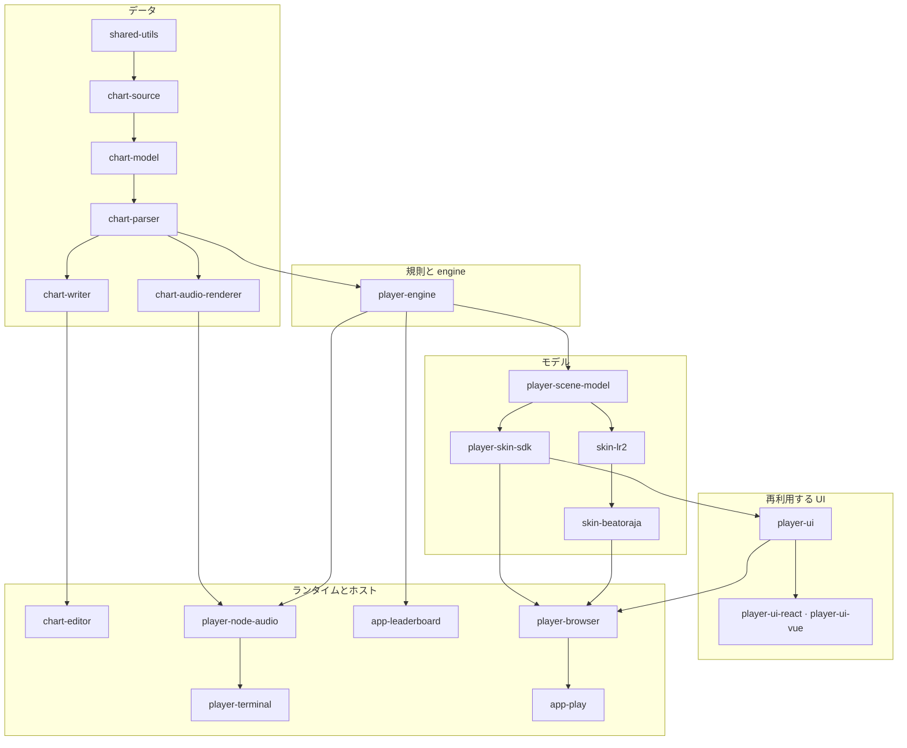

[English version](./README.md)

# Be-Music

[パッケージの責務](./docs/packages.ja.md)

Be-Music は、BMS・bmson 譜面を遊び、扱うためのオープンソースプロジェクトです。ブラウザ版・ターミナル版のプレイヤー、オンラインランキング、譜面処理・プレイエンジン・スキン・UI のための再利用可能な TypeScript パッケージを提供します。

## 特徴

### どこでも動く

- ブラウザで遊べます (WebGPU / WebGL、PWA としてインストール可)。タッチ操作と縦画面のレイアウトにも対応しています。
- ターミナル版 (TUI、単体の実行ファイルもあり) は、kitty グラフィックスで BGA の画像・動画、ロード画面、バナーを描き、kitty キーボードプロトコルで左右の Shift を別々に読みます。
- Web ページに埋め込めるプレビュー / プレイ画面は、どの縦横比のウィンドウでも画面を埋めます。

### 1 つのエンジンで複数のルール

- LR2、beatoraja、That-Which-Must-Not-Be-Named の判定・ゲージ・スコアを、1 つのエンジンの上で切り替えられます。
- 3 つのプレイオプションをまとめて持っていて、譜面や表示を変えるだけのものはどのルールでも使えます。
- オート、リプレイ、手動のどのプレイでも好きな位置にシークでき、2 人プレイ (BATTLE / COUPLE / 2P PLAY) もあります。

### スキン

- LR2 スキンと beatoraja スキン (JSON / Lua) をそのまま読み込めます。
- 組み込みスキンは Plain、Native (DOM + Canvas)、Synesthesia です。Synesthesia は曲の音域ごとの音量に合わせて動く 3D の演出です。

### リプレイ・記録・コース

- プレイをリプレイとして記録し、どのルールでも再判定できます。判定は決定的なので、スコアの検証に使えます。
- リプレイスロットと、ブラウザ内に保存されたデータのビューアがあります。
- 譜面フィンガープリントは、ファイルのバイト列ではなく譜面の内容で譜面を識別します。`#RANDOM` を含む譜面にも対応しています。
- LR2 のコースファイル、beatoraja の SQL フィルタによるランダムコース、NONSTOP コース (つないだ 1 本のプレイ) に対応し、コースのリプレイもあります。

### 譜面・メディア・音声

- フォルダや ZIP をドロップするだけで読み込めます。譜面と LR2 / beatoraja テーマが混ざったドロップにも対応し、大きな音声・動画は必要になったときに読み込みます。
- BMS テキストの文字コード (Shift_JIS、UTF-8、EUC-JP など) を推定し、変わっていない元の行を残したまま BMS を書き出せます。
- BGA の静止画・動画に対応し、ブラウザで再生できない形式はブラウザ内で変換します。WebCodecs でプレイを MP4 / WebM に録画できます。
- キー音・BGM・マスターのバスごとにコンプレッサーとリミッターを調整でき、重い準備処理は Worker のプールで並列に動きます。
- 譜面の編集、BMS・bmson・JSON の相互変換、譜面を音声ファイルに書き出すツールがあります。

### オンラインサービス

- プレイヤーと一体で作られた Leaderboard があります。送信はオプトインで、何を表示するかは Leaderboard が決めます。譜面のスコアとコースランにはシェアカードが付きます。
- Be-Music 独自の OIDC プロバイダで、プレイヤー・Leaderboard・ダッシュボードを 1 つのアカウントでつなぎます。サービスは Cloudflare Workers 上で動いています。

### オープンでモジュール式

- MIT ライセンスのオープンソースです。
- 譜面の解析と書き出し、譜面モデル、プレイエンジン、スキン、UI を再利用できるパッケージ (`@be-music/*`) として提供します。実行環境に依存しない譜面処理とエンジンはブラウザでも Node でも動き、ブラウザ UI と Node 音声は別のアダプターなので、アプリに必要な部分を選べます。
- プレイヤー画面用の Lit Web Components と、その型付きの React / Vue ラッパー、フレームワークに依存しないスキン SDK があります。

## パッケージ

使い方、オプション、対応状況は各パッケージの README にあります。

- [`@be-music/chart-source`](./packages/chart-source/README.ja.md): Be-Music 内部処理専用の BMS/bmson 中間表現 (JSON互換) の pure IR
- [`@be-music/chart-model`](./packages/chart-model/README.ja.md): beat 解決、イベント順序、ロングノート解決などの譜面意味論 helper
- [`@be-music/shared-utils`](./packages/shared-utils/README.ja.md): 全パッケージで再利用する汎用ユーティリティ。browser-safe な core helper と Node 向け helper は狭い subpath export で分けています
- [`@be-music/chart-parser`](./packages/chart-parser/README.ja.md): `.bms` / `.bme` / `.bml` / `.pms` / `.bmson` / JSON のパーサ
- [`@be-music/chart-writer`](./packages/chart-writer/README.ja.md): JSON から `.bms` / `.bmson` への文字列化
- [`@be-music/chart-audio-renderer`](./packages/chart-audio-renderer/README.ja.md): 譜面をレンダリングして `.wav` / `.aiff` を出力
- [`@be-music/player-engine`](./packages/player-engine/README.ja.md): 規則と再生 engine を共有する package。1 つのプレイループ（手動・AUTO・リプレイ）、判定、score、gauge とクリアランプ、自己ベスト、コースの実行と NONSTOP、リプレイの形式、ホストが差し込む runtime 契約
- [`@be-music/player-node-audio`](./packages/player-node-audio/README.ja.md): Node 用の音声セッション、サンプルデコード、PCM 出力を提供するホストアダプター
- [`@be-music/player-terminal`](./packages/player-terminal/README.ja.md): autoplay、keyboard play、Music Select、BGA、SEA build を扱う terminal UI と `bms-player` CLI frontend、およびリプレイ再シミュレータ `bms-replay`
- [`@be-music/player-scene-model`](./packages/player-scene-model/README.ja.md): ライブラリの項目・一覧・プレイオプション・プレイ状態と結果・コース・効果音など、スキンの種類によらず共有する実行環境非依存のシーンモデル
- [`@be-music/skin-lr2`](./packages/skin-lr2/README.ja.md): Lunatic Rave 2 skin parser、asset resolver、theme loader を renderer 非依存で提供する package
- [`@be-music/skin-beatoraja`](./packages/skin-beatoraja/README.ja.md): beatoraja JSON/Lua skin parser、normalizer、theme loader を renderer 非依存で提供する package
- [`@be-music/player-skin-sdk`](./packages/player-skin-sdk/README.ja.md): browser player 向け Be-Music Skin を書くための描画フレームワーク非依存の SDK
- [`@be-music/player-ui`](./packages/player-ui/README.ja.md), [`@be-music/player-ui-react`](./packages/player-ui-react/README.ja.md), [`@be-music/player-ui-vue`](./packages/player-ui-vue/README.ja.md): 再利用可能な Lit 製 Web Components と、型付き React・Vue ラッパー
- [`@be-music/player-browser`](./packages/player-browser/README.ja.md): browser の PixiJS ランタイム。選曲・決定・プレイ・リザルトの各画面を、built-in・LR2・beatoraja のファミリービューが描くシーンセッションとして 1 つのホスト向け API から作る。音声サービス、譜面のコレクション、スキンの読み込み、gameplay の録画も持つ
- [`@be-music/app-play`](./packages/app-play/README.ja.md): folder / ZIP drop、LR2 / beatoraja theme、Options ダイアログ、browser 再生を、1 つのシーンルーターの下のサービスとして接続する private Vite プレイヤー
- [`@be-music/app-leaderboard`](./packages/app-leaderboard/README.ja.md): Cloudflare Workers で動く private な Leaderboard API。リプレイの投稿、再シミュレーションによる検証、ランキング
- [`@be-music/app-dashboard`](./packages/app-dashboard/README.ja.md): 非公開のサービスダッシュボードと Accounts サービス（ログイン、パスキー、連携プロバイダーを扱う OIDC プロバイダー）
- [`@be-music/worker-play`](./packages/worker-play/README.ja.md): 静的アセット、OIDC セッション、設定、Leaderboard 転送、URL・メディアプロキシを扱うプレイヤー配信用 Worker
- [`@be-music/service-auth-client`](./packages/service-auth-client/README.ja.md): 共通の OIDC クライアント、サービスセッション、API トークン検証
- [`@be-music/service-web-theme`](./packages/service-web-theme/README.ja.md): クライアントとサーバーのエントリーを分けた、サービス共通のスタイルと Lit ビュー
- [`@be-music/chart-editor`](./packages/chart-editor/README.ja.md): CLI エディタ (インポート・編集・エクスポート)

図は譜面処理とプレイヤーのレイヤー、および Leaderboard のエンジンへの依存を示します。矢印は、パッケージからそれに依存するパッケージへ向かいます。ほかの矢印を通じて既に届く依存は重ねて描いていません（`@be-music/shared-utils` はほぼすべてのパッケージの下にあります）。パッケージの内側の同じレイヤーは [アーキテクチャ — 目指す構造](./docs/architecture.ja.md#目指す構造) にあります。



## 必要環境

- Node.js `>= 26`
- pnpm workspaces

## セットアップ

```bash
pnpm install
```

## ビルド・検証

```bash
pnpm run clean
pnpm run build
pnpm run check
pnpm run test
```

ツールチェーンは [Vite+](https://viteplus.dev/) (`vite-plus`) で、ルートの `vite.config.ts` に設定を集約しています。`pnpm run build` は Vite+ のタスクランナー (`vp run -r --cache build`) で各ワークスペースの `build` スクリプトを依存順に実行し、変更のない package はタスクキャッシュから再生します。ライブラリ package は各 `vite.config.ts` の `pack` ブロックから `vp pack` (tsdown) でビルドし、bundle と型定義 (`.d.ts`) をまとめて出力します。`pnpm run check` はフォーマット・lint・型チェック (Oxfmt / Oxlint / tsgolint) をワークスペース全体に対して一度に実行し、`pnpm run format` / `pnpm run lint` / `pnpm run typecheck` で個別に実行できます。各 package の `tsconfig.json` は型チェック用のプロジェクトで、型定義の出力には `tsconfig.build.json` を使います。依存関係をインストールすると、ステージされたファイルに `vp check --fix` を実行する Vite+ の pre-commit フックも登録されます。`pnpm run test:e2e` は Web プレイヤーでコースのブラウザ確認を Playwright で端から端まで実行します（数分かかるため `pnpm run test` には含めていません）。[docs/player-web.ja.md#ブラウザー検証](docs/player-web.ja.md#ブラウザー検証) を参照してください。

## package ごとの release

このリポジトリでは `Changesets` で package ごとの version と changelog を管理します。

```bash
pnpm run changeset
pnpm run release:status
pnpm run release:version
```

- 通常の feature PR では、変更した package に対する `.changeset/*.md` を追加します
- release したいタイミングで `devel` 上で `pnpm run release:version` を実行し、生成された `packages/*/package.json` と `packages/*/CHANGELOG.md` の更新をまとめてコミットします
- その状態で `devel -> main` の release PR を merge すると、version が上がった公開 package だけ GitHub Release が個別に作成されます（プレイヤーのプレイヤーや Leaderboard などの private package は対象外です）
- player SEA 実行ファイルは `@be-music/player-terminal` から build し、`@be-music/player-terminal` release に添付します。`@be-music/chart-audio-renderer` も SEA zip を添付します
- private な repository root の `package.json` は `0.0.0` のままで、release 対象 version は `packages/*/package.json` で管理します
- changelog の行は `scripts/release/changelog.ts` が書きます。changeset ごとに `- <commit>: <summary>`、workspace の依存が上がっただけの package には、依存の新しい version を並べた `- Updated dependencies: ...` を 1 行だけ書きます

tag は `@be-music/package-name@x.y.z` 形式で作成されます。

## 仕様書

- [共通ユーティリティ](docs/shared-utils.ja.md)
- [仕様書トップ](docs/README.ja.md)
- [アーキテクチャ](docs/architecture.ja.md)と[設計判断の記録](docs/adr/README.ja.md)
- [BMS 実装仕様](docs/bms-spec.ja.md)
- [bmson 実装仕様](docs/bmson-spec.ja.md)
- [Bemuse 実装仕様](docs/bemuse-spec.ja.md)
- [Player 実装仕様](docs/player-spec.ja.md)
- [Terminal player 実装メモ](docs/player-tui.ja.md)
- [Browser player 実装メモ](docs/player-web.ja.md)
- [シーンモデル（`@be-music/player-scene-model`）](docs/scene-model.ja.md)
- [リプレイ（プレイ履歴）仕様](docs/replay.ja.md)
- [コースと段位認定](docs/course.ja.md)
- [Be-Music Skin の作り方](docs/be-music-skin.ja.md)
- [LR2 skin 実装メモ](docs/lr2-skin.ja.md)
- [beatoraja skin 実装メモ](docs/beatoraja-skin.ja.md)
- [BMS/bmson 中間表現 (`@be-music/chart-source`) 実装仕様](docs/json-spec.ja.md)
- [用語集](docs/glossary.ja.md)

## コマンドラインツール

ルートの `package.json` から各パッケージの CLI と dev server を実行できます。オプションは各パッケージの README を参照してください。

| コマンド                                      | パッケージ                                                                       |
| --------------------------------------------- | -------------------------------------------------------------------------------- |
| `pnpm run parse`                              | [`@be-music/chart-parser`](./packages/chart-parser/README.ja.md)                 |
| `pnpm run stringify`                          | [`@be-music/chart-writer`](./packages/chart-writer/README.ja.md)                 |
| `pnpm run audio-render`, `audio-renderer:sea` | [`@be-music/chart-audio-renderer`](./packages/chart-audio-renderer/README.ja.md) |
| `pnpm run editor`                             | [`@be-music/chart-editor`](./packages/chart-editor/README.ja.md)                 |
| `pnpm run player`, `replay`, `player:sea`     | [`@be-music/player-terminal`](./packages/player-terminal/README.ja.md)           |
| `pnpm run player:web`                         | [`@be-music/app-play`](./packages/app-play/README.ja.md)                         |

サービスのデプロイは [サービスと環境](./docs/services.ja.md) と各サービスのパッケージの README で説明しています。

## Exports ベンチマーク

```bash
# 全パッケージ
pnpm run bench

# 単一パッケージ（例: parser）
pnpm --filter @be-music/chart-parser run bench

# 複数 run を集約
pnpm run bench:aggregate -- --output tmp/bench/head.json tmp/bench/head-runs/*.json

# 2 revision を比較して Markdown を生成
pnpm run bench:compare -- --head tmp/bench/head.json --base tmp/bench/base.json --output tmp/bench/benchmark.md
```

- snapshot 出力: `tmp/bench/exports*.json`
- compare 出力: 任意の Markdown と summary JSON
- GitHub Actions では、`devel` / `main` 向け PR で base/head 比較を PR comment として投稿します
- GitHub Actions では、`devel` / `main` への push でも直前 revision 比較を実行し、対象 commit へ commit comment を投稿します
- PR・push とも、ファイルが変更されたパッケージだけを測定し、そのパッケージに依存するパッケージは測定しません。ドキュメントと `*.test.*` / `*.spec.*` の変更は除外し、測定対象でないパッケージだけの変更はスキップします。共通ツール・ロックファイル・ルート設定の変更は全件を測定します。CI の各ケースの測定時間 50 ms・ウォームアップ 25 ms は維持します。
- CI は base と head を同一 runner で交互に（head、base、head、base…）3 回ずつ計測し、ホスト間のノイズや一時的な遅さが両方に等しくかかるようにします
- 速い関数は 1 回の計測サンプルの中で何度も呼び出し（1 サンプル約 50 µs）、ナノ秒単位のケースもタイマーの分解能に埋もれずに計測します。時間は 1 回の呼び出しあたりで表示します
- 回帰・改善と判定するのは、中央値の変化がしきい値（CI では 8%）を超え、かつ base と head の各回の計測値が重ならないケースだけです。しきい値を超えても計測値が重なるものは「within noise」として別に表示します
- `ioBound` を付けたケース（ファイルシステムに触るもの）は、時間が OS のキャッシュやディスクに左右されるため、判定せずに別枠で表示します
- コメントは判定結果から始まり、base / head のコミットへのリンク、変更したパッケージのケース、追加・削除された公開関数を載せ、ノイズ・除外・実行条件は折りたたんで表示します
