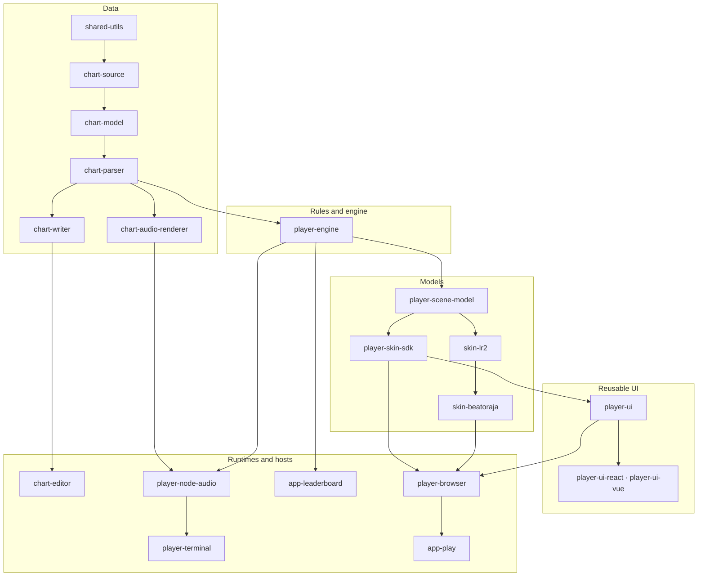

[Japanese version](./README.ja.md)

# Be-Music

[Package responsibilities](./docs/packages.md)

Be-Music is an open-source project for playing and working with BMS and bmson charts. It brings together browser and terminal players, online leaderboards, and reusable TypeScript packages for chart processing, gameplay, skins, and UI.

## Features

### Runs anywhere

- Plays in the browser (WebGPU / WebGL, installable as a PWA), with touch play and portrait layouts.
- A terminal player (TUI, also as a single executable) draws BGA images, videos, loading screens and banners with the kitty graphics protocol, and reads left and right Shift separately with the kitty keyboard protocol.
- An embeddable preview / play view fills a window of any aspect ratio.

### One engine, several rule sets

- LR2, beatoraja and That-Which-Must-Not-Be-Named judgment, gauges and scoring, switchable on one engine.
- The play options of all three in one place; options that only transform the chart or the view work under every rule set.
- Seek to any point during AUTO, replay or manual play, and two-player modes (BATTLE / COUPLE / 2P PLAY).

### Skins

- Loads LR2 skins and beatoraja skins (JSON / Lua) as they are.
- Built-in skins: Plain, Native (DOM + Canvas) and Synesthesia, a 3D scene that moves with each frequency band of the music.

### Replays, records and courses

- Plays can be recorded as replays and re-judged under any rule set; the judge is deterministic, so replays can verify scores.
- Replay slots and a viewer for everything the player keeps in the browser.
- Chart fingerprints identify charts by their content rather than their file bytes, including charts with `#RANDOM`.
- LR2 course files, beatoraja's SQL-filtered random courses and NONSTOP courses (one stitched play), with course replays.

### Charts, media and audio

- Drop folders or ZIPs, including mixed chart and LR2 / beatoraja theme drops; large audio and video load on demand.
- Guesses the text encoding of BMS files (Shift_JIS, UTF-8, EUC-JP and more), and writes BMS back keeping the source lines that did not change.
- BGA images and videos, with in-browser transcoding for formats the browser cannot play, and MP4 / WebM recording of a play with WebCodecs.
- Compressor and limiter controls for the key, BGM and master buses; heavy preparation runs on a worker pool.
- Tools for editing charts, converting between BMS, bmson and JSON, and rendering a chart to an audio file.

### Online services

- A Leaderboard built with the player: sending is opt-in, and the Leaderboard decides what it shows. Chart scores and course runs get share cards.
- One account across the player, the Leaderboard and the dashboard, through Be-Music's own OIDC provider; the services run on Cloudflare Workers.

### Open and modular

- Open source under the MIT License.
- Built from reusable packages (`@be-music/*`) for chart parsing and writing, chart models, gameplay, skins and UI. Runtime-neutral chart and engine packages run in browsers and Node; browser UI and Node audio are separate adapters, so applications can choose the parts they need.
- Lit Web Components for player screens, with typed React and Vue wrappers, and a framework-free SDK for writing skins.

## Packages

Each package's README covers its usage, options and compatibility status.

- [`@be-music/chart-source`](./packages/chart-source/README.md): pure IR of BMS/bmson intermediate representation (JSON compatible) dedicated to Be-Music internal processing
- [`@be-music/chart-model`](./packages/chart-model/README.md): chart semantics helper such as beat resolution, event order, long note resolution, etc.
- [`@be-music/shared-utils`](./packages/shared-utils/README.md): Generic utilities reused across all packages, with narrow subpath exports for browser-safe core helpers and Node-facing helpers
- [`@be-music/chart-parser`](./packages/chart-parser/README.md): `.bms` / `.bme` / `.bml` / `.pms` / `.bmson` / JSON parser
- [`@be-music/chart-writer`](./packages/chart-writer/README.md): Stringization from JSON to `.bms` / `.bmson`
- [`@be-music/chart-audio-renderer`](./packages/chart-audio-renderer/README.md): Render the music score and output `.wav` / `.aiff`
- [`@be-music/player-engine`](./packages/player-engine/README.md): Shared rules and playback engine: one play loop (manual, auto, replay), judgment, scoring, gauges and clear lamps, best records, course runs and NONSTOP, the replay format, and the runtime contracts hosts plug into
- [`@be-music/player-node-audio`](./packages/player-node-audio/README.md): Host adapter for Node audio sessions, sample decoding, and PCM output
- [`@be-music/player-terminal`](./packages/player-terminal/README.md): Terminal UI and `bms-player` CLI frontend for autoplay, keyboard play, Music Select, BGA, and SEA builds, plus the `bms-replay` replay re-simulator
- [`@be-music/player-scene-model`](./packages/player-scene-model/README.md): Runtime-neutral scene models — library entries, browsing, play options, play state and results, course views, system sounds — shared by every skin family
- [`@be-music/skin-lr2`](./packages/skin-lr2/README.md): Renderer-independent Lunatic Rave 2 skin parser, asset resolver, and theme loader
- [`@be-music/skin-beatoraja`](./packages/skin-beatoraja/README.md): Renderer-independent beatoraja JSON/Lua skin parser, normalizer, and theme loader
- [`@be-music/player-skin-sdk`](./packages/player-skin-sdk/README.md): Framework-free SDK for writing Be-Music Skins for the browser player
- [`@be-music/player-ui`](./packages/player-ui/README.md), [`@be-music/player-ui-react`](./packages/player-ui-react/README.md), [`@be-music/player-ui-vue`](./packages/player-ui-vue/README.md): Reusable Lit Web Components, with typed React and Vue wrappers
- [`@be-music/player-browser`](./packages/player-browser/README.md): Browser PixiJS runtime: every select, decide, play and result screen as a scene session drawn by a built-in, LR2 or beatoraja family view, behind one host API, plus the audio service, the chart collection, skin loading and gameplay recording
- [`@be-music/app-play`](./packages/app-play/README.md): Private Vite player that wires folder/ZIP drops, LR2/beatoraja themes, the Options dialog and browser playback together, as services behind one scene router
- [`@be-music/app-leaderboard`](./packages/app-leaderboard/README.md): Private Leaderboard API on Cloudflare Workers: replay submission, verification by re-simulation, and rankings
- [`@be-music/app-dashboard`](./packages/app-dashboard/README.md): Private service dashboard and the Accounts service: the OIDC provider for sign-in, passkeys, and linked providers
- [`@be-music/worker-play`](./packages/worker-play/README.md): Player delivery Worker for static assets, OIDC sessions, settings, Leaderboard forwarding, and URL/media proxies
- [`@be-music/service-auth-client`](./packages/service-auth-client/README.md): Shared OIDC client, service sessions, and API token verification
- [`@be-music/service-web-theme`](./packages/service-web-theme/README.md): Shared service styles and Lit views, with separate client and server entries
- [`@be-music/chart-editor`](./packages/chart-editor/README.md): CLI editor (import/edit/export)

The diagram shows the chart and player layers, including the Leaderboard's engine dependency. An arrow points from a package to a package that depends on it; a dependency already reached through another arrow is not drawn again (`@be-music/shared-utils` sits under almost every package). [Architecture — Target architecture](./docs/architecture.md#target-architecture) shows the same layers inside the packages.



## Required environment

- Node.js `>= 26`
- pnpm workspaces

## Setup

```bash
pnpm install
```

## Build and Verification

```bash
pnpm run clean
pnpm run build
pnpm run check
pnpm run test
```

The toolchain is [Vite+](https://viteplus.dev/) (`vite-plus`), configured from the root `vite.config.ts`. `pnpm run build` runs each workspace's `build` script through the Vite+ task runner (`vp run -r --cache build`) in dependency order, replaying unchanged packages from the task cache; library packages build with `vp pack` (tsdown) from the `pack` block in their `vite.config.ts` and emit the bundle and type definitions (`.d.ts`) together. `pnpm run check` runs formatting, linting, and type checking (Oxfmt, Oxlint, and tsgolint) across the whole workspace in one pass; `pnpm run format` / `pnpm run lint` / `pnpm run typecheck` run the individual steps. Each package's `tsconfig.json` is its type-check project, while `tsconfig.build.json` drives declaration output. Installing dependencies also registers a Vite+ pre-commit hook that runs `vp check --fix` on staged files. `pnpm run test:e2e` plays the course browser checklist in the web player end to end with Playwright (a few minutes, so `pnpm run test` leaves it out); see [docs/player-web.md#browser-verification](docs/player-web.md#browser-verification).

## Package Releases

In this repository, `Changesets` manages the version and changelog for each package.

```bash
pnpm run changeset
pnpm run release:status
pnpm run release:version
```

- Normal feature PR adds `.changeset/*.md` for the changed package
- When you want to release, run `pnpm run release:version` on `devel` and commit the generated `packages/*/package.json` and `packages/*/CHANGELOG.md` updates together.
- In that state, merging the release PR of `devel -> main` creates a separate GitHub Release for each public package whose version has increased (private packages such as the player and the Leaderboard get none).
- The player SEA executable is built from `@be-music/player-terminal` and attached to the `@be-music/player-terminal` release; `@be-music/chart-audio-renderer` also ships a SEA zip
- The private repository root `package.json` stays at `0.0.0`; releasable versions are tracked in `packages/*/package.json`.
- `scripts/release/changelog.ts` writes the changelog lines: each changeset as `- <commit>: <summary>`, and a package bumped only because its workspace dependencies moved gets one `- Updated dependencies: ...` line listing their new versions.

The tag is created in the format `@be-music/package-name@x.y.z`.

## Specifications

- [Shared utilities](./docs/shared-utils.md)
- [Specification top](./docs/README.md)
- [Architecture](./docs/architecture.md) and the [architecture decisions](./docs/adr/README.md)
- [BMS implementation specification](./docs/bms-spec.md)
- [bmson implementation specification](./docs/bmson-spec.md)
- [Bemuse implementation specification](./docs/bemuse-spec.md)
- [Player implementation specification](./docs/player-spec.md)
- [Terminal player implementation notes](./docs/player-tui.md)
- [Browser player implementation notes](./docs/player-web.md)
- [Scene models (`@be-music/player-scene-model`)](./docs/scene-model.md)
- [Replay (play history) specification](./docs/replay.md)
- [Courses and dan certification](./docs/course.md)
- [Writing a Be-Music Skin](./docs/be-music-skin.md)
- [LR2 skin implementation notes](./docs/lr2-skin.md)
- [beatoraja skin implementation notes](./docs/beatoraja-skin.md)
- [BMS/bmson intermediate representation (`@be-music/chart-source`) implementation specification](./docs/json-spec.md)
- [Glossary](./docs/glossary.md)

## Command-line tools

The root `package.json` runs each package's CLI and dev server. See the package READMEs for the options.

| Command                                       | Package                                                                       |
| --------------------------------------------- | ----------------------------------------------------------------------------- |
| `pnpm run parse`                              | [`@be-music/chart-parser`](./packages/chart-parser/README.md)                 |
| `pnpm run stringify`                          | [`@be-music/chart-writer`](./packages/chart-writer/README.md)                 |
| `pnpm run audio-render`, `audio-renderer:sea` | [`@be-music/chart-audio-renderer`](./packages/chart-audio-renderer/README.md) |
| `pnpm run editor`                             | [`@be-music/chart-editor`](./packages/chart-editor/README.md)                 |
| `pnpm run player`, `replay`, `player:sea`     | [`@be-music/player-terminal`](./packages/player-terminal/README.md)           |
| `pnpm run player:web`                         | [`@be-music/app-play`](./packages/app-play/README.md)                         |

Deploying the services is described in [Services and environments](./docs/services.md) and in each service package's README.

## Exports Benchmark

```bash
# All packages
pnpm run bench

# Single package (example: parser)
pnpm --filter @be-music/chart-parser run bench

# Aggregate multiple runs
pnpm run bench:aggregate -- --output tmp/bench/head.json tmp/bench/head-runs/*.json

# Compare two revisions and generate Markdown
pnpm run bench:compare -- --head tmp/bench/head.json --base tmp/bench/base.json --output tmp/bench/benchmark.md
```

- snapshot output: `tmp/bench/exports*.json`
- compare output: arbitrary Markdown and summary JSON
- In GitHub Actions, post base/head comparison as PR comment in PR for `devel` / `main`
- GitHub Actions also performs the previous revision comparison when pushing to `devel` / `main` and posts a commit comment to the target commit.
- Both PR and push benchmarks measure only the packages whose files changed, not the packages that depend on them. Documentation and `*.test.*` / `*.spec.*` changes are ignored; changes to no benchmarked package skip measurement. Shared tooling, lockfiles and root configuration measure the full inventory. Each case retains 50 ms of measurement and 25 ms of warmup in CI.
- CI measures base and head on the same runner, taking turns (head, base, head, base, …) for 3 runs each, so host-to-host noise and slow stretches hit both sides alike.
- Fast functions are called many times per timed sample (about 50 µs a sample), so cases that take nanoseconds are measured rather than lost in the timer's resolution. Times are reported per call.
- A case counts as a regression or an improvement only when its median changes past the threshold (8% in CI) and the runs of the two sides do not overlap; a change past the threshold with overlapping runs is listed as "within noise".
- Cases marked `ioBound` (they touch the filesystem) are listed apart and never judged, since their time follows the OS cache and the disk.
- The comment leads with the verdict, links the base and head commits, lists the changed packages' cases and new or removed exports, and folds noise, exclusions and run details into collapsible sections.
