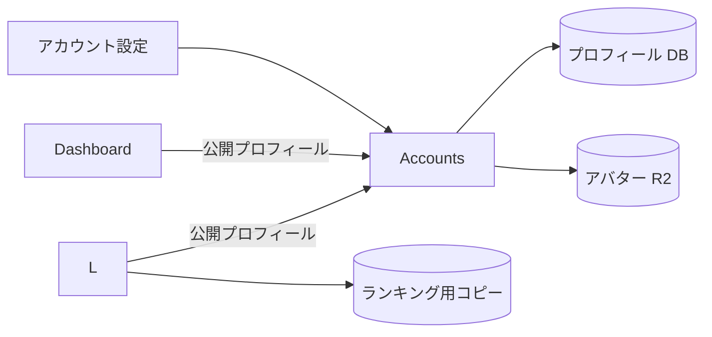

[English version](./0009-accounts-profiles.md)

# 0009: Accounts がプロフィールとアバターを管理する

Accounts が認証に加えてハンドル、表示名、ハンドル履歴、アバターを管理します。編集先は `/account` で、変更には Accounts のセッションと完全一致の Origin が必要です。画像は 128 KiB までで、シグネチャから形式を判定します。公開プロフィールにはハンドル、表示名、アバター URL だけを返します。

Leaderboard はランキングの検索と既存のプレイヤー URL のために表示用のコピーを保持し、認証済みユーザーの同期時に Accounts から正本を取得します。Dashboard は Accounts の公開プロフィールを直接取得し、自身の OIDC セッションと組み合わせます。Dashboard を開くだけでは Leaderboard のプレイヤーを作りません。取得側に Service Binding が設定されていればそれを使い、なければ HTTPS を使います。別アカウントやセルフホストでも依存の向きを揃え、Accounts には利用側サービスの Binding を持たせません。

プロフィール編集時の Leaderboard への通知は行いません。そのユーザーが次に認証付きで Leaderboard を利用した際にコピーを更新するため、それまでは公開ランキングに以前の名前やハンドルが表示されることがあります。この取得方式により、サービスの循環依存、再試行用テーブル、通知用の定期処理をなくします。利用していないユーザーの反映を早める必要があれば、逆向きの依存を戻さず、更新間隔を定めた取得方式を追加できます。

サービスをまたぐ即時のトランザクションの代わりに、ランキングの検索効率と保存先の独立性を選びます。正本は Accounts に置き、Leaderboard 側は編集可能な第二のプロフィールではなく表示用のコピーとします。OIDC が設定されている環境では Leaderboard の旧プロフィール・アバター API での編集を拒否し、設定画面から Accounts に案内します。OIDC を使わないローカル開発では従来の単独構成とテスト用の処理を残します。

D1 と R2 は `accounts`／`accounts-preview`、`leaderboard`／`leaderboard-preview`、`play`／`play-preview` の命名に揃えます。公開の静的アセットは `assets.be-music.app` の `assets` バケットに保存します。本番とプレビューでユーザーの認証データを共有しません。

既存環境では Accounts のプロフィール用マイグレーションを適用し、`packages/app-accounts/scripts/migrate-profiles.ts --apply`（プレビューは `--preview` も付与）でプロフィールと履歴をコピーします。アバターのファイルも Accounts にコピーしてから Worker を切り替えます。所有者をメールアドレスから推測しません。旧認証データの削除前に、パスキーが Accounts に移行済みかスクリプトで確認します。両 Worker が対応したら `--apply --project` で旧アバターのキーを Accounts の URL に置き換えます。

一時的なコピー用 Worker `packages/app-accounts/scripts/storage-copy-worker.ts` は、明示したコピー元・コピー先のバインディングと一時的な秘密値を使います。ファイルをストリームでコピーし、メタデータを引き継いでサイズ、単一パートの ETag、ストリームで計算した SHA-256 を照合します。バインディングを切り替えた後に最終コピーと再検証を行います。静的アセットのドメインはコピー先を検証してから付け替えます。新しいサービスの確認が終わってから旧バケットと一時 Worker を削除します。

Leaderboard の削除用マイグレーションは、旧セッション、認証チャレンジ、外部プロバイダーの認証情報、パスキーを削除し、ローカルのプレイヤー行から旧メール・画像情報を取り除きます。プレイヤー ID、プロフィール、ID 対応、スコアは維持します。テーブル定義は単独のローカル開発用に残しますが、本番の認証は Accounts の OIDC だけを使います。

通知方式を使っていた環境では、Accounts の送信側 Binding と定期ハンドラーを除いたバージョンを先にデプロイし、その後 Leaderboard の RPC エントリーポイントを削除します。Accounts の 0002_remove_profile_outbox.sql を適用し、不要な通知用テーブルを削除します。
