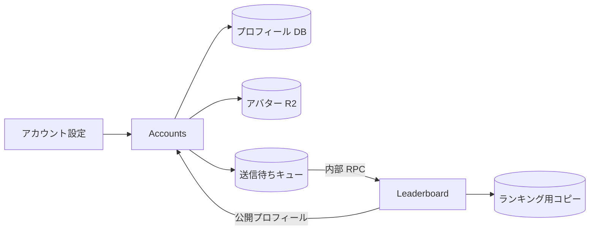

[English version](./0009-accounts-profiles.md)

# 0009: Accounts がプロフィールとアバターを管理する

Accounts が認証に加えてハンドル、表示名、ハンドル履歴、アバターを管理します。編集先は `/account` で、変更には Accounts のセッションと完全一致の Origin が必要です。画像は 128 KiB までで、シグネチャから形式を判定します。公開プロフィールにはハンドル、表示名、アバター URL だけを返します。

Leaderboard はランキングの検索と既存のプレイヤー URL のために表示用のコピーを保持します。認証済みユーザーの同期時に Accounts のバインディングから最新のプロフィールを取得します。Accounts は編集後に `ProfileSync` という Worker の内部エントリーポイントも呼びます。この入口には公開 HTTP ルートを設けず、引数はユーザーの subject だけに限定します。通知失敗は D1 の送信待ちキューに残し、5 分ごとに再試行します。リビジョンを照合し、古い配信で新しい更新の通知を消さないようにします。

サービスをまたぐ即時のトランザクションの代わりに、ランキングの検索効率と保存先の独立性を選びます。正本は Accounts に置き、通知失敗時は送信待ちを保持します。OIDC が設定されている環境では Leaderboard の旧プロフィール・アバター API での編集を拒否し、設定画面から Accounts に案内します。OIDC を使わないローカル開発では従来の単独構成とテスト用の処理を残します。

D1 と R2 は `accounts`／`accounts-preview`、`leaderboard`／`leaderboard-preview`、`play`／`play-preview` の命名に揃えます。公開の静的アセットは `assets.be-music.app` の `assets` バケットに保存します。本番とプレビューでユーザーの認証データを共有しません。

既存環境では Accounts のプロフィール用マイグレーションを適用し、`packages/accounts/scripts/migrate-profiles.ts --apply`（プレビューは `--preview` も付与）でプロフィールと履歴をコピーします。アバターのファイルも Accounts にコピーしてから Worker を切り替えます。所有者をメールアドレスから推測しません。旧認証データの削除前に、パスキーが Accounts に移行済みかスクリプトで確認します。両 Worker が対応したら `--apply --project` で旧アバターのキーを Accounts の URL に置き換えます。

一時的なコピー用 Worker `packages/accounts/scripts/storage-copy-worker.ts` は、明示したコピー元・コピー先のバインディングと一時的な秘密値を使います。ファイルをストリームでコピーし、メタデータを引き継いでサイズ、単一パートの ETag、ストリームで計算した SHA-256 を照合します。バインディングを切り替えた後に最終コピーと再検証を行います。静的アセットのドメインはコピー先を検証してから付け替えます。新しいサービスの確認が終わってから旧バケットと一時 Worker を削除します。

Leaderboard の削除用マイグレーションは、旧セッション、認証チャレンジ、外部プロバイダーの認証情報、パスキーを削除し、ローカルのプレイヤー行から旧メール・画像情報を取り除きます。プレイヤー ID、プロフィール、ID 対応、スコアは維持します。テーブル定義は単独のローカル開発用に残しますが、本番の認証は Accounts の OIDC だけを使います。
