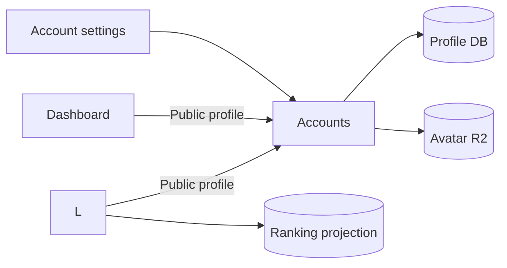

[Japanese version](./0009-accounts-profiles.ja.md)

# 0009: Accounts owns public profiles and avatars

Accounts owns the user's handle, display name, handle history and avatar, in addition to authentication. Editing takes place at `/account`; its session and an exact Origin protect all mutations. Uploaded images are limited to 128 KiB and recognized by signature. Public profile responses contain only the handle, display name and avatar URL.

Leaderboard retains a projection for ranking queries and existing player URLs. It pulls the authoritative profile from Accounts when an authenticated identity is synchronized. Dashboard reads the public profile directly from Accounts and combines it with its own OIDC session; opening Dashboard does not create a Leaderboard player. Both consumers use a Service Binding when configured and HTTPS otherwise, so cross-account and self-hosted deployments keep the same dependency direction. Accounts has no binding to its consumers.

Profile edits no longer notify Leaderboard. Its projection is refreshed on that user's next authenticated Leaderboard request; until then, public ranking pages may show the previous name or handle. This pull model removes the cyclic service dependency, retry outbox and scheduled notification job. A future bounded refresh policy can improve freshness for inactive users without restoring the reverse dependency.

The projection trades immediate cross-service transactions for efficient ranking queries and independent storage. Accounts remains authoritative; Leaderboard stores a read projection rather than a second editable profile. API writes to the old Leaderboard profile/avatar endpoints are refused when OIDC is configured, and settings direct users to Accounts. Local development without OIDC retains the standalone implementation and its test fixtures.

D1 names and R2 bucket names follow `accounts`/`accounts-preview`, `leaderboard`/`leaderboard-preview`, and `play`/`play-preview`. The separate static public asset bucket is `assets` at `assets.be-music.app`. No user authentication data is shared across environments.

For an existing installation, apply the Accounts profile migration, copy the public profiles and handle histories using `packages/accounts/scripts/migrate-profiles.ts --apply` (add `--preview` for preview), and copy avatar objects to Accounts before switching workers. Never infer identity ownership from email. The script checks that passkeys already exist in Accounts before the legacy cleanup migration is run. After both Workers support the projection, use `--apply --project` to replace legacy avatar keys with Accounts URLs.

The one-time storage-copy Worker in `packages/accounts/scripts/storage-copy-worker.ts` streams objects with metadata and checks size, single-part ETags and streaming SHA-256 digests, using explicit source/destination bindings and a temporary secret. Run a final catch-up and verification after switching bindings. Move the static asset custom domain after verifying its new bucket. Delete source buckets and the temporary Worker only after verifying the new services.

The Leaderboard cleanup migration deletes old sessions, verification challenges, provider credentials and passkeys, and removes old email/image data from local player rows. It keeps player IDs, profiles, identity mappings and all scores. The table definitions remain for standalone local development; production uses Accounts OIDC exclusively.

For installations that used profile notifications, deploy Accounts without the outgoing binding and scheduled handler before removing the Leaderboard RPC entrypoint. Then apply Accounts migration 0002_remove_profile_outbox.sql to drop the unused delivery table.
