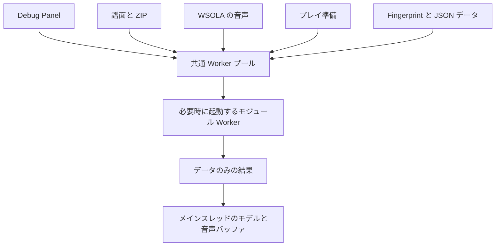

[English version](./0010-browser-task-pool.md)

# ブラウザの CPU 処理で並列数を制限した Worker プールを共有する

譜面の読み込み、ZIP 展開、WSOLA タイムストレッチ、プレイ準備、ランキング送信準備に、必要なときに起動する共通の Web Worker プールを使います。ホストが Worker のエントリをビルドし、`@be-music/player-browser/compute` から生成関数を登録します。生成関数のないホストでは同じ実装をローカルで実行し、各処理の前にイベントループへ制御を返します。Worker の起動・実行基盤に障害があった場合もローカルへ切り替えます。計算そのもののエラーは失敗として返し、基盤の障害として再実行しません。

既定値は `navigator.hardwareConcurrency` の半分を切り捨てた数で、最小値は1です。取得不能・不正な値の場合も1にします。プレイヤーの **Developer → CPU workers** から変更でき、設定を保存します。並列数を減らすと待機中の Worker を終了し、実行中の処理は完了させてから新しい上限で処理を配分します。処理の種類ごとにプールを設けず、共通の上限にすることで CPU とメモリの過剰使用を抑えます。Worker は必要なときだけ起動し、ページを離れる際に戻る・進むキャッシュへ保存されない場合は終了します。

入力はコピーし、Worker が異常終了しても元のデータで再実行できるようにします。出力の配列バッファは所有権を移譲します。パース結果は圧縮したイベント列と譜面ごとの文字列表として返し、メインスレッドで遅延展開するイベントに戻します。完了順にかかわらず、読み込み結果の並びはソースとパスの順を保ちます。ZIP の圧縮前後のサイズ制限とフィルターも維持します。WSOLA は音声単位で分配し、同じ音声の全チャンネルをまとめて処理します。再生用の音声バッファはメインスレッドで再構築します。Signalsmith の既存の AudioWorklet 処理は変更しません。

プレイ準備には用途を絞った `@be-music/player-engine/preparation` を使います。セッション側でランダム分岐を確定してから渡し、返された準備データにローカルの遅延計算する譜面モデルを付けます。エンジンとビューは返された同じノートを共有します。入力、再生中の判定ループ、Web Audio のスケジューリング、Pixi の描画は既存の経路を維持し、メッセージ通信の遅延をゲームプレイに持ち込みません。

アプリ固有の Worker で単曲・コースの fingerprint 検証と JSON のシリアライズ・圧縮も行います。通信と認証はメインスレッドに残します。応答性の改善を目的とし、速度向上の実測値を意味するものではありません。小さな処理ではコピー、起動時間、メモリの負担が並列化の効果を上回る場合があります。

## 比較した案

- **機能ごとのプール：** 所有関係は単純ですが、譜面読み込みと音声準備が重なると CPU とメモリを過剰に使います。
- **プレイヤー全体を Worker へ移動：** 共有する可変ノート、入力時刻、描画、音声との通信を再設計する必要があります。
- **共有メモリ：** コピーを減らせますが、同期処理とオリジン間分離の要件が増えます。今回の完結した準備処理は、データのみのメッセージで対応できます。
