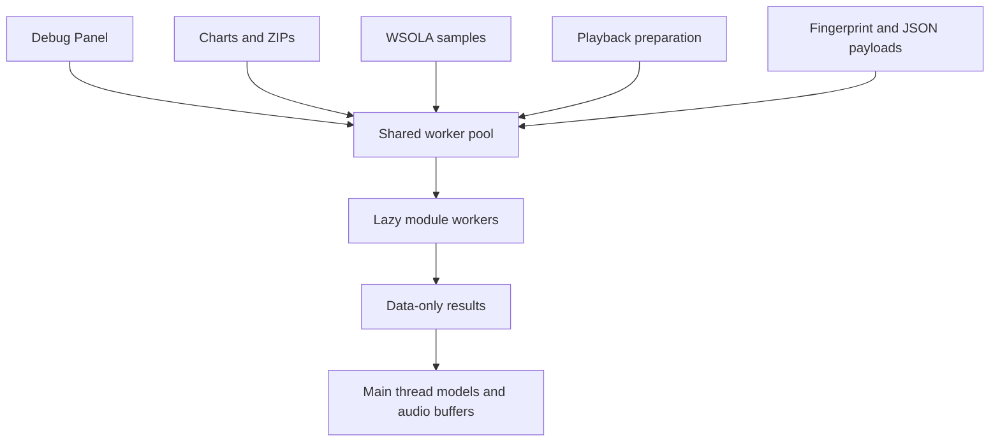

[Japanese version](./0010-browser-task-pool.ja.md)

# Share a bounded worker pool for browser CPU tasks

Chart imports, ZIP expansion, WSOLA time stretching, playback preparation, and leaderboard submission preparation run through one lazy, bounded Web Worker pool. The host bundles the worker entry and installs its factory through `@be-music/player-browser/compute`. A library host without a factory uses the same task implementations locally, yielding before each task. Worker startup/runtime failures also fall back locally; computation errors reject the task and are not retried as infrastructure failures.

The default count is half of `navigator.hardwareConcurrency`, rounded down with a minimum of one. Missing or invalid hardware reports use one. The player exposes **Developer → CPU workers** and persists the override. Resizing retires idle workers, allows active jobs to finish, and schedules queued work under the new limit. The count bounds shared workers across task types, rather than allocating a separate pool for each feature. Workers are created only when needed and disposed when the page leaves without entering the back-forward cache.

Inputs are cloned so a worker crash can retry with intact data; output array buffers are transferred. Parsing returns packed event columns and a per-chart string table, restored as lazy events on the main thread. Import results preserve source/path ordering even when tasks finish out of order. ZIP compressed/uncompressed limits and filtering remain in force. Each WSOLA job keeps all channels of one sample together; playback audio buffers are rebuilt on the main thread. Signalsmith's existing AudioWorklet path remains unchanged.

Playback preparation uses the narrow `@be-music/player-engine/preparation` entry. The session fixes random branches before dispatch, attaches its local lazy resolved-chart model to the returned prepared data, and shares the returned note objects between the engine and views. Input handling, the live judge loop, Web Audio scheduling, and Pixi rendering stay on their existing paths. This avoids introducing message latency into gameplay.

The app-specific worker handles single/course fingerprint verification and JSON serialization/compression. Network requests and authentication stay on the main thread. This improves responsiveness but does not imply a measured speedup: cloning, startup cost, and memory usage can outweigh parallel execution for small jobs.

## Considered options

- **A pool per feature:** simple local ownership, but concurrent imports and audio preparation can oversubscribe the CPU and memory.
- **Move the complete player into a worker:** would require redesigning the shared mutable note state, input timestamps, rendering, and audio communication.
- **Shared memory:** avoids some copies, but adds synchronization and cross-origin isolation requirements. Data-only messages fit these finite preparation tasks without those requirements.
