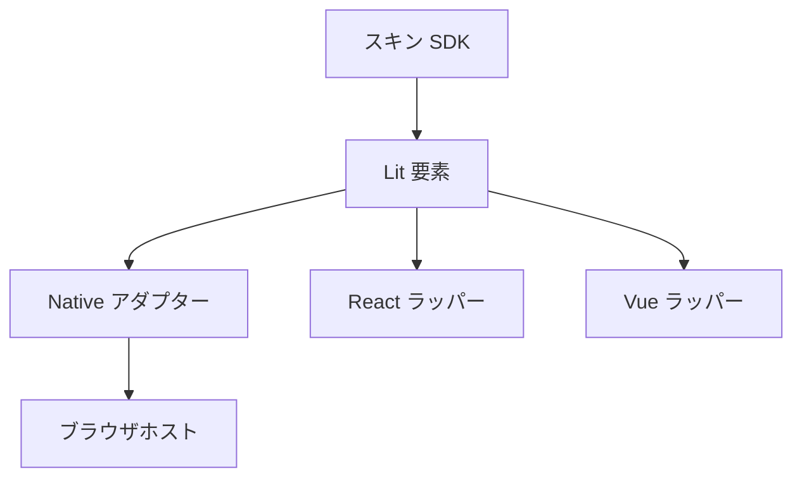

[English version](./0013-player-ui-components.md)

# 再利用するプレイヤー UI を Web Components にする

## 背景

Native Skin では画面単位の HTML 文字列・セレクター・イベント登録・命令的な更新が player-browser に集まっていました。判定表やコレクション一覧を再利用するためにランタイムから描画処理を抜き出す必要があり、React・Vue でも画面ごとの別実装を保守せず同じ表示を使えるようにしたいと考えました。

## 決定

Lit 製 Web Components を `@be-music/player-ui` に置きます。部品はプレーンな表示用 property を受け取り、型付き・bubbling・composed の操作要求イベントを通知します。独立して使うパネルには必要なデータだけを渡し、部品を組み立てる画面には既存の DOM スキンフレームを渡します。フレーム契約は player-skin-sdk に残し、SDK は Lit・フロントエンドのフレームワークに依存させません。

矢印は依存元から利用側へ向かいます。部品はブラウザホスト・Pixi レンダラー・エンジンの root・音声 runtime を import しません。Native はフレームの受け渡しと操作イベントを既存の DOM スキンのライフサイクルに接続します。切り離し中も同じ要素を保持し、破棄時にイベントを解除します。Canvas は既存のプレイループを維持します。

要素登録は明示的かつ冪等にします。import だけでは Be-Music のタグを登録せず、同じタグに別実装があればエラーにします。Native は mount 時に登録します。React ラッパーは `@lit/react` で型付き property・イベント・ref を受け渡し、クライアントで登録します。Vue ラッパーは property を明示的に設定し、イベントを型付き emits に変換してクライアントの mount 前に登録します。各フレームワークは独立したラッパーパッケージの peer dependency です。SSR はホスト要素の出力を扱い、コンポーネント全体のサーバー描画・hydration は今回の対象に含めません。

各部品が小さな Lit テンプレートと Shadow DOM のスタイルを所有します。CSS 変数を継承されるテーマ用トークンとし、parts・slots で調整可能な箇所を公開します。Lit が値の変更時にも DOM ノードを保ちます。コレクション一覧は安定した項目キーを使い、フォーカスと IME を扱います。表示部品は再生クロックや購読を持たず、更新頻度は呼び出し側が制御します。グラフは描画点数を制限し、Native の Gameplay 更新制限も保ちます。

## トレードオフ

Lit が再利用 UI と Native Skin の実行時依存に加わります。テンプレートは引き続き TypeScript 内に書きますが、テンプレート・スタイル・更新処理が部品ごとにまとまります。ブラウザ標準の要素登録を共通の接続点にするため、タグ名と複数バージョンの衝突時の扱いも継続的な契約になります。独立したラッパーを保守し、フレームワークごとの property 設定・イベント型・ref・クライアント mount を揃えます。

最初に公開する部品は既存の Native の動作と配置を引き継ぎます。他のスキンや利用者にこの部品の使用を必須にはしません。アプリケーションは個々のパネルの組み合わせ、独自の DOM スキン、Canvas スキンを選べます。
