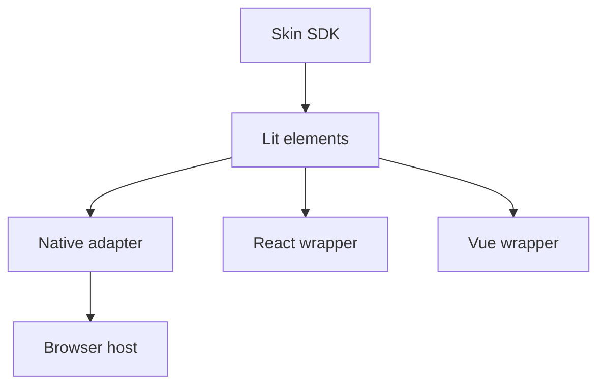

[Japanese version](./0013-player-ui-components.ja.md)

# Reusable player interfaces are Web Components

## Context

Native Skin combined screen-sized HTML strings, selectors, event listeners and imperative updates inside player-browser. Reusing a judgment table or collection browser required extracting rendering details from that runtime. React and Vue consumers need the same presentation without maintaining another implementation of each screen.

## Decision

Put the Lit Web Components in `@be-music/player-ui`. Components receive plain presentation properties and emit typed, bubbling, composed operation requests. Independently useful panels take narrow data contracts; composing screens accept the existing DOM skin frames. Keep the frame contracts in player-skin-sdk, which remains independent of Lit and frontend frameworks.

Arrows point from a dependency to its consumer. The components import no browser host, Pixi renderer, engine root or audio runtime. Native adapts frame delivery and operation events to the existing DOM skin lifecycle. It keeps the same element while detached and removes event listeners when disposed. Canvas stays in the existing play loop.

Use explicit, idempotent element registration. Importing modules registers no Be-Music tags; a conflicting implementation under the same tag is an error. The Native adapter registers elements when mounted. React wrappers use `@lit/react` to forward typed properties, events and refs, and register on the client. Vue wrappers forward properties explicitly and translate events into typed emits before client mounting. Frameworks are peers of separate wrapper packages. SSR can produce the host element; full component server rendering and hydration are not part of this change.

Each component owns a small Lit template and shadow styles. CSS variables provide inherited theme tokens; parts and slots expose supported customization points. Lit preserves DOM nodes across value updates. The collection uses stable entry keys for rows, and its own focus and IME handling. A display component owns no playback clock or subscriptions; the caller controls update cadence. Graphs cap rendering samples, and Native keeps its gameplay update limit.

## Trade-offs

Lit adds a runtime dependency to the reusable UI and therefore to Native Skin. Its templates still live in TypeScript, but templates, styling and state updates are local to each component rather than a screen-wide selector map. Browser-native element registration gives consumers a common integration point and also makes tag names and duplicate-version handling a lasting contract. Separate wrappers add a small maintenance surface so property assignment, custom-event typing, refs and client mounting are consistent for each framework.

The first public components follow existing Native behavior and layout. This decision does not require other skins or consumers to use these components. Applications can compose individual panels, provide their own DOM skin, or keep a Canvas skin.
