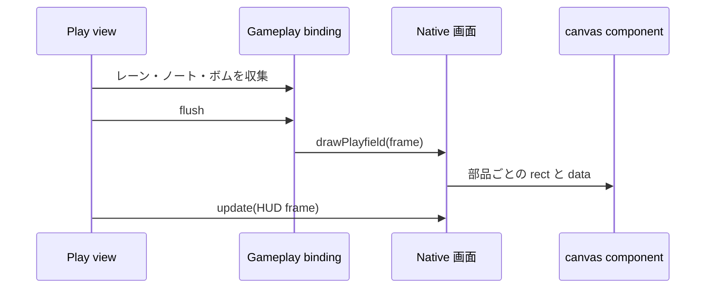

[English version](./0014-native-playfield-components.md)

# Native はプレイフィールドを canvas を持つ component で描く

## 背景

Native はレーン・ノート・判定ライン・ボム・判定文字を、ステージ全体と同じ大きさのスキン surface に描き、Pixi のシーン内で DOM の HUD の下に表示していた（[ADR 0012](./0012-native-skin-screens.ja.md)）。この surface は何も描かない場所も含めてステージ全面を覆い、プレイフィールドは `@be-music/player-ui` のほかの部品のように再利用やスタイル調整ができなかった（[ADR 0013](./0013-player-ui-components.ja.md)）。

## 決定

プレイフィールドを、ステージ上の自分の範囲と同じ大きさの canvas をそれぞれ持つ Web Components に分ける。`be-music-lanes`・`be-music-notes`・`be-music-lane-covers`・`be-music-judge-line`・`be-music-bombs`・`be-music-judgment-display` である。`be-music-playfield` が HUD と同じくレターボックスしたステージ上にこれらを配置する。各 component はステージのデザイン座標のまま描き、自分の canvas を要素の box のデバイスピクセルに合わせて拡大縮小する。

スキンは `gameplay.drawsOnDOM` で有効にし、DOM のゲームプレイ画面が `drawPlayfield(frame)` を返す。host はゲームプレイ用の surface を作らず、収集した `BeMusicGameplayFrame` を毎フレーム一度、Pixi の描画前にその画面へ渡す。スキンの `gameplay.draw` は DOM 画面を持たない host 向けの代替として残り、同じ部品を一枚の surface に描く。

## トレードオフ

DOM はプレイヤーの canvas より上に重なる。プレイヤーがスキンの上に描いていたものは隠れるため、Native は地雷・レーンカバー・小節線も自分で描き、一時停止の状態は HUD が表示する。mount はプレイ画面と一緒にフェードする。プレイヤーの canvas に残るのは BGA だけなので、Canvas のスクリーンショットと録画には Native のプレイフィールドが映らなくなる。

プレイフィールドは毎アニメーションフレーム Lit を通して更新される。各 component は自分の canvas だけを描き直し、ノートを DOM node にはしないため、フレームごとのコストは Canvas 一回分の描画に近い。ほかのスキンはステージ全体の surface を使い続け、この契約は opt-in である。
