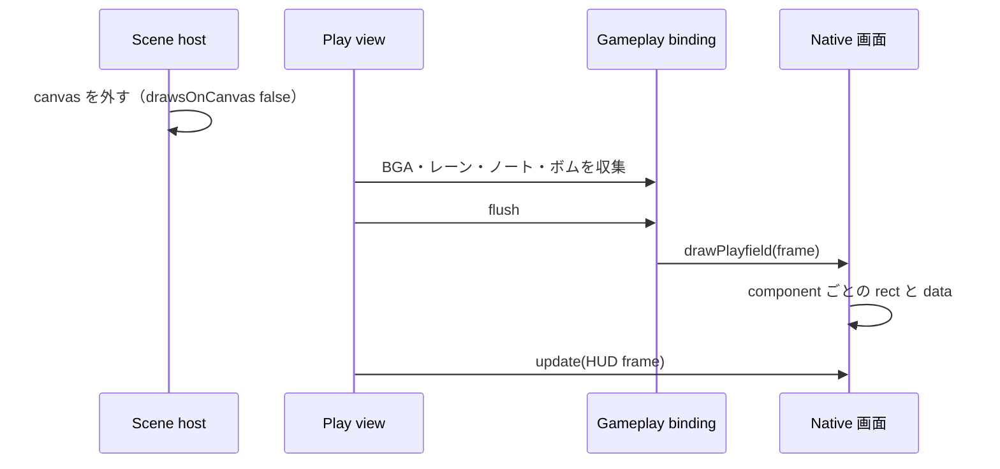

[English version](./0014-native-playfield-components.md)

# Native はプレイフィールドを canvas を持つ component で描く

## 背景

Native はレーン・ノート・判定ライン・ボム・判定文字を、ステージ全体と同じ大きさのスキン surface に描き、Pixi のシーン内で DOM の HUD の下に表示していた。BGA はプレイヤーがその背後に、ステージ全体の大きさの自分の canvas で描いていた（[ADR 0012](./0012-native-skin-screens.ja.md)）。どちらの canvas も何も描かない場所を含めてステージ全面を覆い、プレイフィールドは `@be-music/player-ui` のほかの部品のように再利用やスタイル調整ができなかった（[ADR 0013](./0013-player-ui-components.ja.md)）。

## 決定

プレイフィールドを、ステージ上の自分の範囲と同じ大きさの canvas をそれぞれ持つ Web Components に分ける。`be-music-bga`・`be-music-lanes`・`be-music-notes`・`be-music-lane-covers`・`be-music-judge-line`・`be-music-bombs`・`be-music-judgment-display` である。`be-music-playfield` が HUD と同じくレターボックスしたステージ上にこれらを配置し、ステージとレターボックスの背景を塗る。各 component はステージのデザイン座標のまま描き、自分の canvas を要素の box のデバイスピクセルに合わせて拡大縮小する。

スキンは `gameplay.drawsOnDOM` で有効にし、DOM のゲームプレイ画面が `drawPlayfield(frame)` を返す。host はゲームプレイ用の surface を作らず、収集した `BeMusicGameplayFrame` を毎フレーム一度その画面へ渡す。スキンの `gameplay.draw` は DOM 画面を持たない host 向けの代替として残り、同じ部品を一枚の surface に描く。

画面がすべて DOM の scene は `drawsOnCanvas: false` を返し、`PixiSceneHost` は canvas に描く scene が有効になるまで canvas をページから外す。Native の選曲・決定・リザルト・ゲームプレイ画面はすべてこれに該当するため、Native の表示中はステージ全体の canvas を配置しない。Pixi の application・ticker・WebGL context は次の Canvas scene のために維持する。

## トレードオフ

Native のゲームプレイ中はプレイヤーが canvas に描くものが表示されないため、Native は BGA・地雷・レーンカバー・小節線も自分で描き、一時停止の状態は HUD が表示する。mount はプレイ画面と一緒にフェードする。タッチレーンは canvas と同じ範囲を覆うゲームプレイ画面の mount で指を追い、その中の操作部品への押下は無視する。canvas 要素に結び付いた host の機能（デモの全画面ジェスチャー）はステージで受ける。Canvas のスクリーンショットと録画はプレイヤーの canvas だけを記録するため、Native の画面は映らない。

プレイフィールドは毎アニメーションフレーム Lit を通して更新される。各 component は自分の canvas だけを描き直し、ノートを DOM node にはしないため、フレームごとのコストは Canvas 一回分の描画に近い。ほかのスキンはステージ全体の surface を使い続け、この契約は opt-in である。
