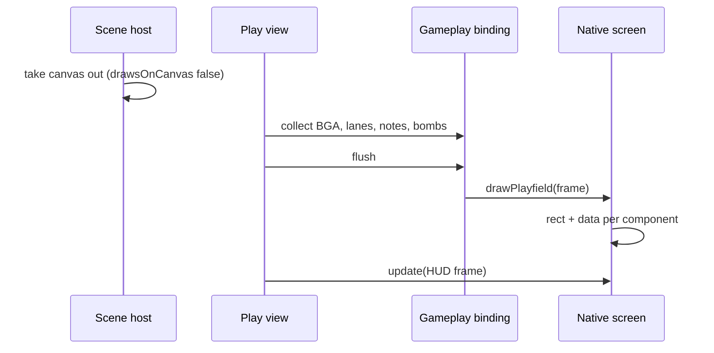

[Japanese version](./0014-native-playfield-components.ja.md)

# Native draws its playfield with canvas components

## Context

Native drew its lanes, notes, judge line, bombs and judgment words on a skin surface the size of the whole stage, shown in the Pixi scene under its DOM HUD, and the player drew the BGA behind it on its own stage-sized canvas ([ADR 0012](./0012-native-skin-screens.md)). Both canvases covered the stage even where nothing was drawn, and the playfield could not be reused or styled like the rest of `@be-music/player-ui` ([ADR 0013](./0013-player-ui-components.md)).

## Decision

Split the playfield into Web Components that each own a canvas the size of their part of the stage: `be-music-bga`, `be-music-lanes`, `be-music-notes`, `be-music-lane-covers`, `be-music-judge-line`, `be-music-bombs` and `be-music-judgment-display`. `be-music-playfield` places them on the letterboxed stage, like the HUD, and paints the stage and letterbox backgrounds. The components keep drawing in stage design pixels; each scales its own canvas to the device pixels of its box.

A skin opts in with `gameplay.drawsOnDOM`, and its DOM gameplay screen returns `drawPlayfield(frame)`. The host then creates no gameplay surface and hands that screen each collected `BeMusicGameplayFrame` once per frame. The skin's `gameplay.draw` stays as the fallback for hosts without DOM screens, and paints the same parts on one surface.

A scene whose screens are all DOM reports `drawsOnCanvas: false`, and `PixiSceneHost` takes its canvas out of the page until a scene that draws on it becomes active. Native's select, decide, result and gameplay screens all do, so no stage-sized canvas is placed while Native is showing. The Pixi application, its ticker and its WebGL context stay alive for the next Canvas scene.

## Trade-offs

Nothing the player draws on its canvas shows during Native gameplay, so Native also draws the BGA, mines, lane covers and measure lines, and the HUD shows the paused state. The mount fades with the play screen. Touch lanes follow the fingers on the gameplay screen's mount, which covers the area the canvas did, and ignore presses on its controls. Host features bound to the canvas element (the player's fullscreen gestures) listen on the stage instead. Canvas screenshots and video recordings capture the player's canvas only, so they show nothing of Native's screens.

The playfield now updates through Lit every animation frame. Each component repaints only its own canvas, and no note becomes a DOM node, so the per-frame cost stays close to one Canvas pass. Other skins keep their stage-sized surfaces; the contract is opt-in.
