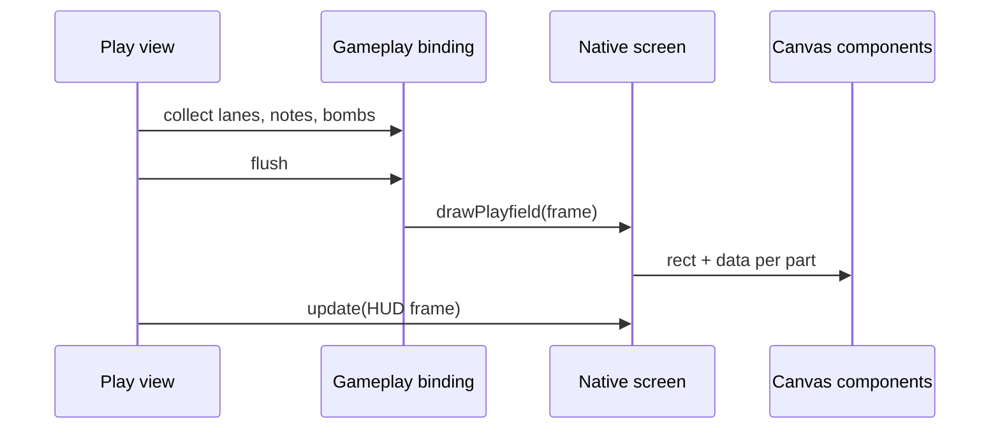

[Japanese version](./0014-native-playfield-components.ja.md)

# Native draws its playfield with canvas components

## Context

Native drew its lanes, notes, judge line, bombs and judgment words on a skin surface the size of the whole stage, shown in the Pixi scene under its DOM HUD ([ADR 0012](./0012-native-skin-screens.md)). The surface covered the stage even where nothing was drawn, and the playfield could not be reused or styled like the rest of `@be-music/player-ui` ([ADR 0013](./0013-player-ui-components.md)).

## Decision

Split the playfield into Web Components that each own a canvas the size of their part of the stage: `be-music-lanes`, `be-music-notes`, `be-music-lane-covers`, `be-music-judge-line`, `be-music-bombs` and `be-music-judgment-display`. `be-music-playfield` places them on the letterboxed stage, like the HUD. The components keep drawing in stage design pixels; each scales its own canvas to the device pixels of its box.

A skin opts in with `gameplay.drawsOnDOM`, and its DOM gameplay screen returns `drawPlayfield(frame)`. The host then creates no gameplay surface and hands that screen each collected `BeMusicGameplayFrame` once per frame, before Pixi renders. The skin's `gameplay.draw` stays as the fallback for hosts without DOM screens, and paints the same parts on one surface.

## Trade-offs

DOM sits above the player's canvas. Whatever the player used to draw over the skin would be hidden, so Native also draws mines, lane covers and measure lines, and the HUD shows the paused state. The mount fades with the play screen. Only the BGA stays on the player's canvas, so Canvas screenshots and video recordings no longer show Native's playfield.

The playfield now updates through Lit every animation frame. Each component repaints only its own canvas, and no note becomes a DOM node, so the per-frame cost stays close to one Canvas pass. Other skins keep their stage-sized surfaces; the contract is opt-in.
