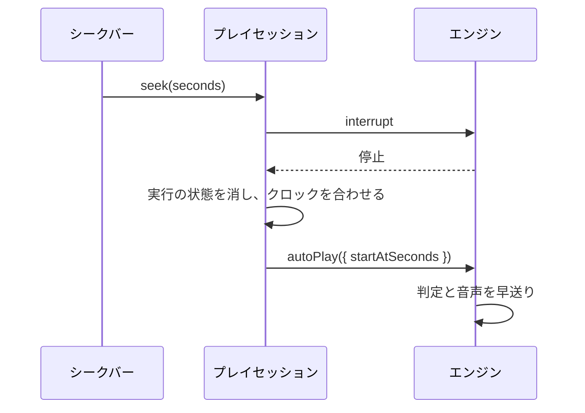

[English version](./0015-preview-seek.md)

# プレビューのシークは AUTO プレイを途中から始めて行う

[ADR 0016](./0016-seek-play-loop-command.ja.md) に置き換えられた。シークは動いているプレイへのコマンドにする。

## 背景

埋め込みページは譜面を AUTO で、動画プレイヤー風のコントロール付きでプレビューする。そのためシークバーで任意の秒数へプレイを動かせる必要がある。プレイループは譜面を先頭から動かし、クロック・リアルタイム音声のカーソル・判定は前にしか進まない。プレイ scene を作り直すと譜面を読み直してすべての音声をデコードし直すため、数秒かかる。

## 決定

AUTO プレイは途中から始められる（`PlayerOptions.startAtSeconds`）。プレイのクロックは、その譜面の秒数にあたる位置から始まる。最初の tick の前にループは早送りする。それより前の音量変化を適用し、AUTO の判定はそれより前のノートを効果なし（キー音・フラッシュ・ボム・トレースなし）で確定させる。その時点でまだ鳴っている背景音とノートのキー音は、音声セッションの任意の `triggerEventAt(event, offsetSeconds)` で途中から鳴らす。これを持たないバックエンドでは、それらの音は鳴らない。手動プレイとリプレイはこのオプションを無視する。

ブラウザーのプレイはセッションの中でシークする（`PlayScene.seek`）。動いているエンジンを F5 と同じように止め、止まるのを待つ。そのあと、その実行がプレイに残したもの（ノートの判定済みの印・プレイ状態・ロングノート・レーンのビーム・ボム・moments・BGA の動画）を消す。譜面のクロックを目標の位置に合わせ、デコード済みの音声・準備済みのノート・BGA を再利用して、`startAtSeconds` 付きでエンジンを起動し直す。エンジンが止まる間に行ったシークは最後の 1 つにまとめる。

## トレードオフ

シークにかかる時間は読み直しではなく、エンジンの停止と起動の分だけになる。スコア・コンボ・ゲージはその位置まで進んだプレイと一致する。ゲージとスコアのグラフ、判定タイミングはシークした位置から描き直す。飛ばしたノートの視覚効果は再生せず、リプレイも記録しない。一時停止中のプレイはシークすると再開する。
