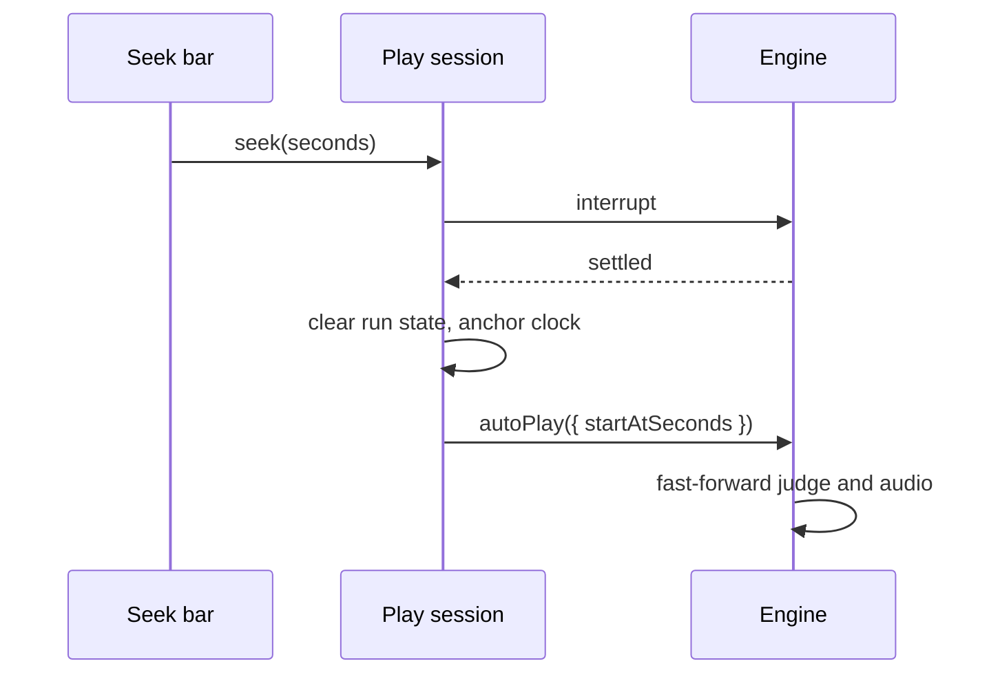

[Japanese version](./0015-preview-seek.ja.md)

# Previews seek by starting AUTO play partway

## Context

The embed page previews a chart in AUTO with video-player controls, so its seek bar must move the play to any second. The play loop runs a chart from its first second: the clock, the realtime audio cursors and the judge only move forward. Restarting the play scene reloads the chart and decodes every sample again, which takes seconds.

## Decision

AUTO play can start partway (`PlayerOptions.startAtSeconds`). The play clock starts where that chart second falls. Before the first tick the loop fast-forwards: the volume changes before it apply, the AUTO judge settles every note before it without its effects (no keysound, flash, bomb or trace), and the background sounds and note keysounds still ringing there start partway through the audio session's optional `triggerEventAt(event, offsetSeconds)`. A backend without it leaves those sounds silent. Manual play and replays ignore the option.

The browser play seeks inside its session (`PlayScene.seek`). It stops the running engine as F5 does and waits for it to settle. Then it clears what the run left on the play: the notes' judged marks, the play state, long notes, lane beams, bombs, moments and BGA videos. It anchors the chart clock at the target and launches the engine again with `startAtSeconds`, reusing the decoded samples, the prepared notes and the BGA. Seeks made while the engine stops collapse into the last one.

## Trade-offs

A seek takes the time the engine needs to stop and start, not a reload, and the score, combo and gauge match a play that reached the point. The gauge and score graphs and the judgment timings start again from the point sought. A seek replays no visual effects of the notes it skips, and records no replay. A paused play resumes when sought.
