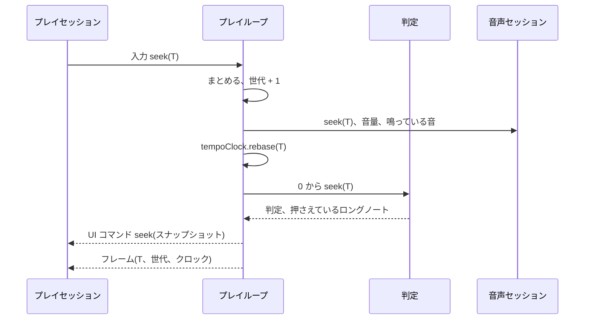

[English version](./0016-seek-play-loop-command.md)

# シークはプレイループのコマンドにする

[ADR 0015](./0015-preview-seek.ja.md) を置き換える。

## 背景

ADR 0015 は AUTO プレイを途中から始められるようにし（`startAtSeconds`）、ブラウザーはエンジンを止めてその位置で起動し直してシークしていた。エンジンの外からシークすると、手当てでは消せない欠陥が残った。

- プレイの状態の出どころが 2 つある。エンジンは判定を効果なしで早送りするので、件数は目標に追いつくが、判定の合図から作るコンボ・最大コンボ・グラフ・タイミングは 0 からやり直しになる。
- 譜面時刻の持ち主が 2 つある。ビューのクロックとエンジンのクロックを一度だけ合わせる仕組みで、止めた実行の古いフレームがそれを動かせる。
- 実行の区別がなく、セッションの状態のリセットは手書きで漏れがあり、シークのたびにエンジンをすべて壊して作り直していた。
- AUTO だけで、一時停止中のプレイはシークすると再開し、イントロや譜面の後の保持についての規則がなかった。

## 決定

シークは動いているプレイへのコマンドで、1 つのプレイループ（[ADR 0003](./0003-one-play-loop.ja.md)）が扱う。プレイを始め直すことはない。

- **コマンド。** `PlayerInputCommand { kind: 'seek', seconds }`。コントロールは 1 回の取り出しのうち最後のシークを残し（シークはまとまり、最後が勝つ）、ループは次の tick でそれを適用する。リードイン中のシークは譜面を始める位置を決める。`PlayerOptions.startAtSeconds` はプレイの最初のシークである。
- **適用。** 目標を譜面の範囲に収め、シークの世代を 1 つ進める。音声セッションは鳴っている音を止めてゲインを戻す（任意の `AudioSession.seek`）。目標より前の音量変化をもう一度適用し、その位置でまだ鳴っている音を途中から鳴らす（`triggerEventAt`。双方向の `RealtimeAudioCursor.seek` を通す）。譜面時刻はその時点のテンポで再生クロックに付け替える（`TempoClock.rebase`）ので、一時停止中のプレイは一時停止のままになる。スコア・ゲージ・コンボ・ノートの印をプレイの開始時に戻し、判定は 0 から目標までを、判定だけを残す受け口へ再シミュレーションする（`PlayJudge.seek`）。UI のバスは古い位置のものを捨てる。UI にはスナップショット（サマリ、コンボ、最大コンボ、目標より前のすべての判定）付きの `seek` コマンド、目標をまたいで押さえているロングノートの再通知、POOR 画像の消去を送り、すぐに目標の位置のフレームを出す。譜面の後の保持はもう一度待てるようにする。
- **譜面時刻の持ち主は 1 つ。** どのフレームもシークの `generation` と、その時刻が成り立つ `clock`（`outputSeconds`・`tempo`・`paused`）を持つので、ホストは一度だけ合わせるのではなく、最新のフレームから自分のクロックを進められる。サマリは `combo` と `maxCombo` を持つ。
- **決定性。** 0 から作り直すので、構成上正確になる。シークした AUTO プレイは、目標の位置と終わりで、先頭からのプレイと一致する（`seek-invariants.test.ts`）。適用したシーク 1 回あたり O(ノート数 + 入力数) かかる。シークをまとめることでスクラブの負荷を抑え、ベンチマークでその費用を見張る。
- **練習。** シークしたプレイはリプレイを記録しない。記録は最初のシークで捨てる。

AUTO プレイ以外でのシークの意味：

| プレイ           | シークの後                                                                                                                     |
| ---------------- | ------------------------------------------------------------------------------------------------------------------------------ |
| AUTO             | 先頭からのプレイが目標の位置で持つ判定の状態                                                                                   |
| リプレイ         | 目標より前の記録した入力を流し直し、目標の位置でのリプレイの表示とテンポ                                                       |
| 手動             | beatoraja と同じ練習：目標より前のノートは飛ばし、スコア・ゲージ・コンボはプレイの開始時の値から始め直す。押しているキーは離す |
| コースのステージ | ステージの中で行える。コースの実行は練習になる（ランキングにも記録にも残さない）                                               |
| 一時停止中       | 目標の位置で一時停止のまま                                                                                                     |

作業は段階に分けて入れる。AUTO プレイのエンジンのコマンド（この決定の最初の段階）、ホストがスナップショットから状態を取ること、ブラウザーのセッションをコマンドに切り替え、ビューのクロックをフレームから求め、起動し直す経路を消すこと、リプレイ、手動の練習、コース・NONSTOP・イントロの関門・譜面の後の保持である。ターミナルのプレイヤーは後で続く。

## トレードオフ

シークでエンジンを壊すことはなくなり、目標の位置の状態はエンジンだけが持つ。その代わり、適用したシークのたびに再シミュレーションがかかり、約束事も増える。フレームは世代とクロックを、UI コマンドの列は `seek` コマンドを持ち、音声のバックエンドは `seek` を実装して音を止め、時刻を合わせ直せる。
