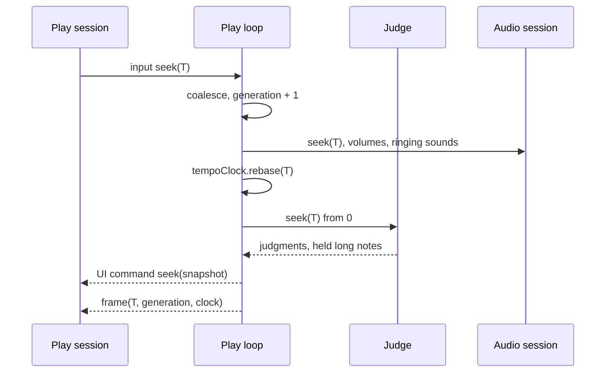

[日本語版](./0016-seek-play-loop-command.ja.md)

# Seek is a play-loop command

## Context

ADR 0015 let an AUTO play start partway (`startAtSeconds`), and the browser sought by stopping the engine and launching it again there. Seeking from outside the engine left defects that patches could not remove:

- Two sources of truth for the play state. The engine fast-forwarded its judge without effects, so the counts followed the target while the combo, the max combo, the graphs and the timings, built from judge cues, started again from 0.
- Two owners of chart time: the view's clock and the engine's, reconciled once by an anchor that a stale frame of the stopped run could move.
- No run identity, an incomplete hand-written reset of the session's state, and the cost of a full engine teardown and setup per seek.
- AUTO only, a paused play resumed when sought, and no rule for the intro or the hold after the chart.

## Decision

A seek is a command to the running play, handled by the one play loop ([ADR 0003](./0003-one-play-loop.md)); the play is never started again.

- **Command.** `PlayerInputCommand { kind: 'seek', seconds }`. The controls keep the last seek of a drain (seeks coalesce, the last wins) and the loop applies it at its next tick. With `PlayerOptions.waitForStart`, `{ kind: 'start' }` opens the chart-start gate after the lead-in; without it the lead-in alone starts the chart. During the lead-in or command gate a seek sets where the chart starts. `PlayerOptions.startAtSeconds` is the play's first seek.
- **Apply.** The target is clamped to the chart and the seek generation goes up by one. The audio session stops what plays and resets its gains (optional `AudioSession.seek`). The volume changes before the target apply again and the sounds still ringing there start partway (`triggerEventAt`, through a bidirectional `RealtimeAudioCursor.seek`). Chart time re-bases on the play clock at the tempo in force (`TempoClock.rebase`), so a paused play stays paused. The score, the gauge, the combos and the notes' marks go back to the play's start, and the judge re-simulates from 0 to the target into a sink that keeps only its judgments (`PlayJudge.seek`). The UI buses drop what they hold of the old position. The UI gets a `seek` command with a snapshot (the summary, the combo, the max combo and every judgment before the target), the long notes held across the target announced again, a cleared POOR image, and at once a frame at the target. The hold after the chart is re-armed.
- **One owner of chart time.** Every frame carries its seek `generation` and the `clock` it holds at (`outputSeconds`, `tempo`, `paused`), so a host can run its own clock on from the latest frame instead of anchoring it once. The summary carries `combo` and `maxCombo`.
- **Determinism.** Rebuilding from 0 is exact by construction: an AUTO play that sought equals a play from the start at the target and at the end (`seek-invariants.test.ts`). It costs O(notes + inputs) per applied seek; coalescing bounds scrubbing, and a benchmark guards the cost.
- **Practice.** A play that seeks records no replay: its recorder is discarded at the first seek.

What a seek means beyond AUTO play:

| Play         | After the seek                                                                                                                                             |
| ------------ | ---------------------------------------------------------------------------------------------------------------------------------------------------------- |
| AUTO         | The judge state of a play from the start at the target                                                                                                     |
| Replay       | The recorded inputs before the target re-driven, the replay's view and tempo at the target                                                                 |
| Manual       | Practice, as in beatoraja: the notes before the target are skipped and score, gauge and combo restart from the play's start values; held keys are released |
| Course stage | Allowed within the stage; the course run becomes practice (not ranked or recorded)                                                                         |
| Paused       | Stays paused at the target                                                                                                                                 |

The work lands in phases: the engine command for AUTO play (this decision's first step); the host taking its state from the snapshot; the browser session on the command, with the view clock derived from frames and the relaunch path deleted; replays; manual practice; courses, NONSTOP, the intro gate and the hold after the chart. These phases are implemented. The terminal player follows later.

## Trade-offs

A seek no longer tears the engine down, and the state at the target is the engine's alone. The price is a full re-simulation per applied seek, and a contract that grows: frames carry a generation and a clock, the UI command queue a `seek` command, and an audio backend can implement `seek` to stop and retime its voices.
