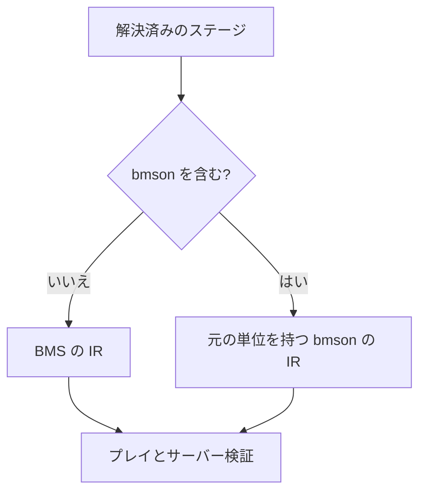

[English](./0017-bmson-nonstop.md)

# 混在する NONSTOP は bmson の IR に元の単位を保持する

bmson のステージを含む NONSTOP は Be-Music 独自の拡張で、intended の配置で利用できます。LR2 の配置は BMS のみを対象とします。BMS の結合出力を流用すると、bmson のサンプル継続が失われ、2文字のリソースキーの上限も適用されます。

1つでも bmson のステージがあれば bmson の IR 譜面を出力します。BMS だけのコースは既存の BMS 出力経路を使います。配置、境界でのノート変換、時間のグリッドは両経路で共有します。

bmson の IR のイベントは元の音声のオフセットと長さを保持し、FIT によって音声座標が譜面時刻の座標に変わることを防ぎます。ロングノートはノートごとの種別を保持します。リソースキーは明示的な bmson の正規化によって2文字を超えられます。ステージの判定ランク変更は単位を明示し、時刻0の初期値も持ちます。TOTAL も最後のステージの単位を明示できます。これらのフィールドは JSON とリプレイの往復でも保持します。

出力形式から単位の変換を推測せず、IR とリプレイに情報を追加します。コースの識別子には引き続き元のステージのフィンガープリントを使います。既存の BMS 出力は変わらず、bmson を含むコースは従来実行できなかったため、結合バージョン1を維持します。通常の譜面とリプレイでは追加フィールドを省略します。
