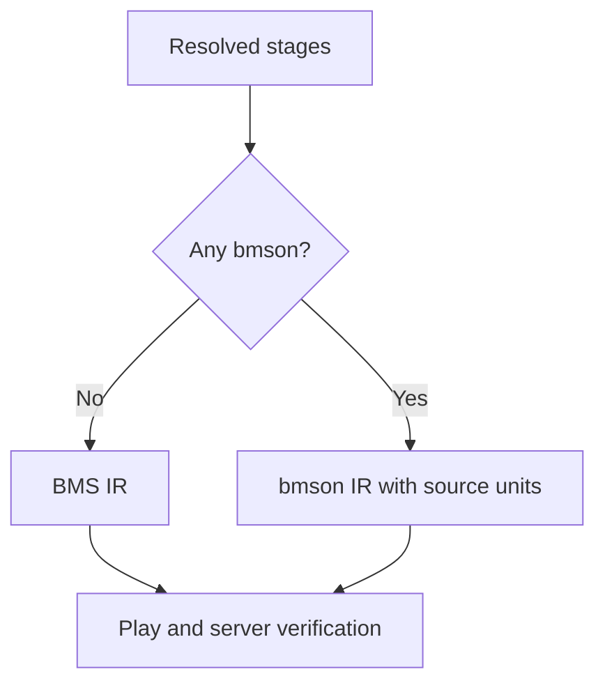

[日本語版](./0017-bmson-nonstop.ja.md)

# Mixed NONSTOP courses retain source units in the bmson IR

A NONSTOP course containing bmson stages is a Be-Music extension, available under the intended placement. LR2 placement remains BMS-only. Reusing the BMS stitch output would discard bmson sample continuation and impose its two-character resource limit.

Emit a bmson IR chart when any stage is bmson. Keep the existing BMS output path for courses containing only BMS. Both paths share placement, seam conversion and the time grid.

The bmson IR carries source-audio offsets and durations on events, so FIT does not turn a source offset into a chart-time offset. Long notes retain per-note modes. Resource keys can grow beyond two characters through explicit bmson normalization. Stage rank changes name their units, including an initial entry at zero, and TOTAL can explicitly retain its last stage's unit. These fields survive JSON and replay round-trips.

This adds IR and replay metadata instead of guessing conversions from the output format. The original stage fingerprints still determine course identity. Stitch version 1 remains valid: existing BMS output is unchanged and bmson-containing courses could not previously run. Ordinary charts and replays omit these added fields.
