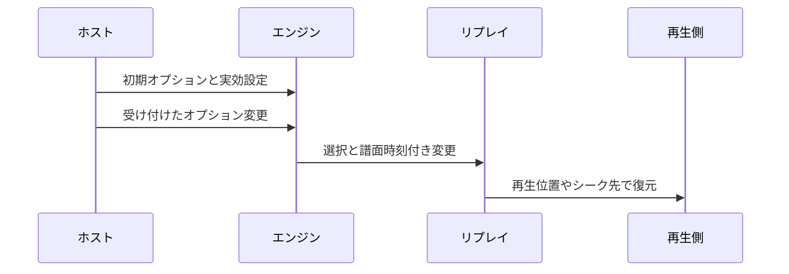

[English](./0018-replay-option-timeline.md)

# 0018: 参照元のオプションをスコア方針と分けて記録する

リプレイには、参照元のオプション選択と、実際にプレイした実効状態の両方を残します。`play.options` は開始時の制約を反映したプリミティブ値を、`play.optionChanges` は受け付けた変更を `{ timeUs, values }` の差分として保存します。参照元固有の名前も読み込み時に維持します。エンジンの譜面時計で時刻を付け、ポーズ中を含めて同じ時刻での変更順序も保持します。

オプションの時系列は、プリミティブな形を検証するメタデータです。別の型なしエンジン命令にはしません。判定では型付きの譜面とエンジン設定を正とし、実効表示とテンポの変化は各時系列に保持します。動的に変更するオプションは、実効動作の変更とともに受け付けた値を記録します。ブラウザーは観測した表示変更を保持し、巻き戻しシークも含めて、その時点の参照元の選択を復元します。

古い読み込み側が認識していない参照元の名前も失わず、任意の名前でエンジンを操作することも防ぎます。実効値と一部の選択値を重複して持つのは意図的です。選んだハイスピードと HS-FIX 適用後の描画速度は別の事実だからです。再現はプレイヤーが、スコアの採用・更新・ランキングは Leaderboard が担当します。この変更では、アシストのスコア方針や過去の記録の修復方針を新たに決めません。
