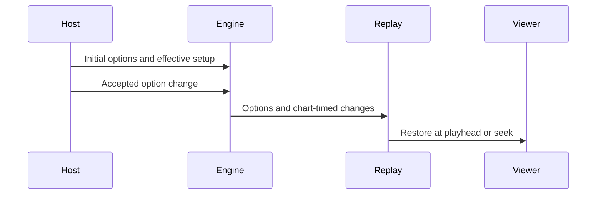

[日本語](./0018-replay-option-timeline.ja.md)

# 0018: Record source options independently of score policy

A replay retains both the selected source options and the effective state played. `play.options` stores primitive option values at the start, after start restrictions; `play.optionChanges` stores accepted changes as `{ timeUs, values }` patches. Source-specific names survive parsing. The engine stamps changes on its chart clock, preserving the order of changes at one timestamp, including while paused.

The option timeline is metadata with a validated primitive shape, rather than a second untyped engine command language. Typed chart and engine fields remain authoritative for judging; view and tempo timelines retain effective dynamic state. Each dynamic option implementation must record the accepted value alongside its effective runtime change. The browser records every observed view change and restores source-option snapshots at the playhead, including backward seeks.

This keeps future source options from disappearing merely because an older reader does not recognize their names, while preventing arbitrary option names from invoking engine behavior. It duplicates a few selected values alongside effective fields, deliberately: the selected hi-speed and the drawn speed after HS-FIX are different facts. Replay reproduction belongs to the player; score acceptance, updates and ranking policy belong to the Leaderboard. This change introduces no new assist-scoring or historical-record repair policy.
