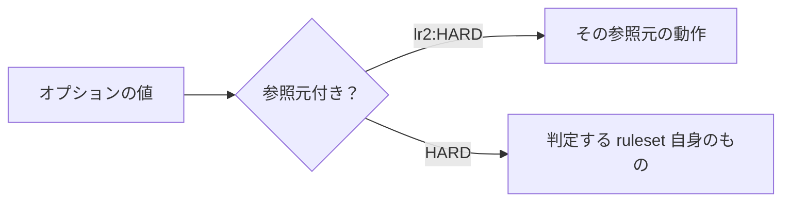

[English](./0019-source-qualified-option-values.md)

# 0019: オプションの値に参照元を持たせ、リプレイは決めた規則で再判定する

プレイオプションを判定 ruleset から切り離す作業を進めています（[#774](https://github.com/nulltask/be-music/issues/774)）。ほとんどのオプションは参照元が1つですが、いくつかの名前は参照元によって意味が違います。

| 名前                      | LR2                            | beatoraja                              | AC（`____`）      |
| ------------------------- | ------------------------------ | -------------------------------------- | ----------------- |
| RANDOM                    | randFix 付きのシャッフル       | Java `Random` によるレーンごとの抽選   | 暫定で LR2 と同じ |
| S-RANDOM                  | 空いたレーン、縦連しきい値なし | 40 ms 未満の縦連を避ける               | 暫定で LR2 と同じ |
| CONVERGE                  | 1 レーンへの集中               | PMS の縦連優先配置                     | —                 |
| GROOVE、EASY、HARD、DEATH | LR2 のゲージ表                 | beatoraja のゲージ表（NORMAL、HAZARD） | AC のゲージ表     |
| EX-HARD、ASSIST-EASY      | —                              | beatoraja の表                         | AC の表           |

今はどれを使うかを判定 ruleset が決めています。オプションやゲージをどの ruleset でも使えるようにすると、ruleset では決められなくなります。

BATTLE は値の上ではすでに分かれています。LR2 の BATTLE は `TWO-PLAYER` として保存し、`BATTLE` は beatoraja と AC の「1 人で両サイド」です。参照元が必要なのは表示名だけです。

## 決定

**衝突する値には参照元を付けます。** 形式は `<source>:<NAME>` で、例は `lr2:S-RANDOM`、`beatoraja:S-RANDOM`、`beatoraja:HARD`、`____:HARD` です。source は `lr2`、`beatoraja`、`____` のいずれかです。

- **参照元を付ける名前:** 2 つの参照元が違う動作で定義している名前だけです。1 つの参照元しか定義していない名前（SPIRAL、SCATTER、H-RANDOM、P-ATTACK など）はそのままにし、`@be-music/player-engine` の対応表で参照元を引きます。
- **参照元のない衝突値は ruleset 相対です:** 「判定する ruleset 自身のもの」を意味します。既存の値はすべて今この意味なので、既存の設定・リプレイ・Leaderboard の結果は書き換えなしで意味が変わりません。
  - 保存済みの設定（[#692](https://github.com/nulltask/be-music/pull/692) の設定ドキュメント）は、移行時に選んでいる ruleset を参照元として、一度だけ参照元付きの値に移行します。
  - リプレイは書き換えません。読み込み側が、判定する ruleset に合わせて参照元のない値を解決します。
- **オプションの時系列はプリミティブのままです**（[ADR 0018](./0018-replay-option-timeline.ja.md)）。参照元付きの値は文字列です。型付きのエンジン項目（`play.gauge`、`play.randomLane`）も同じ文字列を受け取ります。
- **スキン:** LR2 と beatoraja のボタンはそれぞれの参照元の値を巡回し、表示名は参照元を除いた名前を読みます。別の参照元の値は、そのスキンで最も近い表示名で表示し（例: `beatoraja:HARD` は HARD）、選択は Debug Menu から行います。Debug Menu は選択肢を参照元ごとにまとめます。

**リプレイは決めた規則で再判定します。** プレイヤーはリプレイをプレイした ruleset で、Leaderboard はすべての ruleset で再シミュレーションします。別の ruleset で再判定するときの扱いを、オプションごとに次の 3 つのどれかに決めます。

| 扱い           | 意味                                                                                                                  | オプション                                                                         |
| -------------- | --------------------------------------------------------------------------------------------------------------------- | ---------------------------------------------------------------------------------- |
| 記録どおり     | 記録した効果をそのまま再生し、抽選し直さない。                                                                        | レーン配置（実効譜面を記録している）、譜面加工、表示オプション、テンポ             |
| 持ち越し       | 再判定先の ruleset でオプションを適用し直す。参照元付きの値は参照元を保ち、参照元のない値は再判定先のものに解決する。 | ゲージ、ゲージ自動シフト、CUSTOM JUDGE（ruleset ごとの定義ができたら）、2 人プレイ |
| ruleset のもの | 選択に関係なく、再判定先の ruleset 自身の規則を使う。                                                                 | 判定幅、判定アルゴリズム、ロングノーツの種類、地雷の判定、スコア                   |

- **再判定先が定義していない参照元なしの値**（例: beatoraja での古い `P-ATTACK`）は、その再判定先の結果を「再判定不可」とし、理由を付けます。例外は投げず、似た値に置き換えることもしません。
- **入力は補いません。** プレイした ruleset で落ちた時点で止まったプレイは、その時点までだけ再判定します。再判定先では生き残っていたはずの場合、結果は「途中まで」とし、ランキングには載せません。
- **ruleset をまたいだ読み方がまだ決まっていないオプション**は、他の ruleset では「再判定不可」にします。今の CUSTOM JUDGE やゲージ自動シフトのように黙って外すことはしません。
- これらの読み方を変えたときは ruleset のリビジョン（`lr2/0` など）を上げ、Leaderboard が保存済みの結果をリプレイから計算し直すようにします。

## 影響

- `docs/play-options.md` の各オプションに、参照元と再判定の扱いを書きます。新しいオプションは、これがないとマージしません。
- `PlayOptions` の型とリプレイの読み込みは参照元付きの文字列を受け付けます。この ADR より前の読み込み側は、参照元付きのゲージを知らないゲージとして拒否します。これは意図した失敗です。参照元付きのレーンの値はただのラベルとして読みますが、配置は記録してあるので問題ありません。
- 元に戻しにくいのは、設定の移行と「再判定不可」「途中まで」という結果です。参照元をまたいだプレイの記録と Leaderboard の扱いは、[#602](https://github.com/nulltask/be-music/issues/602) で別に決めます。

## 追補：RANDOM・S-RANDOM・CONVERGE・BATTLE での実装（#774）

この決定を実装する際に、次の 4 点を決めました。

- **BATTLE は 2 か所で衝突します。** LR2 の 2 人用 BATTLE（`TWO-PLAYER`）のほかに、beatoraja と AC の 1 人用 BATTLE も対応譜面（5 / 7 / 24KEY と 7KEY）とプレイが残すもの（LIGHT_ASSIST とスコア非保存）が違います。そのため 1 人用の複製は `beatoraja:BATTLE` と `____:BATTLE` として参照元を付けます。`TWO-PLAYER` は参照元を付けず、どの ruleset でも選べます。2 人プレイのない beatoraja のルールでは、LR2 の作り方で譜面を作り、各プレイヤーを beatoraja のルールで判定します。
- **AC の RANDOM と S-RANDOM にも参照元を付けます**（`____:RANDOM`・`____:S-RANDOM`）。当面は LR2 のアルゴリズムで動きますが、あとで AC のアルゴリズムを入れても保存済みの値の意味は変わりません。AC に CONVERGE はありません。
- **設定は読み込むときに移行します。** 設定ドキュメントはまだバージョン 0 で、番号を上げずに形を変えてよいため、バージョンは追加しません。参照元のない値はドキュメントに保存した判定ルール（ないときは LR2）のものとし、次の保存で参照元付きの値を書きます。
- **スキンのボタン。** beatoraja のレーンと `optiondp` のボタンは beatoraja 自身の値を切り替えます。LR2 の RANDOM ボタンはこれまでどおりすべてのレーンオプションを切り替えます。どちらも、ほかの参照元の値は参照元を除いた名前で表示します。

一覧は `@be-music/player-engine/ruleset` の `QUALIFIED_OPTION_SOURCES` です。
