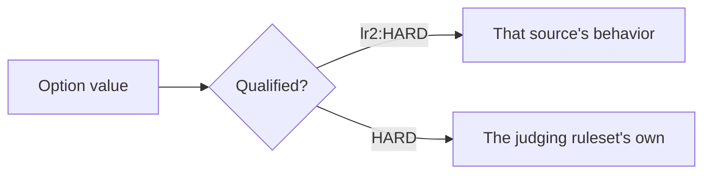

[日本語](./0019-source-qualified-option-values.ja.md)

# 0019: Option values name their source; replays re-judge by declared rules

Play options are being lifted off the judge ruleset ([#774](https://github.com/nulltask/be-music/issues/774)). Most of them have one source, but a few names mean different things in different sources:

| Name                      | LR2                          | beatoraja                               | AC (`____`)          |
| ------------------------- | ---------------------------- | --------------------------------------- | -------------------- |
| RANDOM                    | shuffle with randFix         | per-lane draw on Java `Random`          | LR2's, provisionally |
| S-RANDOM                  | free lane, no jack threshold | avoids jacks under 40 ms                | LR2's, provisionally |
| CONVERGE                  | concentration on one lane    | PMS jack-streak arrangement             | —                    |
| GROOVE, EASY, HARD, DEATH | LR2 gauge tables             | beatoraja gauge tables (NORMAL, HAZARD) | AC gauge tables      |
| EX-HARD, ASSIST-EASY      | —                            | beatoraja tables                        | AC tables            |

Today the judge ruleset picks which one runs. Once options and gauges can be used under every ruleset, the ruleset can no longer decide this.

BATTLE is already apart at the value level: LR2's BATTLE is stored as `TWO-PLAYER`, and `BATTLE` is beatoraja and AC's one player on both sides. Only the labels need the source.

## Decision

**A colliding value carries its source**, as `<source>:<NAME>`: `lr2:S-RANDOM`, `beatoraja:S-RANDOM`, `beatoraja:HARD`, `____:HARD`. The source is `lr2`, `beatoraja` or `____`.

- **Which names are qualified:** only names that two sources define with different behavior. A name only one source defines (SPIRAL, SCATTER, H-RANDOM, P-ATTACK, ...) stays bare, and a registry in `@be-music/player-engine` maps each to its source.
- **A bare colliding value is ruleset-relative:** it means "the ruleset's own". That is what every existing value means today, so existing settings, replays and Leaderboard results keep their meaning without rewriting.
  - Saved settings (the [#692](https://github.com/nulltask/be-music/pull/692) settings document) migrate once to qualified values, with the ruleset selected at migration time as the source.
  - Replays are not rewritten. A reader resolves a bare value against the ruleset it judges under.
- **The option timeline stays primitive** ([ADR 0018](./0018-replay-option-timeline.md)): a qualified value is a string. Typed engine fields (`play.gauge`, `play.randomLane`) take the same strings.
- **Skins:** LR2 and beatoraja buttons cycle their own source's values, and their labels read the bare name. Another source's value shows on a skin as that skin's nearest label (for example `beatoraja:HARD` as HARD), and is selectable from the Debug Menu, which groups choices by source.

**A replay is re-judged by declared rules.** The player re-simulates a replay under its played ruleset, and the Leaderboard under every ruleset. Every option declares one of three behaviors for re-judging under another ruleset:

| Behavior  | Meaning                                                                                                                              | Options                                                                                   |
| --------- | ------------------------------------------------------------------------------------------------------------------------------------ | ----------------------------------------------------------------------------------------- |
| Recorded  | The recorded effect is replayed as is; nothing is drawn again.                                                                       | Lane arrangements (the effective chart is recorded), chart modifiers, view options, tempo |
| Carried   | The option is applied again under the target ruleset. A qualified value keeps its source; a bare value resolves to the target's own. | Gauge, gauge auto-shift, CUSTOM JUDGE (once defined per ruleset), two-player play         |
| Ruleset's | The target ruleset's own rule applies, whatever was selected.                                                                        | Judge windows, judge algorithm, long-note style, mine trigger, score                      |

- A **bare value the target does not define** (for example a legacy `P-ATTACK` under beatoraja) makes that target's result _not simulated_, with the reason. It no longer throws, and it is never mapped to a lookalike.
- **Inputs are never synthesized.** A run that stopped at the played ruleset's failure point is re-judged only up to that point. A target under which it would have survived reports the result as _truncated_, which is not ranked.
- **An option whose cross-ruleset reading is not defined yet** is _not simulated_ under the other rulesets, instead of being dropped silently as CUSTOM JUDGE and gauge auto-shift are today.
- A change to any of these readings bumps the ruleset revision (`lr2/0`, ...), so the Leaderboard recomputes stored results from their replays.

## Consequences

- Each option in `docs/play-options.md` names its source and its re-judging behavior. A new option is not merged without them.
- The `PlayOptions` types and the replay parser accept qualified strings. A reader that predates this ADR refuses a replay with a qualified gauge (an unknown gauge type), which is the intended failure; a qualified lane value it reads as an opaque label, which is harmless because the arrangement is recorded.
- The settings migration and the "not simulated" / "truncated" outcomes are the hard-to-reverse parts. The record and Leaderboard policy for cross-source plays is decided separately in [#602](https://github.com/nulltask/be-music/issues/602).
