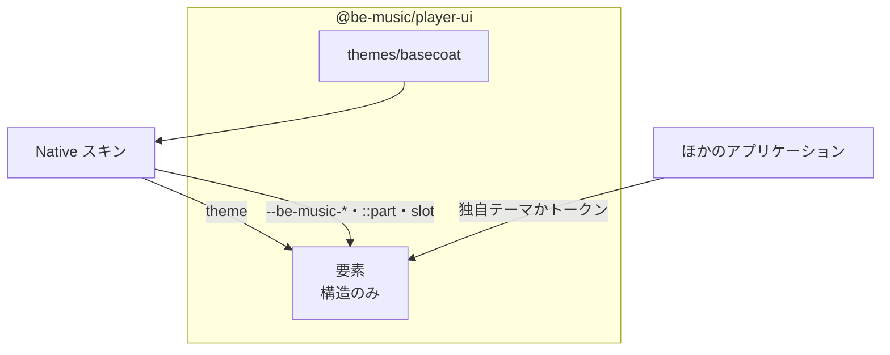

[English](./0020-headless-player-ui.md)

# 0020: Player UI の要素は headless にし、見た目はテーマとスキンが与える

`@be-music/player-ui`（[ADR 0013](./0013-player-ui-components.ja.md)）は各 shadow root に Basecoat を採用し、色・枠線・背景と Native 独自の余白・文字組みをコンポーネント内で指定していました。要素を使うアプリケーションは、外側からそれらのルールを上書きするしかありませんが、shadow DOM が外側に許すのはカスタムプロパティと part だけです。Native の製品名（"Be-Music / Native"）もコレクション画面に書き込まれていました。さらに Basecoat のクラス名がコンポーネント自身のクラス名（`.card`、`.badge`）と衝突し、パネルの余白とリストの行が崩れていました。

## 決定

**要素は構造だけを持つ。** 要素自身のスタイルは、レイアウト・寸法・スクロール・コンテナクエリに限ります。余白は文書化した `--be-music-*` の長さを読み、テーマなしでも読める程度の小さな既定値を持ちます。色・枠線・背景・フォントファミリーは指定しません。

**見た目はテーマが与える。** テーマはスタイルシートの列です。`defineBeMusicElements(registry, { theme })` がレジストリごとに保持し、各要素は自身のスタイルの後にそれを shadow root へ採用します。`@be-music/player-ui/themes/basecoat` は `basecoatTheme` を公開します。中身は Basecoat と、ページの Basecoat トークンから取る要素の色です。メインのエントリはこれを import しないので、headless で使うアプリケーションは Basecoat をバンドルしません。

**スキン固有の見た目はスキンに置く。** Native は `basecoatTheme` で登録し、自前の style 要素のカスタムプロパティと `::part` ルールで余白のスケールと見出しの文字組みを設定します。コレクションの `eyebrow` slot には製品名を入れます。

公開するスタイルの窓口は、theme オプション、`--be-music-*` カスタムプロパティ、パッケージ README に載せた part と slot です。テーマは shadow root 内の part を選択できます（`[part~='panel']`）。`basecoatTheme` は内部のクラス名も選択しますが、それに頼ってよいのはパッケージ同梱のテーマだけです。

## トレードオフ

テーマなしで登録した要素はブラウザ既定の見た目になります。使えますが素朴です。React と Vue のラッパーはテーマなしで登録するので、利用者は先に `defineBeMusicElements` でテーマを設定します。テーマはレジストリ単位で、要素が初めて描画されるときに適用されます。変えても、表示済みの要素の見た目は変わりません。ボタンと入力欄は `basecoatTheme` が装飾できるよう、テンプレートに Basecoat のクラス名を残します。テーマがなければ何も起きません。
