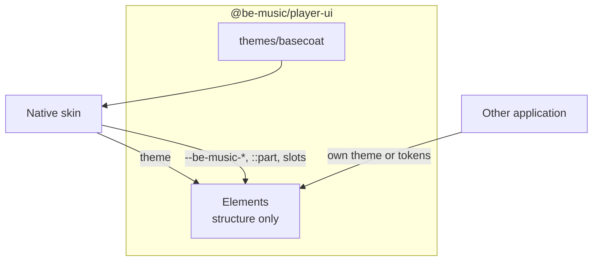

[日本語](./0020-headless-player-ui.ja.md)

# 0020: Player UI elements are headless; themes and skins supply the look

`@be-music/player-ui` ([ADR 0013](./0013-player-ui-components.md)) adopted Basecoat in every shadow root and set colours, borders, backgrounds and Native's own spacing and type in the components. An application using the elements could restyle them only by overriding those rules from outside, which shadow DOM allows only through custom properties and parts. Native's product line ("Be-Music / Native") was written into the collection screen. Basecoat's class names also collided with the components' own (`.card`, `.badge`), which broke panel padding and list rows.

## Decision

**The elements carry structure only.** Their own styles cover layout, sizing, scrolling and container queries. Spacing reads documented `--be-music-*` lengths, with small defaults so an unthemed element still reads. They set no colour, border, background or font family.

**A theme supplies the look.** A theme is a list of style sheets. `defineBeMusicElements(registry, { theme })` keeps it for the registry, and each element adopts it into its shadow root after its own styles. `@be-music/player-ui/themes/basecoat` exports `basecoatTheme`: Basecoat and the elements' colours from the page's Basecoat tokens. The main entry does not import it, so a headless application does not bundle Basecoat.

**A skin's own look stays in the skin.** Native registers with `basecoatTheme`, then sets its spacing scale and title type through custom properties and `::part` rules in a style element of its own, and fills the collection's `eyebrow` slot with its product line.

The public styling surface is the theme option, the `--be-music-*` custom properties, the parts and the slots the package README lists. A theme may select the parts inside a shadow root (`[part~='panel']`); `basecoatTheme` also selects internal class names, which only a theme shipped with the package may rely on.

## Trade-offs

An element registered without a theme renders with browser defaults: usable, but plain. The React and Vue wrappers register without one, so their users set the theme first with `defineBeMusicElements`. A theme is per registry and applies when an element first renders; changing it does not restyle elements already shown. Buttons and fields keep Basecoat's class names in the templates so `basecoatTheme` can style them; they do nothing without it.
