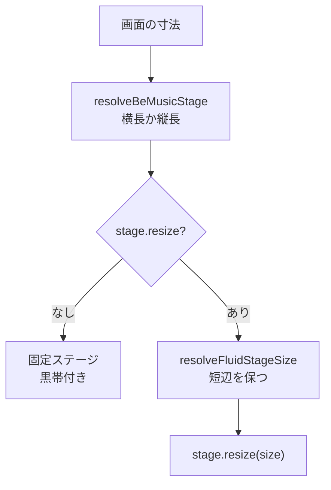

[English](./0021-fluid-stage.md)

# 0021: スキンのステージは可変にできる

be-music スキンは固定のデザインキャンバスに描きます。横長の `wideStage`（854×480）か縦長の `tallStage`（480×854）です。プレイヤーは画面の向きでどちらかを選び、収まるように拡大縮小します。そのため 16:9 でも 9:16 でもない画面（4:3、ウルトラワイド、横に持ったスマートフォン）では黒帯が出ます。埋め込みプレビュー（`/embed/`）はレーン、BGA の正方形、HUD だけを並べるので、どの縦横比でもウィンドウ全体を使えます。一方、内蔵・LR2・beatoraja スキンはクロームを固定のデザイン座標に置くので、それができません。

## 決定

**ステージは `BeMusicStage.resize(size)` で画面に追従することを選べる。** `resolveBeMusicStage` はこれまでどおり横長か縦長のステージを選び、可変のステージを `resolveFluidStage` に渡します。`resolveFluidStage` は `resolveFluidStageSize` で寸法を決め、その寸法で `resize` が作ったステージを返します。寸法はステージの短辺（480）を保つので、スキンの文字とレーンの大きさは変わりません。長辺は画面の縦横比に合わせます。`resize` を持たないステージは寸法を保ち、これまでどおり黒帯付きで収まります。

プレイヤーはステージを毎フレーム解決し、レーンのレイアウトをステージの同一性でキャッシュします。そのため `resolveFluidStage` は元のステージごとに直前に作ったステージを保持し、寸法が変わらないあいだは同じオブジェクトを返します。画面と向きが逆のステージ（縦向きの画面で横長ステージに残るダブルプレイの譜面）は寸法を変えません。

可変のスキンは埋め込みのプレビュースキンだけです。そのステージを作る `createPreviewStage` は、どの寸法でもレーン・BGA・プレイフィールドの範囲を配置し、自身を `resize` として返します。

## トレードオフ

- **埋め込みだけの上書きではなく SDK のオプションにした。** 埋め込みが外側からスキンのステージを差し替える（ウィンドウを読む getter にする）こともできましたが、ステージを解決するのはプレイヤーで、正しい入力は拡大縮小先の画面寸法です。`resize` をステージに置けば、どのホストでも経路は一つになり、スキンはウィンドウを読まずに済みます。代わりに `BeMusicStage` に公開メンバーが一つ増え、後から取り下げにくくなります。
- **固定するのは面積ではなく短辺。** 短辺を 480 デザイン px に保つと、どの縦横比でも文字とレーンの大きさが変わりません。極端に横長・縦長のウィンドウでは文字が大きくなるのではなくステージが長くなります。そうしたくないスキンは `resize` の中で拡大できます。
- **既存のスキンは固定のまま。** クロームを固定座標に置くスキンは、任意の寸法に配置できるよう書き直さなければならないので、`resize` は任意とし、内蔵・LR2・beatoraja スキンはどれも宣言しません。
