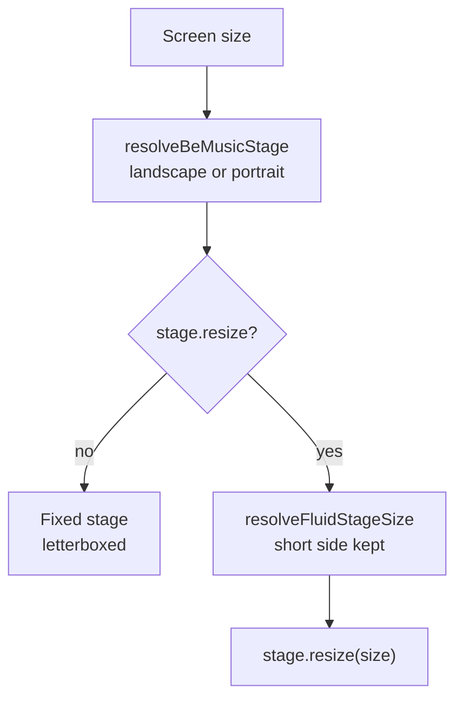

[日本語](./0021-fluid-stage.ja.md)

# 0021: A skin's stage may be fluid

A be-music skin draws on a fixed design canvas: the landscape `wideStage` (854×480) or the portrait `tallStage` (480×854). The player picks one by the screen's orientation and scales it to fit, so any screen that is not 16:9 or 9:16 (4:3, an ultrawide, a phone held sideways) shows black bars. The embed preview (`/embed/`) lays out only lanes, a BGA square and a HUD, and could use the whole window at any aspect ratio; the built-in, LR2 and beatoraja skins place their chrome at fixed design coordinates and cannot.

## Decision

**A stage opts into following the screen with `BeMusicStage.resize(size)`.** `resolveBeMusicStage` still picks the landscape or portrait stage as before, then hands a fluid one to `resolveFluidStage`. That sizes it with `resolveFluidStageSize` and returns the stage `resize` builds for that size. The size keeps the stage's short side (480), so the skin's type and lane sizes do not change, and gives the long side the screen's aspect ratio. A stage without `resize` keeps its size and is letterboxed as before.

The player resolves the stage every frame and caches lane layouts by stage identity, so `resolveFluidStage` keeps the last resized stage per base stage and returns the same object while the size holds. A stage turned the other way from the screen (a double play chart kept on the landscape stage of an upright screen) is not resized.

The embed's preview skin is the only fluid skin. Its stage factory, `createPreviewStage`, lays the lanes, BGA and playfield bounds out for any size and returns itself as `resize`.

## Trade-offs

- **An SDK option rather than an embed-only override.** The embed could have swapped its skin's stage from outside (a getter reading the window), but the player resolves the stage, and only the screen size it scales to is the right input. Putting `resize` on the stage keeps one path for every host and keeps the skin free of window reads. It adds a public member to `BeMusicStage` that is hard to take back.
- **The short side is fixed, not the area.** Keeping 480 design px across the short side keeps text and lanes the same size at every aspect ratio. A very wide or very tall window gets a long stage rather than larger type; a skin that wants otherwise can scale inside `resize`.
- **Existing skins stay fixed.** A skin placing chrome at fixed coordinates would have to be rewritten to lay out at any size, so `resize` is opt-in and no built-in, LR2 or beatoraja skin declares it.
