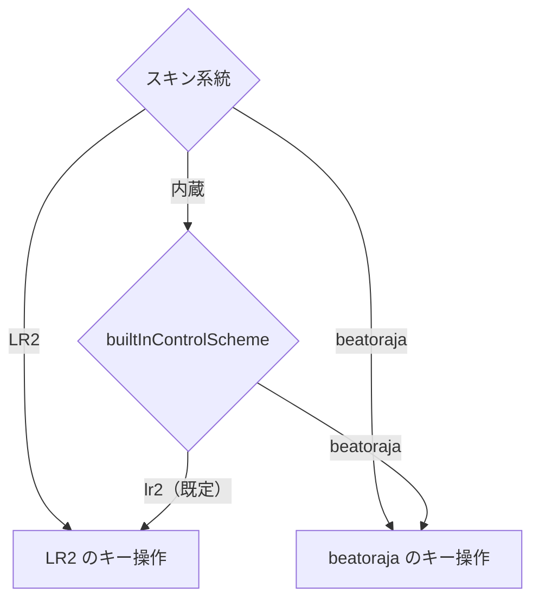

[English](./0038-control-buttons-follow-skin-family.md)

# 0038: 各画面は操作ボタンを、スキン系統のキー操作で読む

## 背景

Be-Music Play は LR2 と beatoraja のスキンを使い、プレイオプションは PC 版からも取り入れています。どれも同じコントローラーで操作します。各サイドに 7 つの鍵盤と皿、START と SELECT です。3 つに共通する操作の多くは「START + 鍵盤」（プレイ中のハイスピード、選曲画面のオプションパネル）か「START 2 回」（レーンカバー）です。Be-Music には START も SELECT もなく、選曲・決定・リザルトの各画面は決まったキー（LR2 のオプションパネルの Z … V）を読んでいたため、レーンのキーを変えても画面のキーは変わりませんでした。また 3 つで同じキーの意味が違う場合（選曲画面の 5 鍵は beatoraja では AUTO、LR2 では決定）、Be-Music はどれか 1 つを選ぶしかありませんでした。

オーナーは次のように決めました。

- 3 つのキー操作のうち、ほかとぶつからないものはすべて受け付ける。
- ぶつかる場合はスキンの系統に従う。LR2 スキンの画面は LR2 のキー操作、beatoraja スキンの画面は beatoraja のキー操作を読む。
- 内蔵スキンはユーザーが選んだ方（既定は LR2）を読み、どのキーも変更できる。
- START と SELECT は独立したボタンとし、既定は Q / W と O / P（LR2 の初期設定で、beatoraja も同じ）。Space は LR2 と同じく左 Ctrl とともに 1P の皿の 2 つ目のキーにし、プレイのポーズは Pause と Tab に移す。
- リプレイには、レーンやボタンだけでなく物理キーも記録する。

## 決定

各画面はキーではなく**操作ボタン**を読みます（`session/controls/control-buttons.ts`）。各サイドの 7 つの鍵盤、2 つの皿のキー（Shift の `scratch-cw` と、2 つ目のキーの `scratch-ccw`）、START と SELECT です。これはユーザーのレーンのキー（`laneKeys`。14 KEY のレーン）と START / SELECT のキー（`controlKeys`）から作ります。セッションが受け取るキーイベントには、そのキーがどのボタンかが付きます（`SessionKeyEvent.buttons`）。`createControlButtonTracker` は、イベント自身のタイムスタンプから、押しっぱなし・長押し・2 回押しを見分けます。

画面がどの系統のキー操作を読むかは、その画面の**操作系統**（`resolveControlScheme`）で決まります。

系統が使っていないキーは、ぶつからない限りほかの系統の意味を持ちます。プレイ中に譜面のレーンが使うキーはレーンになります。レーンと START・SELECT は同じキーにできない（キーコンフィグが拒否する）ので、画面がどちらかを選ぶ必要はありません。

プレイは START と SELECT を `control-input` コマンドとしてエンジンに送り、リプレイはそれを物理キーとともに記録します（`ReplayPlay.controlInputs`）。レーンの入力にも物理キーを記録します（`ReplayInputEvent.code`）。どちらも診断用です。ボタンが何をしたかはその結果の側に記録され、シミュレータはどちらも読みません。

## 結果

レーンのキーを変えると、どの画面のそのキーも変わります。コントローラーはボタンを伝えるだけで画面を操作できます。各系統のキー操作は操作ボタンの 1 か所に書くので、キー操作は画面に散らばったコードではなくデータになります。Space はプレイのポーズではなくなります。これまで Space でポーズしていたユーザーは 1P の皿を回すことになり、ポーズは Pause か Tab で行います。内蔵スキンは、ユーザーが beatoraja のキー操作を選ぶまでは、これまでどおり LR2 と同じです。ぶつかるキーはオーナーが一つずつ決めたとおりで、新たにぶつかるキーはスキン系統の意味に従います。
