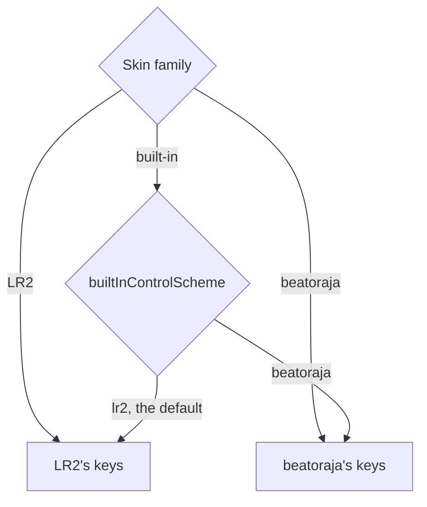

[日本語](./0038-control-buttons-follow-skin-family.ja.md)

# 0038: Screens read control buttons, by the skin family's key map

## Context

Be-Music Play takes its skins from LR2 and beatoraja and its play options from That-Which-Must-Not-Be-Named PC as well. Their screens are worked with the same controller: seven keys and a turntable per side, START and SELECT. Most of what they share is "START + a key" (the hi-speed in a play, the option panel on the select screen) or "START twice" (the lane cover). Be-Music had no START or SELECT, and its select, decide and result screens read fixed keys (Z … V on the LR2 option panel), so a player who moved a lane did not move the screens' keys. Where the three give one key different meanings (on the select screen key 5 is AUTO in beatoraja and decides in LR2), Be-Music had to pick one.

The owner decided that:

- Be-Music takes every key of the three that does not clash with another;
- where they clash, the key does what the skin's family does: an LR2 skin's screens read LR2's keys, a beatoraja skin's beatoraja's;
- the built-in skins read the one the player picks, LR2's by default, and every key can be moved;
- START and SELECT are buttons of their own, on Q / W and O / P by default (LR2's default key config, which beatoraja's keeps), and Space joins Left Ctrl as the 1P turntable's second key, as in LR2; the play's pause moves to Pause and Tab;
- a replay records the physical keys as well as the lanes and buttons they were.

## Decision

The screens read **control buttons**, not keys (`session/controls/control-buttons.ts`): each side's seven keys, its two turntable keys (`scratch-cw`, the Shift key, and `scratch-ccw`, the second key), START and SELECT. They come from the player's lane keys (`laneKeys`, the 14 KEY lanes) and START / SELECT keys (`controlKeys`); every key event a session gets names the buttons it is (`SessionKeyEvent.buttons`), and `createControlButtonTracker` tells a held, long-held or double-pressed button from the events' own time stamps.

Which family's keys a screen reads is its **control scheme** (`resolveControlScheme`):

Each screen's operations and their default keys on each key map are one table (`CONTROL_ACTIONS` in `session/controls/control-actions.ts`); a default is a physical key or a control button, and a key the player gives an operation takes the place of its defaults (`actionKeys`). A key the scheme leaves free takes the other families' meaning for it when none clashes. A key a chart's lane takes in a play is the lane. A lane and START or SELECT never share a key (the key config refuses it), so a screen never has to choose between them.

A play sends START and SELECT to the engine as `control-input` commands, which the replay records with their physical keys (`ReplayPlay.controlInputs`); every lane input records its physical key too (`ReplayInputEvent.code`). Both are diagnostic: what a button did is recorded where it lands, and simulators read neither.

## Consequences

A player who moves a lane moves every screen's key for it, and a controller only has to report buttons to drive the screens. The control buttons are the one place each family's keys are written, so a key map is data, not code spread over the screens. Space is no longer the play's pause: a player who paused with it now turns the 1P turntable, and pauses with Pause or Tab. The built-in skins look like LR2's until the player picks beatoraja's keys, as before. Keys that clash are decided one by one, as the owner did; a new clash takes the skin family's meaning.
