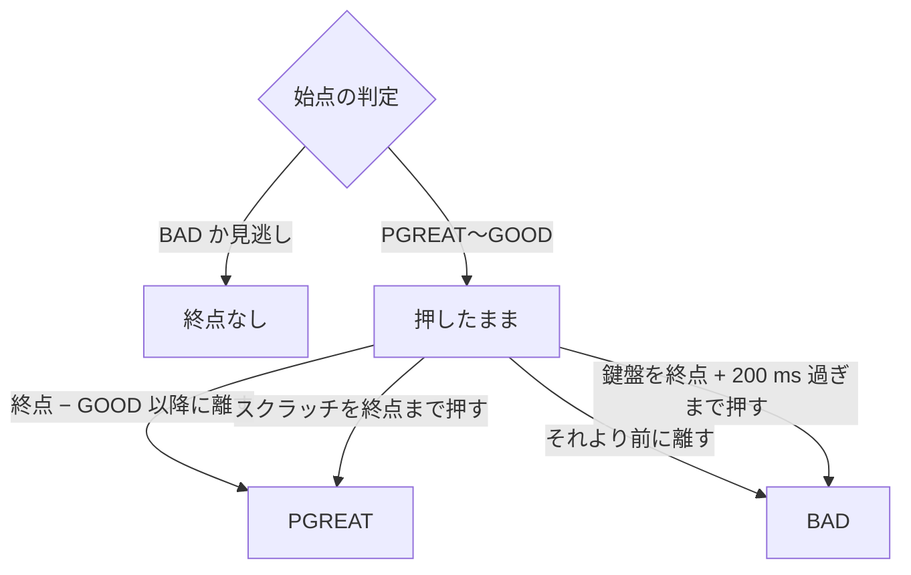

[English version](./0044-plugout-ruleset.md)

# plugout の規則を独立した ruleset として判定する

LRX 譜面は plugout4 -ARCADE EDITION- のものです（[ADR 0043](./0043-lrx-charts.ja.md)）。その判定は、ruleset が受け持つすべての面で LR2 とも beatoraja とも違います。判定幅はランクごとに固定です。ロングノーツの終点は離す操作で、独自の規則があります。ゲージは 8 種類あり、うち 4 種類は EX 版です。さらに持ち越しとライフ数のあるコースゲージがあります。スコアは 100,000 点満点で、ランプは PERFECT までです。`lr2` の下で `#RANK` と絶対値の TOTAL として読めば LRX 譜面は遊べますが、plugout の遊び方にはなりません。

Be-Music は `lr2`、`beatoraja`、`____` に並ぶ 4 つ目の判定 ruleset として `plugout`（リビジョン `plugout/0`）を加えます。規則は `plugout4.exe` から読み取り、[`plugout.ts`](../../packages/player-engine/src/ruleset/plugout.ts) にアドレス付きで記しています。ほかの ruleset と同じくどの譜面でも遊べ、BMS や bmson でも選べます。ライブのエンジンとリプレイのシミュレーターは同じ表を使い、Leaderboard はほかの 3 つと同じくすべてのプレイをこの ruleset でもシミュレートします。

## ruleset が持つもの

- **判定幅**：ランク 0–3 ごとの PGREAT / GREAT / GOOD（12 / 24 / 50、15 / 30 / 100、18 / 40 / 100、21 / 60 / 120 ms）と BAD 200 ms。前後対称で、鍵盤とスクラッチで同じです。レーンの次のノーツの 200 ms から 1 秒前の押下は空 POOR です。譜面に書かれたランクは plugout と同じく読みます（0–2 はそのまま、それ以外は 3）。ランクのない譜面は LR2 の percent 軸で最も近いランクにします。これは Be-Music の決定です。
- **選択**：届く範囲で最も早いノーツ。複数 BAD の連鎖はありません。
- **ロングノーツ**：すべてチャージノーツで、始点と終点を別々に判定します。始点が BAD か見逃しならそのノーツは終わり、終点は判定しません。
- **TOTAL**：譜面に書かれた TOTAL は絶対値です。ないときは LR2 のノーツ数の曲線から ×0.8 を除き、整数に切り捨てた値です。bmson の `total` はほかの ruleset と同じく、その値に対する割合です。
- **スコア**：`100000·PG/n + 50000·GR/n + 25000·GD/n`。各項を整数で割ります。EX-SCORE も並べて持ちます。
- **ランプ**：ゲージの種類から NORMAL、EASY、HARD。HAZARD でのクリアは FULL COMBO、EX-HAZARD でのクリアは PERFECT です。フルコンボは PERFECT が上限で、PERFECT には空 POOR がないことも必要です。MAX はありません。
- **地雷**：plugout にはないため、`____` と同じく LR2 の方針を取り入れます。

ロングノーツの終点は次の規則に従います。

スクラッチのロングノーツはここではバックスピンスクラッチではありません。離すと、鍵盤を離したときと同じく終わります。

## ゲージ

`T` は TOTAL、`n` はノーツ数です。

| ゲージ    | 開始値 | 回復（PG / GR / GD）  | ダメージ（BAD / POOR / 空 POOR） | クリア         |
| --------- | ------ | --------------------- | -------------------------------- | -------------- |
| NORMAL    | 20     | `T/n`、`T/n`、`T/2n`  | 3 / 8 / 2                        | 80 %、下限 2 % |
| EX-NORMAL | 20     | NORMAL と同じ         | NORMAL と同じ                    | 100 %          |
| EASY      | 20     | NORMAL と同じ         | 2.4 / 6.4 / 1.6                  | 80 %、下限 2 % |
| EX-EASY   | 20     | EASY と同じ           | EASY と同じ                      | 4 %            |
| HARD      | 100    | 0.1 / 0.1 / 0.05      | 9 / 18 / 4                       | 生存           |
| EX-HARD   | 100    | 0.1 / 0.1 / 0.05      | 5 / 10 / 2                       | 生存           |
| HAZARD    | 100    | なし                  | 100 / 100 / 0                    | 生存           |
| EX-HAZARD | 100    | GR で 2、GD で 100 減 | 100 / 100 / 100                  | 生存           |

HARD は 30 % 未満で POOR と空 POOR のダメージが ×0.7 になります。BAD には適用されません。EX-EASY のボーダー 4 % は、意図はどうあれコード上の値です。

ゲージの選択は LR2 の名前のままです。GROOVE は NORMAL、DEATH は HAZARD で遊びます。LR2 に対応のない EX ゲージには新しい選択肢を 3 つ使います：`EX-GROOVE`（EX-NORMAL）、`EX-EASY`、`EX-DEATH`（EX-HAZARD）。`EX-HARD` は beatoraja と共通です。新しい 3 つはほかのゲージの出どころでは受け付けず、plugout は ASSIST EASY を受け付けません。ADR 0019 の出どころ付きの選択で、ほかの ruleset の判定のまま plugout のゲージを使えます（`plugout:EX-EASY`）。ゲージオートシフトは EASY → NORMAL → HARD → HAZARD と上がります。

## コースゲージ

plugout のコースは 100 から始まり、回復せず、ステージ間でゲージを持ち越し、0 より上でクリアです。

- **EXPERT と NONSTOP のコース**：NORMAL と EASY のダメージはステージのノーツ数で変わります（100 ノーツ未満で ×2、400 で ×1 まで下がる）。HARD は単曲と同じダメージで、EX-HARD はそれより軽くなります。HAZARD は単曲と同じです。どの種類も 30 % 未満で ×0.7 の軽減があります。
- **段位コース**：NORMAL は 1 / 2 / 2 減ります。EASY は EXPERT と同じで、HARD の表は入れ替わります（HARD 5 / 10 / 2、EX-HARD 9 / 18 / 4）。NORMAL と EASY は 0 より上の間、ダメージがゲージ `g` に応じて `(3g + 100) / 400` 倍になります。0 になるとそのステージは 24 ライフで続き（BAD と空 POOR で 1、POOR で 2 減る）、ライフが残っていればクリアです。次のステージは持ち越した値（0.01 % 未満にはならない）と、改めて 24 ライフで始まります。

plugout のコースのステージは、プレイ中に力尽きたときだけ失敗です。ライフで続いているゲージは失敗になりません。

## 影響

- リプレイは `play.judgeRuleset` に `plugout` と記録し、Leaderboard はその ruleset のボードを持ちます。この変更より古い読み手はこの id を知らないため、ほかの ruleset として読まずにリプレイを拒否します（`ReplayParseError`）。
- ライブのエンジンとリプレイのシミュレーターには、`plugout` だけが使う規則（`heldChargeTail`）がそれぞれ 1 つ加わります：終点を過ぎても押したままのロングノーツと、どの終点の判定幅よりも前に離した場合です。characterization と driver-drift のテストは 4 つの ruleset すべてで回ります。
- EX-SCORE と DJ LEVEL はどの ruleset でもそのままです。plugout 独自のスコアは、LR2 の金額スコアと同じくその隣に出します。
