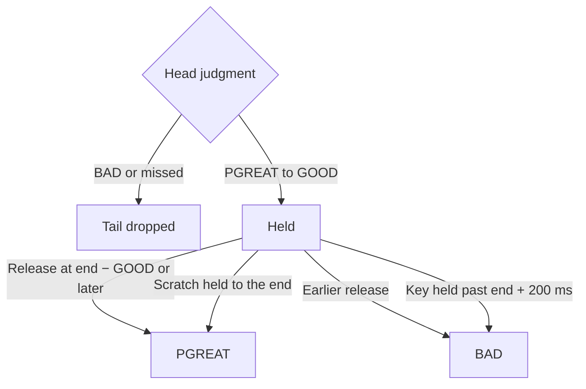

[日本語版](./0044-plugout-ruleset.ja.md)

# Judge plugout's rules as a ruleset of their own

LRX charts come from plugout4 -ARCADE EDITION- ([ADR 0043](./0043-lrx-charts.md)), whose judging differs from LR2's and beatoraja's on every surface a ruleset owns. Its judge windows are fixed per rank. A long note's end is a release with its own rules. It has eight gauges, four of them EX variants, plus course gauges with a carry and a life count. Its score is out of 100,000, and its lamps stop at PERFECT. Read through `#RANK` and an absolute TOTAL under `lr2`, an LRX chart plays, but not as plugout plays it.

Be-Music adds a fourth judge ruleset, `plugout` (revision `plugout/0`), beside `lr2`, `beatoraja` and `____`. Its rules were read in `plugout4.exe` and are cited by address in [`plugout.ts`](../../packages/player-engine/src/ruleset/plugout.ts). Like the others, it plays any chart, and it is selectable for BMS and bmson too. The live engine and the replay simulator share its tables, and the Leaderboard simulates every play under it as it does under the other three.

## What the ruleset holds

- **Windows**: PGREAT / GREAT / GOOD by rank 0–3 (12 / 24 / 50, 15 / 30 / 100, 18 / 40 / 100, 21 / 60 / 120 ms), BAD 200 ms, both ways and alike for keys and scratches. A press 200 ms to 1 s before a lane's next note is an empty POOR. An authored rank is read as plugout reads it (0–2 as written, anything else 3). A chart without one falls back to the nearest rank on LR2's percent axis, which is a Be-Music decision.
- **Selection**: the earliest note in reach. After a BAD the same press judges the lane's next note too, but only one less than 3 ms after the press (0x4407c4..0x4407fa); LR2 reaches ahead to its BAD window instead.
- **AUTO SCRATCH**: the scratch lanes are neither judged nor counted (0x43fa2e, 0x43e1a4): their notes only sound, the note count and TOTAL's default leave them out, and an assisted clear is an ASSIST CLEAR.
- **Long notes**: every long note is a charge note, so the head and the tail are separate judgments. A BAD or missed head settles the note and drops the tail.
- **TOTAL**: an authored TOTAL is absolute. Otherwise it is LR2's note-count curve without its ×0.8, truncated. bmson `total` is a percentage of that, as under the other rulesets.
- **Score**: `100000·PG/n + 50000·GR/n + 25000·GD/n`, each term integer-divided. EX-SCORE is kept beside it.
- **Lamps** (0x43a7d0, from the final gauge once every note is judged): NORMAL, EASY and HARD from the gauge type; a HAZARD clear is FULL COMBO, an EX-HAZARD clear PERFECT. A full combo tops out at PERFECT, which also needs no empty POOR. There is no MAX.
- **Mines**: plugout has none, so the ruleset imports LR2's policy, as `____` does.
- **A survival gauge at 0** stays at 0: a judgment that starts from 0 leaves it there (0x43a4f1), so it never recovers. No code was found that ends the play there; whether a play ends then stays the player's gauge auto-shift choice (NONE ends it, CONTINUE plays on), as under the other rulesets.
- **DJ LEVEL**: plugout's rank letters (AAA, AA, A …) use the EX score's ninths, as DJ LEVEL does (0x43a770).
- **Empty-press sound**: a press with nothing to judge plays the lane's sound cursor, which judged presses, long-note releases and hidden notes move ([format-compat §7](../format-compat.md#7-lrx)). Before the first move the cursor is uninitialized in plugout; Be-Music starts it at the lane's first note.

The long-note end follows this rule:

A scratch long note is not a back-spin scratch here: releasing it ends it as a key's release does.

## Gauges

`T` is TOTAL and `n` the note count.

| Gauge     | Start | Recovery (PG / GR / GD) | Damage (BAD / POOR / empty POOR) | Clear           |
| --------- | ----- | ----------------------- | -------------------------------- | --------------- |
| NORMAL    | 20    | `T/n`, `T/n`, `T/2n`    | 3 / 8 / 2                        | 80 %, floor 2 % |
| EX-NORMAL | 20    | as NORMAL               | as NORMAL                        | 100 %           |
| EASY      | 20    | as NORMAL               | 2.4 / 6.4 / 1.6                  | 80 %, floor 2 % |
| EX-EASY   | 20    | as EASY                 | as EASY                          | 4 %             |
| HARD      | 100   | 0.1 / 0.1 / 0.05        | 9 / 18 / 4                       | survival        |
| EX-HARD   | 100   | 0.1 / 0.1 / 0.05        | 5 / 10 / 2                       | survival        |
| HAZARD    | 100   | none                    | 100 / 100 / 0                    | survival        |
| EX-HAZARD | 100   | GR costs 2, GD 100      | 100 / 100 / 100                  | survival        |

HARD takes ×0.7 damage below 30 % for a POOR or an empty POOR, never for a BAD. EX-EASY's 4 % border is the value in the code, whatever its intent.

The gauge picks keep LR2's names: GROOVE plays NORMAL and DEATH plays HAZARD. Three new picks reach the EX gauges with no LR2 counterpart: `EX-GROOVE` (EX-NORMAL), `EX-EASY` and `EX-DEATH` (EX-HAZARD). `EX-HARD` is shared with beatoraja. The three new picks are refused under any other gauge source, and plugout refuses ASSIST EASY. Through ADR 0019's source-qualified picks, another ruleset's judging can play a plugout gauge (`plugout:EX-EASY`). Gauge auto-shift climbs EASY → NORMAL → HARD → HAZARD.

## Course gauges

plugout's courses start at 100, never recover, carry their gauge between stages, and clear above 0.

- **EXPERT and NONSTOP courses**: NORMAL and EASY damage scales by the stage's note count (×2 under 100 notes, then down to ×1 at 400). HARD keeps its damage, with EX-HARD lighter. HAZARD is as in single play. Every type takes the ×0.7 relief below 30 %.
- **Grade courses**: NORMAL costs 1 / 2 / 2. EASY is as in EXPERT, and the HARD tables are swapped (HARD 5 / 10 / 2, EX-HARD 9 / 18 / 4). While NORMAL or EASY are above 0, damage scales by `(3g + 100) / 400` of the gauge `g`. Once they reach 0, the stage goes on 24 lives (BAD and empty POOR cost one each, POOR two) and clears while any are left. The next stage starts from what was carried, never below 0.01 %, with 24 lives again.

A plugout course stage fails only by a mid-play death. A gauge left on lives does not fail it.

## Consequences

- Replays name the ruleset `plugout` in `play.judgeRuleset`, and the Leaderboard keeps a board for it. A reader older than this change does not know the id and rejects the replay (`ReplayParseError`) rather than reading it as another ruleset.
- The live engine and the replay simulator gain one rule each that only `plugout` sets (`heldChargeTail`): a long note held past its end, and a release before any tail window. The characterization and driver-drift suites run under all four rulesets.
- EX-SCORE and DJ LEVEL stay as they are for every ruleset. plugout's own score is reported beside them, as LR2's money score is.
