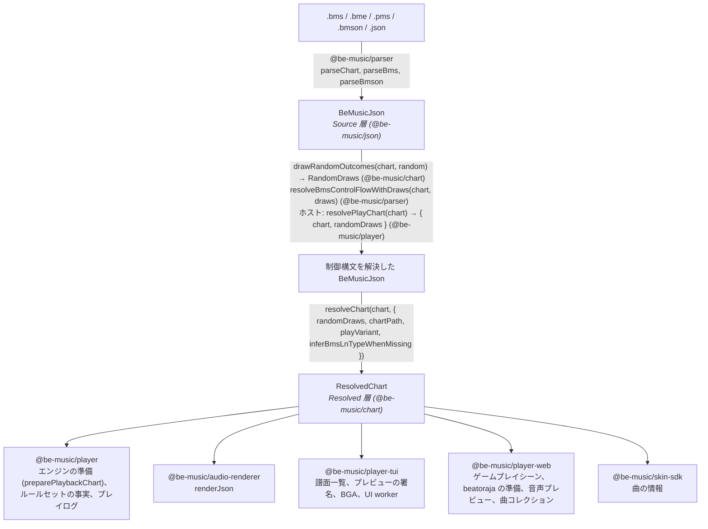
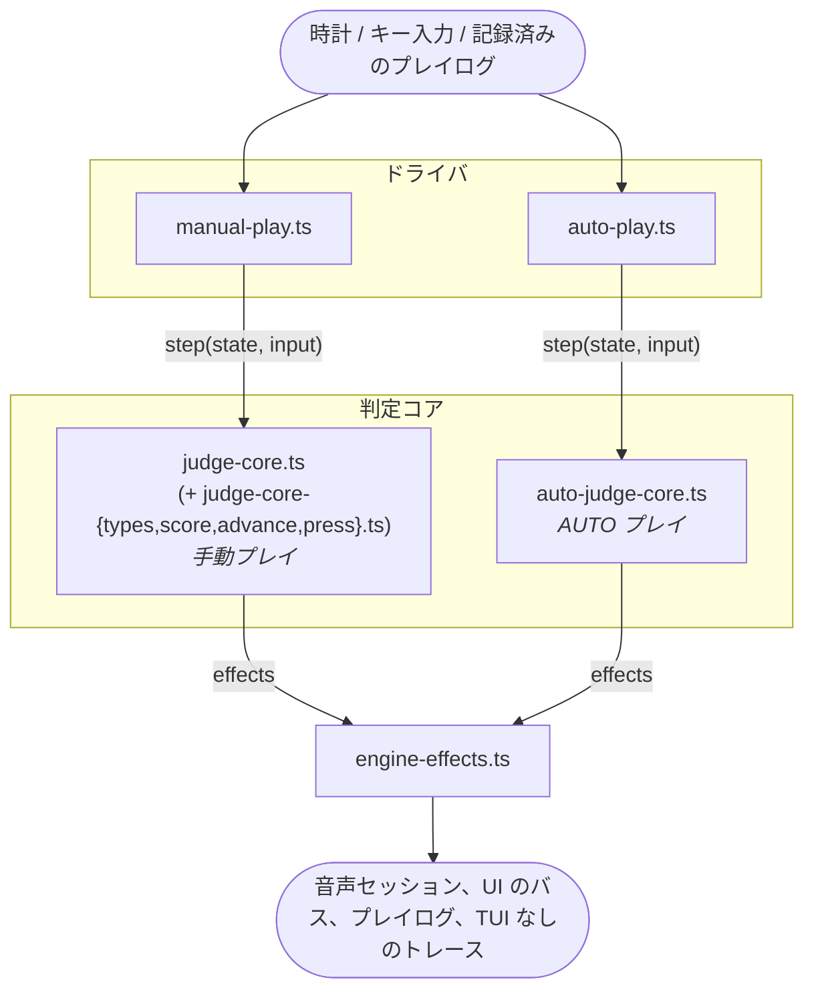
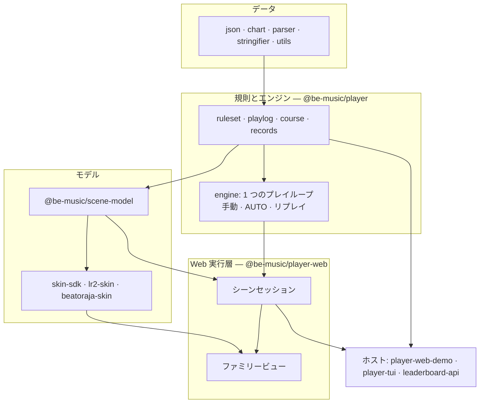

[English version](./architecture.md)

# アーキテクチャ

この文書では、譜面がどのように演奏できる形になるか（Source 層と Resolved 層）、エンジンがどのように判定するか（決定的な判定コアと、それを動かすドライバ）、そしてそれらを実行環境に依存させず小さく保つための規則を説明します。

be-music は譜面を 2 つの層で読みます。**Source 層**はファイルに何が書いてあるかを表し、**Resolved 層**はプレイヤーが何を演奏するかを表します。前者を後者に変える関数は `resolveChart` の 1 つだけで、フォーマットの既定値と de facto の読み方は、すべてこの関数か、この関数が呼ぶヘルパーで適用します。利用側は Resolved 層を読み、フォーマットを解釈し直しません。

## Source 層

`BeMusicJson`（[JSON 仕様](./json-spec.ja.md)）は BMS / bmson ファイルを忠実に表します。生のチャンネルとオブジェクト値、ヘッダの表、小節長、`#RANDOM` / `#SWITCH` のブロック（`bms.controlFlow`）、bmson の拡張、往復変換に必要な保持データを持ちます。これを書くのは `@be-music/parser` と `@be-music/stringifier` だけで、ファイル上の書き方を知る必要があるのもこの 2 つだけです。

パースしたばかりの譜面には制御構文が残っています。その `events` が持つのは無条件のオブジェクトだけです。

## 制御構文と `RandomDraws`

1 回のプレイでの `#RANDOM` / `#SETRANDOM` / `#SWITCH` / `#SETSWITCH` の結果は、`RandomDraws` という値で表します。ファイル順に、行ごとに 1 項目を持ちます。ホストは `drawRandomOutcomes`（`@be-music/chart`）で 1 回だけ引き、`resolveBmsControlFlowWithDraws`（`@be-music/parser`）で譜面を解決します。`resolvePlayChart`（`@be-music/player`）を使えば両方を一度に行えます。そのうえで、同じ譜面と draws を、シーン、エンジン、リザルト画面、プレイログなど、そのプレイのすべての利用者に渡します。分岐の意味を評価するのは `@be-music/chart` の `evaluateControlFlow` だけです。有効になったヘッダ行の適用は parser に残しています。parser のディレクティブ表を使い回すためです。[プレイヤー仕様 — 制御構文の扱い](./player-spec.ja.md#制御構文の扱い) も参照してください。

## Resolved 層

`@be-music/chart` の `resolveChart(chart, options)`（[`resolved-chart.ts`](../packages/chart/src/resolved-chart.ts)）は `ResolvedChart` を返します。この関数は純粋で、同じ譜面とオプションからは常に同じ値が得られます。重い部分は最初に読んだときに計算して保持するので、利用側は読んだ部分の分だけ計算します。

| フィールド                                          | 内容                                                                                                                                                                                                                                                        |
| --------------------------------------------------- | ----------------------------------------------------------------------------------------------------------------------------------------------------------------------------------------------------------------------------------------------------------- |
| `source`、`sourceFormat`、`idBase`                  | 制御構文を解決した元の譜面（メタデータ、リソース、生のセクション）と、そのオブジェクト ID の進数                                                                                                                                                            |
| `randomDraws`、`hasUnresolvedControlFlow`           | 譜面の解決に使った draws と、制御構文がまだ残っているかどうか。残っていれば無条件の内容だけを解決する。これは draw の前に曲一覧が見せる内容にあたる                                                                                                         |
| `playVariant`、`layouts`                            | レーンモード（ホストが渡した `playVariant`、なければ使われているレーンと `chartPath` に対する `resolveChartPlayVariant`）と、そのプレイモード表のレイアウト                                                                                                 |
| `notes`                                             | 判定するノート。`kind: 'tap' \| 'ln'` で、`channel`（演奏できる `1x` / `2x` のレーン）、`beat`、`seconds`、ロングノートなら `endBeat` / `endSeconds` / `lnMode`、FREE ZONE の終端なら `freeZone`、`sampleKey`、元の `event` を持つ。レーンと位置ごとに 1 つ |
| `shadowedNotes`                                     | レーンと位置を判定ノートに譲った重複ノートのうち、キー音が異なるもの                                                                                                                                                                                        |
| `mines`、`invisibleNotes`                           | `damage`（ゲージの %）付きの `kind: 'mine'` と、`kind: 'invisible'`。どちらも置かれた演奏レーン上にある                                                                                                                                                     |
| `sampleTriggers`                                    | 譜面が自分で、またはレーンから鳴らす音のすべて。`#LNOBJ` の終端と鳴らさない `#LNTYPE` の片側は除き、bmson のスライス（`c`）は解決済み                                                                                                                       |
| `volumeChanges`                                     | BMS の `#xxx97` / `#xxx98` による動的な音量変化。対象のバスと線形ゲイン付き                                                                                                                                                                                 |
| `timing`、`beatResolver`、`sortedEvents`            | テンポマップ（BPM の点、STOP と `#STP` の点、beat → 秒）、小節長を考慮した beat の解決、譜面順のイベント                                                                                                                                                    |
| `reversal`                                          | 最初の負の `#BPMxx` が LR2 の逆スクロール・ギミックを起動する位置（`timing.reversal`、beat と秒）。譜面にない場合は未定義（[BMS 仕様](./bms-spec.ja.md)「負の BPM」）                                                                                       |
| `scroll`、`speed`、`barLines`、`barLinesSuppressed` | SCROLL / SPEED のキーフレームと小節線の beat（bmson の `lines: []` で抑止されていれば空）                                                                                                                                                                   |
| `bga`                                               | BGA の切り替え（ベース、レイヤー、レイヤー 2、POOR）。BMS のチャンネルからも bmson の `bga` からも作る                                                                                                                                                      |
| `judgeRank`、`total`、`lnMode`                      | ルールセットへの入力。`#RANK`、`#DEFEXRANK` / bmson の `judge_rank`、`#EXRANKxx` の変化。`#TOTAL`（`absolute`）または bmson の `total`（`percent`）。譜面全体の LN モード                                                                                   |
| `lastNoteSeconds`                                   | 最後の判定ノート、地雷、不可視オブジェクトが終わる時刻                                                                                                                                                                                                      |

解決済みのノートは元の `event` への参照を持ちます。エンジンはこれでキー音を引き、ログはこれでオブジェクトを示します。プレイ中の状態は Resolved 層に含めません。エンジンはノートを書き換えられる演奏ノートにコピーし（`@be-music/player` の `preparePlaybackChart`。`judged` を加え、レーンオプションが `channel` を書き換えられる）、そこでキーをレーンに割り当てます。

### 層の外に置くもの

- **ルールセットの選択**は `@be-music/player` のルールセット（`lr2`、`beatoraja`、`iidx`）が持ちます。判定ランクの入力から判定幅を作ること、既定の TOTAL と bmson の割合をそれにどう適用するか、ゲージの曲線、LN モードの指定をどう演奏するか（LN / CN / HCN）がこれにあたります。Resolved 層は譜面の生の入力を渡します。
- **判定ランクの既定値**：`judgeRank` は譜面が書いた値だけを持ちます。bmson の `judge_rank` の既定値（100）と BMS の `#RANK` の既定値（NORMAL）は各ルールセットが補い、選曲などの画面では同じ値を読む `resolveDisplayedJudgeRankValue` / `Label`（`@be-music/player/utils`）が補います。プレイログは譜面自身の値（`sourceRank` / `sourceExRank`）を記録し、それを持たないログも同じ判定幅で再生できなければならないので、ルールセットはいずれにせよ既定値を必要とします。ここで補うと、`judge_rank` のない bmson 譜面すべてで記録される値も変わります。
- **レーンの割り当てと入力**：キーの割り当て、FREE ZONE のエイリアス、スコア対象のノート、レーンオプション（RANDOM、MIRROR、FLIP）は `@be-music/player` のプレイ設定です。
- **描画と音声出力**：Resolved 層が並べたものを、ホストがどう描き、どうミックスするか。

## プレイモード表

すべてのプレイモード（5 / 7 / 9 PMS / 9 BME / 10 / 14 / 24 / 48 KEY）は `PLAY_MODE_LAYOUTS`（[`play-modes.ts`](../packages/chart/src/play-modes.ts)）で 1 回だけ宣言します。各レーンの種類、サイド、表示位置、BMS のチャンネル（可視、不可視、`#LNTYPE`、地雷）と、FREE ZONE のチャンネルを持ちます。bmson の `mode_hint` の表、stringifier の `x` の対応、プレイバリアントのレーン集合、エンジンのレーン配置、TUI のレーン色、スキンのレーン種別は、すべてここから作ります。`ResolvedChart.layouts` が譜面のバリアントに対応する項目です。[プレイヤー仕様 — プレイモード表](./player-spec.ja.md#プレイモード表) も参照してください。

## 規則の置き場所

| 規則                                                                                                                             | モジュール（`@be-music/chart`）                                                                              |
| -------------------------------------------------------------------------------------------------------------------------------- | ------------------------------------------------------------------------------------------------------------ |
| 分岐の意味（`#RANDOM`、`#SWITCH`、入れ子、閉じていない `#IF`）                                                                   | [`control-flow.ts`](../packages/chart/src/control-flow.ts)                                                   |
| レーンモード（`resolveChartPlayVariant`）、モードごとのレーン、bmson の `mode_hint` のレーン                                     | [`index.ts`](../packages/chart/src/index.ts)、[`play-modes.ts`](../packages/chart/src/play-modes.ts)         |
| 小節長からの beat、イベントの順序                                                                                                | [`index.ts`](../packages/chart/src/index.ts)（`createBeatResolver`、`sortEvents`）                           |
| BPM（`03` / `08`。0 は無視し、負の `#BPMxx` は絶対値で進む）、LR2 の負の BPM による反転、STOP と `#STP`、ノートと同じ位置の STOP | [`timing.ts`](../packages/chart/src/timing.ts)                                                               |
| `#LNOBJ`、`#LNTYPE 1` / `2`（と推定）、bmson の `l` / `t` / `ln_type`、FREE ZONE の終端、レーンと位置ごとに判定ノート 1 つ       | [`index.ts`](../packages/chart/src/index.ts)、[`resolved-notes.ts`](../packages/chart/src/resolved-notes.ts) |
| 地雷のダメージ（36 進の値、bmson の `damage`、既定 4 %）、譜面の LN モード                                                       | [`note-rules.ts`](../packages/chart/src/note-rules.ts)                                                       |
| サンプルトリガ、bmson のスライスと `c`                                                                                           | [`sample-triggers.ts`](../packages/chart/src/sample-triggers.ts)                                             |
| SCROLL / SPEED のキーフレーム、小節線、BPM / 小節 / STOP のタイムライン                                                          | [`timelines.ts`](../packages/chart/src/timelines.ts)                                                         |
| BGA の切り替え                                                                                                                   | [`bga.ts`](../packages/chart/src/bga.ts)                                                                     |

[Be-Music Fingerprint](./fingerprint-spec.ja.md) は同じモジュールを通して項目を読むので、Resolved 層が遊ぶ内容そのもので譜面を識別します。Resolved 層が拍と秒で持つところを小節内の正確な位置で持つことと、`control-flow.ts` のフレーム操作をすべての結果についてまとめて動かすことだけが違います。

それぞれの読み方の理由と、be-music が意図して仕様から外れている箇所は、[BMS / bmson 互換性ノート](./format-compat.ja.md)（§5 に判断の一覧）と、[BMS](./bms-spec.ja.md)・[bmson](./bmson-spec.ja.md) の仕様書に記録しています。

## 層の検証

`tests/regression/resolved-chart.test.ts` は、`examples/test` のすべての譜面を、回帰コーパスが固定している `#RANDOM` の draw ごとに解決します。その結果を、利用側のヘルパー（`extractTimedNotes`、`collectSampleTriggers`、`createTimingResolver`）と、`tests/regression/__expected__` に固定されたエンジンのノート列、トリガ、テンポマップ、譜面の事実と照合します（[回帰コーパス](../tests/regression/README.ja.md) を参照）。

## エンジン: 判定コアとドライバ

`@be-music/player` のエンジン（[`core/`](../packages/player/src/core)）は、決定的な判定コアと、その周りのドライバでできています。

- **判定コア**は、判定を決めるものすべてを明示的な状態オブジェクトに持ちます。ノートの選択、ルールセットの判定幅、ロングノートの保持と終端、HCN のゲージ増減、地雷、オートスクラッチ、見逃し、コンボ、スコア、ゲージです。`runJudgeCoreStep(state, input, emit)`（または effect を配列で返す `stepJudgeCore(state, input)`）は、譜面上の秒で時刻を付けた入力（`advance`、`press`、`hold`、`release`、`finish`）を 1 つ適用し、起きたことを effect として報告します。音の再生と停止、ゲージ・コンボ・ロングノートの変化、UI への合図、プレイログへの記録、トレースの行です。コアは時計を読まず、タイマーを設定せず、入出力もしません。そのため、同じ状態と同じ入力からは常に同じ effect が出ます。`auto-judge-core.ts` は AUTO プレイについて同じことをします。LR2 の負の BPM による反転は、譜面のデータ（`ResolvedChart.reversal` から得た `reversalSeconds`）としてコアに渡ります。反転より後では見逃しと地雷の処理を止め、押下と離鍵は入力自身の譜面時刻から求めた鏡映クロック `2R − now` で判定します。
- **ドライバ**（`manualPlay`、`autoPlay`）は、時計、入力ランタイム、音声のスケジューリング、ポーズと HIGH-SPEED を受け持ち、コアの effect を `engine-effects.ts` を通してホストに伝えます。ライブのプレイでは、再生の時計からフレームごとと、キー入力のたびにコアを進めます。リプレイ（`PlayerOptions.replayInputs`）では、`advanceJudgeCoreReplay` がコアをある瞬間から次の瞬間へ進めます。進める先は、記録された各入力のマイクロ秒と、各時刻つき判定（LN の終点、見逃しの期限、AUTO SCRATCH のノート、地雷の判定。`nextTimedJudgmentUs` が求める）の 1 マイクロ秒後です。そのため、リプレイの判定はティックのタイミングや `speed` に左右されません。
- **時刻つき判定**は、その整数マイクロ秒（playlog の時計）を時間が過ぎたときに確定します。同じ瞬間では、ロングノートの終点と保留していた離鍵、Hell Charge のゲージの刻み、AUTO SCRATCH のノート、見逃し、地雷の順に、それぞれチャンネル順で確定します。見逃しは各ノートそれぞれの期限で判定します。`finish` は残っている判定をすべて同じように進めてからプレイ終了時の規則を適用し、ESC での中断は判定が済んだ時点で止まります（playlog には `play.abortedAtUs` として記録します）。playlog シミュレータも同じ判定を同じ順で扱うので、ゲージが上限・下限で頭打ちになる場合も、両者はゲージに同じ順で到達します。
- **共有する規則**：判定コアとプレイログのシミュレータ（`playlog/simulate.ts`）の両方が使う規則は、ルールセットに置いています。判定幅と分類（`ruleset/judge.ts`）、候補の選択（`ruleset/selection.ts`）、ゲージ（`ruleset/gauge.ts`）、ロングノートの規則（ルールセットが演奏するモード、見逃したチャージノート終端の POOR、LR2 の LN 始点の遅い BAD、マルチ BAD の絞り込み。`ruleset/long-note.ts`）です。シミュレータはマイクロ秒単位の独自のイベントキューを持つので、同じ入力列で両者が同じ判定になることは `playlog/equivalence.test.ts` が確かめます。
- **ドライバ側のサービス**はドライバの横に置いています。`engine-preparation.ts`（演奏用の譜面の解決、読み込みの進捗、ランタイムの起動）、`engine-audio.ts`（組み込みの Node 用音声セッションとミックス）、`engine-clock.ts`（再生の時計と、ドライバが時刻を読み、待機に使うスケジューラ）、`engine-trace.ts`（TUI なしの出力）、`engine-types.ts`（公開する型）です。`engine.ts` は公開用の入口で、分割の前後で export は変わっていません。

### エンジンの特性テスト

[`core/characterization/`](../packages/player/src/core/characterization) は 2 つのドライバの今の挙動を固定し、1 つのプレイループ（P1）が意図しない変更をしていないことを示せるようにします。各ケースは小さな合成譜面（通常ノート、`#LNMODE` ごとのロングノート、地雷、BPM / STOP / SCROLL / SPEED の変化、`#EXRANK` の変化、サバイバルゲージを空にする譜面、2 ステージをつないだ NONSTOP の譜面）を、台本どおりの入力でのライブ、その記録のリプレイ、AUTO の 3 通りで、判定ルールセットごとに演奏します。シナリオでは、開始時に設定したテンポと途中で変えたテンポ、表示・HIGH-SPEED・ポーズのコマンド、ESC・リスタート・Ctrl+C、ゲージ切れで終わるプレイ、`holdAfterChart`、コースのステージの引き継ぎ、UI なし、音声セッションなし、書き込み位置が先行する音声の時計、リードイン、端末からの入力を加えます。`__expected__/` のスナップショットには、各プレイについてホストから見えるものを記録します。サマリ、プレイログとすべてのルールセットでの再シミュレーション、音声セッションへの呼び出し、ゲージ付きの判定の合図、UI のコマンドとフレーム、ホストへのコールバック、テキスト出力です。`driver-drift.test.ts` は、ドライバ間、およびライブのプレイとそのリプレイの間の既知のずれを、`drift: …` という名前のテストとして固定します。

プレイは仮想の時計で動きます。`engine-clock.ts` は時刻の読み取りと待機を `EngineScheduler` を通して行い、テストは `setEngineScheduler` で自前のものに差し替えます（テスト専用で、どの入口からも export しません）。時間はプレイが待つあいだだけ進むので、テストは決定的で数秒で終わります。`virtual-clock.test.ts` は、リプレイと AUTO プレイが実時間の時計でも同じ結果になることを確かめます。実行は `pnpm exec vp test run packages/player/src/core/characterization` です。スナップショットが変わったら、エンジンの挙動が変わったということです。スナップショットの更新（`-u`）は、その挙動を変えるつもりのプルリクエストでだけ行い、理由をそこに書きます。リファクタリングでは触りません。

## エンジンのオプションの分類

`PlayerOptions` は、[`engine-types.ts`](../packages/player/src/core/engine-types.ts) にある 5 つの分類の型を合わせたものです。どのフィールドもちょうど 1 つの分類に属し、そうでなければ `engine-types.test.ts` が型検査で失敗します。`PlayerPlaySettings` は、将来の `play(chart, settings, runtime)` API でシリアライズできる `settings` になり、プレイを再現するためにプレイログが記録すべき集合になる予定です。

| 分類                                                                | フィールド                                                                                                                                                                                                                                                                                                                                                                                                                                                                                          |
| ------------------------------------------------------------------- | --------------------------------------------------------------------------------------------------------------------------------------------------------------------------------------------------------------------------------------------------------------------------------------------------------------------------------------------------------------------------------------------------------------------------------------------------------------------------------------------------- |
| `PlayerPlaySettings`：判定・スコア・譜面を決める                    | `auto`、`autoScratch`、`gauge`、`judgeRuleset`、`randomDraws`、`speed`、`inferBmsLnTypeWhenMissing`、`laneModeExtension`、`playVariant`、`endOnFailure`、`course`                                                                                                                                                                                                                                                                                                                                   |
| `PlayerPlayRuntime`：ホストのサービス、コールバック、実行中のデータ | `preparedChart`、`createUiRuntime`、`createInputRuntime`、`createAudioSession`、`signal`、`holdAfterChart`、`audioBaseDir`、`onLoadProgress`、`onLoadComplete`、`onHighSpeedChange`、`onTempoChange`、`onResolvedChart`、`onRulesetResolved`、`onLog`、`writeOutput`                                                                                                                                                                                                                                |
| `PlayerPlayTuning`：音声・遅延・描画の調整                          | `audio`、`volume`、`bgmVolume`、`playVolume`、`compressor`、`compressorThresholdDb`、`compressorRatio`、`compressorAttackMs`、`compressorReleaseMs`、`compressorMakeupDb`、`limiter`、`limiterCeilingDb`、`limiterReleaseMs`、`leadInMs`、`audioOffsetMs`、`audioHeadPaddingMs`、`audioTailSeconds`、`audioLeadMs`、`audioLeadMaxMs`、`audioLeadStepUpMs`、`audioLeadStepDownMs`、`highSpeed`、`uiFps`、`tui`、`tuiVisibleNotesLimit`、`tuiNoteHeight`、`imageResizeAlgorithm`、`videoBgaStreaming` |
| `PlayerPlayDebug`：診断用の上書き                                   | `judgeWindowMs`（判定が変わる）、`debugActiveAudio`、`showInvisibleNotes`、`missingSampleToneSeconds`                                                                                                                                                                                                                                                                                                                                                                                               |
| `PlayerPlayRecording`：プレイログの記録とリプレイ                   | `recordPlaylog`、`onPlaylogRecorded`、`replayInputs`、`replayTempoChanges`                                                                                                                                                                                                                                                                                                                                                                                                                          |

分類が微妙なフィールド：

- `auto`、`tui`、`audioTailSeconds`、`showInvisibleNotes` はエンジンが読みません。`autoPlay` と `manualPlay` のどちらを使うかはホストが選び、プレイログの `play.mode` はドライバから決まります。
- `preparedChart` はレーンオプションを適用した後の譜面を運びます。これは設定ではなく譜面なので、将来の API では `chart` 引数に入ります。それまではランタイムの分類に置きます。
- `audioBaseDir` はただの文字列ですが、ホストのファイルの場所を指すのでランタイムとして扱います。
- `audioOffsetMs` はライブの押下に対して判定の時計をずらすので、ライブの判定を動かすことがあります。記録される入力はすでに譜面時刻なので、リプレイには必要ありません。
- `highSpeed` はスクロールだけを変えます。それでもホストはログの `play.native` に残せます。
- `recordPlaylog` は、設定である `gauge`、`randomLane`、`dpFlip`、`native` を、譜面の識別情報（`chartSha256`、`chartMd5`、`sourceChart`、`recorder`）と一緒に宣言します。

プレイログ（[`playlog/format.ts`](../packages/player/src/playlog/format.ts) の `PlaylogPlay`）が記録していないもの：

- `speed` は `play.tempo` として、プレイ中のテンポ変更（入力コマンド `{ kind: 'tempo' }`）は `play.tempoChanges` として記録されますが、再シミュレーションはこれらを使いません。入力と判定は譜面時刻だからです。離鍵イベントのない入力（kitty キーボードプロトコルのない端末）はロングノートの保持猶予を開始時のテンポの再生の時計（譜面の 1 秒あたり `1000 / speed` ms。テンポ変更の後はその割合の譜面時刻で、猶予は譜面時刻に対して線形のまま）で数えますが、リプレイには離鍵イベントがあるので猶予を使いません。そのため、そうした入力で 1.0 以外の速度で遊んだプレイは、リプレイで判定が変わることがあります。
- `inferBmsLnTypeWhenMissing` は記録されません。`chart.notes` はこれが作ったロングノートを持ちますが、元の譜面に対してリプレイするには同じフラグが必要です。
- `laneModeExtension` と `playVariant` は、結果の `chart.laneMode` と、フィンガープリントのレーンモードの入力としてしか記録されません。元の譜面に対してリプレイするには、同じレーンモードと、beatoraja ではモードごとの同じ判定幅を得るためにこれらが必要です。

対応するオプションがないプレイログのフィールド：`play.mode`（ドライバ）、`play.randomLane` と `play.dpFlip`（ホストのレーンオプション。`preparedChart` で適用し、`recordPlaylog` で宣言します）、`play.native`、`play.aborted` / `play.abortedAtUs`（結果）。

## 目指す構造

パッケージの構成を、`feat/course-definitions` を `devel` に入れる前に作り直しています（下の段階）。新しいコードはこの構造に従います。理由は[設計判断の記録](./adr/README.ja.md)にあります。

- **規則とエンジン**（`@be-music/player`）。ゲージ・クリアランプ・BP の語彙を 1 つにし、コースの実行、NONSTOP の流れ、コースのステージの規則、自己ベストの統合を持ちます（[ADR 0004](./adr/0004-domain-rules-in-player.ja.md)）。プレイループは 1 つで、手動・AUTO・リプレイの判定の戦略を差し込みます（[ADR 0003](./adr/0003-one-play-loop.ja.md)）。
- **シーンモデル**（`@be-music/scene-model`、新規）。スキンの種類によらず、各画面が何を見せ、どう振る舞うか。ライブラリの項目、一覧の状態とその保存形、プレイオプション、プレイ状態、プレイ結果、コースの表示用モデル、効果音セットです（[ADR 0002](./adr/0002-scene-model-package.ja.md)）。
- **スキンモデル**（`skin-sdk`、`lr2-skin`、`beatoraja-skin`）。スキンを解析し、シーンモデルをそのスキンの語彙に写します。LR2 互換の op・数値・テキスト・タイマーの番号表は 1 つにし、Web 層にあった beatoraja の状態の計算もここに移します。
- **Web 実行層**（`@be-music/player-web`）。シーンセッションが各画面の振る舞い（譜面の準備、RANDOM / FLIP、音と BGA、エンジンの設定、入力、終わり方）を 1 つだけ持ち、ファミリービューは描いてインテントを返すだけです。画面のライフサイクル、音のサービス、ホスト向けの API はそれぞれ 1 つです（[ADR 0001](./adr/0001-skin-families-only-draw.ja.md)）。
- **ホスト**。Web のデモは `main.ts` がつなぐサービスの集まりで、画面の切り替えはすべて 1 つのシーンルーターが受け持ちます（[ADR 0006](./adr/0006-scene-router.ja.md)）。

変更しやすさを保つための規則：

- 1 つの概念は 1 か所で定義する。語彙の型、規則、状態のいずれも。
- スキンの種類ごとの違いは、画面の描き方と、モデルをスキンの語彙に写す方法だけにする。
- 部品を組み合わせる。基底クラスのフックで違いを吸収しない。
- 規則・エンジン・モデルは実行環境に依存せず、Pixi・DOM・Node なしでテストできる。
- パッケージは、ファイル構成ではなく設計した入口を公開する（[ADR 0005](./adr/0005-public-entry-points.ja.md)）。
- 1,500 行を超えるソースファイルを置かない。下の許可リストは最後に空にする。

### 移行

| 段階 | 作業                                                                                                                                                                                   | 状態                                             |
| ---- | -------------------------------------------------------------------------------------------------------------------------------------------------------------------------------------- | ------------------------------------------------ |
| P0   | 安全網：エンジンの挙動のスナップショット（譜面 × 手動 / AUTO / リプレイ × テンポ・ESC・ゲージ切れ・保持・NONSTOP）、コースのブラウザ確認をテスト用の譜面と最小のテスト用スキンで自動化 | 進行中（P0a のエンジンのスナップショットは完了） |
| P1   | 判定の戦略を差し込む 1 つのプレイループ                                                                                                                                                | 予定                                             |
| P2   | 規則を `@be-music/player` に集める：語彙、コースの実行、共有する NONSTOP の流れ（リーダーボードも）、コースのステージの規則、判定ルールセットごとの自己ベスト                          | 予定                                             |
| P3   | `@be-music/scene-model`、`lr2-skin` の LR2 の番号表と状態の写し方、beatoraja の状態の計算を `beatoraja-skin` へ                                                                        | 予定                                             |
| P4   | Web 実行層：画面のライフサイクルの統一、シーンセッション、ファミリービュー（標準 → LR2 → beatoraja の順）、音のサービス、ホスト向けの API。古い画面のクラスは削除                      | 予定                                             |
| P5   | Web のデモをシーンルーターの下のサービスに分け、新しいホスト向けの API に載せる                                                                                                        | 予定                                             |
| P6   | 公開する入口、ドキュメント、ファイルサイズの許可リストを空に、changeset、実在のスキンでの総点検。そのあと `devel` へ                                                                   | 予定                                             |

プルリクエストは、断りのない限り挙動を変えません。挙動を変えるもの（ずれの修正、プレイログやフィンガープリントの変更）は専用のプルリクエストにし、仕様書・golden の値・changeset を一緒に更新します。どのプルリクエストも `pnpm run check`、全テスト、エンジンのスナップショットを通し、各段階の終わりにはブラウザ確認を、自動と実在のスキンの両方で行います。

## 層の規則とサイズの上限

`pnpm run check` は、フォーマット・lint・型のほかに、構造に関する次の規則を検査します。

- **実行環境に依存しないコード**：`@be-music/chart`、`@be-music/json`、`@be-music/parser` と、`@be-music/player` の `core/`、`playlog/`、`ruleset/` は、ブラウザでも Node でもそのまま動きます。そこでは Oxlint の `no-restricted-imports` と `no-restricted-globals`（[`vite.config.ts`](../vite.config.ts) で設定）が、Node の組み込みモジュールの import（`node:*` と接頭辞なしの名前）と、DOM や Node だけのグローバル（`window`、`document`、`process`、`Buffer` など）を拒否します。実行環境のサービスはアダプタを通して渡します。`PlayerOptions.createAudioSession` / `createUiRuntime` / `createInputRuntime`、Node の音声出力を読み込むオプショナルモジュールのローダー、parser の [`node-file.ts`](../packages/parser/src/node-file.ts)（`parseChartFile`）です。`node-file.ts` と parser の CLI、テストはこの規則の対象外です。
- **決定的な判定**：`core/judge-*.ts`、`core/auto-judge-core.ts`、`ruleset/`、`playlog/simulate.ts` では、さらに `Date` と `performance` の読み取り、タイマーの設定、`Math.random` の呼び出しを禁止します。時刻と乱数は入力として受け取ります。
- **ファイルサイズの上限**：[`scripts/lint/file-size-budget.ts`](../scripts/lint/file-size-budget.ts) は、パッケージのソースファイル（テスト、型宣言、フィクスチャを除く）が 1,500 行を超えると失敗します。上限を入れた時点で既に大きかったファイルは許可リストにあり、警告だけを出します。許可リストのファイルが上限を下回ったら、リストから外す必要があります。単独では `pnpm run check:file-size` で実行できます。
