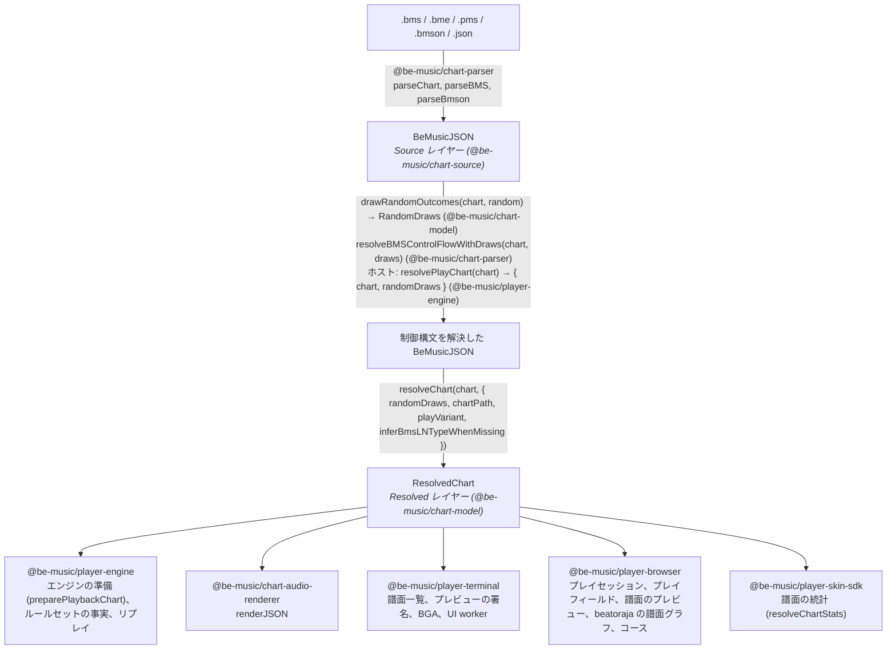
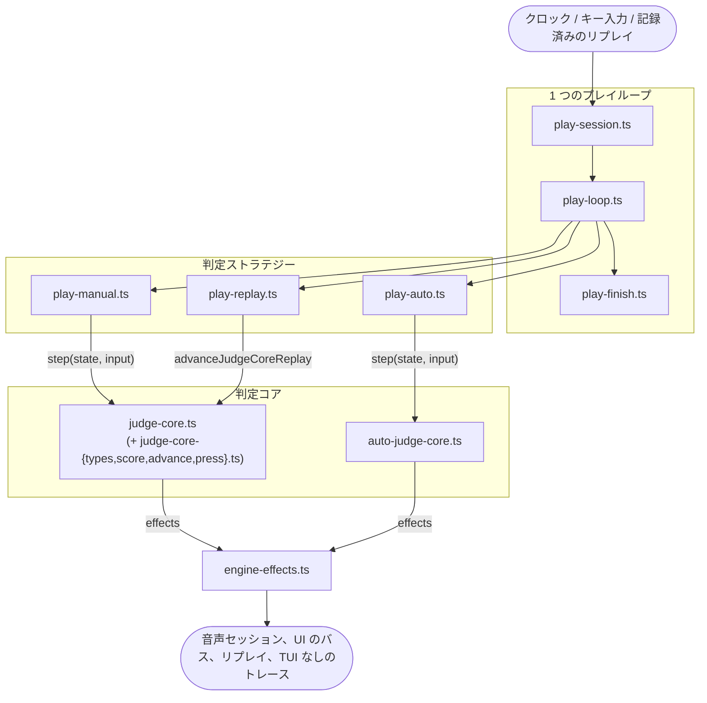
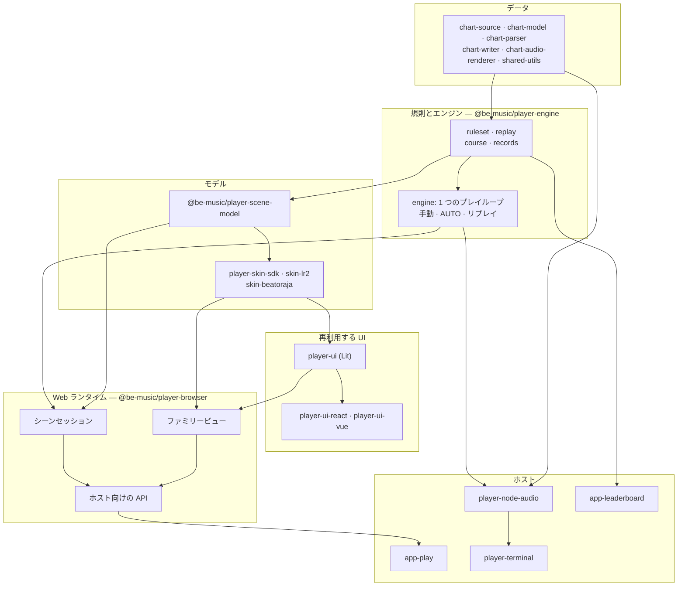

[English version](./architecture.md)

# アーキテクチャ

この文書では、譜面がどのように演奏できる形になるか（Source レイヤーと Resolved レイヤー）、エンジンがどのように判定するか（決定的な判定コアと、それを動かす 1 つのプレイループ）、そしてそれらを実行環境に依存させず小さく保つための規則を説明します。

be-music は譜面を 2 つのレイヤーで読みます。**Source レイヤー**はファイルに何が書いてあるかを表し、**Resolved レイヤー**はプレイヤーが何を演奏するかを表します。前者を後者に変える関数は `resolveChart` の 1 つだけで、フォーマットの既定値と de facto の読み方は、すべてこの関数か、この関数が呼ぶヘルパーで適用します。利用側は Resolved レイヤーを読み、フォーマットを解釈し直しません。

## Source レイヤー

`BeMusicJSON`（[JSON 仕様](./json-spec.ja.md)）は BMS / bmson ファイルを忠実に表します。生のチャンネルとオブジェクト値、ヘッダの表、小節長、`#RANDOM` / `#SWITCH` のブロック（`bms.controlFlow`）、bmson の拡張、往復変換に必要な保持データを持ちます。これを書くのは `@be-music/chart-parser` と `@be-music/chart-writer` だけで、ファイル上の書き方を知る必要があるのもこの 2 つだけです。

パースしたばかりの譜面には制御構文が残っています。その `events` が持つのは無条件のオブジェクトだけです。

## 制御構文と `RandomDraws`

1 回のプレイでの `#RANDOM` / `#SETRANDOM` / `#SWITCH` / `#SETSWITCH` の結果は、`RandomDraws` という値で表します。ファイル順に、行ごとに 1 項目を持ちます。ホストは `drawRandomOutcomes`（`@be-music/chart-model`）で 1 回だけ引き、`resolveBMSControlFlowWithDraws`（`@be-music/chart-parser`）で譜面を解決します。`resolvePlayChart`（`@be-music/player-engine`）を使えば両方を一度に行えます。そのうえで、同じ譜面と draws を、シーン、エンジン、リザルト画面、リプレイなど、そのプレイのすべての利用者に渡します。分岐の意味を評価するのは `@be-music/chart-model` の `evaluateControlFlow` だけです。有効になったヘッダ行の適用は parser に残しています。parser のディレクティブ表を使い回すためです。[プレイヤー仕様 — 制御構文の扱い](./player-spec.ja.md#制御構文の扱い) も参照してください。

## Resolved レイヤー

`@be-music/chart-model` の `resolveChart(chart, options)`（[`resolved-chart.ts`](../packages/chart-model/src/resolved-chart.ts)）は `ResolvedChart` を返します。この関数は純粋で、同じ譜面とオプションからは常に同じ値が得られます。重い部分は最初に読んだときに計算して保持するので、利用側は読んだ部分の分だけ計算します。

| フィールド                                          | 内容                                                                                                                                                                                                                                                        |
| --------------------------------------------------- | ----------------------------------------------------------------------------------------------------------------------------------------------------------------------------------------------------------------------------------------------------------- |
| `source`、`sourceFormat`、`idBase`                  | 制御構文を解決した元の譜面（メタデータ、リソース、生のセクション）と、そのオブジェクト ID の進数                                                                                                                                                            |
| `randomDraws`、`hasUnresolvedControlFlow`           | 譜面の解決に使った draws と、制御構文がまだ残っているかどうか。残っていれば無条件の内容だけを解決する。これは draw の前に曲一覧が見せる内容にあたる                                                                                                         |
| `playVariant`、`layouts`                            | レーンモード（ホストが渡した `playVariant`、なければ使われているレーンと `chartPath` に対する `resolveChartPlayVariant`）と、そのプレイモード表のレイアウト                                                                                                 |
| `notes`                                             | 判定するノート。`kind: 'tap' \| 'ln'` で、`channel`（演奏できる `1x` / `2x` のレーン）、`beat`、`seconds`、ロングノートなら `endBeat` / `endSeconds` / `lnMode`、FREE ZONE の終端なら `freeZone`、`sampleKey`、元の `event` を持つ。レーンと位置ごとに 1 つ |
| `shadowedNotes`                                     | レーンと位置を判定ノートに譲った重複ノートのうち、キー音が異なるもの                                                                                                                                                                                        |
| `mines`、`invisibleNotes`                           | `damage`（ゲージの %）付きの `kind: 'mine'` と、`kind: 'invisible'`。どちらも置かれた演奏レーン上にある                                                                                                                                                     |
| `sampleTriggers`                                    | 譜面が自分で、またはレーンから鳴らす音のすべて。`#LNOBJ` の終端と鳴らさない `#LNTYPE` の片側は除き、bmson のスライス（`c`）は解決済み                                                                                                                       |
| `volumeChanges`                                     | BMS の `#xxx97` / `#xxx98` による動的な音量変化。対象のバスと線形ゲイン付き                                                                                                                                                                                 |
| `timing`、`beatResolver`、`sortedEvents`            | テンポマップ（BPM の点、STOP と `#STP` の点、beat → 秒）、小節長を考慮した beat の解決、譜面順のイベント                                                                                                                                                    |
| `reversal`                                          | 最初の負の `#BPMxx` が LR2 の逆スクロール・ギミックを起動する位置（`timing.reversal`、beat と秒）。譜面にない場合は未定義（[BMS 仕様](./bms-spec.ja.md)「負の BPM」）                                                                                       |
| `scroll`、`speed`、`barLines`、`barLinesSuppressed` | SCROLL / SPEED のキーフレームと小節線の beat（bmson の `lines: []` で抑止されていれば空）                                                                                                                                                                   |
| `bga`                                               | BGA の切り替え（ベース、レイヤー、レイヤー 2、POOR）。BMS のチャンネルからも bmson の `bga` からも作る                                                                                                                                                      |
| `judgeRank`、`total`、`lnMode`                      | ルールセットへの入力。`#RANK`、`#DEFEXRANK` / bmson の `judge_rank`、`#EXRANKxx` の変化。`#TOTAL`（`absolute`）または bmson の `total`（`percent`）。譜面全体の LN モード                                                                                   |
| `lastNoteSeconds`                                   | 最後の判定ノート、地雷、不可視オブジェクトが終わる時刻                                                                                                                                                                                                      |

解決済みのノートは元の `event` への参照を持ちます。エンジンはこれでキー音を引き、ログはこれでオブジェクトを示します。プレイ中の状態は Resolved レイヤーに含めません。エンジンはノートを書き換えられる演奏ノートにコピーし（`@be-music/player-engine` の `preparePlaybackChart`。`judged` を加え、レーンオプションが `channel` を書き換えられる）、そこでキーをレーンに割り当てます。

### レイヤーの外に置くもの

- **ルールセットの選択**は `@be-music/player-engine` のルールセット（`lr2`、`beatoraja`、`____`）が持ちます。判定ランクの入力から判定幅を作ること、既定の TOTAL と bmson の割合をそれにどう適用するか、ゲージの曲線、LN モードの指定をどう演奏するか（LN / CN / HCN）がこれにあたります。Resolved レイヤーは譜面の生の入力を渡します。
- **判定ランクの既定値**：`judgeRank` は譜面が書いた値だけを持ちます。bmson の `judge_rank` の既定値（100）と BMS の `#RANK` の既定値（NORMAL）は各ルールセットが補い、選曲などの画面では同じ値を読む `resolveDisplayedJudgeRankValue` / `Label`（`@be-music/player-engine/display`）が補います。リプレイは譜面自身の値（`sourceRank` / `sourceExRank`）を記録し、それを持たないログも同じ判定幅で再生できなければならないので、ルールセットはいずれにせよ既定値を必要とします。ここで補うと、`judge_rank` のない bmson 譜面すべてで記録される値も変わります。
- **レーンの割り当てと入力**：キーの割り当て、FREE ZONE のエイリアス、スコア対象のノート、レーンオプション（RANDOM、MIRROR、FLIP）は `@be-music/player-engine` のプレイ設定です。
- **描画と音声出力**：Resolved レイヤーが並べたものを、ホストがどう描き、どうミックスするか。

## プレイモード表

すべてのプレイモード（5 / 7 / 9 PMS / 9 BME / 10 / 14 / 24 / 48 KEY）は `PLAY_MODE_LAYOUTS`（[`play-modes.ts`](../packages/chart-model/src/play-modes.ts)）で 1 回だけ宣言します。各レーンの種類、サイド、表示位置、BMS のチャンネル（可視、不可視、`#LNTYPE`、地雷）と、FREE ZONE のチャンネルを持ちます。bmson の `mode_hint` の表、chart-writer の `x` の対応、プレイバリアントのレーン集合、エンジンのレーン配置、TUI のレーン色、スキンのレーン種別は、すべてここから作ります。`ResolvedChart.layouts` が譜面のバリアントに対応する項目です。[プレイヤー仕様 — プレイモード表](./player-spec.ja.md#プレイモード表) も参照してください。

## 規則の置き場所

| 規則                                                                                                                             | モジュール（`@be-music/chart-model`）                                                                                              |
| -------------------------------------------------------------------------------------------------------------------------------- | ---------------------------------------------------------------------------------------------------------------------------------- |
| 分岐の意味（`#RANDOM`、`#SWITCH`、入れ子、閉じていない `#IF`）                                                                   | [`control-flow.ts`](../packages/chart-model/src/control-flow.ts)                                                                   |
| レーンモード（`resolveChartPlayVariant`）、モードごとのレーン、bmson の `mode_hint` のレーン                                     | [`play-variant.ts`](../packages/chart-model/src/play-variant.ts)、[`play-modes.ts`](../packages/chart-model/src/play-modes.ts)     |
| 小節長からの beat、イベントの順序                                                                                                | [`beats.ts`](../packages/chart-model/src/beats.ts)（`createBeatResolver`、`sortEvents`）                                           |
| BPM（`03` / `08`。0 は無視し、負の `#BPMxx` は絶対値で進む）、LR2 の負の BPM による反転、STOP と `#STP`、ノートと同じ位置の STOP | [`timing.ts`](../packages/chart-model/src/timing.ts)                                                                               |
| `#LNOBJ`、`#LNTYPE 1` / `2`（と推定）、bmson の `l` / `t` / `ln_type`、FREE ZONE の終端、レーンと位置ごとに判定ノート 1 つ       | [`long-notes.ts`](../packages/chart-model/src/long-notes.ts)、[`resolved-notes.ts`](../packages/chart-model/src/resolved-notes.ts) |
| 地雷のダメージ（36 進の値、bmson の `damage`、既定 4 %）、譜面の LN モード                                                       | [`note-rules.ts`](../packages/chart-model/src/note-rules.ts)                                                                       |
| サンプルトリガ、bmson のスライスと `c`                                                                                           | [`sample-triggers.ts`](../packages/chart-model/src/sample-triggers.ts)                                                             |
| SCROLL / SPEED のキーフレーム、小節線、BPM / 小節 / STOP のタイムライン                                                          | [`timelines.ts`](../packages/chart-model/src/timelines.ts)                                                                         |
| BGA の切り替え                                                                                                                   | [`bga.ts`](../packages/chart-model/src/bga.ts)                                                                                     |

[Be-Music Fingerprint](./fingerprint-spec.ja.md) は同じモジュールを通して項目を読むので、Resolved レイヤーが遊ぶ内容そのもので譜面を識別します。Resolved レイヤーが拍と秒で持つところを小節内の正確な位置で持つことと、`control-flow.ts` のフレーム操作をすべての結果についてまとめて動かすことだけが違います。

形式の解釈は [BMS / bmson 互換仕様](./format-compat.ja.md)、[BMS](./bms-spec.ja.md)、[bmson](./bmson-spec.ja.md) に定義します。判定とゲージは[プレイヤー仕様](./player-spec.ja.md)、オプションは[プレイオプション](./play-options.ja.md)、スキン固有の状態は [LR2](./lr2-skin.ja.md) と [beatoraja](./beatoraja-skin.ja.md) の仕様を参照してください。

## レイヤーの検証

`test/regression/resolved-chart.test.ts` は、`test/fixtures` のすべての譜面を、回帰コーパスが固定している `#RANDOM` の draw ごとに解決します。その結果を、利用側のヘルパー（`extractTimedNotes`、`collectSampleTriggers`、`createTimingResolver`）と、`test/regression/__expected__` に固定されたエンジンのノート列、トリガ、テンポマップ、譜面の事実と照合します（[回帰コーパス](../test/regression/README.ja.md) を参照）。

## エンジン: 判定コアと 1 つのプレイループ

`@be-music/player-engine` のエンジン（[`core/`](../packages/player-engine/src/core)）は、決定的な判定コアと、それを動かす 1 つのプレイループでできています。手動プレイ、リプレイ、AUTO プレイの違いは、ループに差し込む判定ストラテジーだけです（[ADR 0003](./adr/0003-one-play-loop.ja.md)）。

- **判定コア**は、判定を決めるものすべてを明示的な状態オブジェクトに持ちます。ノートの選択、ルールセットの判定幅、ロングノートの保持と終端、HCN のゲージ増減、地雷、オートスクラッチ、見逃し、コンボ、スコア、ゲージです。`runJudgeCoreStep(state, input, emit)`（または effect を配列で返す `stepJudgeCore(state, input)`）は、譜面上の秒で時刻を付けた入力（`advance`、`press`、`hold`、`release`、`finish`）を 1 つ適用し、起きたことを effect として報告します。音の再生と停止、ゲージ・コンボ・ロングノートの変化、UI への合図、リプレイへの記録、トレースの行です。コアはキー状態の入力だけを受けます。レーンは `hold` から `release` までのあいだ押されていて、ロングノートはレーンが押されているあいだ（または、離したものがルールセットの解放の猶予を待つあいだ）だけ保持されます。コアはクロックを読まず、タイマーを設定せず、入出力もしません。そのため、同じ状態と同じ入力からは常に同じ effect が出ます。`auto-judge-core.ts` は AUTO プレイについて同じことをします。LR2 の負の BPM による反転は、譜面のデータ（`ResolvedChart.reversal` から得た `reversalSeconds`）としてコアに渡ります。反転より後では見逃しと地雷の処理を止め、押下と離鍵は入力自身の譜面時刻から求めた鏡映クロック `2R − now` で判定します。
- **プレイループ**はすべてのプレイを動かします。`manualPlay` と `autoPlay`（`play.ts`）は、内部の `play(chart, options, strategy)` の薄い包みです。`play-session.ts` はプレイの準備をします。演奏用に解決した譜面、テンポのクロック、`preparePlaybackChart`、ルールセットとスコア、リプレイの記録、UI と入力のバスとランタイム、音声セッション、TUI なしのトレースです。残りは `play-loop.ts`（`runPlayLoop`）が受け持ちます。リードイン、再生クロック、60 Hz のティックとそれを入力で早める待機、終わりの目安、譜面の後の保持（`holdAfterChart`）、ランタイムの後始末です。各ティックでは、入力コマンドを処理し（`play-controls.ts`：ポーズ、HIGH-SPEED、テンポの変更とリプレイが記録から辿る変更、リプレイ用の表示の変更、シーク、中断）、最後に求められたシークを適用し（`play-seek.ts`、[ADR 0016](./adr/0016-seek-play-loop-command.ja.md)。音声セッション・音量の変化・まだ鳴っている音を目標へ動かし、譜面時刻を再生クロックに付け替え、判定は 0 から再シミュレーションし、UI には `seek` コマンドと次の世代のフレームを送ります。`startAtSeconds` は最初のシークです）、音声の書き込み位置までに来たリアルタイムの音を送り（`play-audio-cursor.ts`。音量の変化、背景の音、AUTO プレイのノートのキー音に同じカーソルを使います）、戦略に判定させ、UI のフレームを出します。規則はどの戦略でも同じです。入力ランタイムはリードインの前に始まり、リードイン中の ESC は譜面の音が始まる前にプレイを終えます。終わりの目安は、再生クロックで譜面の終わりに最も広い BAD の幅と 1 秒を足した時刻です。譜面が終わり判定が済んだ時点でプレイを終えるのは、音声セッションも保持（`holdAfterChart`。終わりの目安で落ち着きます）もないときだけです。中断されなかったプレイは、終わりの規則を適用したあと、直前のフレームと同じ時刻で最後のフレームを出します。表示する時刻が戻ることはありません。リプレイ（どちらのモードでも `replayInputs` があるとき）はテンポを記録せず、`replayTempoChanges` に従い、`replayAbortedAtUs` があればログが中断した所で止まります。シークしたプレイはリプレイを記録しません。どのフレームもシークの世代と、その譜面時刻が成り立つクロックを持ちます。`play-finish.ts`（`finishPlay`）は、どのプレイも同じ形で終えます。ESC は中断したプレイのサマリを返し、リスタートと Ctrl+C は `PlayerInterruptedError` を投げ、それ以外は完走か失敗です。リプレイと TUI なしのトレースもここで閉じます。
- **判定ストラテジー**（`play-strategy.ts`）は、プレイをどう判定するかを決めます。`play-manual.ts` は、再生クロックをティックごとに、キーの出来事をそのたびに、キーが押された瞬間の時刻を付けて判定コアに渡します。キーの解放を伝えると宣言した入力ランタイム（`PlayerInputRuntime.reportsKeyReleases`。ブラウザのものと、端末が kitty キーボードプロトコルに応えたあとの TUI のもの）は、最初のキーからキー状態の入力です。解放を伝えない入力では、`kitty-state` コマンドが来るまで `play-key-inference.ts` が各キーを離した時刻を推定し、リプレイはその解放を記録します。`play-replay.ts` は、記録された入力列（`PlayerOptions.replayInputs`）を `advanceJudgeCoreReplay` で、ある瞬間から次の瞬間へ進めます。進める先は、記録された各入力のマイクロ秒と、各時刻つき判定（LN の終点、見逃しの期限、AUTO SCRATCH のノート、地雷の判定。`nextTimedJudgmentUs` が求める）の 1 マイクロ秒後です。そのため、リプレイの判定はティックのタイミングや `speed` に左右されません。`play-auto.ts` は AUTO の判定コアを進め、各ノートのキー音を判定より先に、書き込み位置に合わせて送ります。`manualPlay` は手動かリプレイの戦略を、`autoPlay` は AUTO の戦略を選びます。
- **時刻つき判定**は、その整数マイクロ秒（replay のクロック）を時間が過ぎたときに確定します。同じ瞬間では、ロングノートの終点と保留していた離鍵、Hell Charge のゲージの刻み、AUTO SCRATCH のノート、見逃し、地雷の順に、それぞれチャンネル順で確定します。見逃しは各ノートそれぞれの期限で判定します。`finish` は残っている判定をすべて同じように進めてからプレイ終了時の規則を適用し、ESC での中断は判定が済んだ時点で止まります（replay には `play.abortedAtUs` として記録します）。replay シミュレータも同じ判定を同じ順で扱うので、ゲージが上限・下限で頭打ちになる場合も、両者はゲージに同じ順で到達します。
- **共有する規則**：判定コアとリプレイのシミュレータ（`replay/simulate.ts`）の両方が使う規則は、ルールセットに置いています。判定幅と分類（`ruleset/judge.ts`）、候補の選択（`ruleset/selection.ts`）、ゲージ（`ruleset/gauge.ts`）、ロングノートの規則（ルールセットが演奏するモード、見逃したチャージノート終端の POOR、LR2 の LN 始点の遅い BAD、マルチ BAD の絞り込み。`ruleset/long-note.ts`）です。シミュレータはマイクロ秒単位の独自のイベントキューを持つので、同じ入力列で両者が同じ判定になることは `replay/equivalence.test.ts` が確かめます。
- **ループの周りのサービス**：`engine-preparation.ts`（演奏用の譜面の解決、読み込みの進捗、ランタイムの起動）、`engine-audio.ts`（ホストの音声セッションの起動と、無音時のフォールバック）、`engine-clock.ts`（再生クロックと、ループが時刻を読み、待機に使うスケジューラ）、`engine-effects.ts`（判定の effect をホストへ）、`engine-trace.ts`（TUI なしの出力）、`engine-types.ts`（公開する型）です。`engine.ts` は公開用のエントリポイントで、パッケージのルートです。エンジンとその型だけを公開します。ホストのランタイムがプレイとやり取りするもの、レーン、ホストが表示するものは `./signals`、`./lanes`、`./display` のエントリポイントです（[Player 実装仕様 — 公開するエントリポイント](./player-spec.ja.md#公開するエントリポイント)）。

### エンジンの特性テスト

[`core/characterization/`](../packages/player-engine/src/core/characterization) はエンジンの挙動を固定し、リファクタリングが意図しない変更をしていないことを示せるようにします。1 つのプレイループ（P1）は、これが書かれた元の 2 つのドライバを置き換え、スナップショットを 1 つも変えませんでした。そのあと、ドライバ間のずれをプルリクエストのコミットごとに 1 つずつ直し、それぞれどのスナップショットを変えたかを書いています。各ケースは小さな合成譜面（通常ノート、`#LNMODE` ごとのロングノート、地雷、BPM / STOP / SCROLL / SPEED の変化、`#EXRANK` の変化、サバイバルゲージを空にする譜面、2 ステージをつないだ NONSTOP の譜面）を、台本どおりの入力でのライブ、その記録のリプレイ、AUTO の 3 通りで、判定ルールセットごとに演奏します。シナリオでは、開始時に設定したテンポと途中で変えたテンポ、表示・HIGH-SPEED・ポーズのコマンド、ESC・リスタート・Ctrl+C、ゲージ切れで終わるプレイ、`holdAfterChart`、コースのステージの引き継ぎ、UI なし、音声セッションなし、書き込み位置が先行する音声クロック、リードイン、端末からの入力、途中から始める AUTO プレイ（`startAtSeconds`）、シークのコマンド（前と後ろ、まとめ、一時停止中、リードイン中、保持からの復帰、テンポ変更の後）を加えます。`__expected__/` のスナップショットには、各プレイについてホストから見えるものを記録します。サマリ、リプレイとすべてのルールセットでの再シミュレーション、音声セッションへの呼び出し、ゲージ付きの判定の合図、UI のコマンドとフレーム、ホストへのコールバック、テキスト出力です。`driver-drift.test.ts` は、古いドライバ間でずれていたところで、手動と AUTO のプレイ、およびライブのプレイとそのリプレイが一致することを確かめます。解放のない入力のプレイも、リプレイと再シミュレーションがライブの結果と一致します。`seek-invariants.test.ts` は、シークした AUTO プレイ（そこから始めたもの、前や後ろへシークしたもの）を譜面の頭からのプレイと、シークした秒（`snapshotJudgeState`）と終わりで比べます。

プレイは仮想のクロックで動きます。`engine-clock.ts` は時刻の読み取りと待機を `EngineScheduler` を通して行い、テストは `setEngineScheduler` で自前のものに差し替えます（テスト専用で、どのエントリポイントからも export しません）。時間はプレイが待つあいだだけ進むので、テストは決定的で数秒で終わります。`virtual-clock.test.ts` は、リプレイと AUTO プレイが実時間のクロックでも同じ結果になることを確かめます。実行は `pnpm exec vp test run packages/player-engine/src/core/characterization` です。スナップショットが変わったら、エンジンの挙動が変わったということです。スナップショットの更新（`-u`）は、その挙動を変えるつもりのプルリクエストでだけ行い、理由をそこに書きます。リファクタリングでは触りません。

## エンジンのオプションの分類

`PlayerOptions` は、[`engine-types.ts`](../packages/player-engine/src/core/engine-types.ts) にある 5 つの分類の型を合わせたものです。どのフィールドもちょうど 1 つの分類に属し、そうでなければ `engine-types.test.ts` が型検査で失敗します。`PlayerPlaySettings` は、将来の `play(chart, settings, runtime)` API でシリアライズできる `settings` になり、プレイを再現するためにリプレイが記録すべき集合になる予定です。

| 分類                                                                | フィールド                                                                                                                                                                                                                                                                                                                                                                                                                                                                                          |
| ------------------------------------------------------------------- | --------------------------------------------------------------------------------------------------------------------------------------------------------------------------------------------------------------------------------------------------------------------------------------------------------------------------------------------------------------------------------------------------------------------------------------------------------------------------------------------------- |
| `PlayerPlaySettings`：判定・スコア・譜面を決める                    | `auto`、`autoScratch`、`gauge`、`judgeRuleset`、`randomDraws`、`speed`、`startAtSeconds`、`inferBmsLNTypeWhenMissing`、`laneModeExtension`、`playVariant`、`endOnFailure`、`course`                                                                                                                                                                                                                                                                                                                 |
| `PlayerPlayRuntime`：ホストのサービス、コールバック、実行中のデータ | `preparedChart`、`keyBoundBGACues`、`createUIRuntime`、`createInputRuntime`、`createAudioSession`、`signal`、`holdAfterChart`、`audioBaseDir`、`onLoadProgress`、`onLoadComplete`、`onHighSpeedChange`、`onTempoChange`、`onResolvedChart`、`onRulesetResolved`、`onLog`、`writeOutput`                                                                                                                                                                                                             |
| `PlayerPlayTuning`：音声・遅延・描画の調整                          | `audio`、`volume`、`bgmVolume`、`playVolume`、`compressor`、`compressorThresholdDb`、`compressorRatio`、`compressorAttackMs`、`compressorReleaseMs`、`compressorMakeupDb`、`limiter`、`limiterCeilingDb`、`limiterReleaseMs`、`leadInMs`、`audioOffsetMs`、`audioHeadPaddingMs`、`audioTailSeconds`、`audioLeadMs`、`audioLeadMaxMs`、`audioLeadStepUpMs`、`audioLeadStepDownMs`、`highSpeed`、`uiFPS`、`tui`、`tuiVisibleNotesLimit`、`tuiNoteHeight`、`imageResizeAlgorithm`、`videoBGAStreaming` |
| `PlayerPlayDebug`：診断用の上書き                                   | `judgeWindowMs`（判定が変わる）、`debugActiveAudio`、`showInvisibleNotes`、`missingSampleToneSeconds`                                                                                                                                                                                                                                                                                                                                                                                               |
| `PlayerPlayRecording`：リプレイの記録とリプレイ                     | `recordReplay`、`onReplayRecorded`、`replayInputs`、`replayTempoChanges`、`replayAbortedAtUs`                                                                                                                                                                                                                                                                                                                                                                                                       |

分類が微妙なフィールド：

- `auto`、`tui`、`audioTailSeconds`、`showInvisibleNotes` はエンジンが読みません。`autoPlay` と `manualPlay` のどちらを使うかはホストが選び、リプレイの `play.mode` は判定ストラテジーから決まります。
- `preparedChart` はレーンオプションを適用した後の譜面を運びます。これは設定ではなく譜面なので、将来の API では `chart` 引数に入ります。それまではランタイムの分類に置きます。
- `audioBaseDir` はただの文字列ですが、ホストのファイルの場所を指すのでランタイムとして扱います。
- `audioOffsetMs` はライブの押下に対して判定クロックをずらすので、ライブの判定を動かすことがあります。記録される入力はすでに譜面時刻なので、リプレイには必要ありません。
- `highSpeed` はスクロールだけを変えます。それでもホストはログの `play.native` に残せます。
- `recordReplay` は、設定である `gauge`、`randomLane`、`dpFlip`、`native` を、譜面の識別情報（`chartSHA256`、`chartMD5`、`sourceChart`、`recorder`）と一緒に宣言します。

リプレイ（[`replay/format.ts`](../packages/player-engine/src/replay/format.ts) の `ReplayPlay`）が記録していないもの：

- `speed` は `play.tempo` として、プレイ中のテンポ変更（入力コマンド `{ kind: 'tempo' }`）は `play.tempoChanges` として記録されますが、再シミュレーションはこれらを使いません。入力と判定は譜面時刻だからです。離鍵イベントのない入力（kitty キーボードプロトコルのない端末）は、離した時刻を推定し（`play-key-inference.ts`。押下ごとの保持猶予を、開始時のテンポの再生クロック、譜面の 1 秒あたり `1000 / speed` ms で数えるので、譜面時刻に対して線形です）、リプレイはその解放を記録します。そのため、リプレイと再シミュレーションはライブで判定したとおりに判定します（[解放のない入力](./replay.ja.md#解放のない入力)）。
- `inferBmsLNTypeWhenMissing` は記録されません。`chart.notes` はこれが作ったロングノートを持ちますが、元の譜面に対してリプレイするには同じフラグが必要です。
- `laneModeExtension` と `playVariant` は、結果の `chart.laneMode` と、フィンガープリントのレーンモードの入力としてしか記録されません。元の譜面に対してリプレイするには、同じレーンモードと、beatoraja ではモードごとの同じ判定幅を得るためにこれらが必要です。

対応するオプションがないリプレイのフィールド：`play.mode`（判定ストラテジー）、`play.randomLane` と `play.dpFlip`（ホストのレーンオプション。`preparedChart` で適用し、`recordReplay` で宣言します）、`play.native`、`play.aborted` / `play.abortedAtUs`（結果）。

音声実装はホストが提供します。`@be-music/player-node-audio` が Node セッション、`chart-audio-renderer` によるサンプルのデコード、`node-web-audio-api` による PCM 出力を所有します。エンジンは `AudioSession` 契約を持ち、自身の解決済み譜面をファクトリーへ渡します。未指定なら無音再生です。ターミナルは Node アダプター、ブラウザーは Web Audio アダプターを設定し、デバッグ用のサンプル長読み込みも注入します（[ADR 0011](./adr/0011-host-provided-audio.ja.md)）。

## 目指す構造

この節は現在のパッケージ構造を定義します。新規コードと移動するコードは、このレイヤー構成に従います。各境界の設計判断は [ADR](./adr/README.ja.md) を参照してください。

矢印は、あるレイヤーからその上に作られたレイヤーへ向かいます。

- **規則とエンジン**（`@be-music/player-engine`）。ゲージ・クリアランプ・BP・スコアの定義（`./ruleset`）、コースの実行、NONSTOP の流れ、コースのステージの規則（`./course`）、判定ルールセットごとの自己ベストの統合（`./records`）、リプレイの形式とそのシミュレータ（`./replay`）を持ちます（[ADR 0004](./adr/0004-domain-rules-in-player.ja.md)）。パッケージのルートはエンジンで、プレイループは 1 つ、手動・AUTO・リプレイの判定ストラテジーを差し込みます（[ADR 0003](./adr/0003-one-play-loop.ja.md)）。ホストの実行環境がプレイとやり取りするもの、レーン、ホストが表示するものは、エントリポイントの `./signals`、`./lanes`、`./display` です（[Player 実装仕様 — 公開するエントリポイント](./player-spec.ja.md#公開するエントリポイント)）。
- **シーンモデル**（`@be-music/player-scene-model`）。スキンの種類によらず、各画面が何を見せ、どう振る舞うか。ライブラリの項目（`LibraryChart`、`LibraryFolder`、`LibraryCourse`）、一覧の状態とそのスナップショット（`BrowseState`、`BrowseSnapshot`）、プレイオプション、プレイ状態（`PlayState`）、プレイ結果（`PlayResult`）、コースの表示用モデル（`CourseView`）、効果音セットです（[ADR 0002](./adr/0002-scene-model-package.ja.md)、[シーンモデル](./scene-model.ja.md)）。
- **スキンモデル**（`player-skin-sdk`、`skin-lr2`、`skin-beatoraja`）。それぞれのスキンを解析し、シーンモデルをそのスキンの表現に対応付けます。be-music スキンの契約（`@be-music/player-skin-sdk`）、LR2 互換の op・数値・テキスト・タイマーの番号表 1 つ（`@be-music/skin-lr2/ids`）と LR2 の状態を求める関数（`@be-music/skin-lr2/state`）、beatoraja の状態の計算（`@be-music/skin-beatoraja/scene`）です。
- **再利用する UI**（`player-ui`、`player-ui-react`、`player-ui-vue`）。Lit 製 Web Components は SDK の表示用データを受け取り、操作要求をイベントで通知します。Native Skin はシーンのフレームと操作を部品に接続し、React / Vue は同じ部品の property・イベント・ref を公開します。UI は再生ループや音声を所有せず、SDK は Lit に依存しません（[Player UI](../packages/player-ui/README.ja.md)、[ADR 0013](./adr/0013-player-ui-components.ja.md)）。

- **Web ランタイム**（`@be-music/player-browser`）。シーンセッション（`session/`）が各画面の振る舞いを、どのスキンの種類にも共通に 1 つだけ持ちます。譜面の準備、RANDOM / FLIP、音と BGA、エンジンの設定、入力、終了処理です。ファミリービュー（`view/`）はセッションのフレームを描いてインテントを返すだけです（[ADR 0001](./adr/0001-skin-families-only-draw.ja.md)）。ホスト向けの API（`./host`）は、どの画面もファミリーキットから `createSelectScene`、`createDecideScene`、`createPlayScene`、`createResultScene` で作り、`PixiSceneHost` が表示する 1 つの画面のライフサイクル（`PixiScene`）を持つ `SessionScene` にします。プレイの譜面の音以外はすべて 1 つの音声サービス（`./audio`、[ADR 0007](./adr/0007-one-system-audio-context.ja.md)）を通ります。[ブラウザプレイヤー — シーンセッションとファミリービュー](./player-web.ja.md#シーンセッションとファミリービュー)を参照してください。
- **ホスト**。Web プレイヤーは、構成の根（`app/app.ts`）がつなぐサービス（`services/`）とルート（`app/routes/`）の集まりで、画面の切り替えはすべて 1 つのシーンルーター（`app/scene-router.ts`）が受け持ちます（[ADR 0006](./adr/0006-scene-router.ja.md)）。ルートは選曲、決定、プレイ、リザルト、リプレイ、コース、NONSTOP です。`main.ts` はアプリを起動するだけで、サービスは Tweakpane、UI（`ui/`）、アプリ（`app/`）のモジュールを import しません（[ブラウザプレイヤー — プレイヤーの作り](./player-web.ja.md#プレイヤーの作り)）。ターミナルプレイヤーはエンジンとエントリポイントの `./signals`、`./lanes`、`./display` で遊び、Leaderboard は規則（`./course`、`./replay`、`./ruleset`）で記録を確かめて順位を付けます。

変更しやすさを保つための規則：

- 1 つの概念は 1 か所で定義する。型、規則、状態のいずれも。
- スキンの種類ごとの違いは、画面の描き方と、モデルをスキンの表現に対応付ける方法だけにする。
- 部品を組み合わせる。基底クラスのフックで違いを吸収しない。
- 規則・エンジン・モデルは実行環境に依存せず、Pixi・DOM・Node なしでテストできる。
- パッケージは、ファイル構成ではなく設計したエントリポイントを公開する（[ADR 0005](./adr/0005-public-entry-points.ja.md)）。
- 1,500 行を超えるソースファイルを置かない。[許可リスト](#レイヤーの規則とサイズの上限)は空です。

## レイヤーの規則とサイズの上限

`pnpm run check` は、フォーマット・lint・型のほかに、構造に関する次の規則を検査します。

- **実行環境に依存しないコード**：`@be-music/chart-model`、`@be-music/chart-source`、`@be-music/chart-parser`、`@be-music/player-scene-model`、`@be-music/skin-lr2` の `state/`、`@be-music/skin-beatoraja` の `scene/` と、`@be-music/player-engine` の `core/`、`course/`、`replay/`、`records/`、`ruleset/` と、エントリポイントの `signals`、`lanes`、`display` およびそれらが集めるモジュールは、ブラウザでも Node でもそのまま動きます。そこでは Oxlint の `no-restricted-imports` と `no-restricted-globals`（[`vite.config.ts`](../vite.config.ts) で設定）が、Node の組み込みモジュールの import（`node:*` と接頭辞なしの名前）と、DOM や Node だけのグローバル（`window`、`document`、`process`、`Buffer` など）を拒否します。実行環境のサービスはアダプタを通して渡します。`PlayerOptions.createAudioSession` / `createUIRuntime` / `createInputRuntime`、Node の音声出力を読み込むオプショナルモジュールのローダー、parser の [`node-file.ts`](../packages/chart-parser/src/node-file.ts)（`parseChartFile`）です。`node-file.ts` と parser の CLI、テストはこの規則の対象外です。
- **決定的な判定**：`core/judge-*.ts`、`core/auto-judge-core.ts`、`ruleset/`、`replay/simulate.ts` では、さらに `Date` と `performance` の読み取り、タイマーの設定、`Math.random` の呼び出しを禁止します。時刻と乱数は入力として受け取ります。シーンモデル（`@be-music/player-scene-model`）と、LR2 と beatoraja の状態を求める関数（`@be-music/skin-lr2` の `state/`、`@be-music/skin-beatoraja` の `scene/`）にも同じ規則を課します。画面の時刻は入力として受け取ります。
- **web ランタイムのレイヤー**：`@be-music/player-browser` では、同じ Oxlint の規則がレイヤーを分けたまま保ちます（[レイヤーの分け方](./player-web.ja.md#レイヤーの分け方)）。下位レイヤー（`host/`、`session/`、`view/` 以外のすべてのディレクトリ）は、ホスト、セッション、ビューを型であっても import しません。セッションとビューが互いとホストに触れるのは型だけで、セッションは Pixi も型だけ、ビューはエンジンを型であっても import しません。エンジンを値として import するのはセッションと `runtime/engine-driver.ts` だけで、`AudioContext` や `OfflineAudioContext` を作るのは音声レイヤーの `runtime/` だけです。後の 2 つの規則は Web プレイヤー にも課します。
- **web プレイヤーのレイヤー**：web プレイヤーのサービス（`services/`）は、Tweakpane、`ui/`、`app/` のモジュールを型であっても import しません。アプリから必要なものは deps として受け取ります（[ブラウザプレイヤー — プレイヤーの作り](./player-web.ja.md#プレイヤーの作り)）。
- **ファイルサイズの上限**：[`scripts/lint/file-size-budget.ts`](../scripts/lint/file-size-budget.ts) は、パッケージのソースファイル（テスト、型宣言、フィクスチャを除く）が 1,500 行を超えると失敗します。上限を入れた時点で既に大きかったファイルは許可リストに入れて警告だけを出し、分けるたびに外してきました。いまリストは空です。許可リストのファイルが上限を下回ったら、リストから外す必要があります。単独では `pnpm run check:file-size` で実行できます。
