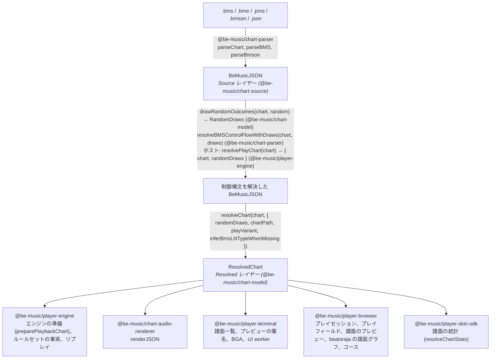
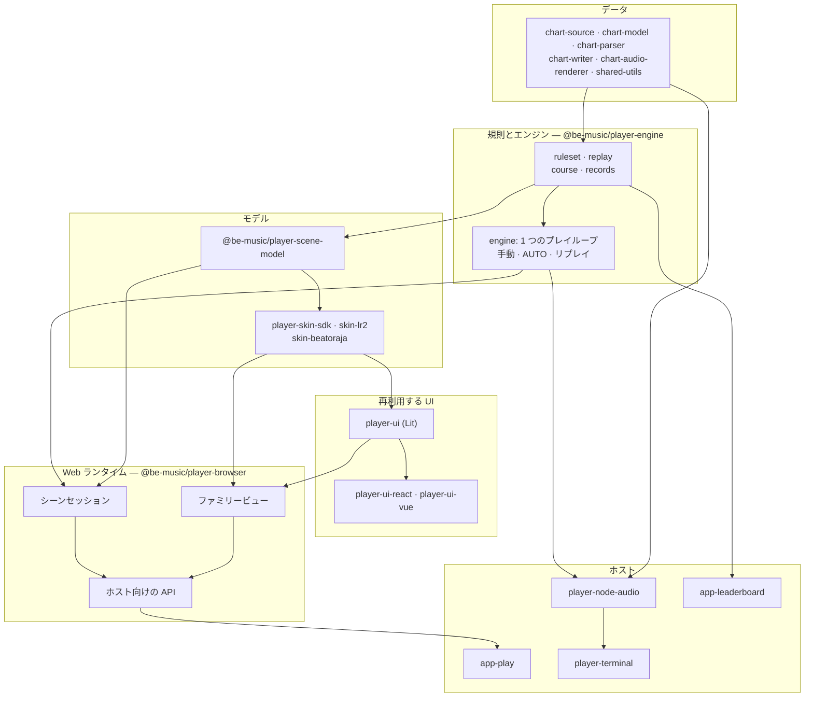

[English version](./architecture.md)

# アーキテクチャ

この文書では、譜面がどのように演奏できる形になるか（Source レイヤーと Resolved レイヤー）、エンジンがどのように判定するか（決定的な判定コアと、それを動かす 1 つのプレイループ）、そしてそれらを実行環境に依存させず小さく保つための規則を説明します。

be-music は譜面を 2 つのレイヤーで読みます。**Source レイヤー**はファイルに何が書いてあるかを表し、**Resolved レイヤー**はプレイヤーが何を演奏するかを表します。前者を後者に変える関数は `resolveChart` の 1 つだけで、フォーマットの既定値と de facto の読み方は、すべてこの関数か、この関数が呼ぶヘルパーで適用します。利用側は Resolved レイヤーを読み、フォーマットを解釈し直しません。

## Source レイヤー

`BeMusicJSON`（[JSON 仕様](./json-spec.ja.md)）は BMS / bmson ファイルを忠実に表します。生のチャンネルとオブジェクト値、ヘッダの表、小節長、`#RANDOM` / `#SWITCH` のブロック（`bms.controlFlow`）、bmson の拡張、往復変換に必要な保持データを持ちます。これを書くのは `@be-music/chart-parser` と `@be-music/chart-writer` だけで、ファイル上の書き方を知る必要があるのもこの 2 つだけです。

パースしたばかりの譜面には制御構文が残っています。その `events` が持つのは無条件のオブジェクトだけです。

## 制御構文と `RandomDraws`

1 回のプレイでの `#RANDOM` / `#SETRANDOM` / `#SWITCH` / `#SETSWITCH` の結果は、`RandomDraws` という値で表します。ファイル順に、行ごとに 1 項目を持ちます。ホストは `drawRandomOutcomes`（`@be-music/chart-model`）で 1 回だけ引き、`resolveBMSControlFlowWithDraws`（`@be-music/chart-parser`）で譜面を解決します。`resolvePlayChart`（`@be-music/player-engine`）を使えば両方を一度に行えます。そのうえで、同じ譜面と draws を、シーン、エンジン、リザルト画面、リプレイなど、そのプレイのすべての利用者に渡します。分岐の意味を評価するのは `@be-music/chart-model` の `evaluateControlFlow` だけです。有効になったヘッダ行の適用は parser に残しています。parser のディレクティブ表を使い回すためです。[プレイヤー仕様 — 制御構文の扱い](./player-spec.ja.md#制御構文の扱い) も参照してください。

## Resolved レイヤー

`@be-music/chart-model` の `resolveChart(chart, options)`（[`resolved-chart.ts`](../packages/chart-model/src/resolved-chart.ts)）は `ResolvedChart` を返します。この関数は純粋で、同じ譜面とオプションからは常に同じ値が得られます。重い部分は最初に読んだときに計算して保持するので、利用側は読んだ部分の分だけ計算します。

| フィールド                                          | 内容                                                                                                                                                                                                                                                        |
| --------------------------------------------------- | ----------------------------------------------------------------------------------------------------------------------------------------------------------------------------------------------------------------------------------------------------------- |
| `source`、`sourceFormat`、`idBase`                  | 制御構文を解決した元の譜面（メタデータ、リソース、生のセクション）と、そのオブジェクト ID の進数                                                                                                                                                            |
| `randomDraws`、`hasUnresolvedControlFlow`           | 譜面の解決に使った draws と、制御構文がまだ残っているかどうか。残っていれば無条件の内容だけを解決する。これは draw の前に曲一覧が見せる内容にあたる                                                                                                         |
| `playVariant`、`layouts`                            | レーンモード（ホストが渡した `playVariant`、なければ使われているレーンと `chartPath` に対する `resolveChartPlayVariant`）と、そのプレイモード表のレイアウト                                                                                                 |
| `notes`                                             | 判定するノート。`kind: 'tap' \| 'ln'` で、`channel`（演奏できる `1x` / `2x` のレーン）、`beat`、`seconds`、ロングノートなら `endBeat` / `endSeconds` / `lnMode`、FREE ZONE の終端なら `freeZone`、`sampleKey`、元の `event` を持つ。レーンと位置ごとに 1 つ |
| `shadowedNotes`                                     | レーンと位置を判定ノートに譲った重複ノートのうち、キー音が異なるもの                                                                                                                                                                                        |
| `mines`、`invisibleNotes`                           | `damage`（ゲージの %）付きの `kind: 'mine'` と、`kind: 'invisible'`。どちらも置かれた演奏レーン上にある                                                                                                                                                     |
| `sampleTriggers`                                    | 譜面が自分で、またはレーンから鳴らす音のすべて。`#LNOBJ` の終端と鳴らさない `#LNTYPE` の片側は除き、bmson のスライス（`c`）は解決済み                                                                                                                       |
| `volumeChanges`                                     | BMS の `#xxx97` / `#xxx98` による動的な音量変化。対象のバスと線形ゲイン付き                                                                                                                                                                                 |
| `timing`、`beatResolver`、`sortedEvents`            | テンポマップ（BPM の点、STOP と `#STP` の点、beat → 秒）、小節長を考慮した beat の解決、譜面順のイベント                                                                                                                                                    |
| `reversal`                                          | 最初の負の `#BPMxx` が LR2 の逆スクロール・ギミックを起動する位置（`timing.reversal`、beat と秒）。譜面にない場合は未定義（[BMS 仕様](./bms-spec.ja.md)「負の BPM」）                                                                                       |
| `scroll`、`speed`、`barLines`、`barLinesSuppressed` | SCROLL / SPEED のキーフレームと小節線の beat（bmson の `lines: []` で抑止されていれば空）                                                                                                                                                                   |
| `bga`                                               | BGA の切り替え（ベース、レイヤー、レイヤー 2、POOR）。BMS のチャンネルからも bmson の `bga` からも作る                                                                                                                                                      |
| `judgeRank`、`total`、`lnMode`                      | ルールセットへの入力。`#RANK`、`#DEFEXRANK` / bmson の `judge_rank`、`#EXRANKxx` の変化。`#TOTAL`（`absolute`）または bmson の `total`（`percent`）。譜面全体の LN モード                                                                                   |
| `lastNoteSeconds`                                   | 最後の判定ノート、地雷、不可視オブジェクトが終わる時刻                                                                                                                                                                                                      |

解決済みのノートは元の `event` への参照を持ちます。エンジンはこれでキー音を引き、ログはこれでオブジェクトを示します。プレイ中の状態は Resolved レイヤーに含めません。エンジンはノートを書き換えられる演奏ノートにコピーし（`@be-music/player-engine` の `preparePlaybackChart`。`judged` を加え、レーンオプションが `channel` を書き換えられる）、そこでキーをレーンに割り当てます。

### レイヤーの外に置くもの

- **ルールセットの選択**は `@be-music/player-engine` のルールセット（`lr2`、`beatoraja`、`iidx`）が持ちます。判定ランクの入力から判定幅を作ること、既定の TOTAL と bmson の割合をそれにどう適用するか、ゲージの曲線、LN モードの指定をどう演奏するか（LN / CN / HCN）がこれにあたります。Resolved レイヤーは譜面の生の入力を渡します。
- **判定ランクの既定値**：`judgeRank` は譜面が書いた値だけを持ちます。bmson の `judge_rank` の既定値（100）と BMS の `#RANK` の既定値（NORMAL）は各ルールセットが補い、選曲などの画面では同じ値を読む `resolveDisplayedJudgeRankValue` / `Label`（`@be-music/player-engine/display`）が補います。リプレイは譜面自身の値（`sourceRank` / `sourceExRank`）を記録し、それを持たないログも同じ判定幅で再生できなければならないので、ルールセットはいずれにせよ既定値を必要とします。ここで補うと、`judge_rank` のない bmson 譜面すべてで記録される値も変わります。
- **レーンの割り当てと入力**：キーの割り当て、FREE ZONE のエイリアス、スコア対象のノート、レーンオプション（RANDOM、MIRROR、FLIP）は `@be-music/player-engine` のプレイ設定です。
- **描画と音声出力**：Resolved レイヤーが並べたものを、ホストがどう描き、どうミックスするか。

## プレイモード表

すべてのプレイモード（5 / 7 / 9 PMS / 9 BME / 10 / 14 / 24 / 48 KEY）は `PLAY_MODE_LAYOUTS`（[`play-modes.ts`](../packages/chart-model/src/play-modes.ts)）で 1 回だけ宣言します。各レーンの種類、サイド、表示位置、BMS のチャンネル（可視、不可視、`#LNTYPE`、地雷）と、FREE ZONE のチャンネルを持ちます。bmson の `mode_hint` の表、chart-writer の `x` の対応、プレイバリアントのレーン集合、エンジンのレーン配置、TUI のレーン色、スキンのレーン種別は、すべてここから作ります。`ResolvedChart.layouts` が譜面のバリアントに対応する項目です。[プレイヤー仕様 — プレイモード表](./player-spec.ja.md#プレイモード表) も参照してください。

## 規則の置き場所

| 規則                                                                                                                             | モジュール（`@be-music/chart-model`）                                                                                              |
| -------------------------------------------------------------------------------------------------------------------------------- | ---------------------------------------------------------------------------------------------------------------------------------- |
| 分岐の意味（`#RANDOM`、`#SWITCH`、入れ子、閉じていない `#IF`）                                                                   | [`control-flow.ts`](../packages/chart-model/src/control-flow.ts)                                                                   |
| レーンモード（`resolveChartPlayVariant`）、モードごとのレーン、bmson の `mode_hint` のレーン                                     | [`play-variant.ts`](../packages/chart-model/src/play-variant.ts)、[`play-modes.ts`](../packages/chart-model/src/play-modes.ts)     |
| 小節長からの beat、イベントの順序                                                                                                | [`beats.ts`](../packages/chart-model/src/beats.ts)（`createBeatResolver`、`sortEvents`）                                           |
| BPM（`03` / `08`。0 は無視し、負の `#BPMxx` は絶対値で進む）、LR2 の負の BPM による反転、STOP と `#STP`、ノートと同じ位置の STOP | [`timing.ts`](../packages/chart-model/src/timing.ts)                                                                               |
| `#LNOBJ`、`#LNTYPE 1` / `2`（と推定）、bmson の `l` / `t` / `ln_type`、FREE ZONE の終端、レーンと位置ごとに判定ノート 1 つ       | [`long-notes.ts`](../packages/chart-model/src/long-notes.ts)、[`resolved-notes.ts`](../packages/chart-model/src/resolved-notes.ts) |
| 地雷のダメージ（36 進の値、bmson の `damage`、既定 4 %）、譜面の LN モード                                                       | [`note-rules.ts`](../packages/chart-model/src/note-rules.ts)                                                                       |
| サンプルトリガ、bmson のスライスと `c`                                                                                           | [`sample-triggers.ts`](../packages/chart-model/src/sample-triggers.ts)                                                             |
| SCROLL / SPEED のキーフレーム、小節線、BPM / 小節 / STOP のタイムライン                                                          | [`timelines.ts`](../packages/chart-model/src/timelines.ts)                                                                         |
| BGA の切り替え                                                                                                                   | [`bga.ts`](../packages/chart-model/src/bga.ts)                                                                                     |

[Be-Music Fingerprint](./fingerprint-spec.ja.md) は同じモジュールを通して項目を読むので、Resolved レイヤーが遊ぶ内容そのもので譜面を識別します。Resolved レイヤーが拍と秒で持つところを小節内の正確な位置で持つことと、`control-flow.ts` のフレーム操作をすべての結果についてまとめて動かすことだけが違います。

それぞれの読み方の理由と、be-music が意図して仕様から外れている箇所は、[BMS / bmson 互換性ノート](./format-compat.ja.md)（§5 に判断の一覧）と、[BMS](./bms-spec.ja.md)・[bmson](./bmson-spec.ja.md) の仕様書に記録しています。譜面フォーマットより上では、be-music は判定 ruleset の外で LR2 を優先します。判定、記録、オプション、スキンで 2 つのエンジンがどう違い、それぞれの違いがどのレイヤーに属するかは [LR2 と beatoraja のセマンティクス](./semantics-lr2-beatoraja.ja.md) にまとめています。

## レイヤーの検証

`test/regression/resolved-chart.test.ts` は、`test/fixtures` のすべての譜面を、回帰コーパスが固定している `#RANDOM` の draw ごとに解決します。その結果を、利用側のヘルパー（`extractTimedNotes`、`collectSampleTriggers`、`createTimingResolver`）と、`test/regression/__expected__` に固定されたエンジンのノート列、トリガ、テンポマップ、譜面の事実と照合します（[回帰コーパス](../test/regression/README.ja.md) を参照）。

## エンジン: 判定コアと 1 つのプレイループ

`@be-music/player-engine` のエンジン（[`core/`](../packages/player-engine/src/core)）は、決定的な判定コアと、それを動かす 1 つのプレイループでできています。手動プレイ、リプレイ、AUTO プレイの違いは、ループに差し込む判定ストラテジーだけです（[ADR 0003](./adr/0003-one-play-loop.ja.md)）。

- **判定コア**は、判定を決めるものすべてを明示的な状態オブジェクトに持ちます。ノートの選択、ルールセットの判定幅、ロングノートの保持と終端、HCN のゲージ増減、地雷、オートスクラッチ、見逃し、コンボ、スコア、ゲージです。`runJudgeCoreStep(state, input, emit)`（または effect を配列で返す `stepJudgeCore(state, input)`）は、譜面上の秒で時刻を付けた入力（`advance`、`press`、`hold`、`release`、`finish`）を 1 つ適用し、起きたことを effect として報告します。音の再生と停止、ゲージ・コンボ・ロングノートの変化、UI への合図、リプレイへの記録、トレースの行です。コアはキー状態の入力だけを受けます。レーンは `hold` から `release` までのあいだ押されていて、ロングノートはレーンが押されているあいだ（または、離したものがルールセットの解放の猶予を待つあいだ）だけ保持されます。コアはクロックを読まず、タイマーを設定せず、入出力もしません。そのため、同じ状態と同じ入力からは常に同じ effect が出ます。`auto-judge-core.ts` は AUTO プレイについて同じことをします。LR2 の負の BPM による反転は、譜面のデータ（`ResolvedChart.reversal` から得た `reversalSeconds`）としてコアに渡ります。反転より後では見逃しと地雷の処理を止め、押下と離鍵は入力自身の譜面時刻から求めた鏡映クロック `2R − now` で判定します。
- **プレイループ**はすべてのプレイを動かします。`manualPlay` と `autoPlay`（`play.ts`）は、内部の `play(chart, options, strategy)` の薄い包みです。`play-session.ts` はプレイの準備をします。演奏用に解決した譜面、テンポのクロック、`preparePlaybackChart`、ルールセットとスコア、リプレイの記録、UI と入力のバスとランタイム、音声セッション、TUI なしのトレースです。残りは `play-loop.ts`（`runPlayLoop`）が受け持ちます。リードイン、再生クロック、60 Hz のティックとそれを入力で早める待機、終わりの目安、譜面の後の保持（`holdAfterChart`）、ランタイムの後始末です。各ティックでは、入力コマンドを処理し（`play-controls.ts`：ポーズ、HIGH-SPEED、テンポの変更とリプレイが記録から辿る変更、リプレイ用の表示の変更、中断）、音声の書き込み位置までに来たリアルタイムの音を送り（`play-audio-cursor.ts`。音量の変化、背景の音、AUTO プレイのノートのキー音に同じカーソルを使います）、戦略に判定させ、UI のフレームを出します。規則はどの戦略でも同じです。入力ランタイムはリードインの前に始まり、リードイン中の ESC は譜面の音が始まる前にプレイを終えます。終わりの目安は、再生クロックで譜面の終わりに最も広い BAD の幅と 1 秒を足した時刻です。譜面が終わり判定が済んだ時点でプレイを終えるのは、音声セッションも保持（`holdAfterChart`。終わりの目安で落ち着きます）もないときだけです。中断されなかったプレイは、終わりの規則を適用したあと、直前のフレームと同じ時刻で最後のフレームを出します。表示する時刻が戻ることはありません。リプレイ（どちらのモードでも `replayInputs` があるとき）はテンポを記録せず、`replayTempoChanges` に従い、`replayAbortedAtUs` があればログが中断した所で止まります。`play-finish.ts`（`finishPlay`）は、どのプレイも同じ形で終えます。ESC は中断したプレイのサマリを返し、リスタートと Ctrl+C は `PlayerInterruptedError` を投げ、それ以外は完走か失敗です。リプレイと TUI なしのトレースもここで閉じます。
- **判定ストラテジー**（`play-strategy.ts`）は、プレイをどう判定するかを決めます。`play-manual.ts` は、再生クロックをティックごとに、キーの出来事をそのたびに、キーが押された瞬間の時刻を付けて判定コアに渡します。キーの解放を伝えると宣言した入力ランタイム（`PlayerInputRuntime.reportsKeyReleases`。ブラウザのものと、端末が kitty キーボードプロトコルに応えたあとの TUI のもの）は、最初のキーからキー状態の入力です。解放を伝えない入力では、`kitty-state` コマンドが来るまで `play-key-inference.ts` が各キーを離した時刻を推定し、リプレイはその解放を記録します。`play-replay.ts` は、記録された入力列（`PlayerOptions.replayInputs`）を `advanceJudgeCoreReplay` で、ある瞬間から次の瞬間へ進めます。進める先は、記録された各入力のマイクロ秒と、各時刻つき判定（LN の終点、見逃しの期限、AUTO SCRATCH のノート、地雷の判定。`nextTimedJudgmentUs` が求める）の 1 マイクロ秒後です。そのため、リプレイの判定はティックのタイミングや `speed` に左右されません。`play-auto.ts` は AUTO の判定コアを進め、各ノートのキー音を判定より先に、書き込み位置に合わせて送ります。`manualPlay` は手動かリプレイの戦略を、`autoPlay` は AUTO の戦略を選びます。
- **時刻つき判定**は、その整数マイクロ秒（replay のクロック）を時間が過ぎたときに確定します。同じ瞬間では、ロングノートの終点と保留していた離鍵、Hell Charge のゲージの刻み、AUTO SCRATCH のノート、見逃し、地雷の順に、それぞれチャンネル順で確定します。見逃しは各ノートそれぞれの期限で判定します。`finish` は残っている判定をすべて同じように進めてからプレイ終了時の規則を適用し、ESC での中断は判定が済んだ時点で止まります（replay には `play.abortedAtUs` として記録します）。replay シミュレータも同じ判定を同じ順で扱うので、ゲージが上限・下限で頭打ちになる場合も、両者はゲージに同じ順で到達します。
- **共有する規則**：判定コアとリプレイのシミュレータ（`replay/simulate.ts`）の両方が使う規則は、ルールセットに置いています。判定幅と分類（`ruleset/judge.ts`）、候補の選択（`ruleset/selection.ts`）、ゲージ（`ruleset/gauge.ts`）、ロングノートの規則（ルールセットが演奏するモード、見逃したチャージノート終端の POOR、LR2 の LN 始点の遅い BAD、マルチ BAD の絞り込み。`ruleset/long-note.ts`）です。シミュレータはマイクロ秒単位の独自のイベントキューを持つので、同じ入力列で両者が同じ判定になることは `replay/equivalence.test.ts` が確かめます。
- **ループの周りのサービス**：`engine-preparation.ts`（演奏用の譜面の解決、読み込みの進捗、ランタイムの起動）、`engine-audio.ts`（ホストの音声セッションの起動と、無音時のフォールバック）、`engine-clock.ts`（再生クロックと、ループが時刻を読み、待機に使うスケジューラ）、`engine-effects.ts`（判定の effect をホストへ）、`engine-trace.ts`（TUI なしの出力）、`engine-types.ts`（公開する型）です。`engine.ts` は公開用のエントリポイントで、パッケージのルートです。エンジンとその型だけを公開します。ホストのランタイムがプレイとやり取りするもの、レーン、ホストが表示するものは `./signals`、`./lanes`、`./display` のエントリポイントです（[Player 実装仕様 — 公開するエントリポイント](./player-spec.ja.md#公開するエントリポイント)）。

### エンジンの特性テスト

[`core/characterization/`](../packages/player-engine/src/core/characterization) はエンジンの挙動を固定し、リファクタリングが意図しない変更をしていないことを示せるようにします。1 つのプレイループ（P1）は、これが書かれた元の 2 つのドライバを置き換え、スナップショットを 1 つも変えませんでした。そのあと、ドライバ間のずれをプルリクエストのコミットごとに 1 つずつ直し、それぞれどのスナップショットを変えたかを書いています。各ケースは小さな合成譜面（通常ノート、`#LNMODE` ごとのロングノート、地雷、BPM / STOP / SCROLL / SPEED の変化、`#EXRANK` の変化、サバイバルゲージを空にする譜面、2 ステージをつないだ NONSTOP の譜面）を、台本どおりの入力でのライブ、その記録のリプレイ、AUTO の 3 通りで、判定ルールセットごとに演奏します。シナリオでは、開始時に設定したテンポと途中で変えたテンポ、表示・HIGH-SPEED・ポーズのコマンド、ESC・リスタート・Ctrl+C、ゲージ切れで終わるプレイ、`holdAfterChart`、コースのステージの引き継ぎ、UI なし、音声セッションなし、書き込み位置が先行する音声クロック、リードイン、端末からの入力を加えます。`__expected__/` のスナップショットには、各プレイについてホストから見えるものを記録します。サマリ、リプレイとすべてのルールセットでの再シミュレーション、音声セッションへの呼び出し、ゲージ付きの判定の合図、UI のコマンドとフレーム、ホストへのコールバック、テキスト出力です。`driver-drift.test.ts` は、古いドライバ間でずれていたところで、手動と AUTO のプレイ、およびライブのプレイとそのリプレイが一致することを確かめます。解放のない入力のプレイも、リプレイと再シミュレーションがライブの結果と一致します。

プレイは仮想のクロックで動きます。`engine-clock.ts` は時刻の読み取りと待機を `EngineScheduler` を通して行い、テストは `setEngineScheduler` で自前のものに差し替えます（テスト専用で、どのエントリポイントからも export しません）。時間はプレイが待つあいだだけ進むので、テストは決定的で数秒で終わります。`virtual-clock.test.ts` は、リプレイと AUTO プレイが実時間のクロックでも同じ結果になることを確かめます。実行は `pnpm exec vp test run packages/player-engine/src/core/characterization` です。スナップショットが変わったら、エンジンの挙動が変わったということです。スナップショットの更新（`-u`）は、その挙動を変えるつもりのプルリクエストでだけ行い、理由をそこに書きます。リファクタリングでは触りません。

## エンジンのオプションの分類

`PlayerOptions` は、[`engine-types.ts`](../packages/player-engine/src/core/engine-types.ts) にある 5 つの分類の型を合わせたものです。どのフィールドもちょうど 1 つの分類に属し、そうでなければ `engine-types.test.ts` が型検査で失敗します。`PlayerPlaySettings` は、将来の `play(chart, settings, runtime)` API でシリアライズできる `settings` になり、プレイを再現するためにリプレイが記録すべき集合になる予定です。

| 分類                                                                | フィールド                                                                                                                                                                                                                                                                                                                                                                                                                                                                                          |
| ------------------------------------------------------------------- | --------------------------------------------------------------------------------------------------------------------------------------------------------------------------------------------------------------------------------------------------------------------------------------------------------------------------------------------------------------------------------------------------------------------------------------------------------------------------------------------------- |
| `PlayerPlaySettings`：判定・スコア・譜面を決める                    | `auto`、`autoScratch`、`gauge`、`judgeRuleset`、`randomDraws`、`speed`、`startAtSeconds`、`inferBmsLNTypeWhenMissing`、`laneModeExtension`、`playVariant`、`endOnFailure`、`course`                                                                                                                                                                                                                                                                                                                 |
| `PlayerPlayRuntime`：ホストのサービス、コールバック、実行中のデータ | `preparedChart`、`createUIRuntime`、`createInputRuntime`、`createAudioSession`、`signal`、`holdAfterChart`、`audioBaseDir`、`onLoadProgress`、`onLoadComplete`、`onHighSpeedChange`、`onTempoChange`、`onResolvedChart`、`onRulesetResolved`、`onLog`、`writeOutput`                                                                                                                                                                                                                                |
| `PlayerPlayTuning`：音声・遅延・描画の調整                          | `audio`、`volume`、`bgmVolume`、`playVolume`、`compressor`、`compressorThresholdDb`、`compressorRatio`、`compressorAttackMs`、`compressorReleaseMs`、`compressorMakeupDb`、`limiter`、`limiterCeilingDb`、`limiterReleaseMs`、`leadInMs`、`audioOffsetMs`、`audioHeadPaddingMs`、`audioTailSeconds`、`audioLeadMs`、`audioLeadMaxMs`、`audioLeadStepUpMs`、`audioLeadStepDownMs`、`highSpeed`、`uiFPS`、`tui`、`tuiVisibleNotesLimit`、`tuiNoteHeight`、`imageResizeAlgorithm`、`videoBGAStreaming` |
| `PlayerPlayDebug`：診断用の上書き                                   | `judgeWindowMs`（判定が変わる）、`debugActiveAudio`、`showInvisibleNotes`、`missingSampleToneSeconds`                                                                                                                                                                                                                                                                                                                                                                                               |
| `PlayerPlayRecording`：リプレイの記録とリプレイ                     | `recordReplay`、`onReplayRecorded`、`replayInputs`、`replayTempoChanges`、`replayAbortedAtUs`                                                                                                                                                                                                                                                                                                                                                                                                       |

分類が微妙なフィールド：

- `auto`、`tui`、`audioTailSeconds`、`showInvisibleNotes` はエンジンが読みません。`autoPlay` と `manualPlay` のどちらを使うかはホストが選び、リプレイの `play.mode` は判定ストラテジーから決まります。
- `preparedChart` はレーンオプションを適用した後の譜面を運びます。これは設定ではなく譜面なので、将来の API では `chart` 引数に入ります。それまではランタイムの分類に置きます。
- `audioBaseDir` はただの文字列ですが、ホストのファイルの場所を指すのでランタイムとして扱います。
- `audioOffsetMs` はライブの押下に対して判定クロックをずらすので、ライブの判定を動かすことがあります。記録される入力はすでに譜面時刻なので、リプレイには必要ありません。
- `highSpeed` はスクロールだけを変えます。それでもホストはログの `play.native` に残せます。
- `recordReplay` は、設定である `gauge`、`randomLane`、`dpFlip`、`native` を、譜面の識別情報（`chartSHA256`、`chartMD5`、`sourceChart`、`recorder`）と一緒に宣言します。

リプレイ（[`replay/format.ts`](../packages/player-engine/src/replay/format.ts) の `ReplayPlay`）が記録していないもの：

- `speed` は `play.tempo` として、プレイ中のテンポ変更（入力コマンド `{ kind: 'tempo' }`）は `play.tempoChanges` として記録されますが、再シミュレーションはこれらを使いません。入力と判定は譜面時刻だからです。離鍵イベントのない入力（kitty キーボードプロトコルのない端末）は、離した時刻を推定し（`play-key-inference.ts`。押下ごとの保持猶予を、開始時のテンポの再生クロック、譜面の 1 秒あたり `1000 / speed` ms で数えるので、譜面時刻に対して線形です）、リプレイはその解放を記録します。そのため、リプレイと再シミュレーションはライブで判定したとおりに判定します（[解放のない入力](./replay.ja.md#解放のない入力)）。
- `inferBmsLNTypeWhenMissing` は記録されません。`chart.notes` はこれが作ったロングノートを持ちますが、元の譜面に対してリプレイするには同じフラグが必要です。
- `laneModeExtension` と `playVariant` は、結果の `chart.laneMode` と、フィンガープリントのレーンモードの入力としてしか記録されません。元の譜面に対してリプレイするには、同じレーンモードと、beatoraja ではモードごとの同じ判定幅を得るためにこれらが必要です。

対応するオプションがないリプレイのフィールド：`play.mode`（判定ストラテジー）、`play.randomLane` と `play.dpFlip`（ホストのレーンオプション。`preparedChart` で適用し、`recordReplay` で宣言します）、`play.native`、`play.aborted` / `play.abortedAtUs`（結果）。

音声実装はホストが提供します。`@be-music/player-node-audio` が Node セッション、`chart-audio-renderer` によるサンプルのデコード、`node-web-audio-api` による PCM 出力を所有します。エンジンは `AudioSession` 契約を持ち、自身の解決済み譜面をファクトリーへ渡します。未指定なら無音再生です。ターミナルは Node アダプター、ブラウザーは Web Audio アダプターを設定し、デバッグ用のサンプル長読み込みも注入します（[ADR 0011](./adr/0011-host-provided-audio.ja.md)）。

## 目指す構造

パッケージの構成は、`feat/course-definitions` を `devel` に入れる前に作り直しました。手順ごとの記録は下の[移行](#移行)に残します。この節では今の構造を説明し、新しいコードや移すコードはこれに従います。理由は[設計判断の記録](./adr/README.ja.md)にあります。

矢印は、あるレイヤーからその上に作られたレイヤーへ向かいます。

- **規則とエンジン**（`@be-music/player-engine`）。ゲージ・クリアランプ・BP・スコアの定義（`./ruleset`）、コースの実行、NONSTOP の流れ、コースのステージの規則（`./course`）、判定ルールセットごとの自己ベストの統合（`./records`）、リプレイの形式とそのシミュレータ（`./replay`）を持ちます（[ADR 0004](./adr/0004-domain-rules-in-player.ja.md)）。パッケージのルートはエンジンで、プレイループは 1 つ、手動・AUTO・リプレイの判定ストラテジーを差し込みます（[ADR 0003](./adr/0003-one-play-loop.ja.md)）。ホストの実行環境がプレイとやり取りするもの、レーン、ホストが表示するものは、エントリポイントの `./signals`、`./lanes`、`./display` です（[Player 実装仕様 — 公開するエントリポイント](./player-spec.ja.md#公開するエントリポイント)）。
- **シーンモデル**（`@be-music/player-scene-model`）。スキンの種類によらず、各画面が何を見せ、どう振る舞うか。ライブラリの項目（`LibraryChart`、`LibraryFolder`、`LibraryCourse`）、一覧の状態とそのスナップショット（`BrowseState`、`BrowseSnapshot`）、プレイオプション、プレイ状態（`PlayState`）、プレイ結果（`PlayResult`）、コースの表示用モデル（`CourseView`）、効果音セットです（[ADR 0002](./adr/0002-scene-model-package.ja.md)、[シーンモデル](./scene-model.ja.md)）。
- **スキンモデル**（`player-skin-sdk`、`skin-lr2`、`skin-beatoraja`）。それぞれのスキンを解析し、シーンモデルをそのスキンの表現に対応付けます。be-music スキンの契約（`@be-music/player-skin-sdk`）、LR2 互換の op・数値・テキスト・タイマーの番号表 1 つ（`@be-music/skin-lr2/ids`）と LR2 の状態を求める関数（`@be-music/skin-lr2/state`）、beatoraja の状態の計算（`@be-music/skin-beatoraja/scene`）です。
- **再利用する UI**（`player-ui`、`player-ui-react`、`player-ui-vue`）。Lit 製 Web Components は SDK の表示用データを受け取り、操作要求をイベントで通知します。Native Skin はシーンのフレームと操作を部品に接続し、React / Vue は同じ部品の property・イベント・ref を公開します。UI は再生ループや音声を所有せず、SDK は Lit に依存しません（[Player UI](../packages/player-ui/README.ja.md)、[ADR 0013](./adr/0013-player-ui-components.ja.md)）。

- **Web ランタイム**（`@be-music/player-browser`）。シーンセッション（`session/`）が各画面の振る舞いを、どのスキンの種類にも共通に 1 つだけ持ちます。譜面の準備、RANDOM / FLIP、音と BGA、エンジンの設定、入力、終了処理です。ファミリービュー（`view/`）はセッションのフレームを描いてインテントを返すだけです（[ADR 0001](./adr/0001-skin-families-only-draw.ja.md)）。ホスト向けの API（`./host`）は、どの画面もファミリーキットから `createSelectScene`、`createDecideScene`、`createPlayScene`、`createResultScene` で作り、`PixiSceneHost` が表示する 1 つの画面のライフサイクル（`PixiScene`）を持つ `SessionScene` にします。プレイの譜面の音以外はすべて 1 つの音声サービス（`./audio`、[ADR 0007](./adr/0007-one-system-audio-context.ja.md)）を通ります。[ブラウザプレイヤー — シーンセッションとファミリービュー](./player-web.ja.md#シーンセッションとファミリービュー)を参照してください。
- **ホスト**。Web のデモは、構成の根（`app/app.ts`）がつなぐサービス（`services/`）とルート（`app/routes/`）の集まりで、画面の切り替えはすべて 1 つのシーンルーター（`app/scene-router.ts`）が受け持ちます（[ADR 0006](./adr/0006-scene-router.ja.md)）。ルートは選曲、決定、プレイ、リザルト、リプレイ、コース、NONSTOP です。`main.ts` はアプリを起動するだけで、サービスは Tweakpane、UI（`ui/`）、アプリ（`app/`）のモジュールを import しません（[ブラウザプレイヤー — demo の作り](./player-web.ja.md#demo-の作り)）。ターミナルプレイヤーはエンジンとエントリポイントの `./signals`、`./lanes`、`./display` で遊び、Leaderboard は規則（`./course`、`./replay`、`./ruleset`）で記録を確かめて順位を付けます。

変更しやすさを保つための規則：

- 1 つの概念は 1 か所で定義する。型、規則、状態のいずれも。
- スキンの種類ごとの違いは、画面の描き方と、モデルをスキンの表現に対応付ける方法だけにする。
- 部品を組み合わせる。基底クラスのフックで違いを吸収しない。
- 規則・エンジン・モデルは実行環境に依存せず、Pixi・DOM・Node なしでテストできる。
- パッケージは、ファイル構成ではなく設計したエントリポイントを公開する（[ADR 0005](./adr/0005-public-entry-points.ja.md)）。
- 1,500 行を超えるソースファイルを置かない。[許可リスト](#レイヤーの規則とサイズの上限)は空です。

### 移行

| 段階                             | 作業                                                                                                                             | 状態   |
| -------------------------------- | -------------------------------------------------------------------------------------------------------------------------------- | ------ |
| [P0](#p0-安全網)                 | 安全網：エンジンのスナップショットと、コースの確認の自動化                                                                       | 完了   |
| [P1](#p1-1-つのプレイループ)     | 判定ストラテジーを差し込む 1 つのプレイループ                                                                                    | 完了   |
| [P2](#p2-ドメインの規則)         | 規則を `@be-music/player-engine` に集める                                                                                        | 完了   |
| [P3](#p3-シーンとスキンのモデル) | `@be-music/player-scene-model`、スキンのパッケージでの LR2 と beatoraja の状態の対応付け方                                       | 完了   |
| [P4](#p4-web-ランタイム)         | Web ランタイム：シーンセッション、ファミリービュー、画面のライフサイクル・音声サービス・ホスト向けの API をそれぞれ 1 つに       | 完了   |
| [P5](#p5-web-のデモ)             | Web のデモをシーンルーターの下のサービスに分ける                                                                                 | 完了   |
| [P6](#p6-devel-への仕上げ)       | 公開するエントリポイント、ドキュメント、ファイルサイズの許可リストを空に、changeset、実在のスキンでの総点検。そのあと `devel` へ | 進行中 |

プルリクエストは、断りのない限り挙動を変えません。挙動を変えるもの（ずれの修正、リプレイやフィンガープリントの変更）は専用のプルリクエストにし、仕様書・golden の値・changeset を一緒に更新します。どのプルリクエストも `pnpm run check`、全テスト、エンジンのスナップショットを通し、シーン、コースの流れ、デモのホストに触れるものは E2E テスト（[`pnpm run test:e2e`](./course-checklist.ja.md#自動実行)）も通します。各段階の終わりにはブラウザ確認を、自動と実在のスキンの両方で行います。

各段階の手順は下の表にまとめます。プルリクエストは、入るときに自分の手順の行（PR と状態）だけを書き換え、上の表は段階が始まるときと終わるときにだけ変えます。ほかの行が整形し直されないよう、セルは列の今の幅に収めます。

#### P0: 安全網

何かを動かす前に、エンジンの挙動とコースの流れを固定します。

| 手順 | 入ったもの                                                                                                                                  | 削除 | PR                                                    | 状態 |
| ---- | ------------------------------------------------------------------------------------------------------------------------------------------- | ---- | ----------------------------------------------------- | ---- |
| P0a  | 仮想のクロックでのエンジンの挙動のスナップショット：譜面 × 手動 / AUTO / リプレイ × テンポ・ESC・ゲージ切れ・保持・NONSTOP                  | —    | [#422](https://github.com/nulltask/be-music/pull/422) | 完了 |
| P0b  | コースのブラウザ確認を、テスト用の譜面と最小のテスト用スキンで自動化（`pnpm run test:e2e`）。テスト用のフック `window.__beMusicTest` で読む | —    | [#426](https://github.com/nulltask/be-music/pull/426) | 完了 |

#### P1: 1 つのプレイループ

| 手順   | 入ったもの                                                                                                                                  | 削除                                                           | PR                                                    | 状態 |
| ------ | ------------------------------------------------------------------------------------------------------------------------------------------- | -------------------------------------------------------------- | ----------------------------------------------------- | ---- |
| ループ | 手動・AUTO・リプレイを、判定ストラテジーを差し込む 1 つのプレイループで動かす（[ADR 0003](./adr/0003-one-play-loop.ja.md)）。構造だけの変更 | 2 つのドライバー、`core/manual-play.ts` と `core/auto-play.ts` | [#425](https://github.com/nulltask/be-music/pull/425) | 完了 |
| ずれ   | 古い手動と AUTO のドライバーのずれを 1 つずつ修正                                                                                           | `StrategyDrifts`                                               | [#427](https://github.com/nulltask/be-music/pull/427) | 完了 |

#### P2: ドメインの規則

| 手順 | 入ったもの                                                                                                                                                             | 削除                                                                                                                                | PR                                                    | 状態 |
| ---- | ---------------------------------------------------------------------------------------------------------------------------------------------------------------------- | ----------------------------------------------------------------------------------------------------------------------------------- | ----------------------------------------------------- | ---- |
| P2a  | ゲージ・クリアランプ・BP の定義を 1 つに（`@be-music/player-engine/ruleset`）、判定ルールセットごとの自己ベスト（[ADR 0004](./adr/0004-domain-rules-in-player.ja.md)） | player-browser・リーダーボード・デモ・skin-beatoraja にあったランプと記録の規則の重複実装、`core/groove-gauge` と `GrooveGaugeType` | [#424](https://github.com/nulltask/be-music/pull/424) | 完了 |
| P2b  | コースの実行、共有する NONSTOP の流れ（リーダーボードも）、コースのステージの規則を `@be-music/player-engine/course` に                                                | player-browser のコレクションにあったコースの規則、デモの `CourseSession`、デモとリーダーボードにあった NONSTOP の重複実装          | [#423](https://github.com/nulltask/be-music/pull/423) | 完了 |

#### P3: シーンとスキンのモデル

| 手順          | 入ったもの                                                                                                                                                                                                                                            | 削除                                                                                  | PR                                                                                                           | 状態 |
| ------------- | ----------------------------------------------------------------------------------------------------------------------------------------------------------------------------------------------------------------------------------------------------- | ------------------------------------------------------------------------------------- | ------------------------------------------------------------------------------------------------------------ | ---- |
| P3a           | `@be-music/player-scene-model` パッケージ（[ADR 0002](./adr/0002-scene-model-package.ja.md)）：ライブラリ、一覧、プレイオプション。続いてプレイ状態、プレイ結果、コースの表示、システム音                                                             | —                                                                                     | [#429](https://github.com/nulltask/be-music/pull/429), [#431](https://github.com/nulltask/be-music/pull/431) | 完了 |
| P3b           | LR2 の番号表 `@be-music/skin-lr2/ids`。`skin-beatoraja` と共有し、Web のシーンが使う                                                                                                                                                                  | Web のシーンにあった LR2 の生の番号                                                   | [#428](https://github.com/nulltask/be-music/pull/428)                                                        | 完了 |
| P3c-LR2       | `@be-music/skin-lr2/state` が選曲・決定・プレイ・リザルトの画面とコースについて、シーンモデルを LR2 の op、数値、テキスト、スライダー、タイマーに対応付け、LR2 のシーンがそれを呼ぶ                                                                   | —                                                                                     | [#433](https://github.com/nulltask/be-music/pull/433)                                                        | 完了 |
| P3c-beatoraja | `@be-music/skin-beatoraja/scene` がプレイ・選曲・リザルトの画面、コース、システム音について、シーンモデルを beatoraja の op、数値、テキスト、タイマー、ゲージ、グラフに対応付け、beatoraja のランタイムアダプターと選曲・リザルトのシーンがそれを呼ぶ | player-browser にあった状態の計算：`BeatorajaRuntimeAdapter` は 3,100 行から 914 行に | [#434](https://github.com/nulltask/be-music/pull/434)                                                        | 完了 |

#### P4: Web ランタイム

画面のライフサイクル、シーンセッション、ファミリービュー（標準 → LR2 → beatoraja の順）、音声サービス、ホスト向けの API をそれぞれ 1 つにし、古い画面のクラスを削除します（[ADR 0001](./adr/0001-skin-families-only-draw.ja.md)）。E はエンジンの積み残しの対応、B は beatoraja のビューの下準備として行った移動だけの分割です。D・R・S・PL は決定・リザルト・選曲・プレイの各系列です。Z1 と Z2 でこの段階を終えます。

| 手順         | 入ったもの                                                                                                                                                                                                                              | 削除                                                                                                                                                   | PR                                                                                                           | 状態 |
| ------------ | --------------------------------------------------------------------------------------------------------------------------------------------------------------------------------------------------------------------------------------- | ------------------------------------------------------------------------------------------------------------------------------------------------------ | ------------------------------------------------------------------------------------------------------------ | ---- |
| P4.1         | 画面のライフサイクルの統一：標準・LR2・beatoraja のどの画面も `identity`（`{ kind, family }`）を持つ `PixiScene` を実装し、Web のデモは `PixiSceneHost.setScene` だけで画面を切り替える                                                 | —                                                                                                                                                      | [#439](https://github.com/nulltask/be-music/pull/439)                                                        | 完了 |
| P4.2         | オーディオサービス `createAudioService`。システムの `AudioContext` 1 つの上で鳴らす（[ADR 0007](./adr/0007-one-system-audio-context.ja.md)）                                                                                            | —                                                                                                                                                      | [#436](https://github.com/nulltask/be-music/pull/436)                                                        | 完了 |
| P4.3         | セッションとビューの契約（`host/family-kit.ts`、`view/types.ts`）、`SessionScene`、`session/` と `view/` を分ける lint                                                                                                                  | —                                                                                                                                                      | [#438](https://github.com/nulltask/be-music/pull/438)                                                        | 完了 |
| E1           | 入力のランタイムが、キーを離したことを報告すると宣言できる（`PlayerInputRuntime.reportsKeyReleases`）。ブラウザの最初の押下はキーの状態の推測を通らない                                                                                 | —                                                                                                                                                      | [#437](https://github.com/nulltask/be-music/pull/437)                                                        | 完了 |
| E2           | 判定コアはキーの状態の入力だけを受け取る。離した情報のない入力は `play-key-inference.ts` を通し、離したことを記録していないログは推測し直す（EP2、[#495](https://github.com/nulltask/be-music/pull/495) で廃止）                        | 離した情報のない押下のためのコアの経路：保持の猶予、ロングノートのリピートの抑制（`isLongNoteKeyRepeat`）、猶予による地雷の判定、`keyStateInput`       | [#441](https://github.com/nulltask/be-music/pull/441)                                                        | 完了 |
| E3           | 判定ルールセットの id をすべて `RulesetId` で型付け。`JudgeWindowRuleset` は非推奨の別名として残す                                                                                                                                      | —                                                                                                                                                      | [#435](https://github.com/nulltask/be-music/pull/435)                                                        | 完了 |
| E4           | スコアの定義を `@be-music/player-engine/ruleset` から公開。`core/scoring` は非推奨の別名として残す                                                                                                                                      | —                                                                                                                                                      | [#440](https://github.com/nulltask/be-music/pull/440)                                                        | 完了 |
| E5           | [#430](https://github.com/nulltask/be-music/issues/430) で確度が低かったスキンの番号を OpenLR2 と beatoraja で確かめ、既知の問題のうち番号の誤りを修正                                                                                  | —                                                                                                                                                      | [#443](https://github.com/nulltask/be-music/pull/443)                                                        | 完了 |
| B1           | `loadBeatorajaSceneKit`（`@be-music/player-browser/skin`）が、beatoraja の各画面のスキンを `BeatorajaSceneKit` に読み込む                                                                                                               | デモにあった、項目ごとのスキンの読み込みの重複実装                                                                                                     | [#454](https://github.com/nulltask/be-music/pull/454)                                                        | 完了 |
| B2           | 移動のみ：beatoraja のプレイのスキンビューのグラフとゲージの描画を `skin-view/` へ                                                                                                                                                      | —                                                                                                                                                      | [#446](https://github.com/nulltask/be-music/pull/446)                                                        | 完了 |
| B3           | 移動のみ：テキスト・数値・画像の描画と Lua のコンテキスト。`skin-view.ts` をファイルサイズの許可リストから外す                                                                                                                          | —                                                                                                                                                      | [#448](https://github.com/nulltask/be-music/pull/448)                                                        | 完了 |
| B4           | 移動のみ：`PixiBeatorajaSelectScene` の曲の一覧の行を `select/rows.ts` へ                                                                                                                                                               | —                                                                                                                                                      | [#456](https://github.com/nulltask/be-music/pull/456)                                                        | 完了 |
| B5           | 移動のみ：検索、譜面の画像、スキンの状態。`scene/beatoraja/select.ts` を許可リストから外す                                                                                                                                              | —                                                                                                                                                      | [#458](https://github.com/nulltask/be-music/pull/458)                                                        | 完了 |
| D1           | 決定画面のセッション：標準の決定画面を `createDecideScene` で作り、オーディオサービスで鳴らす                                                                                                                                           | `DefaultPixiDecideView`、`CoreDecideView`                                                                                                              | [#444](https://github.com/nulltask/be-music/pull/444)                                                        | 完了 |
| D2           | LR2 の決定画面のビュー：LR2 の kit を渡した決定画面のセッション                                                                                                                                                                         | `PixiDecideView`                                                                                                                                       | [#450](https://github.com/nulltask/be-music/pull/450)                                                        | 完了 |
| D3           | beatoraja の決定画面のビュー。これでどの決定画面も `createDecideScene` で作る                                                                                                                                                           | `PixiBeatorajaDecideScene`                                                                                                                             | [#463](https://github.com/nulltask/be-music/pull/463)                                                        | 完了 |
| R1           | リザルト画面のセッション：標準のリザルト画面を `createResultScene` で作り、ジングルはオーディオサービスで鳴らす                                                                                                                         | `DefaultPixiResultView`                                                                                                                                | [#447](https://github.com/nulltask/be-music/pull/447)                                                        | 完了 |
| R2           | LR2 のリザルト画面のビュー：LR2 のリザルト画面はすべて、LR2 の kit を渡したリザルト画面のセッション                                                                                                                                     | `PixiResultView`、`CoreResultView`                                                                                                                     | [#453](https://github.com/nulltask/be-music/pull/453)                                                        | 完了 |
| R3           | `PlayResult` を読む beatoraja のリザルト画面のビュー。これでどのリザルト画面も `createResultScene` で作る                                                                                                                               | `PixiBeatorajaResultScene`、`BeatorajaSceneBgmPlayer`、`BeatorajaSceneTransition`                                                                      | [#465](https://github.com/nulltask/be-music/pull/465)                                                        | 完了 |
| S1           | 移動のみ：選曲画面のポインター入力を `session/select/` へ、readme の表示と空のときの案内を `view/built-in/` へ                                                                                                                          | —                                                                                                                                                      | [#449](https://github.com/nulltask/be-music/pull/449)                                                        | 完了 |
| S2           | 移動のみ：一覧の操作・キー入力・音を `session/select/` へ、描画を `view/built-in/` へ。`scene/core/select.ts` を許可リストから外す                                                                                                      | —                                                                                                                                                      | [#452](https://github.com/nulltask/be-music/pull/452)                                                        | 完了 |
| S3           | 一覧のモデル：標準と LR2 の選曲画面は `reduceBrowse`・`browseEntries`・`captureBrowse` / `restoreBrowse`・`browseSystemSound` でたどり、プレイをまたいで `BrowseSnapshot` を保持                                                        | `PixiSongSelectNavigation`、`resolveSelectNavigation`                                                                                                  | [#460](https://github.com/nulltask/be-music/pull/460)                                                        | 完了 |
| S4           | 選曲画面のセッション：標準の選曲画面を `createSelectScene` で作り、オーディオサービスで鳴らす。決定音はプレイまで鳴り続ける                                                                                                             | `DefaultPixiSongSelectView`                                                                                                                            | [#462](https://github.com/nulltask/be-music/pull/462)                                                        | 完了 |
| S5           | LR2 の選曲画面のビュー：LR2 の kit を渡した選曲画面のセッション                                                                                                                                                                         | `PixiSongSelectView`、`CoreSongSelectView`                                                                                                             | [#464](https://github.com/nulltask/be-music/pull/464)                                                        | 完了 |
| S6           | beatoraja の選曲画面のビュー。これでどの選曲画面も `createSelectScene` で作り、一覧のモデルでたどる                                                                                                                                     | `PixiBeatorajaSelectScene`。player-scene-model の `browseSnapshotFromBeatorajaSelect`。skin-lr2 の `LR2_KEYS_FILTER_OPS`、`lr2CourseMatchesKeysFilter` | [#474](https://github.com/nulltask/be-music/pull/474)                                                        | 完了 |
| PL1          | 移動のみ：譜面とメディアの準備を `CoreGameplayView` から `session/play/` へ                                                                                                                                                             | —                                                                                                                                                      | [#442](https://github.com/nulltask/be-music/pull/442)                                                        | 完了 |
| PL2          | 移動のみ：プレイフィールド、BGA、画面の枠の描画を `view/` へ                                                                                                                                                                            | —                                                                                                                                                      | [#445](https://github.com/nulltask/be-music/pull/445)                                                        | 完了 |
| PL3          | 移動のみ：エンジン、入力、表示設定、終了処理を `session/play/` へ。`scene/core/gameplay.ts` を許可リストから外す（PL1–PL3 で 5,934 行から 1,408 行に）                                                                                  | —                                                                                                                                                      | [#451](https://github.com/nulltask/be-music/pull/451)                                                        | 完了 |
| PL4          | プレイ状態：標準と LR2 のプレイ画面は `PlayState` を 1 つ持ち、リザルトをそこから読む                                                                                                                                                   | `JudgeTimingLog`、画面が別に持っていたスコアとゲージの履歴                                                                                             | [#455](https://github.com/nulltask/be-music/pull/455)                                                        | 完了 |
| PL5          | リプレイの表示設定：それらの画面は `visibleMs` をシーンモデルの白数字として記録する                                                                                                                                                     | `scene/core/lane-cover.ts`                                                                                                                             | [#457](https://github.com/nulltask/be-music/pull/457)                                                        | 完了 |
| PL6          | プレイのセッション：標準のプレイ画面を `createPlayScene` で作り、音はオーディオサービスで開き、決定画面が引いた `#RANDOM` のとおりにプレイする                                                                                          | `DefaultPixiGameplayView`                                                                                                                              | [#461](https://github.com/nulltask/be-music/pull/461)                                                        | 完了 |
| PL7          | LR2 のプレイ画面のビュー：LR2 のプレイ画面はすべて、LR2 の kit を渡したプレイのセッション。共有のプレイフィールドは各ビューの `PlayfieldSkin` に尋ねる                                                                                  | `PixiGameplayView`、`CoreGameplayView`、`CoreGameplayState`                                                                                            | [#466](https://github.com/nulltask/be-music/pull/466)                                                        | 完了 |
| PL8          | 決定画面が引いた `#RANDOM` のとおりにプレイする beatoraja のプレイ画面のビュー（先にレイヤーを `view/beatoraja/play` へ移動）。これでどのプレイ画面も `createPlayScene` で作る                                                          | `PixiBeatorajaGameplayView`、`BeatorajaRuntimeAdapter`、`prepareBeatorajaGameplayChart`                                                                | [#467](https://github.com/nulltask/be-music/pull/467), [#473](https://github.com/nulltask/be-music/pull/473) | 完了 |
| PL9          | beatoraja のレーンオプション：ほかの種類と同じく RANDOM、MIRROR、S-RANDOM、SCATTER を適用し、リプレイに記録する                                                                                                                         | —                                                                                                                                                      | [#483](https://github.com/nulltask/be-music/pull/483)                                                        | 完了 |
| PL10         | beatoraja のプレイ状態の選択：HS-FIX でのスクロール、プレイオプションから始めるレーンカバー、DP 譜面のレーンが使うキーはレーンに残す、EX score が届いた汎用のランクの op（220-227）をすべて点ける、離れるときにスキンのループ音を止める | —                                                                                                                                                      | [#486](https://github.com/nulltask/be-music/pull/486)                                                        | 完了 |
| PL11         | beatoraja の NONSTOP とリプレイをテーマ自身のプレイのスキンで遊び、NONSTOP の結果はリザルトのスキンで見せる。コース全体の結果はどの種類も `playResultFromCourseRun` で読む                                                              | player-scene-model の `playResultFromBeatoraja`、`beatorajaCompletionFromPlayResult`。デモの `buildCourseResultSummary`                                | [#487](https://github.com/nulltask/be-music/pull/487)                                                        | 完了 |
| ビルドの修正 | `isolatedDeclarations` でのパッケージのビルドに要る型を明示。マージの確認でも `vp run build` を実行する                                                                                                                                 | —                                                                                                                                                      | [#459](https://github.com/nulltask/be-music/pull/459)                                                        | 完了 |
| BP の修正    | LR2 のルールセットのプレイの BP で、空 POOR を 1 回だけ数える                                                                                                                                                                           | —                                                                                                                                                      | [#481](https://github.com/nulltask/be-music/pull/481)                                                        | 完了 |
| Z1-docs      | 移行の進み具合を、この段階ごとの表で追う。コースの確認のテストの表を最新にする                                                                                                                                                          | —                                                                                                                                                      | [#489](https://github.com/nulltask/be-music/pull/489)                                                        | 完了 |
| Z1a          | `scene/` を削除：中のファイルを `host/`、`stage/`、`chart/`、`session/play/`、`view/` へ移す                                                                                                                                            | `scene/` とその再エクスポートの中継                                                                                                                    | [#491](https://github.com/nulltask/be-music/pull/491)                                                        | 完了 |
| Z1b          | 最後の橋渡しをなくす。デモは beatoraja のスキンの音をオーディオサービスで鳴らす                                                                                                                                                         | `BeatorajaSkinAudioPlayer`、player-scene-model の `browseSnapshotFromSelectNavigation`                                                                 | [#488](https://github.com/nulltask/be-music/pull/488)                                                        | 完了 |
| Z1c          | レイヤーの lint を `player-browser` 全体に：下位レイヤーは上位レイヤーを import せず、`AudioContext` を作るのは音声レイヤーだけ                                                                                                         | —                                                                                                                                                      | [#494](https://github.com/nulltask/be-music/pull/494)                                                        | 完了 |
| Z1d          | 任意：リプレイの白数字のメイン BPM の決め方を、どの種類でも 1 つにする                                                                                                                                                                  | —                                                                                                                                                      | [#503](https://github.com/nulltask/be-music/pull/503)                                                        | 完了 |
| Z2           | ライブラリの項目を譜面の語で：`LibraryEntry` の `song` / `songs` を `chart` / `charts` に。テスト用のフックは名前を保つ                                                                                                                 | `song` / `songs` のフィールド                                                                                                                          | [#500](https://github.com/nulltask/be-music/pull/500)                                                        | 完了 |

#### P5: Web のデモ

Web のデモを 1 つのシーンルーター（[ADR 0006](./adr/0006-scene-router.ja.md)）の下のサービスに分け、新しいホスト向けの API に載せます。E2E テスト用のフック（`window.__beMusicTest`）は保ちます。F は挙動の修正で、それぞれ専用のプルリクエストにします。

| 手順  | 範囲                                                                                            | PR                                                    | 状態 |
| ----- | ----------------------------------------------------------------------------------------------- | ----------------------------------------------------- | ---- |
| P5.1a | シーンルーターのモジュール（`app/scene-router.ts`）と、その単体テスト。`main.ts` はまだ使わない | [#492](https://github.com/nulltask/be-music/pull/492) | 完了 |
| P5.1b | 画面の切り替えをすべてシーンルーターで行う                                                      | [#502](https://github.com/nulltask/be-music/pull/502) | 完了 |
| P5.2  | 設定のサービスと、`PlayOptions` 全体を持つプレイオプションのサービス                            | [#510](https://github.com/nulltask/be-music/pull/510) | 完了 |
| P5.3  | Debug Menu を `ui/debug-menu/` へ                                                               | [#516](https://github.com/nulltask/be-music/pull/516) | 完了 |
| P5.4  | ライブラリ・記録・コースメーカーのサービスと、ドロップの受け口                                  | [#514](https://github.com/nulltask/be-music/pull/514) | 完了 |
| P5.5  | LR2・beatoraja・標準のテーマのサービスと、ファミリーの kit                                      | [#519](https://github.com/nulltask/be-music/pull/519) | 完了 |
| P5.6  | コースのサービスと、コースと NONSTOP のルート                                                   | [#522](https://github.com/nulltask/be-music/pull/522) | 完了 |
| P5.7a | 選曲と決定のルート                                                                              | [#525](https://github.com/nulltask/be-music/pull/525) | 完了 |
| P5.7b | プレイ・リザルト・リプレイのルート                                                              | [#529](https://github.com/nulltask/be-music/pull/529) | 完了 |
| P5.8  | リプレイ・録画・ステータスのサービス                                                            | [#530](https://github.com/nulltask/be-music/pull/530) | 完了 |
| P5.9  | テスト用のフックの状態をサービスに。契約の v1 は変えない                                        | [#534](https://github.com/nulltask/be-music/pull/534) | 完了 |
| P5.10 | `main.ts` を起動処理だけに。アプリを `app/app.ts` と `app/shell.ts` へ。サービスの lint         | [#539](https://github.com/nulltask/be-music/pull/539) | 完了 |
| P5.F1 | NONSTOP の配置を変えたら、選曲画面を描き直す                                                    | [#517](https://github.com/nulltask/be-music/pull/517) | 完了 |
| P5.F2 | F5 は AUTO のプレイを AUTO で、リプレイをリプレイでやり直す                                     | [#490](https://github.com/nulltask/be-music/pull/490) | 完了 |
| P5.F3 | プレイ中に画面が切り替わったら、コースの実行を終え、録画を締めくくる                            | [#507](https://github.com/nulltask/be-music/pull/507) | 完了 |

#### P6: devel への仕上げ

公開するエントリポイント（[ADR 0005](./adr/0005-public-entry-points.ja.md)）、ドキュメント、ファイルサイズの許可リストを空に、changeset、実在のスキンでの総点検。そのあと `feat/course-definitions` を `devel` へ入れます。Web ランタイムの外の移動だけの分割は先に入り、許可リストに最後まで残ったデモの `main.ts` も P5.7b で外れたので、許可リストは空です。

| 手順           | 範囲                                                                                                                                                                                          | PR                                                    | 状態 |
| -------------- | --------------------------------------------------------------------------------------------------------------------------------------------------------------------------------------------- | ----------------------------------------------------- | ---- |
| `skin-lr2`     | 移動のみ：LR2 のスキンの解析器 `src/skin.ts` を `src/skin/` へ。許可リストから外す                                                                                                            | [#468](https://github.com/nulltask/be-music/pull/468) | 完了 |
| `chart-model`  | 移動のみ：`src/index.ts` をモジュールに分ける。許可リストから外す                                                                                                                             | [#469](https://github.com/nulltask/be-music/pull/469) | 完了 |
| `chart-parser` | 移動のみ：`src/core/parser.ts` をモジュールに分ける。許可リストから外す                                                                                                                       | [#470](https://github.com/nulltask/be-music/pull/470) | 完了 |
| `chart-writer` | 移動のみ：`src/index.ts` をモジュールに分ける。許可リストから外す                                                                                                                             | [#471](https://github.com/nulltask/be-music/pull/471) | 完了 |
| TUI のランナー | 移動のみ：`player-terminal` の `src/cli/runner.ts` をモジュールに分ける。許可リストから外す                                                                                                   | [#472](https://github.com/nulltask/be-music/pull/472) | 完了 |
| TUI の画面     | 移動のみ：`player-terminal` の `src/tui/tui.ts` をモジュールに分ける。許可リストから外す                                                                                                      | [#482](https://github.com/nulltask/be-music/pull/482) | 完了 |
| TUI の BGA     | 移動のみ：`player-terminal` の `src/bga.ts` をモジュールに分ける。許可リストから外す                                                                                                          | [#485](https://github.com/nulltask/be-music/pull/485) | 完了 |
| EP1            | `@be-music/player-engine` のエントリポイント `./signals`、`./lanes`、`./display` と、`./ruleset` の判定幅とリプレイのルールセット ID。TUI、player-skin-sdk、回帰テストがそれを使う            | [#496](https://github.com/nulltask/be-music/pull/496) | 完了 |
| EP2            | 離鍵を記録していないリプレイ（#432 より前）のリプレイで、離鍵を推定し直さない                                                                                                                 | [#495](https://github.com/nulltask/be-music/pull/495) | 完了 |
| EP3            | `@be-music/player-browser` のエントリポイント `./host`、`./skin`、`./collection`、`./audio`、`./recording` と、別名の削除（`Pixi*` の型、`resolveSceneCourseInfo`、`PixiGameplayResultData`） | [#497](https://github.com/nulltask/be-music/pull/497) | 完了 |
| EP4            | `player-browser` が player の新しいエントリポイントと、`@be-music/chart-model` のタイミング API を使う                                                                                        | [#499](https://github.com/nulltask/be-music/pull/499) | 完了 |
| EP5            | player-skin-sdk のライブラリの `Browser*` 型を、player-scene-model の `Library*` の名前に（Z2 で完了）                                                                                        | [#500](https://github.com/nulltask/be-music/pull/500) | 完了 |
| EP6            | player のファイル名の subpath（`core/*` と `core/scoring`、`utils`、`judging` など）と、chart-audio-renderer の `./triggers` の廃止                                                           | [#501](https://github.com/nulltask/be-music/pull/501) | 完了 |
| EP7            | 任意：すべてのエントリポイントのベンチマーク（skin-beatoraja のルート、utils の Node 専用の subpath）                                                                                         | [#498](https://github.com/nulltask/be-music/pull/498) | 完了 |
| ドキュメント   | ドキュメントと用語集を、目指す構造の用語にそろえる                                                                                                                                            | [#531](https://github.com/nulltask/be-music/pull/531) | 完了 |
| changeset      | changeset を、パッケージと変更ごとにまとめる                                                                                                                                                  | [#528](https://github.com/nulltask/be-music/pull/528) | 完了 |
| 実在のスキン   | 実在のスキン（LR2 の標準のテーマ、ModernChic）で、ブラウザ確認を手で行う                                                                                                                      | —                                                     | 完了 |
| `devel`        | `feat/course-definitions` を `devel` へマージ                                                                                                                                                 | —                                                     | 予定 |

## レイヤーの規則とサイズの上限

`pnpm run check` は、フォーマット・lint・型のほかに、構造に関する次の規則を検査します。

- **実行環境に依存しないコード**：`@be-music/chart-model`、`@be-music/chart-source`、`@be-music/chart-parser`、`@be-music/player-scene-model`、`@be-music/skin-lr2` の `state/`、`@be-music/skin-beatoraja` の `scene/` と、`@be-music/player-engine` の `core/`、`course/`、`replay/`、`records/`、`ruleset/` と、エントリポイントの `signals`、`lanes`、`display` およびそれらが集めるモジュールは、ブラウザでも Node でもそのまま動きます。そこでは Oxlint の `no-restricted-imports` と `no-restricted-globals`（[`vite.config.ts`](../vite.config.ts) で設定）が、Node の組み込みモジュールの import（`node:*` と接頭辞なしの名前）と、DOM や Node だけのグローバル（`window`、`document`、`process`、`Buffer` など）を拒否します。実行環境のサービスはアダプタを通して渡します。`PlayerOptions.createAudioSession` / `createUIRuntime` / `createInputRuntime`、Node の音声出力を読み込むオプショナルモジュールのローダー、parser の [`node-file.ts`](../packages/chart-parser/src/node-file.ts)（`parseChartFile`）です。`node-file.ts` と parser の CLI、テストはこの規則の対象外です。
- **決定的な判定**：`core/judge-*.ts`、`core/auto-judge-core.ts`、`ruleset/`、`replay/simulate.ts` では、さらに `Date` と `performance` の読み取り、タイマーの設定、`Math.random` の呼び出しを禁止します。時刻と乱数は入力として受け取ります。シーンモデル（`@be-music/player-scene-model`）と、LR2 と beatoraja の状態を求める関数（`@be-music/skin-lr2` の `state/`、`@be-music/skin-beatoraja` の `scene/`）にも同じ規則を課します。画面の時刻は入力として受け取ります。
- **web ランタイムのレイヤー**：`@be-music/player-browser` では、同じ Oxlint の規則がレイヤーを分けたまま保ちます（[レイヤーの分け方](./player-web.ja.md#レイヤーの分け方)）。下位レイヤー（`host/`、`session/`、`view/` 以外のすべてのディレクトリ）は、ホスト、セッション、ビューを型であっても import しません。セッションとビューが互いとホストに触れるのは型だけで、セッションは Pixi も型だけ、ビューはエンジンを型であっても import しません。エンジンを値として import するのはセッションと `runtime/engine-driver.ts` だけで、`AudioContext` や `OfflineAudioContext` を作るのは音声レイヤーの `runtime/` だけです。後の 2 つの規則は web demo にも課します。
- **web demo のレイヤー**：web demo のサービス（`services/`）は、Tweakpane、`ui/`、`app/` のモジュールを型であっても import しません。アプリから必要なものは deps として受け取ります（[ブラウザプレイヤー — demo の作り](./player-web.ja.md#demo-の作り)）。
- **ファイルサイズの上限**：[`scripts/lint/file-size-budget.ts`](../scripts/lint/file-size-budget.ts) は、パッケージのソースファイル（テスト、型宣言、フィクスチャを除く）が 1,500 行を超えると失敗します。上限を入れた時点で既に大きかったファイルは許可リストに入れて警告だけを出し、分けるたびに外してきました。いまリストは空です。許可リストのファイルが上限を下回ったら、リストから外す必要があります。単独では `pnpm run check:file-size` で実行できます。
