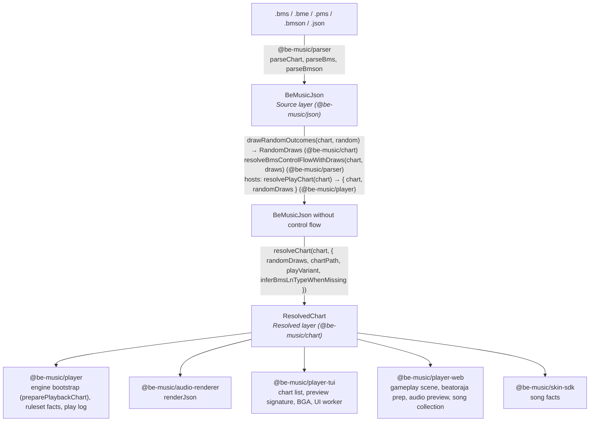
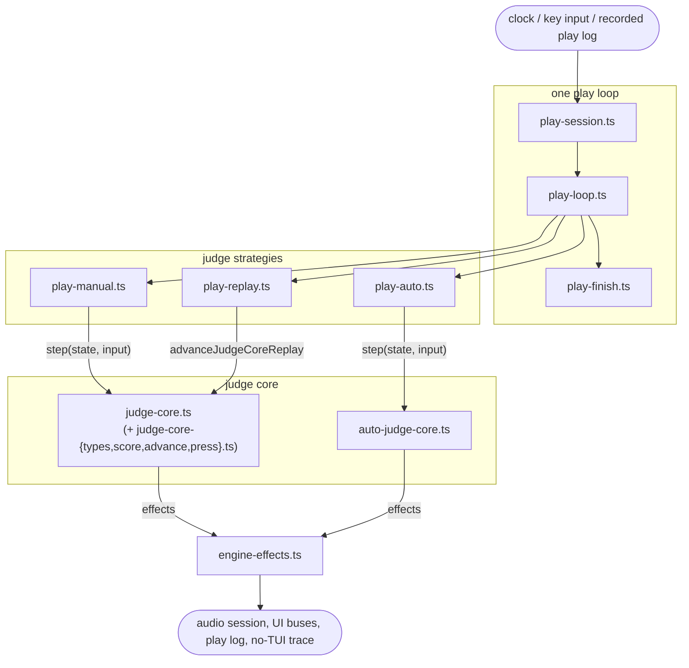
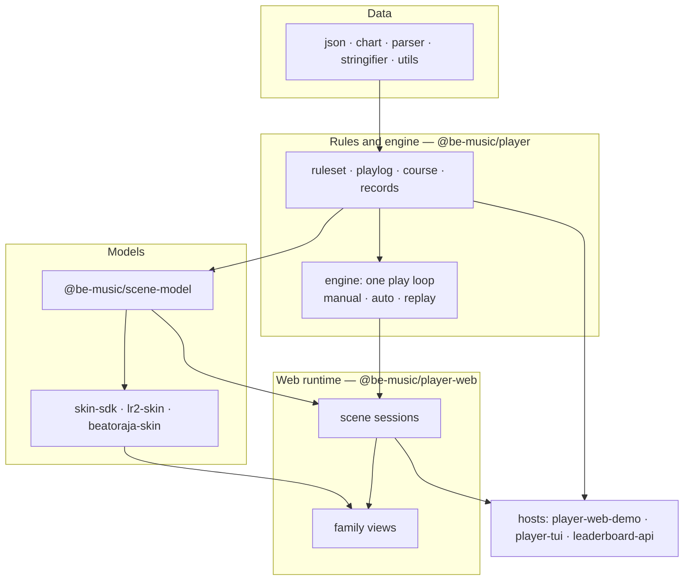

[Japanese version](./architecture.ja.md)

# Architecture

This document covers how a chart becomes something to play (the Source and Resolved layers), how the engine judges a play (a deterministic judge core and the one play loop around it), and the rules that keep these parts runtime-neutral and small.

be-music reads a chart in two layers. The **Source layer** says what the file says. The **Resolved layer** says what the player plays. Exactly one function, `resolveChart`, turns the first into the second, and every format default and de facto reading is applied there or in a helper it calls. Consumers read the Resolved layer and do not interpret the format again.

## Source layer

`BeMusicJson` ([JSON spec](./json-spec.md)) represents a BMS or bmson file faithfully: raw channels and object values, header tables, measure lengths, the `#RANDOM` / `#SWITCH` blocks (`bms.controlFlow`), the bmson extensions, and the preservation data a round trip needs. Only `@be-music/parser` and `@be-music/stringifier` write it, and only they need to know how a file spells something.

A parsed chart still carries its control flow. Its `events` hold only the unconditional objects.

## Control flow and `RandomDraws`

The `#RANDOM` / `#SETRANDOM` / `#SWITCH` / `#SETSWITCH` outcomes of one play are a value, `RandomDraws`: one entry per line in file order. A host draws them once with `drawRandomOutcomes` (`@be-music/chart`) and resolves the chart with `resolveBmsControlFlowWithDraws` (`@be-music/parser`), or does both with `resolvePlayChart` (`@be-music/player`). It then hands the same chart and draws to every consumer of the play: the scene, the engine, the result screen and the play log. `evaluateControlFlow` in `@be-music/chart` is the only evaluator of the branch semantics. Applying the active header lines stays in the parser, because it reuses the parser's directive table. See [Player spec — Handling control syntax](./player-spec.md#handling-control-syntax).

## Resolved layer

`resolveChart(chart, options)` in `@be-music/chart` ([`resolved-chart.ts`](../packages/chart/src/resolved-chart.ts)) returns a `ResolvedChart`. The function is pure: the same chart and options always give the same value. The heavy parts are computed on first access and then kept, so a consumer pays only for what it reads.

| Field                                               | Contents                                                                                                                                                                                                                                                       |
| --------------------------------------------------- | -------------------------------------------------------------------------------------------------------------------------------------------------------------------------------------------------------------------------------------------------------------- |
| `source`, `sourceFormat`, `idBase`                  | The control-flow-resolved source chart (metadata, resources, raw sections) and its object-ID base                                                                                                                                                              |
| `randomDraws`, `hasUnresolvedControlFlow`           | The draws the chart was resolved with, and whether control flow is still on the chart. If it is, only the unconditional content is resolved: this is what a song list shows before any draw                                                                    |
| `playVariant`, `layouts`                            | The lane mode (the host's `playVariant`, otherwise `resolveChartPlayVariant` over the lanes in use and `chartPath`) and its play-mode table layouts                                                                                                            |
| `notes`                                             | Judged notes, `kind: 'tap' \| 'ln'`, with `channel` (the playable `1x` / `2x` lane), `beat`, `seconds`, `endBeat` / `endSeconds` / `lnMode` for long notes, `freeZone` for FREE ZONE tails, `sampleKey` and the source `event`. One note per lane and position |
| `shadowedNotes`                                     | Duplicate notes that lost their lane and position to a judged note and carry a different keysound                                                                                                                                                              |
| `mines`, `invisibleNotes`                           | `kind: 'mine'` with `damage` (gauge %), and `kind: 'invisible'`, both on the playable lane they sit on                                                                                                                                                         |
| `sampleTriggers`                                    | Every sound the chart triggers by itself or from a lane, with `#LNOBJ` ends and suppressed `#LNTYPE` halves left out and bmson slices (`c`) resolved                                                                                                           |
| `volumeChanges`                                     | BMS `#xxx97` / `#xxx98` dynamic volume changes with their bus and linear gain                                                                                                                                                                                  |
| `timing`, `beatResolver`, `sortedEvents`            | The tempo map (BPM points, STOP and `#STP` points, beat → seconds), measure-aware beat resolution, and the events in chart order                                                                                                                               |
| `reversal`                                          | Where the first negative `#BPMxx` arms LR2's reverse-scroll gimmick (`timing.reversal`, beat and seconds), if the chart has one ([BMS spec — Negative BPM](./bms-spec.md#negative-bpm-bpmxx-via-channel-08-basis))                                             |
| `scroll`, `speed`, `barLines`, `barLinesSuppressed` | SCROLL / SPEED keyframes and bar-line beats (none when bmson `lines: []` suppresses them)                                                                                                                                                                      |
| `bga`                                               | BGA cues (base, layer, layer 2, POOR) from BMS channels and bmson `bga` alike                                                                                                                                                                                  |
| `judgeRank`, `total`, `lnMode`                      | Inputs for the rulesets: `#RANK`, `#DEFEXRANK` / bmson `judge_rank`, the `#EXRANKxx` changes; `#TOTAL` (`absolute`) or bmson `total` (`percent`); the chart-level LN mode                                                                                      |
| `lastNoteSeconds`                                   | When the last judged note, mine or invisible object ends                                                                                                                                                                                                       |

Resolved notes keep a reference to the source `event`. The engine uses it to look up keysounds, and the logs use it to name objects. Play state is not part of the Resolved layer. The engine copies the notes into mutable play notes (`preparePlaybackChart` in `@be-music/player`, which adds `judged` and lets lane options rewrite `channel`) and binds keys to lanes there.

### What stays outside

- **Ruleset choices** belong to `@be-music/player`'s rulesets (`lr2`, `beatoraja`, `iidx`): judge windows from the judge-rank inputs, the default TOTAL and how bmson's percentage applies to it, gauge curves, and how an LN mode request plays (LN / CN / HCN). The Resolved layer gives them the chart's raw inputs.
- **Judge-rank defaults**: `judgeRank` holds only what the chart sets. The bmson `judge_rank` default (100) and the BMS `#RANK` default (NORMAL) are filled by each ruleset and, for song screens, by `resolveDisplayedJudgeRankValue` / `Label` (`@be-music/player/utils`), which read the same facts. A play log records the chart's own values (`sourceRank` / `sourceExRank`), and a log without them must replay to the same windows, so the rulesets need the defaults anyway; filling them here would also change the recorded facts of every bmson chart without `judge_rank`.
- **Lane bindings and input**: key assignment, FREE ZONE aliases, scorable notes and lane options (RANDOM, MIRROR, FLIP) are play settings in `@be-music/player`.
- **Rendering and audio output**: how the hosts draw and mix what the Resolved layer lists.

## Play-mode table

Every play mode (5 / 7 / 9 PMS / 9 BME / 10 / 14 / 24 / 48 KEY) is declared once in `PLAY_MODE_LAYOUTS` ([`play-modes.ts`](../packages/chart/src/play-modes.ts)): each lane's kind, side, display slot and BMS channels (visible, invisible, `#LNTYPE`, mine), plus FREE ZONE channels. The bmson `mode_hint` tables, the stringifier's `x` map, the play-variant lane sets, the engine's lane layout, the TUI lane colours and the skin lane kinds are all derived from it. `ResolvedChart.layouts` is the entry for the chart's variant. See [Player spec — Play-mode table](./player-spec.md#play-mode-table).

## Where the rules live

| Rule                                                                                                                                                  | Module (`@be-music/chart`)                                                                                   |
| ----------------------------------------------------------------------------------------------------------------------------------------------------- | ------------------------------------------------------------------------------------------------------------ |
| Branch semantics (`#RANDOM`, `#SWITCH`, nesting, unclosed `#IF`)                                                                                      | [`control-flow.ts`](../packages/chart/src/control-flow.ts)                                                   |
| Lane mode (`resolveChartPlayVariant`), lanes per mode, bmson `mode_hint` lanes                                                                        | [`index.ts`](../packages/chart/src/index.ts), [`play-modes.ts`](../packages/chart/src/play-modes.ts)         |
| Beats from measure lengths, event order                                                                                                               | [`index.ts`](../packages/chart/src/index.ts) (`createBeatResolver`, `sortEvents`)                            |
| BPM (`03` / `08`; zero ignored, a negative `#BPMxx` at its absolute value), the LR2 negative-BPM reversal, STOP and `#STP`, STOP at a note's position | [`timing.ts`](../packages/chart/src/timing.ts)                                                               |
| `#LNOBJ`, `#LNTYPE 1` / `2` (and inference), bmson `l` / `t` / `ln_type`, FREE ZONE tails, one judged note per lane and position                      | [`index.ts`](../packages/chart/src/index.ts), [`resolved-notes.ts`](../packages/chart/src/resolved-notes.ts) |
| Mine damage (base-36 value, bmson `damage`, default 4 %), chart LN mode                                                                               | [`note-rules.ts`](../packages/chart/src/note-rules.ts)                                                       |
| Sample triggers, bmson slices and `c`                                                                                                                 | [`sample-triggers.ts`](../packages/chart/src/sample-triggers.ts)                                             |
| SCROLL / SPEED keyframes, bar lines, BPM / measure / STOP timelines                                                                                   | [`timelines.ts`](../packages/chart/src/timelines.ts)                                                         |
| BGA cues                                                                                                                                              | [`bga.ts`](../packages/chart/src/bga.ts)                                                                     |

The [Be-Music Fingerprint](./fingerprint-spec.md) reads its items through these same modules, so it identifies a chart by exactly what the Resolved layer plays; it only keeps exact measure positions where the Resolved layer has beats and seconds, and drives `control-flow.ts`'s frame operations for every outcome at once.

The reasons behind each reading, and every place where be-music departs from a specification on purpose, are recorded in [BMS / bmson compatibility notes](./format-compat.md) (§5 lists the decisions) and in the [BMS](./bms-spec.md) and [bmson](./bmson-spec.md) specs.

## Checking the layer

`tests/regression/resolved-chart.test.ts` resolves every chart in `examples/test`, for each `#RANDOM` draw the regression corpus pins. It checks the result against the consumer helpers (`extractTimedNotes`, `collectSampleTriggers`, `createTimingResolver`) and against the pinned engine note list, triggers, tempo map and chart facts in `tests/regression/__expected__` (see the [regression corpus](../tests/regression/README.md)).

## The engine: judge core and one play loop

`@be-music/player`'s engine ([`core/`](../packages/player/src/core)) is a deterministic judge core driven by one play loop. Manual play, a replay and AUTO play differ only in the judge strategy plugged into the loop ([ADR 0003](./adr/0003-one-play-loop.md)).

- **The judge core** holds everything that decides a judgment in an explicit state object: note selection, the ruleset windows, long-note holds and tails, HCN gauge ticks, mines, auto-scratch, misses, combo, score and gauge. `runJudgeCoreStep(state, input, emit)` (or `stepJudgeCore(state, input)`, which returns the effects as an array) applies one input — `advance`, `press`, `hold`, `release` or `finish`, stamped with chart seconds — and reports what happened as effects: sounds and sound stops, gauge / combo / long-note changes, UI cues, play-log records and trace lines. The core reads no clock, sets no timer and does no I/O, so the same state and inputs always give the same effects. `auto-judge-core.ts` does the same for AUTO play. The LR2 negative-BPM reversal reaches the cores as chart data (`reversalSeconds`, from `ResolvedChart.reversal`): past it they stop sweeping misses and mines and judge presses and releases on the mirrored clock `2R − now`, computed from the input's own chart time.
- **The play loop** runs every play: `manualPlay` and `autoPlay` (`play.ts`) are thin wrappers over an internal `play(chart, options, strategy)`. `play-session.ts` sets the play up: the chart resolved for play, the tempo clock, `preparePlaybackChart`, the ruleset and score, the play-log recorder, the UI and input buses and runtimes, the audio session and the no-TUI trace. `play-loop.ts` (`runPlayLoop`) owns the rest: the lead-in, the play clock, the 60 Hz tick and the input wake-up that cuts it short, the horizon, the hold after the chart (`holdAfterChart`) and closing the runtimes. Each tick drains the input commands (`play-controls.ts`: pause, HIGH-SPEED, tempo changes and a replay's recorded ones, view changes for the play log, interrupts), queues the realtime audio due by the audio write head (`play-audio-cursor.ts`, one cursor for the volume changes, the background sounds and AUTO play's note keysounds), lets the strategy judge, and publishes a UI frame. Every strategy plays by the same rules: the input runtime starts before the lead-in, and an ESC during it ends the play before the chart's audio starts; the horizon is the chart's end plus the widest BAD reach plus a second, on the play clock; a play ends as soon as its chart is over and judged only without an audio session or a hold (`holdAfterChart`, which settles at the horizon); a play that was not interrupted publishes a closing frame after its end-of-play rules, at the time of its last frame, so the time it shows never steps back; a replay (`replayInputs` set, in either mode) records no tempo, follows `replayTempoChanges` and, given `replayAbortedAtUs`, stops where its log was aborted. `play-finish.ts` (`finishPlay`) ends every play the same way: an ESC returns the summary of an aborted play, a restart or Ctrl+C throws `PlayerInterruptedError`, anything else completes or fails; the play log and the no-TUI trace are closed there.
- **Judge strategies** (`play-strategy.ts`) say how a play is judged. `play-manual.ts` feeds the judge core the play clock once per tick and every key event, stamped with the instant the key went down; for input that reports no releases, `play-key-inference.ts` infers when each key came up, and the play log records those releases. `play-replay.ts` re-drives a recorded input stream (`PlayerOptions.replayInputs`) with `advanceJudgeCoreReplay`, from one instant to the next: to each recorded input's microsecond and to the microsecond after each timed judgment (a long-note tail, a miss deadline, an AUTO SCRATCH note, a mine check, from `nextTimedJudgmentUs`), so a replay's judgments do not depend on tick timing or `speed`. `play-auto.ts` steps the auto judge core and queues each note's keysound against the write head, ahead of its judgment. `manualPlay` picks the manual or the replay strategy, `autoPlay` the auto one.
- **Timed judgments** fall due once time has moved past their whole microsecond (the play log's clock). One instant settles long-note tails and held-back releases first, then Hell Charge gauge ticks, then AUTO SCRATCH notes, then misses, then mines, each in channel order; misses are taken at each note's own deadline. `finish` steps through every judgment still pending the same way before it applies the end-of-play rules, and an ESC abort stops where the judge stood (the play log records it as `play.abortedAtUs`). The play-log simulator schedules the same judgments in the same order, so the two reach the gauge in the same sequence even where it clamps.
- **Shared rules.** The rules both the judge core and the play-log simulator (`playlog/simulate.ts`) apply live in the ruleset: windows and classification (`ruleset/judge.ts`), candidate selection (`ruleset/selection.ts`), the gauge (`ruleset/gauge.ts`), and the long-note rules — the mode a ruleset plays, the missed-charge-tail POOR, LR2's late LN-head BAD and the multi-BAD pruning (`ruleset/long-note.ts`). The simulator keeps its own microsecond event queue, so `playlog/equivalence.test.ts` checks that the two reach the same judgments on the same input stream.
- **Services around the loop**: `engine-preparation.ts` (chart resolution for play, load progress, runtime start-up), `engine-audio.ts` (the built-in Node audio session and mixing), `engine-clock.ts` (the playback clock, and the scheduler the loop reads the time and waits through), `engine-effects.ts` (the judge's effects onto the host), `engine-trace.ts` (no-TUI output) and `engine-types.ts` (the public types). `engine.ts` is the public facade; its exports did not change with the split or the one loop.

### Engine characterization tests

[`core/characterization/`](../packages/player/src/core/characterization) pins what the engine does, so a refactor can show that it changes nothing it does not mean to: the one play loop (P1) replaced the two drivers they were written against and left every snapshot as it was, and then fixed the drifts between them one pull-request commit at a time, each saying which snapshots it changed. Each case plays a small synthetic chart (normal notes, long notes under each `#LNMODE`, mines, BPM / STOP / SCROLL / SPEED changes, `#EXRANK` changes, a chart that empties a survival gauge, a stitched two-stage NONSTOP chart) live with scripted input, as a replay of its own log and in AUTO, under each judge ruleset. Scenarios add the tempo set at the start and changed mid-play, view, HIGH-SPEED and pause commands, ESC, restart and Ctrl+C, a play that ends on failure, `holdAfterChart`, a course stage's carry-in, no UI, no audio session, an audio clock whose write head runs ahead, the lead-in and terminal input. A snapshot in `__expected__/` holds what a host can observe of each play: the summary, the play log and its re-simulation under every ruleset, the audio session's calls, the judge cues with the gauge, the UI commands and frames, the host callbacks and the text output. `driver-drift.test.ts` checks that manual and AUTO play, and a live play and its replay, agree where the old drivers drifted apart, including a play from input without key releases, whose replay and re-simulations now reach its live result.

The plays run on a virtual clock. `engine-clock.ts` reads the time and waits through an `EngineScheduler`, and a test swaps its own in with `setEngineScheduler` (test-only; no entry point exports it). Time then moves only while the play waits, so the suite is deterministic and runs in seconds, and `virtual-clock.test.ts` checks that a replay and an AUTO play reach the same results on the real clock. Run it with `pnpm exec vp test run packages/player/src/core/characterization`. A changed snapshot means the engine's behaviour changed: update the snapshots (`-u`) only in a pull request that means to change that behaviour, and say why there. A refactor leaves them alone.

## Engine options by category

`PlayerOptions` is the union of five category types in [`engine-types.ts`](../packages/player/src/core/engine-types.ts). Every field belongs to exactly one of them; `engine-types.test.ts` fails the type check otherwise. `PlayerPlaySettings` is meant to become the serializable `settings` of a future `play(chart, settings, runtime)` API, and the set a play log must record to reproduce a play.

| Category                                                 | Fields                                                                                                                                                                                                                                                                                                                                                                                                                                                                                              |
| -------------------------------------------------------- | --------------------------------------------------------------------------------------------------------------------------------------------------------------------------------------------------------------------------------------------------------------------------------------------------------------------------------------------------------------------------------------------------------------------------------------------------------------------------------------------------- |
| `PlayerPlaySettings`: decides judgments, score or chart  | `auto`, `autoScratch`, `gauge`, `judgeRuleset`, `randomDraws`, `speed`, `inferBmsLnTypeWhenMissing`, `laneModeExtension`, `playVariant`, `endOnFailure`, `course`                                                                                                                                                                                                                                                                                                                                   |
| `PlayerPlayRuntime`: host services, callbacks, live data | `preparedChart`, `createUiRuntime`, `createInputRuntime`, `createAudioSession`, `signal`, `holdAfterChart`, `audioBaseDir`, `onLoadProgress`, `onLoadComplete`, `onHighSpeedChange`, `onTempoChange`, `onResolvedChart`, `onRulesetResolved`, `onLog`, `writeOutput`                                                                                                                                                                                                                                |
| `PlayerPlayTuning`: audio, latency and rendering knobs   | `audio`, `volume`, `bgmVolume`, `playVolume`, `compressor`, `compressorThresholdDb`, `compressorRatio`, `compressorAttackMs`, `compressorReleaseMs`, `compressorMakeupDb`, `limiter`, `limiterCeilingDb`, `limiterReleaseMs`, `leadInMs`, `audioOffsetMs`, `audioHeadPaddingMs`, `audioTailSeconds`, `audioLeadMs`, `audioLeadMaxMs`, `audioLeadStepUpMs`, `audioLeadStepDownMs`, `highSpeed`, `uiFps`, `tui`, `tuiVisibleNotesLimit`, `tuiNoteHeight`, `imageResizeAlgorithm`, `videoBgaStreaming` |
| `PlayerPlayDebug`: diagnostic overrides                  | `judgeWindowMs` (changes judgments), `debugActiveAudio`, `showInvisibleNotes`, `missingSampleToneSeconds`                                                                                                                                                                                                                                                                                                                                                                                           |
| `PlayerPlayRecording`: play-log capture and replay       | `recordPlaylog`, `onPlaylogRecorded`, `replayInputs`, `replayTempoChanges`, `replayAbortedAtUs`                                                                                                                                                                                                                                                                                                                                                                                                     |

Borderline fields:

- `auto`, `tui`, `audioTailSeconds` and `showInvisibleNotes` are not read by the engine. Hosts pick `autoPlay` or `manualPlay` themselves, and the play log takes `play.mode` from the judge strategy.
- `preparedChart` carries the chart after lane options. It is the chart, not a setting, and belongs to the `chart` argument of the future API. Until then it sits in the runtime group.
- `audioBaseDir` is a plain string, but it locates the host's files, so it counts as runtime.
- `audioOffsetMs` shifts the judge clock against live key presses, so it can move live judgments. Recorded inputs are already on chart time, so a replay does not need it.
- `highSpeed` only changes scrolling. A host can still keep it in the log's `play.native`.
- `recordPlaylog` declares `gauge`, `randomLane`, `dpFlip` and `native`, which are settings, next to the chart identity (`chartSha256`, `chartMd5`, `sourceChart`, `recorder`).

What the play log (`PlaylogPlay` in [`playlog/format.ts`](../packages/player/src/playlog/format.ts)) does not record:

- `speed` is recorded as `play.tempo`, and the tempo changes during the play (`{ kind: 'tempo' }` input commands) as `play.tempoChanges`, but a re-simulation does not use them: inputs and judgments are in chart time. Input without release events (a terminal without the kitty keyboard protocol) has its releases inferred (`play-key-inference.ts`: a hold grace after each press, on the playback clock at the starting tempo, `1000 / speed` ms per chart second, so it stays linear in chart time), and the play log records those releases, so a replay and the re-simulations judge such a play as it was judged live ([Input without key releases](./playlog.md#input-without-key-releases)).
- `inferBmsLnTypeWhenMissing` is not recorded. `chart.notes` keeps the long notes it produced, but replaying against the source chart needs the same flag.
- `laneModeExtension` and `playVariant` are recorded only as their result, `chart.laneMode`, and as the fingerprint's lane-mode input. Replaying against the source chart needs them to get the same lane mode and, under beatoraja, the same per-mode windows.

Play-log fields with no matching option: `play.mode` (the judge strategy), `play.randomLane` and `play.dpFlip` (host lane options, applied through `preparedChart` and declared through `recordPlaylog`), `play.native`, and `play.aborted` / `play.abortedAtUs` (an outcome).

## Target architecture

The packages are being reshaped on `feat/course-definitions` before it goes to `devel` (phases below). New code follows this target; the [architecture decisions](./adr/README.md) record why.

- **Rules and engine** (`@be-music/player`). One vocabulary for gauges, clear lamps and BP; course runs, the NONSTOP pipeline, course stage rules and best-record merging ([ADR 0004](./adr/0004-domain-rules-in-player.md)); one play loop with manual, auto and replay judge strategies ([ADR 0003](./adr/0003-one-play-loop.md)).
- **Scene models** (`@be-music/scene-model`, new). What every screen shows and how it behaves, independent of the skin family: library entries, browse state and its snapshot, play options, play state, play result, course view models, system sound sets ([ADR 0002](./adr/0002-scene-model-package.md)).
- **Skin models** (`skin-sdk`, `lr2-skin`, `beatoraja-skin`). Parse a skin and map scene models to its vocabulary: one table of LR2-compatible op / number / text / timer ids, and the beatoraja state resolution that used to live in the web layer.
- **Web runtime** (`@be-music/player-web`). Scene sessions own each screen's behaviour once (chart preparation, RANDOM / FLIP, audio and BGA, engine options, input, endings); family views only draw and return intents; one scene lifecycle, one audio service, one host API ([ADR 0001](./adr/0001-skin-families-only-draw.md)).
- **Hosts.** The web demo is a set of services wired by `main.ts`, with one scene router owning every transition ([ADR 0006](./adr/0006-scene-router.md)).

Rules that keep it cheap to change:

- One concept is defined in one place: a vocabulary type, a rule, a piece of state.
- What differs between skin families is how a scene is drawn and how a model maps to a skin's vocabulary, nothing else.
- Compose parts; do not absorb differences with base-class hooks.
- Rules, engine and models stay runtime-neutral and run in tests without Pixi, the DOM or Node.
- Packages export designed entry points, not their file layout ([ADR 0005](./adr/0005-public-entry-points.md)).
- No source file over 1,500 lines: the allowlist below ends empty.

### Migration

| Phase | Work                                                                                                                                                                                                                  | Status                                                                                                                                                                                                                                                                                                                                                                                                                                                                                                                                                                                                                                                                                                                                                                    |
| ----- | --------------------------------------------------------------------------------------------------------------------------------------------------------------------------------------------------------------------- | ------------------------------------------------------------------------------------------------------------------------------------------------------------------------------------------------------------------------------------------------------------------------------------------------------------------------------------------------------------------------------------------------------------------------------------------------------------------------------------------------------------------------------------------------------------------------------------------------------------------------------------------------------------------------------------------------------------------------------------------------------------------------- |
| P0    | Safety net: engine characterization snapshots (charts × manual / auto / replay × tempo, ESC, failure, hold, NONSTOP); the course browser checklist automated end to end with fixture charts and minimal fixture skins | done (P0a, the engine characterization snapshots; P0b, the course checklist end to end, `pnpm run test:e2e`)                                                                                                                                                                                                                                                                                                                                                                                                                                                                                                                                                                                                                                                              |
| P1    | One play loop with judge strategies                                                                                                                                                                                   | done                                                                                                                                                                                                                                                                                                                                                                                                                                                                                                                                                                                                                                                                                                                                                                      |
| P2    | Domain rules into `@be-music/player`: vocabulary, course runs, the shared NONSTOP pipeline (the Leaderboard included), course stage rules, best records per judge ruleset                                             | done (P2a, the vocabulary and best records; P2b, course runs, NONSTOP, stage rules)                                                                                                                                                                                                                                                                                                                                                                                                                                                                                                                                                                                                                                                                                       |
| P3    | `@be-music/scene-model`; LR2 id tables and state mapping in `lr2-skin`; beatoraja state resolution into `beatoraja-skin`                                                                                              | in progress (P3a, the `@be-music/scene-model` package, done: library, browse, play options, play state, play result, course view, system sounds; P3b, the LR2 id tables: `@be-music/lr2-skin/ids`, shared with `beatoraja-skin` and used by the web scenes; P3c, the LR2 state mapping: `@be-music/lr2-skin/state` maps the scene models to LR2's ops, numbers, texts, sliders and timers for the select, decide, play and result screens and courses, and the LR2 scenes call it; P3c, the beatoraja state resolution: `@be-music/beatoraja-skin/scene` maps them to beatoraja's ops, numbers, texts, timers, gauge and graphs for the play, select and result screens, courses and system sounds, and the beatoraja runtime adapter and select / result scenes call it) |
| P4    | Web runtime: one scene lifecycle, scene sessions, family views (built-in, then LR2, then beatoraja), one audio service, one host API; the old scene classes removed                                                   | in progress (P4.1, one scene lifecycle: every built-in, LR2 and beatoraja scene implements `PixiScene` with an `identity` (`{ kind, family }`), and the web demo changes scenes only through `PixiSceneHost.setScene`)                                                                                                                                                                                                                                                                                                                                                                                                                                                                                                                                                    |
| P5    | Web demo split into services behind a scene router, on the new host API, keeping the end-to-end test hook (`window.__beMusicTest`)                                                                                    | planned                                                                                                                                                                                                                                                                                                                                                                                                                                                                                                                                                                                                                                                                                                                                                                   |
| P6    | Public entry points, documentation, an empty file-size allowlist, changesets, a full check on real skins; then `devel`                                                                                                | planned                                                                                                                                                                                                                                                                                                                                                                                                                                                                                                                                                                                                                                                                                                                                                                   |

Each pull request keeps behaviour unless it says otherwise: a behaviour change (a fixed drift, a play-log or fingerprint change) goes in its own pull request with its specification, golden values and changeset. Every pull request passes `pnpm run check`, the full test suite and the engine snapshots, and one that touches the scenes, the course flow or the demo host also passes the end-to-end suite ([`pnpm run test:e2e`](./course-checklist.md#automated-run)); each phase ends with the browser checklist, automated and on real skins.

## Layering and size guards

`pnpm run check` enforces these structural rules besides format, lint and types.

- **Runtime-neutral code.** `@be-music/chart`, `@be-music/json`, `@be-music/parser`, `@be-music/scene-model`, `@be-music/lr2-skin`'s `state/` and `@be-music/player`'s `core/`, `course/`, `playlog/`, `records/` and `ruleset/` run unchanged in the browser and in Node. Oxlint's `no-restricted-imports` and `no-restricted-globals` (configured in [`vite.config.ts`](../vite.config.ts)) reject Node built-in imports (`node:*` and bare names) and DOM / Node-only globals (`window`, `document`, `process`, `Buffer`, …) there. Runtime services come in through adapters instead: `PlayerOptions.createAudioSession` / `createUiRuntime` / `createInputRuntime`, the optional-module loader for the Node audio sink, and the parser's [`node-file.ts`](../packages/parser/src/node-file.ts) (`parseChartFile`), which with the parser CLI is exempt. Tests are exempt too.
- **Deterministic judge.** `core/judge-*.ts`, `core/auto-judge-core.ts`, `ruleset/` and `playlog/simulate.ts` additionally may not read `Date` or `performance`, set timers, or call `Math.random`: time and randomness are inputs. The LR2 state resolvers (`@be-music/lr2-skin`'s `state/`) are held to the same rule.
- **File-size budget.** [`scripts/lint/file-size-budget.ts`](../scripts/lint/file-size-budget.ts) fails when a package source file (tests, declarations and fixtures excluded) grows past 1,500 lines. Files that were already larger are on its allowlist and only produce warnings; an allowlisted file that drops under the budget must be taken off the list. Run it alone with `pnpm run check:file-size`.
