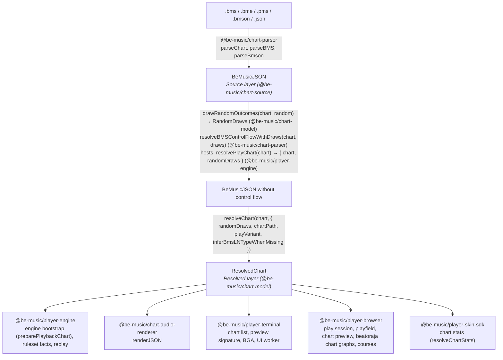
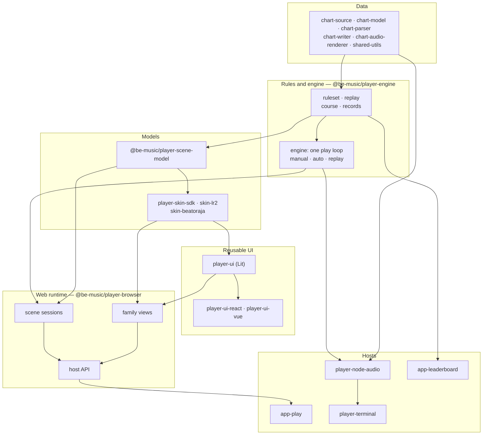

[Japanese version](./architecture.ja.md)

# Architecture

This document covers how a chart becomes something to play (the Source and Resolved layers), how the engine judges a play (a deterministic judge core and the one play loop around it), and the rules that keep these parts runtime-neutral and small.

be-music reads a chart in two layers. The **Source layer** says what the file says. The **Resolved layer** says what the player plays. Exactly one function, `resolveChart`, turns the first into the second, and every format default and de facto reading is applied there or in a helper it calls. Consumers read the Resolved layer and do not interpret the format again.

## Source layer

`BeMusicJSON` ([JSON spec](./json-spec.md)) represents a BMS or bmson file faithfully: raw channels and object values, header tables, measure lengths, the `#RANDOM` / `#SWITCH` blocks (`bms.controlFlow`), the bmson extensions, and the preservation data a round trip needs. Only `@be-music/chart-parser` and `@be-music/chart-writer` write it, and only they need to know how a file spells something.

A parsed chart still carries its control flow. Its `events` hold only the unconditional objects.

## Control flow and `RandomDraws`

The `#RANDOM` / `#SETRANDOM` / `#SWITCH` / `#SETSWITCH` outcomes of one play are a value, `RandomDraws`: one entry per line in file order. A host draws them once with `drawRandomOutcomes` (`@be-music/chart-model`) and resolves the chart with `resolveBMSControlFlowWithDraws` (`@be-music/chart-parser`), or does both with `resolvePlayChart` (`@be-music/player-engine`). It then hands the same chart and draws to every consumer of the play: the scene, the engine, the result screen and the replay. `evaluateControlFlow` in `@be-music/chart-model` is the only evaluator of the branch semantics. Applying the active header lines stays in the parser, because it reuses the parser's directive table. See [Player spec — Handling control syntax](./player-spec.md#handling-control-syntax).

## Resolved layer

`resolveChart(chart, options)` in `@be-music/chart-model` ([`resolved-chart.ts`](../packages/chart-model/src/resolved-chart.ts)) returns a `ResolvedChart`. The function is pure: the same chart and options always give the same value. The heavy parts are computed on first access and then kept, so a consumer pays only for what it reads.

| Field                                               | Contents                                                                                                                                                                                                                                                       |
| --------------------------------------------------- | -------------------------------------------------------------------------------------------------------------------------------------------------------------------------------------------------------------------------------------------------------------- |
| `source`, `sourceFormat`, `idBase`                  | The control-flow-resolved source chart (metadata, resources, raw sections) and its object-ID base                                                                                                                                                              |
| `randomDraws`, `hasUnresolvedControlFlow`           | The draws the chart was resolved with, and whether control flow is still on the chart. If it is, only the unconditional content is resolved: this is what a song list shows before any draw                                                                    |
| `playVariant`, `layouts`                            | The lane mode (the host's `playVariant`, otherwise `resolveChartPlayVariant` over the lanes in use and `chartPath`) and its play-mode table layouts                                                                                                            |
| `notes`                                             | Judged notes, `kind: 'tap' \| 'ln'`, with `channel` (the playable `1x` / `2x` lane), `beat`, `seconds`, `endBeat` / `endSeconds` / `lnMode` for long notes, `freeZone` for FREE ZONE tails, `sampleKey` and the source `event`. One note per lane and position |
| `shadowedNotes`                                     | Duplicate notes that lost their lane and position to a judged note and carry a different keysound                                                                                                                                                              |
| `mines`, `invisibleNotes`                           | `kind: 'mine'` with `damage` (gauge %), and `kind: 'invisible'`, both on the playable lane they sit on                                                                                                                                                         |
| `sampleTriggers`                                    | Every sound the chart triggers by itself or from a lane, with `#LNOBJ` ends and suppressed `#LNTYPE` halves left out and bmson slices (`c`) resolved                                                                                                           |
| `volumeChanges`                                     | BMS `#xxx97` / `#xxx98` dynamic volume changes with their bus and linear gain                                                                                                                                                                                  |
| `timing`, `beatResolver`, `sortedEvents`            | The tempo map (BPM points, STOP and `#STP` points, beat → seconds), measure-aware beat resolution, and the events in chart order                                                                                                                               |
| `reversal`                                          | Where the first negative `#BPMxx` arms LR2's reverse-scroll gimmick (`timing.reversal`, beat and seconds), if the chart has one ([BMS spec — Negative BPM](./bms-spec.md#negative-bpm-bpmxx-via-channel-08-basis))                                             |
| `scroll`, `speed`, `barLines`, `barLinesSuppressed` | SCROLL / SPEED keyframes and bar-line beats (none when bmson `lines: []` suppresses them)                                                                                                                                                                      |
| `bga`                                               | BGA cues (base, layer, layer 2, POOR) from BMS channels and bmson `bga` alike                                                                                                                                                                                  |
| `judgeRank`, `total`, `lnMode`                      | Inputs for the rulesets: `#RANK`, `#DEFEXRANK` / bmson `judge_rank`, the `#EXRANKxx` changes; `#TOTAL` (`absolute`) or bmson `total` (`percent`); the chart-level LN mode                                                                                      |
| `lastNoteSeconds`                                   | When the last judged note, mine or invisible object ends                                                                                                                                                                                                       |

Resolved notes keep a reference to the source `event`. The engine uses it to look up keysounds, and the logs use it to name objects. Play state is not part of the Resolved layer. The engine copies the notes into mutable play notes (`preparePlaybackChart` in `@be-music/player-engine`, which adds `judged` and lets lane options rewrite `channel`) and binds keys to lanes there.

### What stays outside

- **Ruleset choices** belong to `@be-music/player-engine`'s rulesets (`lr2`, `beatoraja`, `iidx`): judge windows from the judge-rank inputs, the default TOTAL and how bmson's percentage applies to it, gauge curves, and how an LN mode request plays (LN / CN / HCN). The Resolved layer gives them the chart's raw inputs.
- **Judgment-rank defaults**: `judgeRank` holds only what the chart sets. The bmson `judge_rank` default (100) and the BMS `#RANK` default (NORMAL) are filled by each ruleset and, for song screens, by `resolveDisplayedJudgeRankValue` / `Label` (`@be-music/player-engine/display`), which read the same facts. A replay records the chart's own values (`sourceRank` / `sourceExRank`), and a log without them must replay to the same windows, so the rulesets need the defaults anyway; filling them here would also change the recorded facts of every bmson chart without `judge_rank`.
- **Lane bindings and input**: key assignment, FREE ZONE aliases, scorable notes and lane options (RANDOM, MIRROR, FLIP) are play settings in `@be-music/player-engine`.
- **Rendering and audio output**: how the hosts draw and mix what the Resolved layer lists.

## Play-mode table

Every play mode (5 / 7 / 9 PMS / 9 BME / 10 / 14 / 24 / 48 KEY) is declared once in `PLAY_MODE_LAYOUTS` ([`play-modes.ts`](../packages/chart-model/src/play-modes.ts)): each lane's kind, side, display slot and BMS channels (visible, invisible, `#LNTYPE`, mine), plus FREE ZONE channels. The bmson `mode_hint` tables, the chart-writer's `x` map, the play-variant lane sets, the engine's lane layout, the TUI lane colours and the skin lane kinds are all derived from it. `ResolvedChart.layouts` is the entry for the chart's variant. See [Player spec — Play-mode table](./player-spec.md#play-mode-table).

## Where the rules live

| Rule                                                                                                                                                  | Module (`@be-music/chart-model`)                                                                                                   |
| ----------------------------------------------------------------------------------------------------------------------------------------------------- | ---------------------------------------------------------------------------------------------------------------------------------- |
| Branch semantics (`#RANDOM`, `#SWITCH`, nesting, unclosed `#IF`)                                                                                      | [`control-flow.ts`](../packages/chart-model/src/control-flow.ts)                                                                   |
| Lane mode (`resolveChartPlayVariant`), lanes per mode, bmson `mode_hint` lanes                                                                        | [`play-variant.ts`](../packages/chart-model/src/play-variant.ts), [`play-modes.ts`](../packages/chart-model/src/play-modes.ts)     |
| Beats from measure lengths, event order                                                                                                               | [`beats.ts`](../packages/chart-model/src/beats.ts) (`createBeatResolver`, `sortEvents`)                                            |
| BPM (`03` / `08`; zero ignored, a negative `#BPMxx` at its absolute value), the LR2 negative-BPM reversal, STOP and `#STP`, STOP at a note's position | [`timing.ts`](../packages/chart-model/src/timing.ts)                                                                               |
| `#LNOBJ`, `#LNTYPE 1` / `2` (and inference), bmson `l` / `t` / `ln_type`, FREE ZONE tails, one judged note per lane and position                      | [`long-notes.ts`](../packages/chart-model/src/long-notes.ts), [`resolved-notes.ts`](../packages/chart-model/src/resolved-notes.ts) |
| Mine damage (base-36 value, bmson `damage`, default 4 %), chart LN mode                                                                               | [`note-rules.ts`](../packages/chart-model/src/note-rules.ts)                                                                       |
| Sample triggers, bmson slices and `c`                                                                                                                 | [`sample-triggers.ts`](../packages/chart-model/src/sample-triggers.ts)                                                             |
| SCROLL / SPEED keyframes, bar lines, BPM / measure / STOP timelines                                                                                   | [`timelines.ts`](../packages/chart-model/src/timelines.ts)                                                                         |
| BGA cues                                                                                                                                              | [`bga.ts`](../packages/chart-model/src/bga.ts)                                                                                     |

The [Be-Music Fingerprint](./fingerprint-spec.md) reads its items through these same modules, so it identifies a chart by exactly what the Resolved layer plays; it only keeps exact measure positions where the Resolved layer has beats and seconds, and drives `control-flow.ts`'s frame operations for every outcome at once.

The reasons behind each reading, and every place where be-music departs from a specification on purpose, are recorded in [BMS / bmson compatibility notes](./format-compat.md) (§5 lists the decisions) and in the [BMS](./bms-spec.md) and [bmson](./bmson-spec.md) specs. Above the chart format, be-music follows LR2 first outside the judge rulesets; [LR2 and beatoraja semantics](./semantics-lr2-beatoraja.md) surveys where the two engines differ in judging, records, options and skins, and which layer each difference belongs to.

## Checking the layer

`test/regression/resolved-chart.test.ts` resolves every chart in `test/fixtures`, for each `#RANDOM` draw the regression corpus pins. It checks the result against the consumer helpers (`extractTimedNotes`, `collectSampleTriggers`, `createTimingResolver`) and against the pinned engine note list, triggers, tempo map and chart facts in `test/regression/__expected__` (see the [regression corpus](../test/regression/README.md)).

## The engine: judge core and one play loop

`@be-music/player-engine`'s engine ([`core/`](../packages/player-engine/src/core)) is a deterministic judge core driven by one play loop. Manual play, a replay and AUTO play differ only in the judge strategy plugged into the loop ([ADR 0003](./adr/0003-one-play-loop.md)).

- **The judge core** holds everything that decides a judgment in an explicit state object: note selection, the ruleset windows, long-note holds and tails, HCN gauge ticks, mines, auto-scratch, misses, combo, score and gauge. `runJudgeCoreStep(state, input, emit)` (or `stepJudgeCore(state, input)`, which returns the effects as an array) applies one input — `advance`, `press`, `hold`, `release` or `finish`, stamped with chart seconds — and reports what happened as effects: sounds and sound stops, gauge / combo / long-note changes, UI cues, replay records and trace lines. It takes key-state input only: a lane is down between its `hold` and its `release`, and a long note is held exactly while its lane is down (or while a let-go one waits out the ruleset's release margin). The core reads no clock, sets no timer and does no I/O, so the same state and inputs always give the same effects. `auto-judge-core.ts` does the same for AUTO play. The LR2 negative-BPM reversal reaches the cores as chart data (`reversalSeconds`, from `ResolvedChart.reversal`): past it they stop sweeping misses and mines and judge presses and releases on the mirrored clock `2R − now`, computed from the input's own chart time.
- **The play loop** runs every play: `manualPlay` and `autoPlay` (`play.ts`) are thin wrappers over an internal `play(chart, options, strategy)`. `play-session.ts` sets the play up: the chart resolved for play, the tempo clock, `preparePlaybackChart`, the ruleset and score, the replay recorder, the UI and input buses and runtimes, the audio session and the no-TUI trace. `play-loop.ts` (`runPlayLoop`) owns the rest: the lead-in, the play clock, the 60 Hz tick and the input wake-up that cuts it short, the horizon, the hold after the chart (`holdAfterChart`) and closing the runtimes. Each tick drains the input commands (`play-controls.ts`: pause, HIGH-SPEED, tempo changes and a replay's recorded ones, view changes for the replay, interrupts), queues the realtime audio due by the audio write head (`play-audio-cursor.ts`, one cursor for the volume changes, the background sounds and AUTO play's note keysounds), lets the strategy judge, and publishes a UI frame. Every strategy plays by the same rules: the input runtime starts before the lead-in, and an ESC during it ends the play before the chart's audio starts; the horizon is the chart's end plus the widest BAD reach plus a second, on the play clock; a play ends as soon as its chart is over and judged only without an audio session or a hold (`holdAfterChart`, which settles at the horizon); a play that was not interrupted publishes a closing frame after its end-of-play rules, at the time of its last frame, so the time it shows never steps back; a replay (`replayInputs` set, in either mode) records no tempo, follows `replayTempoChanges` and, given `replayAbortedAtUs`, stops where its log was aborted. `play-finish.ts` (`finishPlay`) ends every play the same way: an ESC returns the summary of an aborted play, a restart or Ctrl+C throws `PlayerInterruptedError`, anything else completes or fails; the replay and the no-TUI trace are closed there.
- **Judgment strategies** (`play-strategy.ts`) say how a play is judged. `play-manual.ts` feeds the judge core the play clock once per tick and every key event, stamped with the instant the key went down. An input runtime that declares its key releases (`PlayerInputRuntime.reportsKeyReleases`: the browser's, and the TUI's once the terminal has negotiated the kitty keyboard protocol) is key-state input from its first key; for input that reports no releases, `play-key-inference.ts` infers when each key came up until a `kitty-state` command shows otherwise, and the replay records those releases. `play-replay.ts` re-drives a recorded input stream (`PlayerOptions.replayInputs`) with `advanceJudgeCoreReplay`, from one instant to the next: to each recorded input's microsecond and to the microsecond after each timed judgment (a long-note tail, a miss deadline, an AUTO SCRATCH note, a mine check, from `nextTimedJudgmentUs`), so a replay's judgments do not depend on tick timing or `speed`. `play-auto.ts` steps the auto judge core and queues each note's keysound against the write head, ahead of its judgment. `manualPlay` picks the manual or the replay strategy, `autoPlay` the auto one.
- **Timed judgments** fall due once time has moved past their whole microsecond (the replay's clock). One instant settles long-note tails and held-back releases first, then Hell Charge gauge ticks, then AUTO SCRATCH notes, then misses, then mines, each in channel order; misses are taken at each note's own deadline. `finish` steps through every judgment still pending the same way before it applies the end-of-play rules, and an ESC abort stops where the judge stood (the replay records it as `play.abortedAtUs`). The replay simulator schedules the same judgments in the same order, so the two reach the gauge in the same sequence even where it clamps.
- **Shared rules.** The rules both the judge core and the replay simulator (`replay/simulate.ts`) apply live in the ruleset: windows and classification (`ruleset/judge.ts`), candidate selection (`ruleset/selection.ts`), the gauge (`ruleset/gauge.ts`), and the long-note rules — the mode a ruleset plays, the missed-charge-tail POOR, LR2's late LN-head BAD and the multi-BAD pruning (`ruleset/long-note.ts`). The simulator keeps its own microsecond event queue, so `replay/equivalence.test.ts` checks that the two reach the same judgments on the same input stream.
- **Services around the loop**: `engine-preparation.ts` (chart resolution for play, load progress, runtime start-up), `engine-audio.ts` (host audio-session initialization and the silent fallback), `engine-clock.ts` (the playback clock, and the scheduler the loop reads the time and waits through), `engine-effects.ts` (the judge's effects onto the host), `engine-trace.ts` (no-TUI output) and `engine-types.ts` (the public types). `engine.ts` is the public facade and the package root: the engine and its types only. What a host's runtimes exchange with a play, the lanes and what a host shows are the `./signals`, `./lanes` and `./display` entries ([Player spec — Entry points](./player-spec.md#entry-points)).

### Engine characterization tests

[`core/characterization/`](../packages/player-engine/src/core/characterization) pins what the engine does, so a refactor can show that it changes nothing it does not mean to: the one play loop (P1) replaced the two drivers they were written against and left every snapshot as it was, and then fixed the drifts between them one pull-request commit at a time, each saying which snapshots it changed. Each case plays a small synthetic chart (normal notes, long notes under each `#LNMODE`, mines, BPM / STOP / SCROLL / SPEED changes, `#EXRANK` changes, a chart that empties a survival gauge, a stitched two-stage NONSTOP chart) live with scripted input, as a replay of its own log and in AUTO, under each judge ruleset. Scenarios add the tempo set at the start and changed mid-play, view, HIGH-SPEED and pause commands, ESC, restart and Ctrl+C, a play that ends on failure, `holdAfterChart`, a course stage's carry-in, no UI, no audio session, an audio clock whose write head runs ahead, the lead-in, terminal input and an AUTO play started partway (`startAtSeconds`). A snapshot in `__expected__/` holds what a host can observe of each play: the summary, the replay and its re-simulation under every ruleset, the audio session's calls, the judge cues with the gauge, the UI commands and frames, the host callbacks and the text output. `driver-drift.test.ts` checks that manual and AUTO play, and a live play and its replay, agree where the old drivers drifted apart, including a play from input without key releases, whose replay and re-simulations now reach its live result. `seek-invariants.test.ts` compares an AUTO play started partway with a play from the chart's start, at the second it starts (`snapshotJudgeState`) and at the end.

The plays run on a virtual clock. `engine-clock.ts` reads the time and waits through an `EngineScheduler`, and a test swaps its own in with `setEngineScheduler` (test-only; no entry point exports it). Time then moves only while the play waits, so the suite is deterministic and runs in seconds, and `virtual-clock.test.ts` checks that a replay and an AUTO play reach the same results on the real clock. Run it with `pnpm exec vp test run packages/player-engine/src/core/characterization`. A changed snapshot means the engine's behaviour changed: update the snapshots (`-u`) only in a pull request that means to change that behaviour, and say why there. A refactor leaves them alone.

## Engine options by category

`PlayerOptions` is the union of five category types in [`engine-types.ts`](../packages/player-engine/src/core/engine-types.ts). Every field belongs to exactly one of them; `engine-types.test.ts` fails the type check otherwise. `PlayerPlaySettings` is meant to become the serializable `settings` of a future `play(chart, settings, runtime)` API, and the set a replay must record to reproduce a play.

| Category                                                 | Fields                                                                                                                                                                                                                                                                                                                                                                                                                                                                                              |
| -------------------------------------------------------- | --------------------------------------------------------------------------------------------------------------------------------------------------------------------------------------------------------------------------------------------------------------------------------------------------------------------------------------------------------------------------------------------------------------------------------------------------------------------------------------------------- |
| `PlayerPlaySettings`: decides judgments, score or chart  | `auto`, `autoScratch`, `gauge`, `judgeRuleset`, `randomDraws`, `speed`, `startAtSeconds`, `inferBmsLNTypeWhenMissing`, `laneModeExtension`, `playVariant`, `endOnFailure`, `course`                                                                                                                                                                                                                                                                                                                 |
| `PlayerPlayRuntime`: host services, callbacks, live data | `preparedChart`, `createUIRuntime`, `createInputRuntime`, `createAudioSession`, `signal`, `holdAfterChart`, `audioBaseDir`, `onLoadProgress`, `onLoadComplete`, `onHighSpeedChange`, `onTempoChange`, `onResolvedChart`, `onRulesetResolved`, `onLog`, `writeOutput`                                                                                                                                                                                                                                |
| `PlayerPlayTuning`: audio, latency and rendering knobs   | `audio`, `volume`, `bgmVolume`, `playVolume`, `compressor`, `compressorThresholdDb`, `compressorRatio`, `compressorAttackMs`, `compressorReleaseMs`, `compressorMakeupDb`, `limiter`, `limiterCeilingDb`, `limiterReleaseMs`, `leadInMs`, `audioOffsetMs`, `audioHeadPaddingMs`, `audioTailSeconds`, `audioLeadMs`, `audioLeadMaxMs`, `audioLeadStepUpMs`, `audioLeadStepDownMs`, `highSpeed`, `uiFPS`, `tui`, `tuiVisibleNotesLimit`, `tuiNoteHeight`, `imageResizeAlgorithm`, `videoBGAStreaming` |
| `PlayerPlayDebug`: diagnostic overrides                  | `judgeWindowMs` (changes judgments), `debugActiveAudio`, `showInvisibleNotes`, `missingSampleToneSeconds`                                                                                                                                                                                                                                                                                                                                                                                           |
| `PlayerPlayRecording`: replay capture and replay         | `recordReplay`, `onReplayRecorded`, `replayInputs`, `replayTempoChanges`, `replayAbortedAtUs`                                                                                                                                                                                                                                                                                                                                                                                                       |

Borderline fields:

- `auto`, `tui`, `audioTailSeconds` and `showInvisibleNotes` are not read by the engine. Hosts pick `autoPlay` or `manualPlay` themselves, and the replay takes `play.mode` from the judge strategy.
- `preparedChart` carries the chart after lane options. It is the chart, not a setting, and belongs to the `chart` argument of the future API. Until then it sits in the runtime group.
- `audioBaseDir` is a plain string, but it locates the host's files, so it counts as runtime.
- `audioOffsetMs` shifts the judge clock against live key presses, so it can move live judgments. Recorded inputs are already on chart time, so a replay does not need it.
- `highSpeed` only changes scrolling. A host can still keep it in the log's `play.native`.
- `recordReplay` declares `gauge`, `randomLane`, `dpFlip` and `native`, which are settings, next to the chart identity (`chartSHA256`, `chartMD5`, `sourceChart`, `recorder`).

What the replay (`ReplayPlay` in [`replay/format.ts`](../packages/player-engine/src/replay/format.ts)) does not record:

- `speed` is recorded as `play.tempo`, and the tempo changes during the play (`{ kind: 'tempo' }` input commands) as `play.tempoChanges`, but a re-simulation does not use them: inputs and judgments are in chart time. Input without release events (a terminal without the kitty keyboard protocol) has its releases inferred (`play-key-inference.ts`: a hold grace after each press, on the playback clock at the starting tempo, `1000 / speed` ms per chart second, so it stays linear in chart time), and the replay records those releases, so a replay and the re-simulations judge such a play as it was judged live ([Input without key releases](./replay.md#input-without-key-releases)).
- `inferBmsLNTypeWhenMissing` is not recorded. `chart.notes` keeps the long notes it produced, but replaying against the source chart needs the same flag.
- `laneModeExtension` and `playVariant` are recorded only as their result, `chart.laneMode`, and as the fingerprint's lane-mode input. Replaying against the source chart needs them to get the same lane mode and, under beatoraja, the same per-mode windows.

Replay fields with no matching option: `play.mode` (the judge strategy), `play.randomLane` and `play.dpFlip` (host lane options, applied through `preparedChart` and declared through `recordReplay`), `play.native`, and `play.aborted` / `play.abortedAtUs` (an outcome).

Audio implementations are host-provided. `@be-music/player-node-audio` owns the Node session, sample decoding through `chart-audio-renderer`, and PCM output through `node-web-audio-api`. The engine owns the `AudioSession` contract and passes its resolved chart to the factory; an absent adapter means silent playback. The terminal installs the Node adapter, and the browser installs its Web Audio adapter. Optional diagnostic duration loading is injected too ([ADR 0011](./adr/0011-host-provided-audio.md)).

## Target architecture

The packages were reshaped on `feat/course-definitions` before it goes to `devel`; the [migration](#migration) below keeps the record of each step. This section describes the shape they have now, which new and moved code follows. The [architecture decisions](./adr/README.md) record why.

An arrow points from a layer to a layer built on it.

- **Rules and engine** (`@be-music/player-engine`). One vocabulary for gauges, clear lamps, BP and the score (`./ruleset`); course runs, the NONSTOP pipeline and the course stage rules (`./course`); best-record merging per judge ruleset (`./records`); the replay format and its simulator (`./replay`) ([ADR 0004](./adr/0004-domain-rules-in-player.md)). The package root is the engine: one play loop with manual, auto and replay judge strategies ([ADR 0003](./adr/0003-one-play-loop.md)). What a host's runtimes exchange with a play, the lanes and what a host shows are the `./signals`, `./lanes` and `./display` entries ([Player spec — Entry points](./player-spec.md#entry-points)).
- **Scene models** (`@be-music/player-scene-model`). What every screen shows and how it behaves, independent of the skin family: the library entries (`LibraryChart`, `LibraryFolder`, `LibraryCourse`), the browse state and its snapshot (`BrowseState`, `BrowseSnapshot`), the play options, the play state (`PlayState`), the play result (`PlayResult`), the course view (`CourseView`) and the system sound sets ([ADR 0002](./adr/0002-scene-model-package.md), [Scene models](./scene-model.md)).
- **Skin models** (`player-skin-sdk`, `skin-lr2`, `skin-beatoraja`). Each parses its skins and maps the scene models to their vocabulary: the be-music skin contract (`@be-music/player-skin-sdk`), one table of LR2-compatible op / number / text / timer ids (`@be-music/skin-lr2/ids`) with the LR2 state resolvers (`@be-music/skin-lr2/state`), and the beatoraja state resolution (`@be-music/skin-beatoraja/scene`).
- **Reusable UI** (`player-ui`, `player-ui-react`, `player-ui-vue`). Lit Web Components receive SDK presentation data and emit operation requests. Native Skin adapts scene frames and actions to these components; React and Vue wrappers expose their properties, events and refs. The UI owns no play loop or audio, and the SDK does not depend on Lit ([Player UI](../packages/player-ui/README.md), [ADR 0013](./adr/0013-player-ui-components.md)).

- **Web runtime** (`@be-music/player-browser`). A scene session (`session/`) owns each screen's behaviour once, for every skin family: chart preparation, RANDOM / FLIP, audio and BGA, engine options, input, endings. A family view (`view/`) only draws the session's frames and returns intents ([ADR 0001](./adr/0001-skin-families-only-draw.md)). The host API (`./host`) makes every screen with `createSelectScene`, `createDecideScene`, `createPlayScene` or `createResultScene` from a family kit, as a `SessionScene` with the one scene lifecycle (`PixiScene`) that `PixiSceneHost` shows. Every sound outside a play's chart goes through one audio service (`./audio`, [ADR 0007](./adr/0007-one-system-audio-context.md)). See [Browser player — Scene sessions and family views](./player-web.md#scene-sessions-and-family-views).
- **Hosts.** The web demo is a set of services (`services/`) and routes (`app/routes/`: select, decide, play, result, replay, course and NONSTOP) that its composition root (`app/app.ts`) wires together, with one scene router (`app/scene-router.ts`) owning every transition ([ADR 0006](./adr/0006-scene-router.md)). `main.ts` only boots it, and a service imports no Tweakpane, UI (`ui/`) or app (`app/`) module ([Browser player — How the demo is built](./player-web.md#how-the-demo-is-built)). The terminal player plays through the engine and its `./signals`, `./lanes` and `./display` entries, and the Leaderboard checks and ranks runs with the rules (`./course`, `./replay`, `./ruleset`).

Rules that keep it cheap to change:

- One concept is defined in one place: a vocabulary type, a rule, a piece of state.
- What differs between skin families is how a scene is drawn and how a model maps to a skin's vocabulary, nothing else.
- Compose parts; do not absorb differences with base-class hooks.
- Rules, engine and models stay runtime-neutral and run in tests without Pixi, the DOM or Node.
- Packages export designed entry points, not their file layout ([ADR 0005](./adr/0005-public-entry-points.md)).
- No source file over 1,500 lines: the [allowlist](#layering-and-size-guards) is empty.

### Migration

| Phase                           | Work                                                                                                                   | Status      |
| ------------------------------- | ---------------------------------------------------------------------------------------------------------------------- | ----------- |
| [P0](#p0-safety-net)            | Safety net: engine snapshots and the course checklist end to end                                                       | done        |
| [P1](#p1-one-play-loop)         | One play loop with judge strategies                                                                                    | done        |
| [P2](#p2-domain-rules)          | Domain rules into `@be-music/player-engine`                                                                            | done        |
| [P3](#p3-scene-and-skin-models) | `@be-music/player-scene-model`; LR2 and beatoraja state mapping in the skin packages                                   | done        |
| [P4](#p4-web-runtime)           | Web runtime: scene sessions, family views, one lifecycle, one audio service, one host API                              | done        |
| [P5](#p5-web-demo)              | Web demo split into services behind a scene router                                                                     | done        |
| [P6](#p6-ready-for-devel)       | Public entry points, documentation, an empty file-size allowlist, changesets, a full check on real skins; then `devel` | in progress |

Each pull request keeps behaviour unless it says otherwise: a behaviour change (a fixed drift, a replay or fingerprint change) goes in its own pull request with its specification, golden values and changeset. Every pull request passes `pnpm run check`, the full test suite and the engine snapshots, and one that touches the scenes, the course flow or the demo host also passes the end-to-end suite ([`pnpm run test:e2e`](./course-checklist.md#automated-run)); each phase ends with the browser checklist, automated and on real skins.

Each phase has a table of its steps below. A pull request fills in only its own step's row as it lands (its PR and Status), and the phase table above changes only when a phase starts or ends. Keep a cell within the width its column already has, so the formatter does not re-pad the other rows.

#### P0: safety net

The engine's behaviour and the course flow, pinned down before anything moves.

| Step | What landed                                                                                                                                                    | Removed | PR                                                    | Status |
| ---- | -------------------------------------------------------------------------------------------------------------------------------------------------------------- | ------- | ----------------------------------------------------- | ------ |
| P0a  | Engine characterization snapshots on a virtual clock: charts × manual / auto / replay × tempo, ESC, failure, hold, NONSTOP                                     | —       | [#422](https://github.com/nulltask/be-music/pull/422) | done   |
| P0b  | The course browser checklist end to end (`pnpm run test:e2e`) with fixture charts and minimal fixture skins, read through the test hook `window.__beMusicTest` | —       | [#426](https://github.com/nulltask/be-music/pull/426) | done   |

#### P1: one play loop

| Step   | What landed                                                                                                                        | Removed                                                        | PR                                                    | Status |
| ------ | ---------------------------------------------------------------------------------------------------------------------------------- | -------------------------------------------------------------- | ----------------------------------------------------- | ------ |
| Loop   | Manual, auto and replay play through one play loop with judge strategies ([ADR 0003](./adr/0003-one-play-loop.md)), structure only | The two drivers, `core/manual-play.ts` and `core/auto-play.ts` | [#425](https://github.com/nulltask/be-music/pull/425) | done   |
| Drifts | The drifts between the old manual and auto drivers, fixed one by one                                                               | `StrategyDrifts`                                               | [#427](https://github.com/nulltask/be-music/pull/427) | done   |

#### P2: domain rules

| Step | What landed                                                                                                                                                              | Removed                                                                                                                                     | PR                                                    | Status |
| ---- | ------------------------------------------------------------------------------------------------------------------------------------------------------------------------ | ------------------------------------------------------------------------------------------------------------------------------------------- | ----------------------------------------------------- | ------ |
| P2a  | One vocabulary for gauges, clear lamps and BP (`@be-music/player-engine/ruleset`), and best records per judge ruleset ([ADR 0004](./adr/0004-domain-rules-in-player.md)) | The lamp and record rules copied in player-browser, the Leaderboard, the demo and skin-beatoraja; `core/groove-gauge` and `GrooveGaugeType` | [#424](https://github.com/nulltask/be-music/pull/424) | done   |
| P2b  | Course runs, the shared NONSTOP pipeline (the Leaderboard included) and the course stage rules, in `@be-music/player-engine/course`                                      | The course rules in player-browser's collection, the demo's `CourseSession`, the NONSTOP copies in the demo and the Leaderboard             | [#423](https://github.com/nulltask/be-music/pull/423) | done   |

#### P3: scene and skin models

| Step          | What landed                                                                                                                                                                                                                                  | Removed                                                                                           | PR                                                                                                           | Status |
| ------------- | -------------------------------------------------------------------------------------------------------------------------------------------------------------------------------------------------------------------------------------------- | ------------------------------------------------------------------------------------------------- | ------------------------------------------------------------------------------------------------------------ | ------ |
| P3a           | The `@be-music/player-scene-model` package ([ADR 0002](./adr/0002-scene-model-package.md)): library, browse and play options; then play state, play result, course view and system sounds                                                    | —                                                                                                 | [#429](https://github.com/nulltask/be-music/pull/429), [#431](https://github.com/nulltask/be-music/pull/431) | done   |
| P3b           | The LR2 id tables, `@be-music/skin-lr2/ids`, shared with `skin-beatoraja` and used by the web scenes                                                                                                                                         | The web scenes' bare LR2 numbers                                                                  | [#428](https://github.com/nulltask/be-music/pull/428)                                                        | done   |
| P3c-LR2       | `@be-music/skin-lr2/state` maps the scene models to LR2's ops, numbers, texts, sliders and timers for the select, decide, play and result screens and courses; the LR2 scenes call it                                                        | —                                                                                                 | [#433](https://github.com/nulltask/be-music/pull/433)                                                        | done   |
| P3c-beatoraja | `@be-music/skin-beatoraja/scene` maps them to beatoraja's ops, numbers, texts, timers, gauge and graphs for the play, select and result screens, courses and system sounds; the beatoraja runtime adapter and select / result scenes call it | The state resolution in player-browser: `BeatorajaRuntimeAdapter` thinned from 3,100 to 914 lines | [#434](https://github.com/nulltask/be-music/pull/434)                                                        | done   |

#### P4: web runtime

One scene lifecycle, scene sessions, family views (built-in, then LR2, then beatoraja), one audio service and one host API, with the old scene classes removed ([ADR 0001](./adr/0001-skin-families-only-draw.md)). The E steps are engine follow-ups and the B steps move-only splits that prepared the beatoraja views; D, R, S and PL are the decide, result, select and play chains. Z1 and Z2 close the phase.

| Step      | What landed                                                                                                                                                                                                                            | Removed                                                                                                                                                              | PR                                                                                                           | Status |
| --------- | -------------------------------------------------------------------------------------------------------------------------------------------------------------------------------------------------------------------------------------- | -------------------------------------------------------------------------------------------------------------------------------------------------------------------- | ------------------------------------------------------------------------------------------------------------ | ------ |
| P4.1      | One scene lifecycle: every built-in, LR2 and beatoraja scene implements `PixiScene` with an `identity` (`{ kind, family }`), and the web demo changes scenes only through `PixiSceneHost.setScene`                                     | —                                                                                                                                                                    | [#439](https://github.com/nulltask/be-music/pull/439)                                                        | done   |
| P4.2      | The audio service, `createAudioService`, over one system `AudioContext` ([ADR 0007](./adr/0007-one-system-audio-context.md))                                                                                                           | —                                                                                                                                                                    | [#436](https://github.com/nulltask/be-music/pull/436)                                                        | done   |
| P4.3      | The session and view contracts (`host/family-kit.ts`, `view/types.ts`), `SessionScene`, and the lint that keeps `session/` and `view/` apart                                                                                           | —                                                                                                                                                                    | [#438](https://github.com/nulltask/be-music/pull/438)                                                        | done   |
| E1        | An input runtime declares that it reports key releases (`PlayerInputRuntime.reportsKeyReleases`), so a browser's first press skips the key-state inference                                                                             | —                                                                                                                                                                    | [#437](https://github.com/nulltask/be-music/pull/437)                                                        | done   |
| E2        | The judge core takes key-state input only; input without releases goes through `play-key-inference.ts`, and a log recorded without releases is re-inferred (reverted in EP2, [#495](https://github.com/nulltask/be-music/pull/495))    | The core's paths for presses without releases: the hold grace, the long-note repeat suppression (`isLongNoteKeyRepeat`), the grace-based mine check, `keyStateInput` | [#441](https://github.com/nulltask/be-music/pull/441)                                                        | done   |
| E3        | The judge ruleset ids typed `RulesetId` everywhere; `JudgeWindowRuleset` stays as a deprecated alias                                                                                                                                   | —                                                                                                                                                                    | [#435](https://github.com/nulltask/be-music/pull/435)                                                        | done   |
| E4        | The score vocabulary exported from `@be-music/player-engine/ruleset`; `core/scoring` stays as a deprecated alias                                                                                                                       | —                                                                                                                                                                    | [#440](https://github.com/nulltask/be-music/pull/440)                                                        | done   |
| E5        | The less certain [#430](https://github.com/nulltask/be-music/issues/430) skin ids checked against OpenLR2 and beatoraja, and the id bugs among the known gaps fixed                                                                    | —                                                                                                                                                                    | [#443](https://github.com/nulltask/be-music/pull/443)                                                        | done   |
| B1        | `loadBeatorajaSceneKit` (`@be-music/player-browser/skin`) loads each beatoraja scene's skin into a `BeatorajaSceneKit`                                                                                                                 | The demo's copies of the per-entry skin loading                                                                                                                      | [#454](https://github.com/nulltask/be-music/pull/454)                                                        | done   |
| B2        | Move only: the beatoraja play skin view's graph and gauge renderers into `skin-view/`                                                                                                                                                  | —                                                                                                                                                                    | [#446](https://github.com/nulltask/be-music/pull/446)                                                        | done   |
| B3        | Move only: its text, number and image renderers and the Lua context; `skin-view.ts` off the file-size allowlist                                                                                                                        | —                                                                                                                                                                    | [#448](https://github.com/nulltask/be-music/pull/448)                                                        | done   |
| B4        | Move only: the song list rows of `PixiBeatorajaSelectScene` into `select/rows.ts`                                                                                                                                                      | —                                                                                                                                                                    | [#456](https://github.com/nulltask/be-music/pull/456)                                                        | done   |
| B5        | Move only: its search, chart images and skin state; `scene/beatoraja/select.ts` off the allowlist                                                                                                                                      | —                                                                                                                                                                    | [#458](https://github.com/nulltask/be-music/pull/458)                                                        | done   |
| D1        | The decide session: the built-in decide screen, made with `createDecideScene` and playing through the audio service                                                                                                                    | `DefaultPixiDecideView`, `CoreDecideView`                                                                                                                            | [#444](https://github.com/nulltask/be-music/pull/444)                                                        | done   |
| D2        | The LR2 decide view: the decide session with an LR2 kit                                                                                                                                                                                | `PixiDecideView`                                                                                                                                                     | [#450](https://github.com/nulltask/be-music/pull/450)                                                        | done   |
| D3        | The beatoraja decide view; every decide screen is now made with `createDecideScene`                                                                                                                                                    | `PixiBeatorajaDecideScene`                                                                                                                                           | [#463](https://github.com/nulltask/be-music/pull/463)                                                        | done   |
| R1        | The result session: the built-in result screen, made with `createResultScene` and playing its jingle through the audio service                                                                                                         | `DefaultPixiResultView`                                                                                                                                              | [#447](https://github.com/nulltask/be-music/pull/447)                                                        | done   |
| R2        | The LR2 result view: every LR2 result screen on the result session with an LR2 kit                                                                                                                                                     | `PixiResultView`, `CoreResultView`                                                                                                                                   | [#453](https://github.com/nulltask/be-music/pull/453)                                                        | done   |
| R3        | The beatoraja result view, reading a `PlayResult`; every result screen is now made with `createResultScene`                                                                                                                            | `PixiBeatorajaResultScene`, `BeatorajaSceneBgmPlayer`, `BeatorajaSceneTransition`                                                                                    | [#465](https://github.com/nulltask/be-music/pull/465)                                                        | done   |
| S1        | Move only: the select screen's pointer input into `session/select/`, its readme overlay and empty hint into `view/built-in/`                                                                                                           | —                                                                                                                                                                    | [#449](https://github.com/nulltask/be-music/pull/449)                                                        | done   |
| S2        | Move only: its browsing, keyboard and sound into `session/select/`, its drawing into `view/built-in/`; `scene/core/select.ts` off the allowlist                                                                                        | —                                                                                                                                                                    | [#452](https://github.com/nulltask/be-music/pull/452)                                                        | done   |
| S3        | The browse model: the built-in and LR2 select screens browse with `reduceBrowse`, `browseEntries`, `captureBrowse` / `restoreBrowse` and `browseSystemSound`, and keep a `BrowseSnapshot` across a play                                | `PixiSongSelectNavigation`, `resolveSelectNavigation`                                                                                                                | [#460](https://github.com/nulltask/be-music/pull/460)                                                        | done   |
| S4        | The select session: the built-in select screen, made with `createSelectScene` and playing through the audio service; its decide jingle plays out into the play                                                                         | `DefaultPixiSongSelectView`                                                                                                                                          | [#462](https://github.com/nulltask/be-music/pull/462)                                                        | done   |
| S5        | The LR2 select view: the select session with an LR2 kit                                                                                                                                                                                | `PixiSongSelectView`, `CoreSongSelectView`                                                                                                                           | [#464](https://github.com/nulltask/be-music/pull/464)                                                        | done   |
| S6        | The beatoraja select view; every select screen is now made with `createSelectScene` and browses with the browse model                                                                                                                  | `PixiBeatorajaSelectScene`; player-scene-model's `browseSnapshotFromBeatorajaSelect`; skin-lr2's `LR2_KEYS_FILTER_OPS`, `lr2CourseMatchesKeysFilter`                 | [#474](https://github.com/nulltask/be-music/pull/474)                                                        | done   |
| PL1       | Move only: the chart and media preparation out of `CoreGameplayView` into `session/play/`                                                                                                                                              | —                                                                                                                                                                    | [#442](https://github.com/nulltask/be-music/pull/442)                                                        | done   |
| PL2       | Move only: the playfield, BGA and chrome passes into `view/`                                                                                                                                                                           | —                                                                                                                                                                    | [#445](https://github.com/nulltask/be-music/pull/445)                                                        | done   |
| PL3       | Move only: the engine, input, view settings and ending into `session/play/`; `scene/core/gameplay.ts` off the allowlist (5,934 to 1,408 lines over PL1–PL3)                                                                            | —                                                                                                                                                                    | [#451](https://github.com/nulltask/be-music/pull/451)                                                        | done   |
| PL4       | One play state: the built-in and LR2 play screens keep one `PlayState` and read their result off it                                                                                                                                    | `JudgeTimingLog`, the scene's own score and gauge histories                                                                                                          | [#455](https://github.com/nulltask/be-music/pull/455)                                                        | done   |
| PL5       | The replay's view: those screens record `visibleMs` as the scene model's white number                                                                                                                                                  | `scene/core/lane-cover.ts`                                                                                                                                           | [#457](https://github.com/nulltask/be-music/pull/457)                                                        | done   |
| PL6       | The play session: the built-in play screen, made with `createPlayScene`, opening its audio through the audio service and playing the decide screen's `#RANDOM` draws                                                                   | `DefaultPixiGameplayView`                                                                                                                                            | [#461](https://github.com/nulltask/be-music/pull/461)                                                        | done   |
| PL7       | The LR2 play view: every LR2 play screen on the play session with an LR2 kit; the shared playfield asks each view's `PlayfieldSkin`                                                                                                    | `PixiGameplayView`, `CoreGameplayView`, `CoreGameplayState`                                                                                                          | [#466](https://github.com/nulltask/be-music/pull/466)                                                        | done   |
| PL8       | The beatoraja play view, playing the decide screen's `#RANDOM` draws (its layers first moved to `view/beatoraja/play`); every play screen is now made with `createPlayScene`                                                           | `PixiBeatorajaGameplayView`, `BeatorajaRuntimeAdapter`, `prepareBeatorajaGameplayChart`                                                                              | [#467](https://github.com/nulltask/be-music/pull/467), [#473](https://github.com/nulltask/be-music/pull/473) | done   |
| PL9       | beatoraja lane options: RANDOM, MIRROR, S-RANDOM and SCATTER apply as on every family, and go into the replay                                                                                                                          | —                                                                                                                                                                    | [#483](https://github.com/nulltask/be-music/pull/483)                                                        | done   |
| PL10      | beatoraja play-state choices: HS-FIX scrolling, lane covers from the play options, a DP chart's lanes keep the cover keys they take, every generic rank op (220-227) the EX score reaches, the skin's sound loops stopped as it leaves | —                                                                                                                                                                    | [#486](https://github.com/nulltask/be-music/pull/486)                                                        | done   |
| PL11      | beatoraja NONSTOP runs and replays on the theme's own play skin, NONSTOP results on its result skin; a course run's result read with `playResultFromCourseRun` on every family                                                         | player-scene-model's `playResultFromBeatoraja`, `beatorajaCompletionFromPlayResult`; the demo's `buildCourseResultSummary`                                           | [#487](https://github.com/nulltask/be-music/pull/487)                                                        | done   |
| Build fix | Explicit types where the `isolatedDeclarations` package build needs them; merges are now also checked with `vp run build`                                                                                                              | —                                                                                                                                                                    | [#459](https://github.com/nulltask/be-music/pull/459)                                                        | done   |
| BP fix    | An LR2-ruleset play's BP counts each empty POOR once                                                                                                                                                                                   | —                                                                                                                                                                    | [#481](https://github.com/nulltask/be-music/pull/481)                                                        | done   |
| Z1-docs   | The migration tracked in these per-phase tables; the course checklist's spec table brought up to date                                                                                                                                  | —                                                                                                                                                                    | [#489](https://github.com/nulltask/be-music/pull/489)                                                        | done   |
| Z1a       | `scene/` removed: its files move to `host/`, `stage/`, `chart/`, `session/play/` and `view/`                                                                                                                                           | `scene/` and its re-export shims                                                                                                                                     | [#491](https://github.com/nulltask/be-music/pull/491)                                                        | done   |
| Z1b       | The last bridges retired; the demo plays beatoraja skin sounds through the audio service                                                                                                                                               | `BeatorajaSkinAudioPlayer`, player-scene-model's `browseSnapshotFromSelectNavigation`                                                                                | [#488](https://github.com/nulltask/be-music/pull/488)                                                        | done   |
| Z1c       | The layering lint over all of `player-browser`: no lower layer imports an upper one, and only the audio layer creates an `AudioContext`                                                                                                | —                                                                                                                                                                    | [#494](https://github.com/nulltask/be-music/pull/494)                                                        | done   |
| Z1d       | Optional: one main-BPM rule for the replay's white number on every family                                                                                                                                                              | —                                                                                                                                                                    | [#503](https://github.com/nulltask/be-music/pull/503)                                                        | done   |
| Z2        | Library entries in chart wording: `LibraryEntry`'s `song` / `songs` become `chart` / `charts`; the test hook keeps its names                                                                                                           | The `song` / `songs` fields                                                                                                                                          | [#500](https://github.com/nulltask/be-music/pull/500)                                                        | done   |

#### P5: web demo

The web demo split into services behind one scene router ([ADR 0006](./adr/0006-scene-router.md)), on the new host API, keeping the end-to-end test hook (`window.__beMusicTest`). The F steps are behaviour fixes, each in a pull request of its own.

| Step  | Scope                                                                                         | PR                                                    | Status |
| ----- | --------------------------------------------------------------------------------------------- | ----------------------------------------------------- | ------ |
| P5.1a | The scene router module (`app/scene-router.ts`) with its unit tests, before `main.ts` uses it | [#492](https://github.com/nulltask/be-music/pull/492) | done   |
| P5.1b | Every scene transition through the scene router                                               | [#502](https://github.com/nulltask/be-music/pull/502) | done   |
| P5.2  | The settings service and a play-options service holding the full `PlayOptions`                | [#510](https://github.com/nulltask/be-music/pull/510) | done   |
| P5.3  | The Debug Menu in `ui/debug-menu/`                                                            | [#516](https://github.com/nulltask/be-music/pull/516) | done   |
| P5.4  | The library, records and course-maker services, and the drop target                           | [#514](https://github.com/nulltask/be-music/pull/514) | done   |
| P5.5  | The LR2, beatoraja and built-in theme services, and the family kits                           | [#519](https://github.com/nulltask/be-music/pull/519) | done   |
| P5.6  | The course service, and the course and NONSTOP routes                                         | [#522](https://github.com/nulltask/be-music/pull/522) | done   |
| P5.7a | The select and decide routes                                                                  | [#525](https://github.com/nulltask/be-music/pull/525) | done   |
| P5.7b | The play, result and replay routes                                                            | [#529](https://github.com/nulltask/be-music/pull/529) | done   |
| P5.8  | The replay, video recording and status services                                               | [#530](https://github.com/nulltask/be-music/pull/530) | done   |
| P5.9  | The test hook's state as a service; contract v1 unchanged                                     | [#534](https://github.com/nulltask/be-music/pull/534) | done   |
| P5.10 | `main.ts` down to the bootstrap, the app in `app/app.ts` and `app/shell.ts`, a services lint  | [#539](https://github.com/nulltask/be-music/pull/539) | done   |
| P5.F1 | A NONSTOP placement change redraws the select screen                                          | [#517](https://github.com/nulltask/be-music/pull/517) | done   |
| P5.F2 | F5 restarts an AUTO play as AUTO and a replay as a replay                                     | [#490](https://github.com/nulltask/be-music/pull/490) | done   |
| P5.F3 | A transition during a play ends the course run and finalizes its video recording              | [#507](https://github.com/nulltask/be-music/pull/507) | done   |

#### P6: ready for devel

Public entry points ([ADR 0005](./adr/0005-public-entry-points.md)), documentation, an empty file-size allowlist, changesets and a full check on real skins; then `feat/course-definitions` goes to `devel`. The move-only splits outside the web runtime landed early, and the demo's `main.ts`, the last file on the allowlist, came off it in P5.7b, so the allowlist is empty.

| Step           | Scope                                                                                                                                                                                                     | PR                                                    | Status  |
| -------------- | --------------------------------------------------------------------------------------------------------------------------------------------------------------------------------------------------------- | ----------------------------------------------------- | ------- |
| `skin-lr2`     | Move only: the LR2 skin parser, `src/skin.ts`, into `src/skin/`; off the allowlist                                                                                                                        | [#468](https://github.com/nulltask/be-music/pull/468) | done    |
| `chart-model`  | Move only: `src/index.ts` into modules; off the allowlist                                                                                                                                                 | [#469](https://github.com/nulltask/be-music/pull/469) | done    |
| `chart-parser` | Move only: `src/core/parser.ts` into modules; off the allowlist                                                                                                                                           | [#470](https://github.com/nulltask/be-music/pull/470) | done    |
| `chart-writer` | Move only: `src/index.ts` into modules; off the allowlist                                                                                                                                                 | [#471](https://github.com/nulltask/be-music/pull/471) | done    |
| TUI runner     | Move only: `player-terminal`'s `src/cli/runner.ts` into modules; off the allowlist                                                                                                                        | [#472](https://github.com/nulltask/be-music/pull/472) | done    |
| TUI screen     | Move only: `player-terminal`'s `src/tui/tui.ts` into modules; off the allowlist                                                                                                                           | [#482](https://github.com/nulltask/be-music/pull/482) | done    |
| TUI BGA        | Move only: `player-terminal`'s `src/bga.ts` into modules; off the allowlist                                                                                                                               | [#485](https://github.com/nulltask/be-music/pull/485) | done    |
| EP1            | `@be-music/player-engine`'s entries `./signals`, `./lanes` and `./display`, and the judge windows and replay ruleset ids on `./ruleset`; the TUI, player-skin-sdk and the regression tests use them       | [#496](https://github.com/nulltask/be-music/pull/496) | done    |
| EP2            | A replay no longer re-infers key releases for a replay recorded without them (before #432)                                                                                                                | [#495](https://github.com/nulltask/be-music/pull/495) | done    |
| EP3            | `@be-music/player-browser`'s entries `./host`, `./skin`, `./collection`, `./audio` and `./recording`; aliases removed (the `Pixi*` play-option types, `resolveSceneCourseInfo`, `PixiGameplayResultData`) | [#497](https://github.com/nulltask/be-music/pull/497) | done    |
| EP4            | `player-browser` imports the player's new entries, and the timing API from `@be-music/chart-model`                                                                                                        | [#499](https://github.com/nulltask/be-music/pull/499) | done    |
| EP5            | player-skin-sdk's `Browser*` library types become player-scene-model's `Library*` names (done in Z2)                                                                                                      | [#500](https://github.com/nulltask/be-music/pull/500) | done    |
| EP6            | The player's file-named subpaths retired (`core/*` with `core/scoring`, `utils`, `judging`, …), and chart-audio-renderer's `./triggers`                                                                   | [#501](https://github.com/nulltask/be-music/pull/501) | done    |
| EP7            | Optional: bench cases for every entry (skin-beatoraja's root, utils' Node-only subpaths)                                                                                                                  | [#498](https://github.com/nulltask/be-music/pull/498) | done    |
| Docs           | The documentation and the glossary in the target vocabulary                                                                                                                                               | [#531](https://github.com/nulltask/be-music/pull/531) | done    |
| Changesets     | The changesets folded together per package and change                                                                                                                                                     | [#528](https://github.com/nulltask/be-music/pull/528) | done    |
| Real skins     | The browser checklist by hand on real skins (the stock LR2 theme, ModernChic)                                                                                                                             | —                                                     | done    |
| `devel`        | `feat/course-definitions` merged into `devel`                                                                                                                                                             | —                                                     | planned |

## Layering and size guards

`pnpm run check` enforces these structural rules besides format, lint and types.

- **Runtime-neutral code.** `@be-music/chart-model`, `@be-music/chart-source`, `@be-music/chart-parser`, `@be-music/player-scene-model`, `@be-music/skin-lr2`'s `state/`, `@be-music/skin-beatoraja`'s `scene/` and `@be-music/player-engine`'s `core/`, `course/`, `replay/`, `records/` and `ruleset/`, with its `signals`, `lanes` and `display` entries and the modules they gather, run unchanged in the browser and in Node. Oxlint's `no-restricted-imports` and `no-restricted-globals` (configured in [`vite.config.ts`](../vite.config.ts)) reject Node built-in imports (`node:*` and bare names) and DOM / Node-only globals (`window`, `document`, `process`, `Buffer`, …) there. Runtime services come in through adapters instead: `PlayerOptions.createAudioSession` / `createUIRuntime` / `createInputRuntime`, and the parser's [`node-file.ts`](../packages/chart-parser/src/node-file.ts) (`parseChartFile`), which with the parser CLI is exempt. Tests are exempt too.
- **Deterministic judge.** `core/judge-*.ts`, `core/auto-judge-core.ts`, `ruleset/` and `replay/simulate.ts` additionally may not read `Date` or `performance`, set timers, or call `Math.random`: time and randomness are inputs. The scene models (`@be-music/player-scene-model`) and the LR2 and beatoraja state resolvers (`@be-music/skin-lr2`'s `state/`, `@be-music/skin-beatoraja`'s `scene/`) are held to the same rule: a scene's time comes in as an input.
- **Web runtime layers.** In `@be-music/player-browser`, the same Oxlint rules keep the layers apart ([Layering](./player-web.md#layering)): no lower layer (every directory but `host/`, `session/` and `view/`) imports the host, a session or a view, not even a type; a session and a view reach each other and the host only for types, a session uses Pixi only for types, and a view imports nothing of the engine, not even a type; only a session and `runtime/engine-driver.ts` import the engine as values; and only the audio layer, `runtime/`, creates an `AudioContext` or `OfflineAudioContext`. The last two rules cover the web demo too.
- **Web demo layers.** In the web demo, a service (`services/`) imports no Tweakpane, `ui/` or `app/` module, not even a type: it takes what it needs of the app as deps ([Browser player — How the demo is built](./player-web.md#how-the-demo-is-built)).
- **File-size budget.** [`scripts/lint/file-size-budget.ts`](../scripts/lint/file-size-budget.ts) fails when a package source file (tests, declarations and fixtures excluded) grows past 1,500 lines. Files that were already larger went on its allowlist, which only warns, and came off it as they were split; the list is empty now, and an allowlisted file that drops under the budget must be taken off it. Run it alone with `pnpm run check:file-size`.
