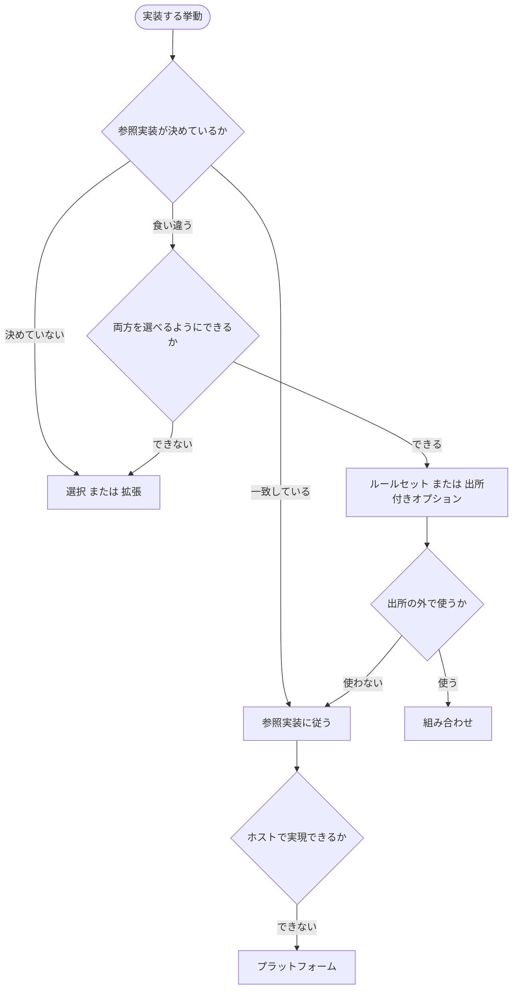

[English version](./be-music-behaviour.md)

# Be-Music 特有の解釈と挙動

Be-Music は、参照できる挙動があれば LR2 と beatoraja に従います。この索引には、譜面の解釈や再生が参照実装と異なる箇所、参照実装が挙動を定めていない箇所、プラットフォームの制約に合わせた箇所を載せます。

各項目には挙動と実装箇所を記します。詳しい仕様と根拠はリンク先で確認できます。参照実装と同じ挙動は一覧から省きます。

## 1. この文書の読み方

各行には種別が 1 つ付きます。

| 種別                 | 意味                                                                                                         |
| -------------------- | ------------------------------------------------------------------------------------------------------------ |
| **相違**             | 参照実装が挙動を決めていて、Be-Music は意図して別の挙動をとる。                                              |
| **拡張**             | LR2 も beatoraja もしないことを、Be-Music は読む、または演奏する。                                           |
| **選択**             | 参照実装どうしが食い違うか、何も決めていないので、Be-Music が 1 つに決める。                                 |
| **組み合わせ**       | ある出所の規則を、その出所が動かない場所で使う。beatoraja の判定ルールセットで LR2 のゲージを使う場合など。  |
| **プラットフォーム** | ブラウザやターミナルでは参照実装と同じことができない。または、参照実装の挙動がその環境でしか意味を持たない。 |

種別は次の規則で決まります。これはリポジトリが従う[参照実装との互換性の規則](../AGENTS.md)を言い直したものです。

判定ルールセットは `lr2`、`beatoraja`、`____`、`plugout` の 4 つです。「すべてのルールセット」はこの 4 つを指します。

## 2. BMS の読み込み

詳細：[BMS 実装仕様](./bms-spec.ja.md)、[互換性ノート §2](./format-compat-bms.ja.md#2-bms)。

### 2.1 行、ヘッダ、オブジェクト

| 挙動                                                                                                                                                                                                                                | 参照実装                                                                                    | 種別 | コード                                                            |
| ----------------------------------------------------------------------------------------------------------------------------------------------------------------------------------------------------------------------------------- | ------------------------------------------------------------------------------------------- | ---- | ----------------------------------------------------------------- |
| 行の前後の空白を除くので、字下げしたコマンドも読む。コマンドとチャネルは大文字と小文字を区別しない。ヘッダ名の後には空白、タブ、VT、FF のいずれかが必要で、`#TITLE:abc` はヘッダではない。                                          | beatoraja は字下げした行を読まず、名前の 1 文字後からを、その文字が何であっても引数とする。 | 相違 | [`parser.ts`][parser] `parseBMS`、`parseHeaderDirectiveLine`      |
| オブジェクトデータは最初の空白で終わる。ID に使えない文字は枠を取らずに飛ばし、端数の 1 文字は捨てる。                                                                                                                              | 未定義。                                                                                    | 選択 | [`event-utils.ts`][event-utils] `collectNonZeroObjectTokens`      |
| 値が空のヘッダは何も定義しない。スロットを設定せず、前の定義も上書きしない。知らないヘッダは `metadata.extras` に残す。                                                                                                             | 未定義。                                                                                    | 選択 | [`bms-headers.ts`][bms-headers]                                   |
| `#BASE` はパースの前に、制御構文とは無関係にファイル全体から探す。最後の `#BASE 36` または `#BASE 62` が有効になる。                                                                                                                | beatoraja と同じ。LR2 に `#BASE` はない。                                                   | 選択 | [`parser.ts`][parser] `detectBMSBase`                             |
| `#EXBPMxx` は `#BPMxx` として読む。`#WAVxx` と `#EXWAVxx` は同じ定義で、後の行が有効になる。                                                                                                                                        | LR2 も beatoraja も `#EXBPM` と `#EXWAV` を読まない。                                       | 拡張 | [`bms-headers.ts`][bms-headers]、[`wav-directives.ts`][wav]       |
| チャネル `03` のトークンは 16 進 2 桁。そうでないトークンは先頭から 16 進として読める分だけを読むので、`1G` は BPM 1、`G1` は無視する。                                                                                             | 不正なトークンについては未定義。                                                            | 選択 | [`channels.ts`][channels] `parseBPMFrom03Token`                   |
| ノートのチャネル `1x` / `2x` では、同じ位置のオブジェクトは後の行のものが前の行のものを置き換える。有効な分岐をまたいでも同じ。地雷と不可視オブジェクトはまとめず、`01` の行は重なる。`#LNOBJ` は残ったオブジェクトだけを組にする。 | 演奏チャネルについては beatoraja と同じ。LR2 の規則は分かっていない。                       | 選択 | [`resolved-notes.ts`][resolved-notes] `selectBMSNormalObjects`    |
| ロングノートは、その始点にある単発ノートに勝つ。置き換えられたノートのキー音が残ったノートと違えば、BGM として鳴らす。                                                                                                              | beatoraja は置き換えられたキー音を捨てる。                                                  | 相違 | [`resolved-notes.ts`][resolved-notes] `collapseSamePositionNotes` |
| `03` / `08` / `09` / `SC` / `SP` では、同じ位置のオブジェクトはファイル順を保ち、最後のものが有効になる。`08` は `03` に勝つ。                                                                                                      | beatoraja：後の行が勝つ。LR2：`08` が `03` に勝つ。同じチャネル内の順序は未定義。           | 選択 | [`beats.ts`][beats] `compareEvents`                               |
| 行順を記録する前に保存した JSON の譜面は、すべてのオブジェクトと以前の規則（最小のオブジェクト ID が勝つ）を保つ。                                                                                                                  | Be-Music 独自の形式。                                                                       | 選択 | [`resolved-notes.ts`][resolved-notes]                             |

### 2.2 制御構文

| 挙動                                                                                                                                                                                    | 参照実装                                                                              | 種別 | コード                                                                    |
| --------------------------------------------------------------------------------------------------------------------------------------------------------------------------------------- | ------------------------------------------------------------------------------------- | ---- | ------------------------------------------------------------------------- |
| 制御構文のコマンドをすべて読む：`#RANDOM`、`#SETRANDOM`、`#IF`、`#ELSEIF`、`#ELSE`、`#ENDIF`、`#ENDRANDOM`、`#SWITCH`、`#SETSWITCH`、`#CASE`、`#SKIP`、`#DEF`、`#ENDSW`。               | LR2 は `#RANDOM` / `#IF` / `#ENDIF`。beatoraja はそれに `#ENDRANDOM` を加える。       | 拡張 | [`control-flow.ts`（model）][cf-model]                                    |
| `#END IF` と単独の `#END` は `#ENDIF`、`#ELSE IF n` は `#ELSEIF n` として読む。書き出しは正式な綴りにする。                                                                             | 未定義。                                                                              | 選択 | [`control-flow.ts`（parser）][cf-parser]                                  |
| すべてのコマンドが 1 つのフレームスタックを共有する。`#ENDIF` は最も内側の `#IF` だけを閉じるので、閉じていない `#IF` は `#ENDRANDOM` の後も続く。`#RANDOM` のない `#IF` は成立しない。 | LR2 は 1 段だけ。beatoraja は `#RANDOM` のない `#IF` ブロックを警告付きで読む。       | 相違 | [`control-flow.ts`（model）][cf-model]                                    |
| `#RANDOM n` の `n` がない、0、負、数値でない場合は、結果を 1 に固定し、乱数を使わない。選ばれない分岐の中も含め、`#RANDOM` / `#SWITCH` の行ごとに抽選する。                             | beatoraja は `(int)(random × n) + 1` を計算するので、負の `n` では 1 以下の値になる。 | 相違 | [`control-flow.ts`（model）][cf-model] `drawRandomOutcomes`               |
| パーサはすべての分岐を残し、抽選はプレイごとに 1 回行う。1 度パースした譜面を、別の抽選結果で何度も演奏できる。                                                                         | LR2 と beatoraja は読み込み時に抽選する。                                             | 相違 | [`control-flow.ts`（parser）][cf-parser] `resolveBMSControlFlowWithDraws` |
| `#OPTION` の行は、分岐の中の行との宣言順を保つ。                                                                                                                                        | 制御構文と一緒に `#OPTION` を読む参照実装はない。                                     | 拡張 | [`parser.ts`][parser]                                                     |

### 2.3 文字コード

| 挙動                                                                                                                                                                            | 参照実装                                                                                           | 種別 | コード                                                      |
| ------------------------------------------------------------------------------------------------------------------------------------------------------------------------------- | -------------------------------------------------------------------------------------------------- | ---- | ----------------------------------------------------------- |
| 判定の順序は、BOM、`#CHARSET`（先頭 4,096 バイトから探す）、ASCII のみ、厳密な UTF-8、韓国語の EUC-KR、そして Shift_JIS・UTF-8・EUC-JP・ISO-8859-1 の採点（Shift_JIS を優先）。 | LR2 は Shift_JIS だけを読む。beatoraja は EUC-KR、MS932、UTF-8 を順に試し、`#CHARSET` を読まない。 | 選択 | [`bms-text-decode.ts`][decode]、[`bms-charset.ts`][charset] |
| 韓国語と判断するのは、上位バイトがすべて EUC-KR の組になり、非 ASCII 文字の 90 % 以上がハングル音節のときだけ。                                                                 | beatoraja の判定にはこの条件がなく、Shift_JIS の半角カタカナを韓国語と読むことがある。             | 相違 | [`bms-text-decode.ts`][decode] `tryDecodeKoreanEUCKr`       |

### 2.4 レーンモード

| 挙動                                                                                                                                        | 参照実装                                                                           | 種別 | コード                                                      |
| ------------------------------------------------------------------------------------------------------------------------------------------- | ---------------------------------------------------------------------------------- | ---- | ----------------------------------------------------------- |
| モードを決めるのは可視ノートとロングノートだけ。地雷と不可視ノートは使わない。これは[未解決の論点](./format-compat.ja.md#6-未解決の論点)。  | beatoraja は地雷と不可視ノートも数える。LR2 の規則は分かっていない。               | 相違 | [`play-variant.ts`][play-variant] `resolveChartPlayVariant` |
| 拡張子よりも、使っているレーンを優先する。6・7 鍵のない `.bme` は 5 KEY または 10 KEY。9 KEY の配置は `.pms` でなくてもレーンから判断する。 | `.bme` は beatoraja と同じ。LR2 と beatoraja は `.pms` のときだけ 9 KEY にする。   | 相違 | [`play-variant.ts`][play-variant]                           |
| チャネル `1A`–`1Z` / `2A`–`2Z` があれば 24 KEY、2P 側のレーンも使っていれば 48 KEY。`1P` / `1Q`（と `2P` / `2Q`）はホイール。               | LR2 も beatoraja も BMS の鍵盤モードを演奏しない。ホイールの綴りは Be-Music 独自。 | 拡張 | [`play-modes.ts`][play-modes]                               |
| FREE ZONE：5・7・10・14 KEY では、`17` / `27` のオブジェクトは 1 拍の長さを持ち、判定しない。                                               | beatoraja は捨てる。LR2 は `17` を鍵盤として扱う。                                 | 拡張 | [`resolved-notes.ts`][resolved-notes]                       |
| bmson の `beat-*` と `popn-*` のヒントは `x` の対応表を選ぶだけで、モードは決めない。モードは使っているレーンで決まる。                     | beatoraja はヒントを信用する。                                                     | 相違 | [`play-variant.ts`][play-variant]                           |

### 2.5 ロングノート、地雷、不可視ノート

| 挙動                                                                                                                                                                                        | 参照実装                                                       | 種別 | コード                                                        |
| ------------------------------------------------------------------------------------------------------------------------------------------------------------------------------------------- | -------------------------------------------------------------- | ---- | ------------------------------------------------------------- |
| `#LNTYPE 2` を演奏する。連続するセルの並びを 1 本のロングノートとし、最後のオブジェクトの 1 セル後で終わる。`#LNTYPE` のない譜面を Type 2 と推測するのは任意の機能で、連続が 2 回以上必要。 | LR2 も beatoraja も `#LNTYPE 2` を演奏しない。                 | 拡張 | [`long-notes.ts`][long-notes] `inferBMSLongNoteType`          |
| レーンに `5x` / `6x` のオブジェクトがあると、待っている `#LNOBJ` の始点を取り消す。専用チャネルが優先される。                                                                               | 未定義。                                                       | 選択 | [`long-notes.ts`][long-notes] `resolveLNOBJLongNotes`         |
| 前にノートのない `#LNOBJ` の終点と、終点のない `5x` / `6x` の始点は、単発ノートとして演奏する。                                                                                             | LR2 と同じ。beatoraja はどちらも捨てる。                       | 選択 | [`long-notes.ts`][long-notes]                                 |
| ロングノートのモードは、`#LNMODE`、`#OPTION charatbeatHDX:LONGMODE`、LN の順に決まる。bmson ではノートの `t`、`ln_type`、LN の順。何を演奏するかはそのあとルールセットが決める（§6）。      | LR2 に `#LNMODE` はない。beatoraja に HDX のオプションはない。 | 拡張 | [`note-rules.ts`][note-rules]、[`hdx-long-note-mode.ts`][hdx] |
| 地雷のダメージは 36 進の値そのままをゲージの割合とする。36 進 2 桁でない値は 4 %。`damage` のない bmson の地雷は 0。                                                                        | nanasigroove は値を半分にする。既定の 4 % は Be-Music 独自。   | 選択 | [`note-rules.ts`][note-rules] `resolveLandmineDamage`         |
| ノートの上やロングノートの中にある地雷は、BMS でも bmson でも残す。                                                                                                                         | LR2 と同じ。beatoraja は捨てる。                               | 選択 | [`resolved-notes.ts`][resolved-notes] `resolveMineNotes`      |

### 2.6 BPM、STOP、SCROLL、小節

| 挙動                                                                                                                                                                                            | 参照実装                                                                             | 種別 | コード                                                    |
| ----------------------------------------------------------------------------------------------------------------------------------------------------------------------------------------------- | ------------------------------------------------------------------------------------ | ---- | --------------------------------------------------------- |
| `#BPM` がない、または 0 以下の譜面は 130 で演奏する。                                                                                                                                           | LR2 はスクロールしない。beatoraja は譜面を拒否する。                                 | 相違 | [`parser.ts`][parser]                                     |
| 負の `#BPMxx` は、すべてのルールセットで LR2 の逆スクロールとして演奏する。逆転はイベントの譜面時刻で始まる。曲は計算済みの終了時刻で終わり、判定されなかったノートがあればプレイは失敗になる。 | LR2 は次のフレームで逆転し、ESC を待ち続ける。beatoraja は 0 以下の BPM を無視する。 | 相違 | [`timing.ts`][timing]、[`judge-core-advance.ts`][advance] |
| STOP の長さは小数を保ち、誤差なく扱う。0、負、未定義の `#STOPxx` は、以降を 1/192 小節だけ前にずらす。同じスロットの正の定義を置き換えることはない。                                            | LR2 は整数に切り捨てる。beatoraja は STOP ごとにマイクロ秒単位へ切り捨てる。         | 相違 | [`timing.ts`][timing]、[`bms-headers.ts`][bms-headers]    |
| `#STP` を演奏する。区切りは 1〜6 個の空白、タブ、全角空白。同じ位置の `#STP` は加算し、そこにある `#STOP` にも加算する。                                                                        | LR2 も beatoraja も `#STP` を読まない。                                              | 拡張 | [`timing.ts`][timing]                                     |
| `SCROLL` は 0 と負を含む有限の値をすべて受け付ける。`SPEED` は負の値と未定義のスロットを無視し、最初のキーフレームまでは 1.0 から補間する。                                                     | Bemuse は最初のキーフレームまで最初の `SPEED` の値を保つ。                           | 選択 | [`timelines.ts`][timelines]                               |
| 小節長は 0 より大きい有限の値。小節線はデータのある最後の小節まで、各小節の先頭に引く。`#BASEBPM` はハイスピードの基準 BPM にだけ使う。                                                         | LR2 は 4999 小節で止まる。beatoraja は `#BASEBPM` を読まない。                       | 選択 | [`beats.ts`][beats]、[`reference-bpm.ts`][reference-bpm]  |
| メイン BPM は、判定されるノートが最も多い BPM。同数なら先に現れる BPM。HS-FIX の `AVERAGE` は時間平均ではなくこれを使う。                                                                       | beatoraja の `MAINBPM` は、同数のときハッシュマップの順に従う。                      | 相違 | [`main-bpm.ts`][main-bpm]、[`hi-speed.ts`][hi-speed]      |

## 3. bmson の読み込み

詳細：[bmson 実装仕様](./bmson-spec.ja.md)、[互換性ノート §3](./format-compat-bmson.ja.md#3-bmson)。

| 挙動                                                                                                                                                                                                   | 参照実装                                                                             | 種別       | コード                                                                         |
| ------------------------------------------------------------------------------------------------------------------------------------------------------------------------------------------------------ | ------------------------------------------------------------------------------------ | ---------- | ------------------------------------------------------------------------------ |
| `version` は `1.0.0` だけを受け付ける。`version` のない譜面は、v0.21 のフィールドがあるときだけ v0.21 として読み、それ以外は拒否する。                                                                 | 仕様はどちらも認めている。jbms-parser はこのフィールドを読まない。                   | 選択       | [`bmson-document.ts`][bmson-doc]、[`bmson-legacy.ts`][bmson-legacy]            |
| `init_bpm` がない、または 0 以下ならエラー。負の `resolution` は絶対値として読む。`x` は切り捨て、`y` は最も近いパルスに丸める。                                                                       | beatoraja は `init_bpm` を検査せず、0 以下の `resolution` を 240 として読む。        | 相違       | [`bmson.ts`][bmson]                                                            |
| 知らない `mode_hint` は、使っている `x` がすべて収まれば `beat-7k` とする。収まらなければ、異なる `x` を小さい順にレーンへ割り当て、レーンを失わない。`generic-Nkeys` は 1〜70 鍵。                    | beatoraja は知らないヒントを `beat-7k` として読み、対応表の外のレーンを BGM にする。 | 相違       | [`bmson.ts`][bmson] `buildBmsonLaneMap`、[`generic-bmson.ts`][generic]         |
| `lines` のない譜面には 4/4 の小節線を引く。`lines: []` なら引かない。                                                                                                                                  | beatoraja は `lines` がなければ小節線を引かない。                                    | 相違       | [`bmson-document.ts`][bmson-doc]                                               |
| 同じパルスの STOP は加算する（BMS の `#STOP` は同じ位置で加算しない）。`scroll_events` の倍率は次のイベントまで続く。                                                                                  | beatoraja は、後のオブジェクトのために作るタイムラインを倍率 1.0 から始める。        | 相違       | [`bmson.ts`][bmson]                                                            |
| BPM、STOP、SCROLL は、異なる値ごとにキーを 1 つ持つ。1,295 を超えると譜面全体を base 62 のキーに切り替え、3,843 を超えるとキーを 3 文字に伸ばす。値は近似しない。そのような譜面は BMS に書き出せない。 | bmson に上限はない。BMS の ID は 2 文字。                                            | 選択       | [`bmson-keys.ts`][bmson-keys]、[`bms.ts`（writer）][writer-bms]                |
| 同じ sound channel の演奏ノートと同じ `y` にある BGM ノートは捨てる。                                                                                                                                  | 未定義。                                                                             | 選択       | [`bmson-document.ts`][bmson-doc]                                               |
| `c: true` のノートで始まる sound channel は、音声ファイルの先頭から鳴らす。                                                                                                                            | 未定義。                                                                             | 選択       | [`sample-triggers.ts`][sample-triggers] `createBmsonSamplePlaybackMap`         |
| `total` は、ルールセットごとの既定 TOTAL に対する百分率で、`0` は既定値を意味する。仕様が示す「`0` なら回復しない」という読み方は任意のプレイ方針で、選ぶとそのプレイはランキング対象外になる。        | beatoraja の読み方を、すべてのルールセットに当てはめている。                         | 組み合わせ | [`bmson-total.ts`][bmson-total]、[ADR 0030](./adr/0030-bmson-zero-total.ja.md) |

## 4. LRX

LRX の譜面は独立した形式として読み、`plugout` は独立したルールセットです（[ADR 0043](./adr/0043-lrx-charts.ja.md)、[ADR 0044](./adr/0044-plugout-ruleset.ja.md)）。plugout との違いは[互換性ノート §7.1](./format-compat.ja.md#71-plugout-と異なる点)にあります。次の代替の挙動は Be-Music 独自です。

| 挙動                                                                                                                                                                   | 参照実装                                                         | 種別       | コード                  |
| ---------------------------------------------------------------------------------------------------------------------------------------------------------------------- | ---------------------------------------------------------------- | ---------- | ----------------------- |
| 既知の `lanetype` がないとき、レーン 8 か 9 にノートがあり、レーン 0 と 10〜19 にノートがなければ 9 鍵とする。それ以外は beat の配置を使う。                           | plugout はヘッダの `lanetype` を必要とする。                     | 選択       | [`lrx.ts`][lrx]         |
| `c="301"` のノートがないとき、BPM は `.lrh` の `startbpm`、`basebpm`、130 の順に決める。ランクがなければ 2。                                                           | plugout は `startbpm` を表示するだけで、譜面の時間には使わない。 | 選択       | [`lrx.ts`][lrx]         |
| レーン種別の外にあるレーンのノートは BGM として鳴らす。                                                                                                                | plugout の挙動は確認していない。                                 | 選択       | [`lrx.ts`][lrx]         |
| `plugout` ルールセットでは、plugout のランクを持たない BMS と bmson の譜面を最も近いランクにする。LR2 のランクの軸で `round(percent / 25) − 1` を求め、0〜3 に収める。 | plugout はどちらの形式も読まない。                               | 組み合わせ | [`plugout.ts`][plugout] |

## 5. BMS と bmson の相互変換

詳細：[互換性ノート §4](./format-compat.ja.md#4-bms-と-bmson-の相互変換)。

| 挙動                                                                                                                                                                                     | 参照実装                                                 | 種別 | コード                                                                 |
| ---------------------------------------------------------------------------------------------------------------------------------------------------------------------------------------- | -------------------------------------------------------- | ---- | ---------------------------------------------------------------------- |
| BMS から bmson へは、`#RANK` 0〜4 を `judge_rank` 33 / 67 / 100 / 133 / 167 として書く。正の `#DEFEXRANK` はそのまま書く。bmson から BMS へは、`judge_rank` を `#DEFEXRANK` として書く。 | BmsONE は 40 / 60 / 80 / 100 / 120 を書く。              | 選択 | [`bmson.ts`（writer）][writer-bmson]、[`bms.ts`（writer）][writer-bms] |
| TOTAL は変換しない。変換先の形式の既定値が使われ、writer がそのことを報告する。                                                                                                          | 参照する変換ツールはない。                               | 選択 | [`bmson.ts`（writer）][writer-bmson]                                   |
| bmson から BMS へは、地雷のダメージを `01`〜`ZZ` に丸める。`damage` のない地雷（bmson では 0）は `01` として書く。                                                                       | BMS は 0 のダメージを表せない。                          | 選択 | [`bms.ts`（writer）][writer-bms]                                       |
| BMS から bmson へは、0、負、未定義の `#STOPxx` と `#BPMxx` を省く。逆スクロールと 1/192 小節のずれは失われる。プレイが変わるものは writer が報告する（`bpm`、`stop`）。                  | bmson にはそれらを表すフィールドがない。                 | 選択 | [`bmson.ts`（writer）][writer-bmson]                                   |
| 出力の分解能は、すべてのオブジェクトが整数パルスに乗る 240 の最小の倍数で、上限は 61,440。その格子でロングノートが潰れる場合はエラーにする。                                             | 参照する変換ツールはない。                               | 選択 | [`bmson-output-resolution.ts`][writer-resolution]                      |
| 正式な `mode_hint` のない配置は `generic-<レーン数>keys` として書く。generic のヒントを持つ譜面は BMS に書き出せない。                                                                   | 仕様は、新しい配置には新しいヒントを使うよう求めている。 | 選択 | [`bmson.ts`（writer）][writer-bmson]                                   |

## 6. 判定

詳細：[Player 実装仕様](./player-spec.ja.md)、[リプレイ仕様](./replay.ja.md#再現度に関する注意)。

| 挙動                                                                                                                                                                                                           | 参照実装                                                                      | 種別       | コード                                                                               |
| -------------------------------------------------------------------------------------------------------------------------------------------------------------------------------------------------------------- | ----------------------------------------------------------------------------- | ---------- | ------------------------------------------------------------------------------------ |
| `lr2` では、`#DEFEXRANK` と `#EXRANKxx` が `#RANK 2` の判定幅（18 / 40 / 100 ms）を `n / 100` 倍にする。BAD は 200 ms のまま。単位は nanasigroove のものなので、`#DEFEXRANK 133` は `#RANK 3` と同じではない。 | LR2 はどちらのコマンドも読まない。                                            | 組み合わせ | [`judge-window.ts`][judge-window] `resolveBMSJudgeWindowsMsForExRankValue`           |
| `#EXRANKxx` がプレイ中に判定幅を変えるのは `lr2` だけ。`beatoraja` では、`#DEFEXRANK` を judgerank `value × 75 / 100` として読む。                                                                             | beatoraja はチャネル `A0` を無視する。                                        | 組み合わせ | [`definitions.ts`][definitions]                                                      |
| `lr2` では、bmson の `judge_rank` を LR2 の百分率の軸（`value × 75 / 100`）に移し、`#RANK` の判定幅のあいだを補間する。そのため `judge_rank 120` と `#DEFEXRANK 120` は別の判定幅になる。                      | LR2 は bmson を読まない。モデルは lr2oraja のもの。                           | 組み合わせ | [`judge-window.ts`][judge-window]                                                    |
| `#LNMODE` は要求として扱う。`lr2` はすべてのロングノートを LN として、`____` と `plugout` はすべてを CN（譜面が求めれば HCN）として演奏し、`beatoraja` は譜面の求めるとおりに演奏する。ノート数もそれに従う。  | 各参照実装は自分の方式だけを演奏する。                                        | 選択       | [`long-note.ts`][ruleset-ln]                                                         |
| `____` の判定幅は暫定。実測に基づくのはノートの判定幅だけで、空 POOR の範囲と離しの範囲は beatoraja のもの。HCN のティックは 200 ms ごと。                                                                     | 実機は非公開で、HCN のティックは 16 分音符。                                  | 選択       | [`definitions.ts`][definitions]                                                      |
| 空 POOR は専用のカウンタを持ち、POOR の数と EX-SCORE を変えない。POOR として表示するか、コンボを切るかはルールセットが決める。                                                                                 | LR2 の POOR カウンタは 1 つ。                                                 | 選択       | [`judge-core-press.ts`][press]、[`score.ts`][score]                                  |
| `____` と `plugout` では、地雷は LR2 の規則に従う。押したときは早い GREAT の範囲内にある地雷が、押したままのときは通過した地雷が爆発する。                                                                     | どちらのゲームにも地雷はない。                                                | 組み合わせ | [`judge-core-advance.ts`][advance]                                                   |
| 負の BPM による逆転のあとは、折り返した時計で押下を判定する。判定されないノートを残して終わったプレイは、ゲージを 0 にする。                                                                                   | LR2 ではそのプレイが終わらない。                                              | 相違       | [`judge-core-advance.ts`][advance]、[`gauge.ts`][gauge]                              |
| コースの `no_good` と `no_great` の制約は、すべてのルールセットで有効。                                                                                                                                        | 定義しているのは beatoraja だけ。                                             | 組み合わせ | [`course.ts`（ruleset）][ruleset-course]                                             |
| nanasigroove の HELLJUDGE は、ルールセット自身の判定幅を 3/8、3/8、1/3、1/4（PGREAT から BAD）に狭める。GOOD2BAD と GREAT2BAD は判定を変えず、ゲージの増減だけを BAD のものにする。                            | nanasigroove は独自の判定表に差し替える。                                     | 組み合わせ | [`chart-judge.ts`][chart-judge]                                                      |
| nanasigroove の ADDMINE は、200 点満点のダメージを半分にしてゲージの割合とする。回復する地雷は何も起こさない。                                                                                                 | nanasigroove のゲージは 200 点満点で、回復する地雷がある。                    | 相違       | [`nanasi-add-mine.ts`][add-mine]                                                     |
| ANY KEY：押下は、どのレーンであっても、判定幅の中で最も近い未判定のノートを取る。同じ距離なら早いノート、次に小さいチャネル。                                                                                  | PC 版はこのオプションの名前を示すだけで、内容を説明していない。               | 選択       | [`any-key.ts`][any-key]                                                              |
| バックスピンスクラッチの始点が、対になる入力元を持たない入力（タッチ領域、ボタン）で押された場合、そのレーンへの新しい押下で終わる。                                                                           | beatoraja は別の入力元でしか終わらせない。入力元が 1 つでは終わらせられない。 | 相違       | [`input-source.ts`][input-source]、[ADR 0040](./adr/0040-replay-input-sources.ja.md) |
| デバッグ用の `judgeWindowMs` は BAD の幅だけを置き換え、そのプレイはアシスト扱いになる。                                                                                                                       | 参照実装にはない。                                                            | 拡張       | [`judge-window.ts`][judge-window]、[`assist-policy.ts`][assist]                      |

## 7. ゲージ、スコア、記録

詳細：[プレイオプション](./play-options.ja.md)、[コース](./course.ja.md)、[ADR 0019](./adr/0019-source-qualified-option-values.ja.md)。

| 挙動                                                                                                                                                                                          | 参照実装                                                                                       | 種別       | コード                                                                                     |
| --------------------------------------------------------------------------------------------------------------------------------------------------------------------------------------------- | ---------------------------------------------------------------------------------------------- | ---------- | ------------------------------------------------------------------------------------------ |
| `lr2:HARD` のような出所付きのゲージは、どの判定ルールセットでも、出所の増減表、TOTAL の読み方、ラダー、フォールバック、コースゲージを保つ。増減量は、判定ルールセットが出す判定の数で決まる。 | この組み合わせを定義する参照実装はない。                                                       | 組み合わせ | [`definitions.ts`][definitions]、[`gauge-type.ts`][gauge-type]                             |
| `____` では、ルールセットにない素のゲージと同じく、コースの外の出所のない `DEATH` を拒否し、そのリプレイも再判定しない。コースのステージでは段位ゲージで演奏する。                            | このゲームにそのゲージはない。                                                                 | 選択       | [`gauge-type.ts`][gauge-type]、[`rejudge.ts`][rejudge]                                     |
| LR2 の `DEATH` は LR2 自身に従う。回復せず、単曲の終わりに 80 % のボーダーがある。`DEATH-CORRECTED` は、そのボーダーのない同じゲージ。                                                        | lr2oraja のゲージは回復する。LR2 では、生き残った `DEATH` のプレイが失敗になることがある。     | 選択       | [`definitions.ts`][definitions]                                                            |
| ゲージの自動切り替えはすべてのルールセットで動く。ラダーは Be-Music が定める：LR2 は `EASY`、`GROOVE`、`HARD`、`DEATH`。`____` と plugout はそれに当たるゲージ。                              | 自動切り替えがあるのは beatoraja だけ。                                                        | 組み合わせ | [`gauge-shift.ts`][gauge-shift]                                                            |
| `lr2` は `#TOTAL` を整数に切り捨て、1 未満なら既定値を使う。`____` は TOTAL を読まず、報告する値は LR2 の曲線に従う。                                                                         | `____` が報告する値は Be-Music 独自。                                                          | 選択       | [`definitions.ts`][definitions]                                                            |
| 譜面の `774:GAMELEVEL_*` と `EXTRA_*` は、ルールセットのゲージに対応付ける。ルールセットにないゲージは `GROOVE` の側へ 1 段寄せる。                                                           | nanasigroove には独自のゲージがある。                                                          | 組み合わせ | [`chart-gauge.ts`][chart-gauge]、[ADR 0034](./adr/0034-chart-authored-gauge-options.ja.md) |
| LR2 のコースは LR2 自身のコースゲージで、`____` のコースは beatoraja の段位ゲージで演奏する。                                                                                                 | lr2oraja は LR2 のコースを beatoraja のゲージで演奏する。`____` に公開された段位ゲージはない。 | 選択       | [`course.ts`（ruleset）][ruleset-course]                                                   |
| コースのステージを ESC で投げたあとは、コースゲージの参照元に従う。LR2 のゲージは残っていれば次のステージへ進み、段位ゲージはそこで終わる。どちらでもコースは失敗になる。                     | LR2 は、ゲージが 2 % 以上なら次のステージへ進む。beatoraja はそこで終える。                    | 選択       | [`run.ts`][course-run], [`course.ts` (ruleset)][ruleset-course]                            |
| GRADE コースをクリアすると、プレイヤーの段位が決まる。段位はコース名から読み、1 つの序列（級、段、中伝、皆伝、発狂以上）に並べる。                                                            | どちらの参照実装も段位を記録しない。                                                           | 拡張       | [`dan-rank.ts`][dan-rank]                                                                  |
| PRACTICE はすべてのルールセットで動く。前後の余白は小節で数え、既定は前後 1 小節ずつ。                                                                                                        | PRACTICE があるのは beatoraja だけで、余白は 1,000 ms。                                        | 組み合わせ | [`practice.ts`][practice]                                                                  |
| EX-SCORE と、9 分割の DJ LEVEL は、ルールセット自身のスコアとは別に、すべてのルールセットで報告する。                                                                                         | 各ゲームは自分のスコアだけを表示する。                                                         | 組み合わせ | [`score.ts`][score]                                                                        |
| クリアランプは 11 段の 1 つの序列にまとめる。ゲージのランプはゲージの出所に、フルコンボのランプは判定ルールセットに従う。                                                                     | 各ゲームは独自のランプを持つ。                                                                 | 組み合わせ | [`clear-lamp.ts`][clear-lamp]                                                              |
| アシストかどうかはオプションの出所が、アシストの扱いは判定ルールセットが決める（[ADR 0031](./adr/0031-assist-record-policy.ja.md)）。                                                         | 各ゲームの方針は 1 つに固定されている。                                                        | 組み合わせ | [`assist-policy.ts`][assist]                                                               |
| 手動プレイはすべて送信できる。テンポを変えたプレイ、コースのステージ、bmson の TOTAL 0 のプレイは、保存するがランキングには載せない。                                                         | beatoraja の frequency trainer の規則を、すべてのルールセットに当てはめている。                | 組み合わせ | [`eligibility.ts`][eligibility]                                                            |
| リプレイは別のルールセットで再判定できる。結果は、再現できた、途中で切れた（`truncated`）、拒否した（`not-simulated`）のどれかを示す。入力を作り出すことはない。                              | 再判定する参照実装はない。                                                                     | 拡張       | [`rejudge.ts`][rejudge]                                                                    |
| NONSTOP は、既定ではステージを意図どおりに並べる。3 ステージ目からのバグを含む LR2 どおりの並べ方は、オプションとして選べる。bmson と混在のコースは既定の並べ方でだけ演奏できる。             | LR2 の NONSTOP は BMS だけ。                                                                   | 相違       | [`plan.ts`][nonstop-plan]、[ADR 0017](./adr/0017-bmson-nonstop.ja.md)                      |

## 8. プレイの操作と入力

| 挙動                                                                                                                                                                                            | 参照実装                                                 | 種別             | コード                                                             |
| ----------------------------------------------------------------------------------------------------------------------------------------------------------------------------------------------- | -------------------------------------------------------- | ---------------- | ------------------------------------------------------------------ |
| キーの離しを報告しないターミナルでは、押下のあと 120 ms、ロングノートの始点を取った押下のあとは 380 ms のあいだ、レーンを押したままとする。推測した離しはリプレイに記録する。                   | 参照実装は常に離しを受け取る。                           | プラットフォーム | [`play-key-inference.ts`][key-inference]                           |
| ブラウザでは、押下を次のフレームではなくイベントの時刻で判定し、OS のキーリピートは捨てる。                                                                                                     | ブラウザのイベントモデルに合わせた Be-Music 独自の扱い。 | プラットフォーム | [`web-input-runtime.ts`][web-input]                                |
| 8 ビットの位置を報告するターンテーブルは、2 目盛り動くとスクラッチを始めるか反転し、100 ms 動かなければ離す。                                                                                   | Be-Music 独自のしきい値。                                | プラットフォーム | [`arcade-gamepad.ts`][arcade-gamepad]                              |
| HI-SPEED は 0.5〜10.0 で、0.5 刻み。                                                                                                                                                            | Be-Music 独自の範囲と刻み。                              | 選択             | [`high-speed-control.ts`][high-speed]                              |
| プレイのテンポは 0.5 倍〜1.5 倍。                                                                                                                                                               | Be-Music 独自の範囲。                                    | 選択             | [`play-tempo.ts`][play-tempo]                                      |
| プレイ中にシークできる。AUTO、手動プレイ、リプレイのどれでも同じ。判定状態はシーク先で作り直し、シークしたプレイはリプレイを記録しない（[ADR 0016](./adr/0016-seek-play-loop-command.ja.md)）。 | プレイ中にシークする参照実装はない。                     | 拡張             | [`play-seek.ts`][play-seek]                                        |
| 画面のキー操作はスキンの系統に従う。LR2 のスキンは LR2 のキー配置を、beatoraja のスキンは beatoraja のキー配置を読む（[ADR 0038](./adr/0038-control-buttons-follow-skin-family.ja.md)）。       | 参照実装どうしで、同じキーの意味が違う。                 | 選択             | [`control-buttons.ts`][control-buttons]                            |
| Backspace を 500 ms 押し続けるとプレイをやめる。                                                                                                                                                | Be-Music 独自。                                          | プラットフォーム | [`quit-hold.ts`][quit-hold]                                        |
| 最後まで演奏したプレイは、最後のノートから 8 拍待ってからフェードアウトする。失敗したプレイは参照実装と同じくすぐに止まるが、音は閉じる演出のあいだにフェードアウトする。                       | LR2 と beatoraja は、失敗時に音を切る。                  | 相違             | [`result-delay.ts`][result-delay]、[`play-ending.ts`][play-ending] |

## 9. 音声とアセット

詳細：[Player 実装仕様 — 音声処理](./player-runtime.ja.md#音声処理)、[互換性ノート §2.19](./format-compat-bms.ja.md#219-アセットファイルの探し方)。

| 挙動                                                                                                                                                             | 参照実装                                                                     | 種別 | コード                                                      |
| ---------------------------------------------------------------------------------------------------------------------------------------------------------------- | ---------------------------------------------------------------------------- | ---- | ----------------------------------------------------------- |
| `#WAVCMD`、`#EXWAVxx`、`#PATH_WAV` が効く（[ADR 0024](./adr/0024-extended-bms-audio.ja.md)）。                                                                   | LR2 も beatoraja も読まない。                                                | 拡張 | [`wav-directives.ts`][wav]、[`sample-path.ts`][sample-path] |
| BMS の `#WAV` スロットは同時に 1 音、bmson の切り出しは重ねて鳴らす。この規則はスロットごとに決まるので、混在の NONSTOP コースの中の BMS ステージも 1 音のまま。 | LR2 はスロットごとに 1 音。                                                  | 選択 | [`wav-directives.ts`][wav] `usesMonophonicWAVPlayback`      |
| チャネル `97` と `98` は、そのあとに鳴り始める音の音量を決める。すでに鳴っている音の音量は変えない。                                                             | 未定義。                                                                     | 選択 | [`web-audio-session.ts`][web-audio]                         |
| 途中で切る切り出しは 1 ms のフェードで終える。                                                                                                                   | 未定義。                                                                     | 選択 | [`audio-transform.ts`][audio-transform]                     |
| ブラウザは、キー音と BGM を別々のコンプレッサーに通し、最後に 1 つのリミッターに通す。ターミナルは、リミッターを切ったとき BGM だけを下げる。                    | Be-Music 独自のミックス。                                                    | 選択 | [`audio-bus.ts`][audio-bus]、[`session.ts`][node-session]   |
| 見つからないファイルは、書かれた名前を最初に、次に別の拡張子で探す。Be-Music 独自なのは順序だけで、web プレイヤーは `.opus` と `.webp` を先に試す。              | LR2 は `.ogg` と `.wav` を試す。beatoraja は書かれた名前を最初には試さない。 | 選択 | [`collection.ts`][collection]                               |
| 見つからない動画は、譜面のフォルダと親フォルダで別の動画の拡張子を探し、そのあと静止画として探す。                                                               | LR2 は画像だけを試す。beatoraja は動画、次に画像を試す。                     | 選択 | [`collection.ts`][collection] `resolveChartBGAAsset`        |
| プレビュー用のファイルがなければ、ブラウザは譜面そのものを 30 秒鳴らし、最後の 3 秒でフェードアウトする。                                                        | LR2 は何も鳴らさない。                                                       | 拡張 | [`preview.ts`][preview]                                     |

## 10. BGA

詳細：[互換性ノート §2.17](./format-compat-bms.ja.md#217-bga)。

| 挙動                                                                                                                                                                      | 参照実装                                                         | 種別             | コード                                 |
| ------------------------------------------------------------------------------------------------------------------------------------------------------------------------- | ---------------------------------------------------------------- | ---------------- | -------------------------------------- |
| 2 枚目のレイヤー `0A`、`#BGA` の部分領域、EXBMP のカラーキー、チャネルの ARGB、SWBGA をすべて描く。                                                                       | LR2 は `04` と `07` を描く。beatoraja は `0A` を無視する。       | 拡張             | [`bga.ts`][bga]                        |
| BMS のレイヤーは真っ黒を透過し、bmson のレイヤーは黒を残す。この規則は画像スロットごとに決まるので、混在の NONSTOP コースの中でも成り立つ。                               | 形式によって違う。スロットごとに決めるのは Be-Music 独自。       | 選択             | [`bga.ts`][bga] `keysOutBGALayerBlack` |
| POOR レイヤーは 0.5 秒表示する。譜面の最初の `06` オブジェクトまでは `#BMP00` を代わりに使う。                                                                            | beatoraja は 500 ms 表示する。                                   | 選択             | [`bga-timeline.ts`][bga-timeline]      |
| 動画はプレイのテンポに従う。0.25 秒より大きくずれたら時刻を合わせ直す。ループせず、音は出さない。                                                                         | 未定義。                                                         | プラットフォーム | [`bga-renderer.ts`][bga-renderer]      |
| 条件が `play` または `always` で間隔を持つ bmson の BGA イベントレイヤーを、譜面時刻で動かす。リプレイでも同じ絵になる（[ADR 0022](./adr/0022-bmson-bga-events.ja.md)）。 | beatoraja はデータを保持するだけで、描くのは MISS レイヤーだけ。 | 拡張             | [`bmson-bga.ts`][bmson-bga]            |

## 11. 描画とスキン

詳細：[LR2 スキン実装ノート](./lr2-skin.ja.md)、[beatoraja スキン実装ノート](./beatoraja-skin.ja.md)、[ブラウザプレイヤー](./player-web.ja.md)。

| 挙動                                                                                                                                                               | 参照実装                                                         | 種別             | コード                                                                              |
| ------------------------------------------------------------------------------------------------------------------------------------------------------------------ | ---------------------------------------------------------------- | ---------------- | ----------------------------------------------------------------------------------- |
| 描画は判定ルールセットに属さない。どの譜面も LR2 の規則で描き、LR2 が演奏できない `SCROLL` または `SPEED` のある譜面だけは beatoraja の規則で描く。                | 各参照実装は自分の規則で描く。                                   | 選択             | [`note-draw-window.ts`][draw-window]                                                |
| 離した、または見逃したロングノートは、内蔵と LR2 の画面では半透明で描く。                                                                                          | LR2 と同じ。beatoraja は暗くしない。                             | 選択             | [`long-notes.ts`（view）][view-ln]                                                  |
| 24 KEY と 48 KEY の譜面は、7 KEY または 14 KEY の LR2 プレイスキンを枠として借り、レーンは Be-Music が描く。beatoraja のプレイスキンも、鍵盤数をまたいで代用する。 | LR2 に鍵盤モードはない。beatoraja は鍵盤数をまたいで代用しない。 | 拡張             | [`play-skin.ts`（LR2）][lr2-play-skin]、[`play-skin.ts`（beatoraja）][bo-play-skin] |
| `#RESOLUTION` のない LR2 スキンは、使っている座標からキャンバスの大きさを決める。上限は 2560×1440。                                                                | LR2 は常に 640×480。                                             | 拡張             | [`canvas.ts`][lr2-canvas]                                                           |
| LR2 の `#FONT` は、システムのサンセリフ体に 2 ピクセルの縁取りを付けて描く。LR2 と同じ見た目になるのは `#LR2FONT` のビットマップフォントだけ。                     | LR2 は指定された Windows のフォントで描く。                      | プラットフォーム | [`scene-render.ts`][lr2-scene-render]                                               |
| Be-Music が持たない LR2 の状態は固定の値を返す。ゴーストのオプションは常にオフで、データベースのタグの文字列は空。                                                 | LR2 は自分の楽曲データベースとインターネットランキングを読む。   | プラットフォーム | [`skin-lr2/src/state`][lr2-state]                                                   |
| beatoraja の Lua スキンはサンドボックスの中で動く。`io` と `os` はメモリ上のファイルを扱い、`os.clock()` はシーンの時計を返し、`luajava` は空のスタブ。            | beatoraja は、スキンに実際のファイルと Java のクラスを使わせる。 | プラットフォーム | [`lua.ts`][lua]                                                                     |
| beatoraja のブレンドモード 4 と 9 は、透明なキャンバスに合わせて変えてある。不透明なテクセルは beatoraja と同じ結果になり、透明なテクセルは絵を変えない。          | beatoraja は不透明なウィンドウに描く。                           | プラットフォーム | [`blend.ts`][blend]                                                                 |
| バトル用のスキン種別 12、13、14、18 は、バトルの配置なしでプレイスキンとして読み込む。                                                                             | beatoraja はバトルの配置で描く。                                 | プラットフォーム | [`types.ts`][bo-types]                                                              |
| Be-Music Skin は 854×480 のステージに自分で画面を描く。ステージは大きさを変えられる（[ADR 0021](./adr/0021-fluid-stage.ja.md)）。                                  | LR2 と beatoraja のスキンは、固定の画面が読むデータ。            | 拡張             | [`stage.ts`][stage]                                                                 |

[parser]: ../packages/chart-parser/src/core/parser.ts
[event-utils]: ../packages/chart-parser/src/core/event-utils.ts
[bms-headers]: ../packages/chart-parser/src/core/bms-headers.ts
[cf-parser]: ../packages/chart-parser/src/core/control-flow.ts
[decode]: ../packages/chart-parser/src/core/bms-text-decode.ts
[charset]: ../packages/chart-parser/src/core/bms-charset.ts
[bmson]: ../packages/chart-parser/src/core/bmson.ts
[bmson-doc]: ../packages/chart-parser/src/core/bmson-document.ts
[bmson-legacy]: ../packages/chart-parser/src/core/bmson-legacy.ts
[bmson-keys]: ../packages/chart-parser/src/core/bmson-keys.ts
[lrx]: ../packages/chart-parser/src/core/lrx.ts
[cf-model]: ../packages/chart-model/src/control-flow.ts
[wav]: ../packages/chart-model/src/wav-directives.ts
[channels]: ../packages/chart-model/src/channels.ts
[resolved-notes]: ../packages/chart-model/src/resolved-notes.ts
[beats]: ../packages/chart-model/src/beats.ts
[play-variant]: ../packages/chart-model/src/play-variant.ts
[play-modes]: ../packages/chart-model/src/play-modes.ts
[long-notes]: ../packages/chart-model/src/long-notes.ts
[note-rules]: ../packages/chart-model/src/note-rules.ts
[hdx]: ../packages/chart-model/src/hdx-long-note-mode.ts
[timing]: ../packages/chart-model/src/timing.ts
[timelines]: ../packages/chart-model/src/timelines.ts
[reference-bpm]: ../packages/chart-model/src/reference-bpm.ts
[main-bpm]: ../packages/chart-model/src/main-bpm.ts
[generic]: ../packages/chart-model/src/generic-bmson.ts
[sample-triggers]: ../packages/chart-model/src/sample-triggers.ts
[bga]: ../packages/chart-model/src/bga.ts
[writer-bms]: ../packages/chart-writer/src/bms.ts
[writer-bmson]: ../packages/chart-writer/src/bmson.ts
[writer-resolution]: ../packages/chart-writer/src/bmson-output-resolution.ts
[hi-speed]: ../packages/player-scene-model/src/play-state/hi-speed.ts
[judge-window]: ../packages/player-engine/src/core/judge-window.ts
[advance]: ../packages/player-engine/src/core/judge-core-advance.ts
[press]: ../packages/player-engine/src/core/judge-core-press.ts
[add-mine]: ../packages/player-engine/src/core/nanasi-add-mine.ts
[any-key]: ../packages/player-engine/src/core/any-key.ts
[input-source]: ../packages/player-engine/src/core/input-source.ts
[practice]: ../packages/player-engine/src/core/practice.ts
[key-inference]: ../packages/player-engine/src/core/play-key-inference.ts
[high-speed]: ../packages/player-engine/src/core/high-speed-control.ts
[play-seek]: ../packages/player-engine/src/core/play-seek.ts
[bga-timeline]: ../packages/player-engine/src/core/bga-timeline.ts
[bmson-bga]: ../packages/player-engine/src/core/bmson-bga.ts
[definitions]: ../packages/player-engine/src/ruleset/definitions.ts
[ruleset-ln]: ../packages/player-engine/src/ruleset/long-note.ts
[ruleset-course]: ../packages/player-engine/src/ruleset/course.ts
[score]: ../packages/player-engine/src/ruleset/score.ts
[gauge]: ../packages/player-engine/src/ruleset/gauge.ts
[gauge-type]: ../packages/player-engine/src/ruleset/gauge-type.ts
[gauge-shift]: ../packages/player-engine/src/ruleset/gauge-shift.ts
[chart-gauge]: ../packages/player-engine/src/ruleset/chart-gauge.ts
[chart-judge]: ../packages/player-engine/src/ruleset/chart-judge.ts
[clear-lamp]: ../packages/player-engine/src/ruleset/clear-lamp.ts
[bmson-total]: ../packages/player-engine/src/ruleset/bmson-total.ts
[plugout]: ../packages/player-engine/src/ruleset/plugout.ts
[assist]: ../packages/player-engine/src/records/assist-policy.ts
[dan-rank]: ../packages/player-engine/src/records/dan-rank.ts
[eligibility]: ../packages/player-engine/src/replay/eligibility.ts
[rejudge]: ../packages/player-engine/src/replay/rejudge.ts
[course-run]: ../packages/player-engine/src/course/run.ts
[nonstop-plan]: ../packages/player-engine/src/course/nonstop/plan.ts
[sample-path]: ../packages/chart-audio-renderer/src/core/sample-path.ts
[node-session]: ../packages/player-node-audio/src/session.ts
[audio-transform]: ../packages/shared-utils/src/audio-transform.ts
[web-input]: ../packages/player-browser/src/runtime/web-input-runtime.ts
[arcade-gamepad]: ../packages/player-browser/src/runtime/arcade-gamepad.ts
[play-tempo]: ../packages/player-browser/src/runtime/play-tempo.ts
[web-audio]: ../packages/player-browser/src/runtime/web-audio-session.ts
[audio-bus]: ../packages/player-browser/src/runtime/audio-bus.ts
[collection]: ../packages/player-browser/src/collection/collection.ts
[preview]: ../packages/player-browser/src/chart/preview.ts
[draw-window]: ../packages/player-browser/src/chart/note-draw-window.ts
[control-buttons]: ../packages/player-browser/src/session/controls/control-buttons.ts
[quit-hold]: ../packages/player-browser/src/session/play/quit-hold.ts
[result-delay]: ../packages/player-browser/src/session/play/result-delay.ts
[play-ending]: ../packages/player-browser/src/session/play/play-ending.ts
[bga-renderer]: ../packages/player-browser/src/view/shared/bga-renderer.ts
[view-ln]: ../packages/player-browser/src/view/shared/playfield/long-notes.ts
[lr2-scene-render]: ../packages/player-browser/src/skin/lr2/scene-render.ts
[blend]: ../packages/player-browser/src/skin/beatoraja/blend.ts
[lr2-play-skin]: ../packages/skin-lr2/src/play-skin.ts
[lr2-canvas]: ../packages/skin-lr2/src/skin/canvas.ts
[lr2-state]: ../packages/skin-lr2/src/state
[bo-play-skin]: ../packages/skin-beatoraja/src/play-skin.ts
[bo-types]: ../packages/skin-beatoraja/src/types.ts
[lua]: ../packages/skin-beatoraja/src/lua.ts
[stage]: ../packages/player-skin-sdk/src/stage.ts
