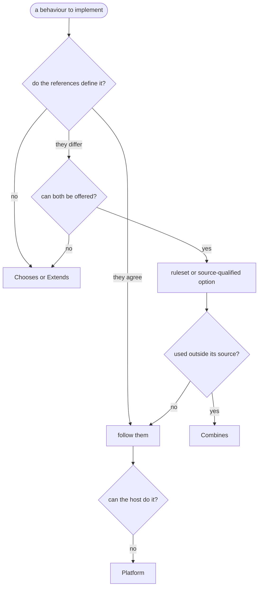

[Japanese version](./be-music-behaviour.ja.md)

# Be-Music-specific interpretations and behaviour

Be-Music aims to behave as LR2 and beatoraja do. This document lists the places where it does something of its own: it reads a chart differently from a reference, plays something no reference plays, picks a behaviour the references leave open, or works around its platform.

It is an index, not a specification. Each row states one behaviour and names the code that implements it; the linked documents hold the details and the evidence. Behaviour that simply matches the references is left out.

## 1. How to read this document

Each row carries one kind:

| Kind         | Meaning                                                                                                                         |
| ------------ | ------------------------------------------------------------------------------------------------------------------------------- |
| **Differs**  | A reference defines the behaviour and Be-Music does something else on purpose.                                                  |
| **Extends**  | Be-Music plays or reads something that neither LR2 nor beatoraja does.                                                          |
| **Chooses**  | The references disagree or define nothing, and Be-Music needs one behaviour.                                                    |
| **Combines** | A rule from one source runs where that source never ran, such as an LR2 gauge under beatoraja's judge ruleset.                  |
| **Platform** | The browser or the terminal cannot do what the reference does, or the reference's behaviour only makes sense on its own system. |

A behaviour gets its kind from the rule below, which restates the [reference compatibility rules](../AGENTS.md) the repository follows.

The judge rulesets are `lr2`, `beatoraja`, `____` and `plugout`. "Every ruleset" means all four.

## 2. Reading BMS

Details: [BMS implementation specification](./bms-spec.md) and [compatibility notes §2](./format-compat.md#2-bms).

### 2.1 Lines, headers and objects

| Behaviour                                                                                                                                                                                                   | References                                                                                          | Kind    | Code                                                              |
| ----------------------------------------------------------------------------------------------------------------------------------------------------------------------------------------------------------- | --------------------------------------------------------------------------------------------------- | ------- | ----------------------------------------------------------------- |
| Lines are trimmed, so an indented command is read. Commands and channels ignore case. A header needs a space, tab, VT or FF after its name; `#TITLE:abc` is not a header.                                   | beatoraja skips indented lines and takes the argument one character after the name, whatever it is. | Differs | [`parser.ts`][parser] `parseBMS`, `parseHeaderDirectiveLine`      |
| Object data ends at the first whitespace. A character outside the ID alphabet is skipped without taking a slot, and a trailing odd character is dropped.                                                    | Undefined.                                                                                          | Chooses | [`event-utils.ts`][event-utils] `collectNonZeroObjectTokens`      |
| A header with an empty value defines nothing: it neither sets a slot nor overrides an earlier definition. An unknown header is kept in `metadata.extras`.                                                   | Undefined.                                                                                          | Chooses | [`bms-headers.ts`][bms-headers]                                   |
| `#BASE` is scanned over the whole file before parsing, outside control flow, and the last `#BASE 36` or `#BASE 62` line wins.                                                                               | As beatoraja. LR2 has no `#BASE`.                                                                   | Chooses | [`parser.ts`][parser] `detectBMSBase`                             |
| `#EXBPMxx` is read as `#BPMxx`. `#WAVxx` and `#EXWAVxx` are one definition: the later line wins.                                                                                                            | LR2 and beatoraja read neither `#EXBPM` nor `#EXWAV`.                                               | Extends | [`bms-headers.ts`][bms-headers], [`wav-directives.ts`][wav]       |
| A channel `03` token is two hex digits. A token that is not falls back to a leading-hex parse, so `1G` is BPM 1 and `G1` is ignored.                                                                        | Undefined for invalid tokens.                                                                       | Chooses | [`channels.ts`][channels] `parseBPMFrom03Token`                   |
| On the note channels `1x` / `2x`, the object from the later line replaces the earlier one at a position, across active branches too. Mines and invisible objects are never collapsed, and `01` lines stack. | As beatoraja on playable channels. LR2's rule is not known.                                         | Chooses | [`resolved-notes.ts`][resolved-notes] `selectBMSNormalObjects`    |
| A long note wins over a tap at its start. A replaced note whose keysound differs from the kept one still sounds, as background audio.                                                                       | beatoraja discards the replaced keysound.                                                           | Differs | [`resolved-notes.ts`][resolved-notes] `collapseSamePositionNotes` |
| On `03` / `08` / `09` / `SC` / `SP`, objects at one position keep file order and the last takes effect; `08` beats `03`.                                                                                    | beatoraja: the later line wins. LR2: `08` beats `03`, same-channel order undefined.                 | Chooses | [`beats.ts`][beats] `compareEvents`                               |
| A JSON chart saved before line order was recorded keeps every object and the earlier rule (the lowest object ID wins).                                                                                      | Be-Music's own format.                                                                              | Chooses | [`resolved-notes.ts`][resolved-notes]                             |

### 2.2 Control flow

| Behaviour                                                                                                                                                                       | References                                                                               | Kind    | Code                                                                     |
| ------------------------------------------------------------------------------------------------------------------------------------------------------------------------------- | ---------------------------------------------------------------------------------------- | ------- | ------------------------------------------------------------------------ |
| Every control-flow command is read: `#RANDOM`, `#SETRANDOM`, `#IF`, `#ELSEIF`, `#ELSE`, `#ENDIF`, `#ENDRANDOM`, `#SWITCH`, `#SETSWITCH`, `#CASE`, `#SKIP`, `#DEF`, `#ENDSW`.    | LR2 has `#RANDOM` / `#IF` / `#ENDIF`; beatoraja adds `#ENDRANDOM`.                       | Extends | [`control-flow.ts` (model)][cf-model]                                    |
| `#END IF` and a bare `#END` are `#ENDIF`; `#ELSE IF n` is `#ELSEIF n`. Output uses the canonical spelling.                                                                      | Undefined.                                                                               | Chooses | [`control-flow.ts` (parser)][cf-parser]                                  |
| All commands share one frame stack. `#ENDIF` closes the innermost `#IF` only, so an unclosed `#IF` outlives `#ENDRANDOM`. An `#IF` with no `#RANDOM` never matches.             | LR2 has one level. beatoraja reads an `#IF` block without `#RANDOM`, with a warning.     | Differs | [`control-flow.ts` (model)][cf-model]                                    |
| A missing, zero, negative or non-numeric `#RANDOM n` is a single outcome of 1 and uses no random number. Every `#RANDOM` / `#SWITCH` line gets a draw, in untaken branches too. | beatoraja computes `(int)(random × n) + 1`, so a negative `n` gives values of 1 or less. | Differs | [`control-flow.ts` (model)][cf-model] `drawRandomOutcomes`               |
| The parser keeps every branch, and the draw happens once per play. A chart parsed once can be played many times with different draws.                                           | LR2 and beatoraja draw while loading.                                                    | Differs | [`control-flow.ts` (parser)][cf-parser] `resolveBMSControlFlowWithDraws` |
| `#OPTION` lines keep their declaration order against the lines inside branches.                                                                                                 | No reference reads `#OPTION` with control flow.                                          | Extends | [`parser.ts`][parser]                                                    |

### 2.3 Character encoding

| Behaviour                                                                                                                                                                                          | References                                                                                      | Kind    | Code                                                        |
| -------------------------------------------------------------------------------------------------------------------------------------------------------------------------------------------------- | ----------------------------------------------------------------------------------------------- | ------- | ----------------------------------------------------------- |
| The order is: a BOM, `#CHARSET` (looked for in the first 4,096 bytes), plain ASCII, strict UTF-8, Korean EUC-KR, then a score over Shift_JIS, UTF-8, EUC-JP and ISO-8859-1 that prefers Shift_JIS. | LR2 reads Shift_JIS only. beatoraja probes EUC-KR, MS932 and UTF-8, and never reads `#CHARSET`. | Chooses | [`bms-text-decode.ts`][decode], [`bms-charset.ts`][charset] |
| A file is Korean only when every high byte pairs as EUC-KR and at least 90 % of its non-ASCII characters are Hangul syllables.                                                                     | beatoraja's probe has no such guard, so Shift_JIS half-width katakana can read as Korean.       | Differs | [`bms-text-decode.ts`][decode] `tryDecodeKoreanEUCKr`       |

### 2.4 Lane mode

| Behaviour                                                                                                                                                              | References                                                                              | Kind    | Code                                                        |
| ---------------------------------------------------------------------------------------------------------------------------------------------------------------------- | --------------------------------------------------------------------------------------- | ------- | ----------------------------------------------------------- |
| Only visible notes and long notes decide the mode. Mines and invisible notes never do. This is an [open question](./format-compat.md#6-known-open-questions).          | beatoraja counts mines and invisible notes. LR2's rule is not known.                    | Differs | [`play-variant.ts`][play-variant] `resolveChartPlayVariant` |
| The lanes in use win over the file extension: a `.bme` chart without the 6th and 7th keys is 5 or 10 KEY. A 9 KEY layout is recognised from its lanes, without `.pms`. | `.bme` as beatoraja. LR2 and beatoraja take 9 KEY from `.pms` only.                     | Differs | [`play-variant.ts`][play-variant]                           |
| Channels `1A`–`1Z` / `2A`–`2Z` select 24 KEY, or 48 KEY when a 2P lane is used. `1P` / `1Q` (and `2P` / `2Q`) are the wheel.                                           | LR2 and beatoraja play no keyboard mode from BMS. The wheel spelling is Be-Music's own. | Extends | [`play-modes.ts`][play-modes]                               |
| FREE ZONE: under 5, 7, 10 and 14 KEY, an object on `17` / `27` gets a one-beat tail and is not judged.                                                                 | beatoraja drops it. LR2 treats `17` as a key.                                           | Extends | [`resolved-notes.ts`][resolved-notes]                       |
| A bmson `beat-*` or `popn-*` hint picks the `x` table but does not fix the mode; the lanes in use still decide it.                                                     | beatoraja trusts the hint.                                                              | Differs | [`play-variant.ts`][play-variant]                           |

### 2.5 Long notes, mines and invisible notes

| Behaviour                                                                                                                                                                                      | References                                                    | Kind    | Code                                                          |
| ---------------------------------------------------------------------------------------------------------------------------------------------------------------------------------------------- | ------------------------------------------------------------- | ------- | ------------------------------------------------------------- |
| `#LNTYPE 2` plays: a run of consecutive cells is one long note that ends one cell after the last object. Guessing Type 2 for a chart without `#LNTYPE` is opt-in and needs two continuations.  | Neither LR2 nor beatoraja plays `#LNTYPE 2`.                  | Extends | [`long-notes.ts`][long-notes] `inferBMSLongNoteType`          |
| A `5x` / `6x` object on a lane clears the pending `#LNOBJ` start, so the dedicated channels win.                                                                                               | Undefined.                                                    | Chooses | [`long-notes.ts`][long-notes] `resolveLNOBJLongNotes`         |
| An `#LNOBJ` end with no note before it, and a `5x` / `6x` start with no end, play as taps.                                                                                                     | As LR2. beatoraja drops both.                                 | Chooses | [`long-notes.ts`][long-notes]                                 |
| The long-note mode comes from `#LNMODE`, then `#OPTION charatbeatHDX:LONGMODE`, then LN. For bmson it is the note's `t`, then `ln_type`, then LN. The ruleset then decides what it plays (§6). | LR2 has no `#LNMODE`. beatoraja has no HDX option.            | Extends | [`note-rules.ts`][note-rules], [`hdx-long-note-mode.ts`][hdx] |
| Mine damage is the raw base-36 value as a gauge percentage. A value that is not two base-36 digits deals 4 %. A bmson mine without `damage` deals 0.                                           | nanasigroove halves the value. The 4 % default is Be-Music's. | Chooses | [`note-rules.ts`][note-rules] `resolveLandmineDamage`         |
| A mine on a note or inside a long note is kept, in BMS and bmson.                                                                                                                              | As LR2. beatoraja drops it.                                   | Chooses | [`resolved-notes.ts`][resolved-notes] `resolveMineNotes`      |

### 2.6 BPM, STOP, SCROLL and measures

| Behaviour                                                                                                                                                                                                | References                                                                              | Kind    | Code                                                      |
| -------------------------------------------------------------------------------------------------------------------------------------------------------------------------------------------------------- | --------------------------------------------------------------------------------------- | ------- | --------------------------------------------------------- |
| A chart with no `#BPM`, or a zero or negative one, plays at 130.                                                                                                                                         | LR2 does not scroll. beatoraja refuses the chart.                                       | Differs | [`parser.ts`][parser]                                     |
| A negative `#BPMxx` plays LR2's reverse scroll under every ruleset. The reversal starts at the event's chart time, and the song still ends at its computed end with the unjudged notes failing the play. | LR2 reverses on the next frame and waits for ESC. beatoraja ignores a BPM of 0 or less. | Differs | [`timing.ts`][timing], [`judge-core-advance.ts`][advance] |
| STOP lengths keep their decimals and stay exact. A zero, negative or undefined `#STOPxx` moves what follows 1/192 of a measure earlier, and never replaces a positive definition of the same slot.       | LR2 truncates to an integer. beatoraja truncates each stop to whole microseconds.       | Differs | [`timing.ts`][timing], [`bms-headers.ts`][bms-headers]    |
| `#STP` plays. The separator is one to six spaces, tabs or full-width spaces. `#STP` lines at one position add up, and add to a `#STOP` there.                                                            | Neither LR2 nor beatoraja reads `#STP`.                                                 | Extends | [`timing.ts`][timing]                                     |
| `SCROLL` takes any finite value, zero and negative included. `SPEED` ignores a negative value and an undefined slot, and ramps from 1.0 before its first keyframe.                                       | Bemuse holds the first `SPEED` value before the first keyframe.                         | Chooses | [`timelines.ts`][timelines]                               |
| A measure length is any finite value above 0. Bar lines start each measure up to the last one with data. `#BASEBPM` is only the reference BPM for hi-speed.                                              | LR2 stops at measure 4999. beatoraja does not read `#BASEBPM`.                          | Chooses | [`beats.ts`][beats], [`reference-bpm.ts`][reference-bpm]  |
| The main BPM is the one the most judged notes sit at. A tie goes to the BPM reached first. HS-FIX `AVERAGE` uses it, not a time average.                                                                 | beatoraja's `MAINBPM` breaks ties by hash-map order.                                    | Differs | [`main-bpm.ts`][main-bpm], [`hi-speed.ts`][hi-speed]      |

## 3. Reading bmson

Details: [bmson implementation specification](./bmson-spec.md) and [compatibility notes §3](./format-compat.md#3-bmson).

| Behaviour                                                                                                                                                                                                                    | References                                                                              | Kind     | Code                                                                        |
| ---------------------------------------------------------------------------------------------------------------------------------------------------------------------------------------------------------------------------- | --------------------------------------------------------------------------------------- | -------- | --------------------------------------------------------------------------- |
| Only `version` `1.0.0` is accepted. A chart without `version` is read as v0.21 only when it has v0.21 fields; otherwise it is refused.                                                                                       | The specification allows either. jbms-parser never reads the field.                     | Chooses  | [`bmson-document.ts`][bmson-doc], [`bmson-legacy.ts`][bmson-legacy]         |
| A missing, zero or negative `init_bpm` is an error. A negative `resolution` is its absolute value. `x` is floored and `y` is rounded to the nearest pulse.                                                                   | beatoraja does not check `init_bpm` and reads a `resolution` of 0 or less as 240.       | Differs  | [`bmson.ts`][bmson]                                                         |
| An unknown `mode_hint` is `beat-7k` when every `x` in use fits it. Otherwise the distinct `x` values become lanes in ascending order, so no lane is lost. `generic-Nkeys` takes 1 to 70 keys.                                | beatoraja reads an unknown hint as `beat-7k` and sends the lanes past its table to BGM. | Differs  | [`bmson.ts`][bmson] `buildBmsonLaneMap`, [`generic-bmson.ts`][generic]      |
| A chart without `lines` gets 4/4 bar lines. `lines: []` draws none.                                                                                                                                                          | beatoraja draws no bar line when `lines` is missing.                                    | Differs  | [`bmson-document.ts`][bmson-doc]                                            |
| Stops on one pulse add up, where BMS `#STOP` objects at one position do not. A `scroll_events` rate holds until the next event.                                                                                              | beatoraja starts the timelines it creates for later objects at rate 1.0.                | Differs  | [`bmson.ts`][bmson]                                                         |
| BPM, STOP and SCROLL values get one key per distinct value. Past 1,295 entries the chart moves to base-62 keys, and past 3,843 the keys grow to three characters. No value is approximated; BMS export refuses such a chart. | bmson has no limit; BMS IDs have two characters.                                        | Chooses  | [`bmson-keys.ts`][bmson-keys], [`bms.ts` (writer)][writer-bms]              |
| A BGM note at the same `y` as a playable note of the same sound channel is dropped.                                                                                                                                          | Undefined.                                                                              | Chooses  | [`bmson-document.ts`][bmson-doc]                                            |
| A sound channel that starts with a `c: true` note plays from the start of its file.                                                                                                                                          | Undefined.                                                                              | Chooses  | [`sample-triggers.ts`][sample-triggers] `createBmsonSamplePlaybackMap`      |
| `total` is a percentage of the ruleset's own default TOTAL, and `0` means the default. Reading `0` as "no recovery", as the specification implies, is an opt-in play policy that leaves the play unranked.                   | beatoraja's reading, applied to every ruleset.                                          | Combines | [`bmson-total.ts`][bmson-total], [ADR 0030](./adr/0030-bmson-zero-total.md) |

## 4. LRX

LRX charts are read as their own source format, and `plugout` is a ruleset of its own ([ADR 0043](./adr/0043-lrx-charts.md), [ADR 0044](./adr/0044-plugout-ruleset.md)). [Compatibility notes §7.1](./format-compat.md#71-where-be-music-still-differs-from-plugout) lists the differences from plugout. The fallbacks below are Be-Music's own.

| Behaviour                                                                                                                                                         | References                                                  | Kind     | Code                    |
| ----------------------------------------------------------------------------------------------------------------------------------------------------------------- | ----------------------------------------------------------- | -------- | ----------------------- |
| Without a known `lanetype`, a chart with notes on lane 8 or 9 and none on lane 0 or 10–19 is 9 keys; any other chart uses the beat layout.                        | plugout needs the header's `lanetype`.                      | Chooses  | [`lrx.ts`][lrx]         |
| Without a `c="301"` note, the BPM is the `.lrh` `startbpm`, then `basebpm`, then 130. A missing rank is 2.                                                        | plugout shows `startbpm` and does not time the chart by it. | Chooses  | [`lrx.ts`][lrx]         |
| A lane note outside the lane type plays as background audio.                                                                                                      | Not traced in plugout.                                      | Chooses  | [`lrx.ts`][lrx]         |
| Under the `plugout` ruleset, a BMS or bmson chart without a plugout rank takes the nearest one: `round(percent / 25) − 1` on LR2's rank axis, held within 0 to 3. | plugout reads neither format.                               | Combines | [`plugout.ts`][plugout] |

## 5. Converting between BMS and bmson

Details: [compatibility notes §4](./format-compat.md#4-converting-between-bms-and-bmson).

| Behaviour                                                                                                                                                                                                | References                                              | Kind    | Code                                                                 |
| -------------------------------------------------------------------------------------------------------------------------------------------------------------------------------------------------------- | ------------------------------------------------------- | ------- | -------------------------------------------------------------------- |
| BMS to bmson writes `#RANK` 0–4 as `judge_rank` 33 / 67 / 100 / 133 / 167, or a positive `#DEFEXRANK` as it is. bmson to BMS writes `judge_rank` as `#DEFEXRANK`.                                        | BmsONE writes 40 / 60 / 80 / 100 / 120.                 | Chooses | [`bmson.ts` (writer)][writer-bmson], [`bms.ts` (writer)][writer-bms] |
| TOTAL is never converted: each format's default applies, and the writer reports it.                                                                                                                      | No reference converter.                                 | Chooses | [`bmson.ts` (writer)][writer-bmson]                                  |
| bmson to BMS rounds mine damage into `01`–`ZZ`. A mine without `damage`, which deals 0 in bmson, is written as `01`.                                                                                     | BMS cannot hold a damage of 0.                          | Chooses | [`bms.ts` (writer)][writer-bms]                                      |
| BMS to bmson leaves out a zero, negative or undefined `#STOPxx` and `#BPMxx`, so the reverse-scroll gimmick and the 1/192 shift are lost. The writer reports each one that changes play (`bpm`, `stop`). | bmson has no field for them.                            | Chooses | [`bmson.ts` (writer)][writer-bmson]                                  |
| The output resolution is the least multiple of 240 that puts every object on a whole pulse, up to 61,440. A long note that collapses on that grid is an error.                                           | No reference converter.                                 | Chooses | [`bmson-output-resolution.ts`][writer-resolution]                    |
| A layout with no canonical `mode_hint` is written as `generic-<lanes>keys`. A chart with a generic hint cannot be written as BMS.                                                                        | The specification asks for a new hint for a new layout. | Chooses | [`bmson.ts` (writer)][writer-bmson]                                  |

## 6. Judging

Details: [player specification](./player-spec.md) and [replay specification](./replay.md#fidelity-notes).

| Behaviour                                                                                                                                                                                                  | References                                                                 | Kind     | Code                                                                              |
| ---------------------------------------------------------------------------------------------------------------------------------------------------------------------------------------------------------- | -------------------------------------------------------------------------- | -------- | --------------------------------------------------------------------------------- |
| Under `lr2`, `#DEFEXRANK` and `#EXRANKxx` scale the `#RANK 2` widths (18 / 40 / 100 ms) by `n / 100`. BAD stays at 200 ms. The unit is nanasigroove's, so `#DEFEXRANK 133` is not `#RANK 3`.               | LR2 reads neither command.                                                 | Combines | [`judge-window.ts`][judge-window] `resolveBMSJudgeWindowsMsForExRankValue`        |
| `#EXRANKxx` changes the windows during play under `lr2` only. Under `beatoraja`, `#DEFEXRANK` becomes the judgerank `value × 75 / 100`.                                                                    | beatoraja ignores channel `A0`.                                            | Combines | [`definitions.ts`][definitions]                                                   |
| Under `lr2`, a bmson `judge_rank` moves to LR2's percent axis (`value × 75 / 100`) and is interpolated between the `#RANK` widths. `judge_rank 120` and `#DEFEXRANK 120` therefore give different windows. | LR2 does not read bmson. The model is lr2oraja's.                          | Combines | [`judge-window.ts`][judge-window]                                                 |
| `#LNMODE` is a request. `lr2` plays every long note as LN, `____` and `plugout` play every one as CN (HCN when the chart asks), and `beatoraja` plays what the chart asks. The note count follows.         | Each reference plays its own style only.                                   | Chooses  | [`long-note.ts`][ruleset-ln]                                                      |
| The `____` windows are provisional. Only the note windows are measured; the empty-POOR window and the release bounds are beatoraja's, and the HCN tick runs every 200 ms.                                  | The real game is closed, and its HCN tick is a 16th note.                  | Chooses  | [`definitions.ts`][definitions]                                                   |
| An empty POOR has its own counter and never changes the POOR count or EX-SCORE. Whether it shows as a POOR and breaks the combo is the ruleset's.                                                          | LR2 has one POOR counter.                                                  | Chooses  | [`judge-core-press.ts`][press], [`score.ts`][score]                               |
| Under `____` and `plugout`, mines follow LR2's rule: a press detonates a mine up to the early GREAT bound ahead, and a held key detonates it when it passes.                                               | Neither game has mines.                                                    | Combines | [`judge-core-advance.ts`][advance]                                                |
| Past a negative-BPM reversal, presses are judged on the mirrored clock. A play that ends with notes left unjudged drops the gauge to 0.                                                                    | LR2 never ends such a play.                                                | Differs  | [`judge-core-advance.ts`][advance], [`gauge.ts`][gauge]                           |
| A course's `no_good` and `no_great` constraints apply under every ruleset.                                                                                                                                 | Only beatoraja defines them.                                               | Combines | [`course.ts` (ruleset)][ruleset-course]                                           |
| nanasigroove's HELLJUDGE narrows the ruleset's own windows by 3/8, 3/8, 1/3 and 1/4 (PGREAT to BAD). GOOD2BAD and GREAT2BAD keep the judgments and give them the gauge's BAD change.                       | nanasigroove swaps in its own judge table.                                 | Combines | [`chart-judge.ts`][chart-judge]                                                   |
| nanasigroove's ADDMINE halves its 200-point damage into a gauge percentage. Its healing mine deals nothing.                                                                                                | nanasigroove has a 200-point gauge and a mine that heals.                  | Differs  | [`nanasi-add-mine.ts`][add-mine]                                                  |
| ANY KEY: a press takes the nearest unjudged note in the window on any lane. A tie goes to the earlier note, then the lower channel.                                                                        | The PC edition names the option without describing it.                     | Chooses  | [`any-key.ts`][any-key]                                                           |
| A back-spin scratch whose head came from a source with no counterpart (a touch zone, a button) ends on any new press of the lane.                                                                          | beatoraja ends it only on another source, which one source could never do. | Differs  | [`input-source.ts`][input-source], [ADR 0040](./adr/0040-replay-input-sources.md) |
| The debugging override `judgeWindowMs` replaces only the BAD width, and the play counts as assisted.                                                                                                       | No reference has it.                                                       | Extends  | [`judge-window.ts`][judge-window], [`assist-policy.ts`][assist]                   |

## 7. Gauges, scores and records

Details: [play options](./play-options.md), [courses](./course.md) and [ADR 0019](./adr/0019-source-qualified-option-values.md).

| Behaviour                                                                                                                                                                                               | References                                                                            | Kind     | Code                                                                                    |
| ------------------------------------------------------------------------------------------------------------------------------------------------------------------------------------------------------- | ------------------------------------------------------------------------------------- | -------- | --------------------------------------------------------------------------------------- |
| A source-qualified gauge such as `lr2:HARD` keeps its source's table, TOTAL reading, ladder, fallback and course gauges under any judge ruleset. It scales over the judgments the judge ruleset issues. | No reference defines the combination.                                                 | Combines | [`definitions.ts`][definitions], [`gauge-type.ts`][gauge-type]                          |
| Under `____`, a plain `DEATH` is refused outside a course, as every bare gauge a ruleset lacks is, and a replay with one is not re-judged there. A course stage plays it on the class gauge.            | The game has no such gauge.                                                           | Chooses  | [`gauge-type.ts`][gauge-type], [`rejudge.ts`][rejudge]                                  |
| LR2's `DEATH` follows LR2 itself: no recovery, and an 80 % border at the end of a single chart. `DEATH-CORRECTED` is the same gauge without that border.                                                | lr2oraja's gauge recovers. LR2 can fail a `DEATH` run that survived.                  | Chooses  | [`definitions.ts`][definitions]                                                         |
| Gauge auto-shift runs under every ruleset, on ladders Be-Music defines: `EASY`, `GROOVE`, `HARD`, `DEATH` for LR2, and their counterparts for `____` and plugout.                                       | Only beatoraja has auto-shift.                                                        | Combines | [`gauge-shift.ts`][gauge-shift]                                                         |
| `lr2` truncates `#TOTAL` to an integer and takes the default below 1. `____` never reads TOTAL; the value it reports follows LR2's curve.                                                               | The reported `____` value is Be-Music's.                                              | Chooses  | [`definitions.ts`][definitions]                                                         |
| A chart's `774:GAMELEVEL_*` and `EXTRA_*` map onto the ruleset's gauges. A gauge the ruleset lacks moves one step toward `GROOVE`.                                                                      | nanasigroove has its own gauges.                                                      | Combines | [`chart-gauge.ts`][chart-gauge], [ADR 0034](./adr/0034-chart-authored-gauge-options.md) |
| LR2 courses run on LR2's own course gauges, and `____` courses on beatoraja's class gauges.                                                                                                             | lr2oraja runs LR2 courses on beatoraja's gauges. `____` has no published class gauge. | Chooses  | [`course.ts` (ruleset)][ruleset-course]                                                 |
| Giving up a course stage follows the course gauge's source: LR2's goes on to the next stage while the gauge holds, the class gauges end the run. The course is FAILED either way.                       | LR2 goes on to the next stage when the gauge is 2 % or more; beatoraja ends the run.  | Chooses  | [`run.ts`][course-run], [`course.ts` (ruleset)][ruleset-course]                         |
| A cleared GRADE course sets the player's dan rank, read from the course name on one ladder (kyu, dan, 中伝, 皆伝, 発狂 and above).                                                                      | Neither reference keeps a dan rank.                                                   | Extends  | [`dan-rank.ts`][dan-rank]                                                               |
| PRACTICE runs under every ruleset and rests in bars: one bar before and one after by default.                                                                                                           | Only beatoraja has it, and it pads by 1,000 ms.                                       | Combines | [`practice.ts`][practice]                                                               |
| EX-SCORE and a DJ LEVEL on ninths are reported under every ruleset, beside the ruleset's own score.                                                                                                     | Each game shows its own score.                                                        | Combines | [`score.ts`][score]                                                                     |
| The clear lamps form one order of 11. A gauge's lamp follows the gauge's source; the full-combo lamps follow the judge ruleset.                                                                         | Each game has its own lamps.                                                          | Combines | [`clear-lamp.ts`][clear-lamp]                                                           |
| The option's source decides whether it is an assist, and the judge ruleset decides what an assist costs ([ADR 0031](./adr/0031-assist-record-policy.md)).                                               | Each game has one fixed policy.                                                       | Combines | [`assist-policy.ts`][assist]                                                            |
| Every manual play can be submitted. A play at another tempo, a course stage and a bmson zero-TOTAL play are stored but not ranked.                                                                      | beatoraja's frequency-trainer rule, applied to every ruleset.                         | Combines | [`eligibility.ts`][eligibility]                                                         |
| A replay can be judged again under another ruleset. The result says whether it was simulated, cut short (`truncated`) or refused (`not-simulated`), and no input is ever invented.                      | No reference re-judges.                                                               | Extends  | [`rejudge.ts`][rejudge]                                                                 |
| NONSTOP places the stages as intended by default; LR2's own placement, with its bug from the third stage, is an option. bmson and mixed courses play under the default only.                            | LR2's NONSTOP is BMS only.                                                            | Differs  | [`plan.ts`][nonstop-plan], [ADR 0017](./adr/0017-bmson-nonstop.md)                      |

## 8. Play control and input

| Behaviour                                                                                                                                                                                     | References                                           | Kind     | Code                                                               |
| --------------------------------------------------------------------------------------------------------------------------------------------------------------------------------------------- | ---------------------------------------------------- | -------- | ------------------------------------------------------------------ |
| On a terminal that reports no key release, a lane stays down 120 ms after a press, or 380 ms after a press that hits a long-note head. The replay records the inferred releases.              | The references always see releases.                  | Platform | [`play-key-inference.ts`][key-inference]                           |
| The browser judges a press at its event time, not at the next frame, and drops the system's key repeat.                                                                                       | Be-Music's own, for a browser's event model.         | Platform | [`web-input-runtime.ts`][web-input]                                |
| A turntable that reports an 8-bit position starts or reverses the scratch after two ticks, and releases it after 100 ms without movement.                                                     | Be-Music's own thresholds.                           | Platform | [`arcade-gamepad.ts`][arcade-gamepad]                              |
| HI-SPEED runs from 0.5 to 10.0 in steps of 0.5.                                                                                                                                               | Be-Music's own range and step.                       | Chooses  | [`high-speed-control.ts`][high-speed]                              |
| Play tempo runs from 0.5× to 1.5×.                                                                                                                                                            | Be-Music's own range.                                | Chooses  | [`play-tempo.ts`][play-tempo]                                      |
| A play can seek, in AUTO, manual play and replay alike. The judge state is rebuilt at the target, and a play that seeks records no replay ([ADR 0016](./adr/0016-seek-play-loop-command.md)). | No reference seeks during a play.                    | Extends  | [`play-seek.ts`][play-seek]                                        |
| Screen keys follow the skin family: an LR2 skin reads LR2's key map and a beatoraja skin beatoraja's ([ADR 0038](./adr/0038-control-buttons-follow-skin-family.md)).                          | The references give the same key different meanings. | Chooses  | [`control-buttons.ts`][control-buttons]                            |
| Holding Backspace for 500 ms quits a play.                                                                                                                                                    | Be-Music's own.                                      | Platform | [`quit-hold.ts`][quit-hold]                                        |
| A play that reaches its end waits 8 beats after the last note before the fade-out. A failed play stops at once, as in the references, but its sound fades out over the close.                 | LR2 and beatoraja cut the sound on failure.          | Differs  | [`result-delay.ts`][result-delay], [`play-ending.ts`][play-ending] |

## 9. Audio and assets

Details: [player specification — audio processing](./player-spec.md#audio-processing) and [compatibility notes §2.19](./format-compat.md#219-asset-file-lookup).

| Behaviour                                                                                                                                                     | References                                                                  | Kind    | Code                                                        |
| ------------------------------------------------------------------------------------------------------------------------------------------------------------- | --------------------------------------------------------------------------- | ------- | ----------------------------------------------------------- |
| `#WAVCMD`, `#EXWAVxx` and `#PATH_WAV` take effect ([ADR 0024](./adr/0024-extended-bms-audio.md)).                                                             | Neither LR2 nor beatoraja reads them.                                       | Extends | [`wav-directives.ts`][wav], [`sample-path.ts`][sample-path] |
| A BMS `#WAV` slot has one voice, and a bmson slice is polyphonic. The rule belongs to the slot, so a BMS stage inside a mixed NONSTOP course keeps one voice. | LR2 has one voice per slot.                                                 | Chooses | [`wav-directives.ts`][wav] `usesMonophonicWAVPlayback`      |
| Channels `97` and `98` set the volume of the sounds that start afterwards. A sound already playing keeps its volume.                                          | Undefined.                                                                  | Chooses | [`web-audio-session.ts`][web-audio]                         |
| A cut slice ends with a 1 ms fade.                                                                                                                            | Undefined.                                                                  | Chooses | [`audio-transform.ts`][audio-transform]                     |
| The browser mixes keysounds and BGM through separate compressors and one limiter. The terminal lowers only the BGM when the limiter is off.                   | Be-Music's own mix.                                                         | Chooses | [`audio-bus.ts`][audio-bus], [`session.ts`][node-session]   |
| A missing file is tried under other extensions, written name first. Only the order is Be-Music's: the web player tries `.opus` and `.webp` before the others. | LR2 tries `.ogg` and `.wav`; beatoraja does not try the written name first. | Chooses | [`collection.ts`][collection]                               |
| A missing video is tried under the other video extensions in the chart's folder and its parent, and then as a still image.                                    | LR2 tries images only; beatoraja tries videos, then images.                 | Chooses | [`collection.ts`][collection] `resolveChartBGAAsset`        |
| Without a preview file, the browser plays the chart itself for 30 seconds and fades out over the last 3.                                                      | LR2 stays silent.                                                           | Extends | [`preview.ts`][preview]                                     |

## 10. BGA

Details: [compatibility notes §2.17](./format-compat.md#217-bga).

| Behaviour                                                                                                                                                                        | References                                            | Kind     | Code                                   |
| -------------------------------------------------------------------------------------------------------------------------------------------------------------------------------- | ----------------------------------------------------- | -------- | -------------------------------------- |
| The second layer `0A`, `#BGA` sub-regions, EXBMP colour keys, channel ARGB and SWBGA all draw.                                                                                   | LR2 draws `04` and `07`; beatoraja ignores `0A`.      | Extends  | [`bga.ts`][bga]                        |
| A BMS layer keys out pure black, and a bmson layer keeps it. The rule belongs to the image slot, so it holds inside a mixed NONSTOP course.                                      | The formats differ; the per-slot rule is Be-Music's.  | Chooses  | [`bga.ts`][bga] `keysOutBGALayerBlack` |
| The POOR layer shows for 0.5 seconds. `#BMP00` stands in until the chart's first `06` object.                                                                                    | beatoraja shows it for 500 ms.                        | Chooses  | [`bga-timeline.ts`][bga-timeline]      |
| A video follows the play tempo, is put back on time when it drifts more than 0.25 seconds, does not loop and has no sound.                                                       | Undefined.                                            | Platform | [`bga-renderer.ts`][bga-renderer]      |
| bmson BGA event layers with a `play` or `always` condition and an interval run, on chart time, so a replay shows the same pictures ([ADR 0022](./adr/0022-bmson-bga-events.md)). | beatoraja stores them and draws only the MISS layers. | Extends  | [`bmson-bga.ts`][bmson-bga]            |

## 11. Drawing and skins

Details: [LR2 skin notes](./lr2-skin.md), [beatoraja skin notes](./beatoraja-skin.md) and [browser player](./player-web.md).

| Behaviour                                                                                                                                                        | References                                                           | Kind     | Code                                                                              |
| ---------------------------------------------------------------------------------------------------------------------------------------------------------------- | -------------------------------------------------------------------- | -------- | --------------------------------------------------------------------------------- |
| Drawing does not belong to a judge ruleset. Every chart draws by LR2's rules, and a chart with `SCROLL` or `SPEED`, which LR2 cannot play, draws by beatoraja's. | Each reference draws by its own rules.                               | Chooses  | [`note-draw-window.ts`][draw-window]                                              |
| A dropped or missed long note draws at half alpha on built-in and LR2 screens.                                                                                   | As LR2. beatoraja does not dim it.                                   | Chooses  | [`long-notes.ts` (view)][view-ln]                                                 |
| 24 and 48 KEY charts borrow a 7 or 14 KEY LR2 play skin for the frame, and the lanes are drawn by Be-Music. beatoraja play skins fall back across key modes too. | LR2 has no keyboard mode. beatoraja does not fall back across modes. | Extends  | [`play-skin.ts` (LR2)][lr2-play-skin], [`play-skin.ts` (beatoraja)][bo-play-skin] |
| An LR2 skin without `#RESOLUTION` gets its canvas size from the coordinates it uses, up to 2560×1440.                                                            | LR2 is always 640×480.                                               | Extends  | [`canvas.ts`][lr2-canvas]                                                         |
| An LR2 `#FONT` draws in the system's sans-serif font with a 2-pixel outline. Only `#LR2FONT` bitmap fonts match LR2.                                             | LR2 draws the named Windows font.                                    | Platform | [`scene-render.ts`][lr2-scene-render]                                             |
| LR2 state Be-Music does not keep reads as a fixed value: the ghost option is always off, and the database tag texts are empty.                                   | LR2 reads its song database and internet ranking.                    | Platform | [`skin-lr2/src/state`][lr2-state]                                                 |
| beatoraja Lua skins run in a sandbox. `io` and `os` act on files held in memory, `os.clock()` is the scene clock, and `luajava` is an empty stub.                | beatoraja gives skins real files and Java classes.                   | Platform | [`lua.ts`][lua]                                                                   |
| beatoraja blend modes 4 and 9 are adapted to a transparent canvas: an opaque texel matches beatoraja, and a transparent one leaves the picture as it is.         | beatoraja draws into an opaque window.                               | Platform | [`blend.ts`][blend]                                                               |
| Battle skin types 12, 13, 14 and 18 load as play skins without their battle layout.                                                                              | beatoraja lays them out.                                             | Platform | [`types.ts`][bo-types]                                                            |
| A Be-Music Skin draws its own screens on an 854×480 stage, and the stage may resize ([ADR 0021](./adr/0021-fluid-stage.md)).                                     | LR2 and beatoraja skins are data read by a fixed screen.             | Extends  | [`stage.ts`][stage]                                                               |

[parser]: ../packages/chart-parser/src/core/parser.ts
[event-utils]: ../packages/chart-parser/src/core/event-utils.ts
[bms-headers]: ../packages/chart-parser/src/core/bms-headers.ts
[cf-parser]: ../packages/chart-parser/src/core/control-flow.ts
[decode]: ../packages/chart-parser/src/core/bms-text-decode.ts
[charset]: ../packages/chart-parser/src/core/bms-charset.ts
[bmson]: ../packages/chart-parser/src/core/bmson.ts
[bmson-doc]: ../packages/chart-parser/src/core/bmson-document.ts
[bmson-legacy]: ../packages/chart-parser/src/core/bmson-legacy.ts
[bmson-keys]: ../packages/chart-parser/src/core/bmson-keys.ts
[lrx]: ../packages/chart-parser/src/core/lrx.ts
[cf-model]: ../packages/chart-model/src/control-flow.ts
[wav]: ../packages/chart-model/src/wav-directives.ts
[channels]: ../packages/chart-model/src/channels.ts
[resolved-notes]: ../packages/chart-model/src/resolved-notes.ts
[beats]: ../packages/chart-model/src/beats.ts
[play-variant]: ../packages/chart-model/src/play-variant.ts
[play-modes]: ../packages/chart-model/src/play-modes.ts
[long-notes]: ../packages/chart-model/src/long-notes.ts
[note-rules]: ../packages/chart-model/src/note-rules.ts
[hdx]: ../packages/chart-model/src/hdx-long-note-mode.ts
[timing]: ../packages/chart-model/src/timing.ts
[timelines]: ../packages/chart-model/src/timelines.ts
[reference-bpm]: ../packages/chart-model/src/reference-bpm.ts
[main-bpm]: ../packages/chart-model/src/main-bpm.ts
[generic]: ../packages/chart-model/src/generic-bmson.ts
[sample-triggers]: ../packages/chart-model/src/sample-triggers.ts
[bga]: ../packages/chart-model/src/bga.ts
[writer-bms]: ../packages/chart-writer/src/bms.ts
[writer-bmson]: ../packages/chart-writer/src/bmson.ts
[writer-resolution]: ../packages/chart-writer/src/bmson-output-resolution.ts
[hi-speed]: ../packages/player-scene-model/src/play-state/hi-speed.ts
[judge-window]: ../packages/player-engine/src/core/judge-window.ts
[advance]: ../packages/player-engine/src/core/judge-core-advance.ts
[press]: ../packages/player-engine/src/core/judge-core-press.ts
[add-mine]: ../packages/player-engine/src/core/nanasi-add-mine.ts
[any-key]: ../packages/player-engine/src/core/any-key.ts
[input-source]: ../packages/player-engine/src/core/input-source.ts
[practice]: ../packages/player-engine/src/core/practice.ts
[key-inference]: ../packages/player-engine/src/core/play-key-inference.ts
[high-speed]: ../packages/player-engine/src/core/high-speed-control.ts
[play-seek]: ../packages/player-engine/src/core/play-seek.ts
[bga-timeline]: ../packages/player-engine/src/core/bga-timeline.ts
[bmson-bga]: ../packages/player-engine/src/core/bmson-bga.ts
[definitions]: ../packages/player-engine/src/ruleset/definitions.ts
[ruleset-ln]: ../packages/player-engine/src/ruleset/long-note.ts
[ruleset-course]: ../packages/player-engine/src/ruleset/course.ts
[score]: ../packages/player-engine/src/ruleset/score.ts
[gauge]: ../packages/player-engine/src/ruleset/gauge.ts
[gauge-type]: ../packages/player-engine/src/ruleset/gauge-type.ts
[gauge-shift]: ../packages/player-engine/src/ruleset/gauge-shift.ts
[chart-gauge]: ../packages/player-engine/src/ruleset/chart-gauge.ts
[chart-judge]: ../packages/player-engine/src/ruleset/chart-judge.ts
[clear-lamp]: ../packages/player-engine/src/ruleset/clear-lamp.ts
[bmson-total]: ../packages/player-engine/src/ruleset/bmson-total.ts
[plugout]: ../packages/player-engine/src/ruleset/plugout.ts
[assist]: ../packages/player-engine/src/records/assist-policy.ts
[dan-rank]: ../packages/player-engine/src/records/dan-rank.ts
[eligibility]: ../packages/player-engine/src/replay/eligibility.ts
[rejudge]: ../packages/player-engine/src/replay/rejudge.ts
[course-run]: ../packages/player-engine/src/course/run.ts
[nonstop-plan]: ../packages/player-engine/src/course/nonstop/plan.ts
[sample-path]: ../packages/chart-audio-renderer/src/core/sample-path.ts
[node-session]: ../packages/player-node-audio/src/session.ts
[audio-transform]: ../packages/shared-utils/src/audio-transform.ts
[web-input]: ../packages/player-browser/src/runtime/web-input-runtime.ts
[arcade-gamepad]: ../packages/player-browser/src/runtime/arcade-gamepad.ts
[play-tempo]: ../packages/player-browser/src/runtime/play-tempo.ts
[web-audio]: ../packages/player-browser/src/runtime/web-audio-session.ts
[audio-bus]: ../packages/player-browser/src/runtime/audio-bus.ts
[collection]: ../packages/player-browser/src/collection/collection.ts
[preview]: ../packages/player-browser/src/chart/preview.ts
[draw-window]: ../packages/player-browser/src/chart/note-draw-window.ts
[control-buttons]: ../packages/player-browser/src/session/controls/control-buttons.ts
[quit-hold]: ../packages/player-browser/src/session/play/quit-hold.ts
[result-delay]: ../packages/player-browser/src/session/play/result-delay.ts
[play-ending]: ../packages/player-browser/src/session/play/play-ending.ts
[bga-renderer]: ../packages/player-browser/src/view/shared/bga-renderer.ts
[view-ln]: ../packages/player-browser/src/view/shared/playfield/long-notes.ts
[lr2-scene-render]: ../packages/player-browser/src/skin/lr2/scene-render.ts
[blend]: ../packages/player-browser/src/skin/beatoraja/blend.ts
[lr2-play-skin]: ../packages/skin-lr2/src/play-skin.ts
[lr2-canvas]: ../packages/skin-lr2/src/skin/canvas.ts
[lr2-state]: ../packages/skin-lr2/src/state
[bo-play-skin]: ../packages/skin-beatoraja/src/play-skin.ts
[bo-types]: ../packages/skin-beatoraja/src/types.ts
[lua]: ../packages/skin-beatoraja/src/lua.ts
[stage]: ../packages/player-skin-sdk/src/stage.ts
