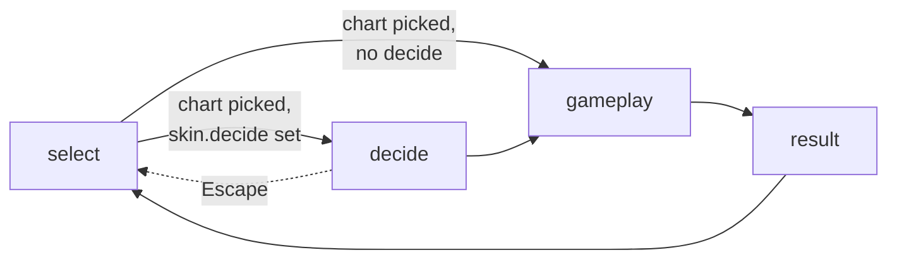

[Japanese version](./be-music-skin-api.ja.md)

# Be-Music Skin API and screen contracts

[Skin authoring guide](./be-music-skin.md)

<details>
<summary>Table of contents</summary>

- [Surfaces](#surfaces)
- [Skin metadata](#skin-metadata)
- [Stage and layout](#stage-and-layout)
  - [Supporting portrait](#supporting-portrait)
- [Screens](#screens)
  - [Gameplay](#gameplay)
  - [Select](#select)
  - [Result](#result)
  - [Decide](#decide)
- [Judgment timing](#judgment-timing)
- [Skin settings](#skin-settings)
- [Chart images](#chart-images)
- [SDK helpers](#sdk-helpers)
- [Reacting to the music](#reacting-to-the-music)
- [Effects level](#effects-level)

</details>

## Surfaces

- **When `draw` runs:**
  - Gameplay draws once per frame, right before the player renders.
  - Select and result draw every frame while they are shown.
- **`'2d'` surfaces** come cleared and scaled, so you draw in design pixels (854×480 on the default stage).
- **WebGL and WebGPU surfaces** are entirely yours. `surface.pixelRatio` gives the canvas pixels per design pixel; resize your renderer when it changes.
- **Dot by dot:** each canvas is sized to the device pixels the stage covers on screen (viewport scale × `devicePixelRatio`) and shown with nearest sampling. Your pixels map one to one onto the screen, up to 4096 canvas pixels on the long side (larger displays are scaled up from that cap).
- **Stage changes:** a skin with a `portraitStage` can be switched between its two stages while a screen is shown (the device rotates). The next draw then comes on a surface of the other size, with `surface.orientation` (`'landscape'` or `'portrait'`) saying which, so size anything you build from `surface.width` / `surface.height` (or the frame's `designWidth` / `designHeight`, `layout.stage`) rather than once at setup.
- **Transparency:** the canvas is composited over the BGA video. Leave the BGA rect transparent wherever the video should show.
- **`contextAttributes`:** passed through to `canvas.getContext`.

## Skin metadata

Every skin declares the fields below. `defineBeMusicSkin` checks the API version, ID, label, version, author and URLs, `fontLoads`, rendering context, each screen’s `draw`, `decide`, and `settings`. It throws at definition time if a check fails.

| Field                                    | Required | Rule                                                                                                                                  |
| ---------------------------------------- | -------- | ------------------------------------------------------------------------------------------------------------------------------------- |
| `apiVersion`                             | yes      | `BE_MUSIC_SKIN_API_VERSION` from the SDK you build against. The player refuses skins written for an API revision it does not support. |
| `id`                                     | yes      | Lowercase letters, digits, and hyphens (`my-skin`). Hosts persist it, so keep it stable across releases.                              |
| `label`                                  | yes      | Name shown in pickers.                                                                                                                |
| `version`                                | yes      | Your skin's own release as a semantic version (`1.2.0`).                                                                              |
| `author`                                 | yes      | `{ name, url? }`. `url` must be http(s).                                                                                              |
| `description`                            | no       | One or two sentences for pickers.                                                                                                     |
| `homepage`                               | no       | http(s) URL of the project page or repository.                                                                                        |
| `license`                                | no       | SPDX identifier of the skin's code and assets (`MIT`).                                                                                |
| `fontLoads`                              | yes      | CSS font shorthands the skin draws with (`'400 24px "Anton"'`). It may be empty.                                                      |
| `context`                                | yes      | `'2d'`, `'webgl'`, `'webgl2'`, or `'webgpu'`.                                                                                         |
| `contextAttributes`, `setup`, `teardown` | no       | See [Surfaces](#surfaces) and [Using a framework](./be-music-skin.md#using-a-framework).                                              |
| `stage`                                  | no       | Design canvas; defaults to `wideStage`. See [Stage and layout](#stage-and-layout).                                                    |
| `portraitStage`                          | no       | Design canvas for portrait screens, e.g. `tallStage`. See [Stage and layout](#stage-and-layout).                                      |
| `gameplay`, `select`, `result`           | yes      | Each screen's `draw` function; see [Screens](#screens).                                                                               |
| `decide`                                 | no       | The decide screen between select and play; see [Decide](#decide).                                                                     |
| `settings`                               | no       | Options the player can tune for the skin; see [Skin settings](#skin-settings).                                                        |

`validateBeMusicSkin(skin)` returns the same problems as a list of messages without throwing, also for a skin written in plain JavaScript that leaves a required field out. A host checks an added skin with it (the Be-Music Skin registry does), so a skin module without `fontLoads`, say, is refused with the reason instead of breaking the page.

## Stage and layout

- **Stage:** the stage is the design canvas a skin draws on. `wideStage` is the 16:9 stage (854×480), and the default.
- **Cabinet layout:** the built-in skins play on `cabinetStage`, `wideStage` with the BGA in a right-hand column. `resolveCabinetLayout(layout)` places the rest around the standard lanes. Under the lanes come the keys, the gauge, the score and the hi-speed. The score graph sits beside them. The right-hand column holds the stage band, the players and the chart, the BGA, the judgement panel, the BPM and the tempo. The panels follow `layout.playfield.right`, so a wider chart narrows the column. Double play (10 / 14 KEY) is centred on the stage instead, through the stage's `playfield.standard.doublePlayCenterX`. The stage band, the chart, the BGA and the judgement panel then take the left column, and the graph and the tempo the right one. The score, the shared gauge, the hi-speed and the BPM sit under the lanes, and `center` (between the banks of keys) shows the gauge. Independent players and side-playfield ghosts set `layout.twoPlayer`; `cabinetStage` separates their banks around a central BGA using `twoPlayerSideInset`, and `resolveCabinetLayout` returns `secondSide` panels with separate gauges, scores, and hi-speed. Ordinary double play keeps its shared field. `doublePlay` identifies the centred double-play arrangement; `controls` is a band beside the menu corner for what the narrow stage band has no room for. The stage band stops short of the top-right corner, which a host keeps for its menu tab. Use it on the landscape standard layout; the touch layout's lanes take the stage, so keep a lighter HUD there.
- **Portrait stage:** a skin may also declare a `portraitStage`, the canvas it draws on while the screen is taller than wide. `tallStage` is the built-in one: 480×854 (9:16), `wideStage` turned on its side, so type keeps its size; a phone browser's viewport (about 9:16 to 9:19.5 once its toolbars take their share) letterboxes a little and a 3:4 tablet pillarboxes. Hosts pick the stage per frame with `resolveBeMusicStage(skin, screen, chart?)`: the portrait stage when the skin has one and the screen is portrait, otherwise `stage`. Gameplay stays on `stage` for charts too wide for a portrait playfield: only single play up to 9 lanes (5 / 7 KEY, 9 KEY) goes portrait (`supportsPortraitLayout`); double play (10 / 14 KEY) and the keyboard modes (24 / 48 KEY) are drawn on the landscape stage, scaled down (the player asks a phone to rotate). A skin without a `portraitStage` is always drawn on `stage`.
- **Fluid stage:** a stage may declare `resize(size)` to follow the screen instead of being letterboxed into it. `resolveBeMusicStage` then sizes it with `resolveFluidStageSize`, keeping its short side (480 px for the built-in stages) and giving the long side the screen's aspect ratio (640×480 on 4:3, 1138×480 on 21:9), and draws on the stage `resize` returns for that size. Lay everything out from that stage (`layout.stage`), not from fixed coordinates. A stage turned the other way from the screen keeps its size. The built-in, LR2 and beatoraja stages are fixed; the embed preview's is fluid. See [ADR 0021](./adr/0021-fluid-stage.md).
- **BGA placement:** `BeMusicStage.resolveBGARect(playfieldRight, playfieldLeft, twoPlayer)` decides where the gameplay BGA goes. The player composites the video there, and your skin frames the same rect. `wideStage` grows the BGA beside a single-play field and shrinks it next to wide double-play or keyboard fields.
- **Layout per frame:** each gameplay frame comes with `layout` (`BeMusicGameplayLayout`), resolved by the host:
  - `mode`: `'standard'` or `'touch'` (optional; absent means `'standard'`). See the touch layout below.
  - `orientation`: `'landscape'` or `'portrait'` (optional; absent means `'landscape'`). See the portrait layout below.
  - `twoPlayer`: optional flag for independent players or a side-playfield ghost. Pass it to layout and BGA resolution; a double-play lane model alone does not imply two players.
  - `stage`: width and height.
  - `lanes`: every lane, with its channel, kind (`white` / `black` / `scratch`, or `wheel-up` / `wheel-down` for the 24 / 48 KEY wheel lanes on each side's outer edge), side, x, and width. The full layout of the chart's play variant (5 / 7 / 9 / 10 / 14 / 24 / 48 KEY) is always present, even for lanes the chart never uses.
  - `playfield`: `left`, `right`, `centerX`, `top`, `judgementY`, and `sides` (the horizontal extent of 1P and, in double play, 2P).
  - `bga`: the BGA rect, or `undefined` when the playfield leaves no room.
- **Placing chrome:** place your chrome from these values instead of hard-coding geometry. Host-side layout changes (double play, keyboard modes, new aspect ratios) then reach your skin for free.
- **Double-play gap:** the 1P and 2P banks stand 60 px apart in the standard layout (`_____DP_SIDE_GAP`) and 24 px apart in the touch layout (`TOUCH_PLAYFIELD.sideGap`); don't hard-code either value. `resolveLaneRuns(lanes)` returns one `{ left, right }` run per contiguous bank. Draw the judgement line and lane grid per run so nothing crosses the gap.
- **Lane widths:** lane widths are fixed by the player. Skins colour lanes, but never resize or move them.
- **Note height:** `NOTE_HEIGHT_LANE_RATIO` is 0.21. `noteHeightForLane(laneWidth)` scales a note to its lane width; built-in playfields use `resolveNoteHeight(laneWidth, findWhiteLaneWidth(lanes))` so scratch and black-key notes share the white-key note height. Long-note caps and mines use the same height, with notes anchored on their bottom edge.
- **Touch layout:** on touch screens the host may resolve the layout with `layoutMode: 'touch'` (`resolveGameplayLayout` input). The lanes then spread across the stage from its left margin to the judgement tally's column (`TOUCH_PLAYFIELD`): every key one width (at most 72 px) and a scratch 1.4 keys wide, the lanes run from y 48 (below the header band) to the judgement line at y 330 (above the bottom HUD band), and `bga` is `undefined`. The 24 / 48 KEY modes keep the standard layout (`supportsTouchLayout`). A skin that places its chrome from `layout` needs no change; read `layout.mode` only to restyle something for touch play. Keep chrome that sits beside the lanes in the standard layout (anything placed from the BGA rect) working when `bga` is `undefined`.
- **Portrait layout:** on a portrait stage the lanes span the stage's width in its lower part, in both modes (`PORTRAIT_PLAYFIELD`, scaled to the stage from the 480×854 `tallStage`): they run from y 300 down to a low judgement line, and the BGA and HUD go in the band above them (`tallStage` puts the BGA in a 206 px square at the top left, under a 40 px header band). `'touch'` gives every key one width (a scratch 1.4 keys wide) across the stage between 12 px margins, with the judgement line at y 740, leaving a band under it for the thumbs; `'standard'` keeps the cabinet's key widths (7 KEY 374 px wide), centred, with the judgement line at y 786. `bga` comes from the portrait stage's `resolveBGARect` in both modes. `resolvePortraitLaneLayout` returns the lane rects for a portrait stage.

### Supporting portrait

Portrait support is opt-in. Plain (`packages/player-browser/src/skins/plain/`) is the worked example: `index.ts` opts in, `layout.ts` works out the portrait geometry as plain, tested functions, and each screen file switches on the surface's orientation.

```ts
import { defineBeMusicSkin, resolveStageOrientation, tallStage } from '@be-music/player-skin-sdk';

export default defineBeMusicSkin({
  // …metadata…
  portraitStage: tallStage, // 480×854 while the screen is taller than wide
  select: {
    layout: { listX: 322, listTop: 56, listBottomInset: 28, rowHeight: 28 },
    // The host hit-tests the portrait list with these numbers: full width, under a focused-song card.
    portraitLayout: { listX: 16, listTop: 304, listBottomInset: 30, rowHeight: 40 },
    draw(surface, frame) {
      // The stage can change between two draws (the device rotates), so check it on every draw.
      if (resolveStageOrientation(surface) === 'portrait') drawPortraitSelect(surface, frame);
      else drawLandscapeSelect(surface, frame);
    },
  },
  gameplay: {
    draw(surface, frame) {
      drawLanesAndNotes(surface, frame); // placed by frame.layout in either orientation
      // Portrait: the lanes fill the lower part, so the HUD goes in the band above layout.playfield.top.
      if (frame.layout.orientation === 'portrait') drawHudAbove(surface, frame.layout);
      else drawHudAround(surface, frame.layout);
    },
  },
  // result: stack the landscape panels on a portrait surface …
});
```

- **What changes:** only the chrome. Lanes, notes, the judgement line and the BGA rect come placed in `frame.layout` for either stage; Plain draws them with the same code in both.
- **Place from the layout:** put portrait chrome in the band above `layout.playfield.top`, beside or under `layout.bga`, and size it from `surface.width` / `surface.height` rather than 480×854, so another portrait stage works too.
- **Corners and type:** keep the top corners of the play header free for a host's touch controls (Plain leaves 52 px), and set nothing below 10 design px: a phone shows the 480 px wide stage at about 0.8 CSS px per design px.
- **Landscape stays:** a skin without `portraitStage` is simply scaled down on portrait screens, and charts that need the landscape stage (double play, 24 / 48 KEY) are drawn on `stage` even when the skin has a portrait one.

## Screens

A host shows the screens in this order; the decide screen only when the skin has one. [Browser player — Scene lifecycle](./player-web-scenes.md#scene-lifecycle) covers how the Be-Music player hands one screen over to the next.



### Gameplay

`gameplay.draw(surface, frame)` receives a `BeMusicGameplayFrame`:

- `layout`: see [Stage and layout](#stage-and-layout).
- `lanes`: each lane's rect (`x`, `w`, `top`, `bottom` at the judgement line), `kind`, and `beam`, the key-beam intensity (1 while held, then decaying). `pressedAtMs` / `releasedAtMs` are the play-clock times of the lane's last press and release; `holding` and `holdStartedAtMs` tell whether a long note in the lane is being held, and since when.
- `notes`: tap notes as `{ kind, x, w, y }`, where `y` is the note's bottom edge. `autoplay` is set on notes autoplay or auto-scratch will hit. As in LR2, a note the player has not hit yet waits on the judgement line (`y` at the lane's `bottom`) until it is judged a miss, and a note hit early is still handed over until its time.
- `longNotes`: long notes as `{ kind, x, w, top, bottom }`. `top` is the tail; `bottom` is the head, held on the judgement line once its time has passed. `mode` (`'ln'` / `'cn'` / `'hcn'`) says how the note judges, `backSpinScratch` marks a back-spin scratch (a charge note on a scratch lane, whose tail is judged on a reverse spin), `state` (`'pending'` / `'held'` / `'draining'` / `'dropped'` / `'done'`) where it is in its life, and `autoplay` whether autoplay plays it. A hell charge note reads `'held'` while it fills the gauge and `'draining'` while it empties it (let go early or missed at the head); pressing the lane again brings it back to `'held'`, and only once its tail has passed does it read `'dropped'` or `'done'`. No other long note reads `'draining'`. LR2 and the built-in skins draw a `'dropped'` long note (missed at the head or let go early) at half alpha until it goes. The built-in skins tell the kinds apart by shape, not colour: an LN's tail cap is faint, a CN's is full, an HCN's centre line zigzags where the other kinds keep it straight, and a BSS's tail carries a chevron pointing back up the lane (`resolveLongNoteMarks`, `hellChargeZigzag`, `backSpinChevron`). An HCN (a hell-charge BSS included) also shows how it stands, changing colour, glow and the zigzag's motion together so that no state rests on colour alone (`resolveHellChargeLook`): before it is reached, a violet HELL colour with a low glow and a still zigzag; while held, a bright pulsing orange glow with the zigzag flowing into the judgement line; while draining, a dim throbbing red with the zigzag flowing back up the lane; once over, no glow.
- `mines`: mine notes as `{ kind, x, w, y }`, where `y` is the bottom edge. A mine that explodes (its lane held as it crosses the judgement line, or under the LR2 and `____` rulesets also pressed inside the GREAT window ahead of the line) drains the gauge; it is not a judgement. Empty unless the skin sets `gameplay.drawsMines` (below).
- `bombs`: live hit effects with `elapsedMs`, a stable `seed`, and the `judge` that set them off.
- `measureLines`: measure lines as `{ side, x, w, y }`, one per lane run they cross. Empty unless the skin sets `gameplay.drawsMeasureLines`.
- `bga`: the BGA layers to composite (`{ base?, layer?, layer2?, poor?, poorActive, poorOverlays?, opacity?, origins?, stacks? }`). `undefined` unless the skin sets `gameplay.drawsBGA`.
- `runtime`: the HUD values (below).
- `beatPhase`, `nowMs`, `effects`, and `audio`.
- `settings` and `chartImage`: see [Skin settings](#skin-settings) and [Song images](#chart-images).

In a chart with a negative `#SCROLL`, a note, mine, long note or measure line that is still ahead can sit below the judgement line, down to the bottom of the stage, because the player draws such charts the way beatoraja does, where other charts never go below the line (see [Browser player — Note visibility](./player-web.md#note-visibility)). Draw it where it is, or clip to the lane's `bottom` if the skin wants nothing below the line.

`gameplay.bombDurationMs` (default 300) sets how long a hit effect lives.

#### Drawing it yourself

By default the player draws a few things over (or behind) your canvas, so a skin that ignores them still shows them. Set the matching flag on `gameplay` to draw them yourself instead:

| Flag                | You draw from        | Without it                                                              |
| ------------------- | -------------------- | ----------------------------------------------------------------------- |
| `drawsMines`        | `frame.mines`        | The player draws red bars with yellow caution stripes over your canvas. |
| `drawsLaneCover`    | `runtime.laneCovers` | The player draws its SUDDEN+ / HIDDEN+ covers over your canvas.         |
| `drawsMeasureLines` | `frame.measureLines` | The player draws its own measure lines.                                 |
| `drawsBGA`          | `frame.bga`          | The player shows the BGA behind your canvas, in `layout.bga`.           |

Every flag defaults to `false`, and the frame field it unlocks stays empty (or `undefined`) until you set it, so existing skins keep their look. With `drawsBGA`, the `layer` and `layer2` images arrive with pure black already turned transparent (the BMS layer convention; draw 07 before 0A) while `base` and `poor` retain black pixels: draw them with plain alpha blending, and while `poorActive`, draw `poor` over the normal layers when `poorOverlays` is true (`#POORBGA 1`), otherwise replace them. Mode 2 supplies no POOR image. A bmson layer (its spec keeps black opaque) and a video layer arrive as authored. The images are `ImageBitmap`s or, for a video BGA, the playing `<video>` element; a `#BGA` sub-region arrives as its own cropped image (missing for the first frame or two while it is cut). The host applies A1–A4 RGB multipliers to the images and supplies plane alpha through `opacity`. Input-bound A5 SWBGA arrives as the last entry in `stacks`, above normal and POOR planes, with its transparent-color key already applied. Draw these stacks in order. Keyed video images are live canvases; whole movies fill the BGA rect while aliases keep their authored placement.

`origins` optionally gives `{ base?, layer?, layer2?, poor? }` placement for cropped BGA images. Each value is an `{ x, y }` pixel offset on the 256×256 canvas; place that plane there instead of centering and top-aligning it. Each NONSTOP stack can carry its own origins. The standard Canvas UI applies them.

`opacity` contains 0..1 values for `{ base, layer, layer2, poor }`; omitted values default to 1. For NONSTOP, `stacks` lists every visible stage from back to front, with its own images, `poorActive` / `poorOverlays`, `opacity`, and crossfade `alpha`. Apply the inherited Canvas `globalAlpha × stack.alpha × stack.opacity[plane]` to each plane. Top-level images still identify the leading stage for existing skins; use `stacks` to draw the full NONSTOP composite. The standard UI's `paintPlayfieldParts` handles these fields.

`runtime` (`BeMusicGameplayRuntime`) carries:

- **Song and score:**
  - `chartTitle`, `chartArtist`, `chartGenre`, `bpm` (the BPM at the playhead, following tempo changes), `hiSpeed`
  - `score`, `exScore`, `exScoreMax`, `combo`, `maxCombo`
  - judgement counts (`perfect` … `poor`, `fast`, `slow`)
  - `rank`, `totalNotes`
- **Gauge:** `gauge`, `clearThreshold`, `gaugeLabel`, `gaugeSurvival`
- **Judgements:** `lastJudge` and `judgeSides` (the latest judgement and combo per side)
- **Play state:** `rulesetLabel` (the active compat ruleset: `lr2` / `beatoraja` / `____`), `autoplay`, `hasBGA`, `loading` (show NOW LOADING while audio decodes or a BGA transcodes), `progressRatio`, `chartMs`, `beatPhase`, `nowMs`
- **Event timestamps:** `judgeAtMs`, `impulseAtMs`, `impulseKind` (the last judgement and key press, for punch and impulse effects)
- **Comfort and sound:** `effects`, `audio`
- **Chart:** `song` (the `LibraryChart` being played; level, difficulty, `#RANK`, and `#TOTAL` are in `song.chart.metadata`), `minBPM`, `maxBPM`, `mainBPM` (the BPM the most notes sit at, the one HS-FIX `AVERAGE` and the replay use), `playVariant` (5 / 7 / 9 / 10 / 14 / 24 / 48 KEY), `laneCount`, and `laneChannels` (the lane channels in display order)
- **Timing:** `lastJudgeDeltaMs` and `judgeTimings` (the last 64 timed judgements, oldest first); see [Judgement timing](#judgment-timing). `judgeWindows` gives the ruleset's windows in ms per note class (`note`, `scratch`, `longNoteEnd`), resolved from `#RANK` when the play starts (a later `#EXRANK` change is not reflected).
- **Lane cover:** `laneCovers` (per side: `sudden`, `hidden`, `lift` as fractions of the lane height), `visibleMs` (how long a note is on screen at the current BPM, hi-speed and `#SCROLL` × `#SPEED`; 0 while the chart scrolls backwards or stands still, as in beatoraja), and `greenNumber` (`visibleMs × 0.6`)
- **Song clock:** `songLengthMs` and `songElapsedMs`, on the audio clock: it starts at 0 with the song and stops while paused, so the remaining time is `songLengthMs - songElapsedMs`. `chartMs` differs: it is measured from the chart's first beat and runs negative through the count-in.
- **Once-per-play moments:** `failedAtMs` (the gauge failed mid-play), `allNotesDoneAtMs` (the last playable note was judged), `outroAtMs` (the chart ended), `gaugeRiseAtMs` (the gauge first rose), and `gaugeMaxAtMs` (it first reached its maximum). Each is a play-clock time latched when the moment happens, `undefined` before.
- **Histories:** `scoreHistory` and `gaugeHistory`, the samples the result screen receives. They are the host's live arrays: read them, never mutate them.
- **Pacemaker and best record:** `bestEXScore` (the player's best EX score on the chart before this play) and `targetEXScore` with `targetLabel` (a pacemaker the host sets). `resolveScorePace(runtime)` holds each to the share of notes judged so far, and paces the AAA line when the host sets no pacemaker. `formatScoreDiff` prints the gap (`+0168`).
- **NONSTOP song info:** in a NONSTOP play, `chartTitle`, `chartArtist` and `chartGenre` are the song of the stage being played. As each stage begins they crossfade over 0.6 s: `songInfoFade` holds the song being replaced and the crossfade's `progress` (0 to 1). `resolveSongInfoLayers(runtime)` returns the song info layers to draw, back to front, each with its opacity, so a skin draws its title block once per layer. A skin that ignores `songInfoFade` switches the song at once.
- **Stage and player:** `course` (the course and stage being played; `resolveStageLabel` names it `1ST STAGE` … `FINAL STAGE`, or `FREE PLAY` for a single chart), `playerName` (the signed-in player), `random1P` (the 1P lane option) and `tempo` (the play tempo, 1 at the chart's own speed). `resolveDifficultyName(runtime.chart)` names `#DIFFICULTY`.

Every runtime field is optional. A host that can't provide one leaves it `undefined`, so draw a sensible fallback.

### Select

- **`select.layout`:** `listX`, `listTop`, `listBottomInset`, and `rowHeight`. The scene hit-tests rows with these numbers, so the rows you draw must match them.
- **`select.portraitLayout`:** the same numbers on the skin's `portraitStage` (optional; defaults to `layout`). `resolveBeMusicSelectLayout(select, stage)` picks the one for a stage.
- **`select.outroMs`:** length of the launch outro. After a chart is picked, the screen keeps drawing with `frame.launchAt` set until it ends, and ignores input meanwhile.
- **`select.draw(surface, frame)`** receives a `BeMusicSelectFrame`:
  - `entries`, `selectedIndex`, `firstVisibleIndex`, `visibleRows`, `focusedChart` (the chart bar under the cursor) and `focusedCourse`
  - Each of `entries` is a `LibraryEntry` (`@be-music/player-scene-model`'s, re-exported by the SDK with `LibraryChart`, `LibraryFolder`, `LibraryCourse`, `LibraryCourseStage` and `ChartSourceKind`): `{ kind: 'folder', folder }` (a chart folder lists `folder.charts`, a course folder `folder.courses`), `{ kind: 'chart', chart }`, or `{ kind: 'course', course }` (each of `course.stages` names the local `chart` it resolved to, if any). `browseEntryTitle`, `browseEntryCount` and `browseEntryBadge` give a row's text, and `describeCourseCard` a focused course's card.
  - Moving from an earlier SDK: a chart bar's kind was `'song'` and is `'chart'`; read `entry.chart` for `entry.song`, `folder.charts` for `folder.songs` and `stage.chart` for `stage.song`. The `Browser*` type aliases are gone: `BrowserSongEntry` is `LibraryChart`, `BrowserFolderNode` `LibraryFolder`, `BrowserCourseEntry` `LibraryCourse`, `BrowserCourseStage` `LibraryCourseStage`, `BrowserBrowseEntry` `LibraryEntry` and `BrowserSongSourceKind` `ChartSourceKind`.
  - `listScroll`: how far the list is pulled toward later entries, in design pixels, under one row. It is non-zero while a finger drags the list, while the list glides after a swipe, or mid-trackpad-scroll, and 0 at rest and at the list's ends. Lay the rows out with `selectListRows(frame, rowHeight)` and the list follows the finger: it gives each row's fractional `slot` (top at `listTop + slot * rowHeight`) and an `alpha` that fades rows sliding past the window's edge. A skin that ignores it scrolls one row at a time.
  - `folderLabel`, `searchQuery`, `searchEditing` (the player is typing in the host's text field over the search box: draw the box but not its text), `totalCharts`, `hasReadme` (the chart under the cursor has a README for `toggleReadme`: enable a README button only then; the host shows the README in its own dialog)
  - `actions`: `play`, `autoPlay`, `activateSearch`, `setPlayOption(key, value)`, `cyclePlayOption(key, step?)` (step 1 or -1, wrapping), and `toggleReadme()` (opens or closes the focused song's `.txt`)
  - `playOptions` (`BeMusicPlayOptions`: hi-speed, random, gauge, HIDDEN / SUDDEN, lane cover, BGA, list filters, …) and `playOptionChoices`, the values each enum or on / off option can take. Values outside the choices are ignored; `hiSpeed` and `shutter` take any number and are clamped to their range, and `cyclePlayOption` leaves them alone.
  - `chartBestRecord(song)`: the player's best record on a chart under the judge ruleset the host plays on (`BeMusicChartBestRecord`, the `BestRecord` of `@be-music/player-engine/records`: `{ lamp, exScore?, maxCombo?, missCount?, playCount? }`), or `undefined` when the host keeps none. `lamp` is a `BeMusicClearLamp` (the `ClearLamp` of `@be-music/player-engine/ruleset`), worst first: `NO_PLAY`, `FAILED`, `ASSIST_EASY`, `LIGHT_ASSIST_EASY`, `EASY`, `NORMAL`, `HARD`, `EX_HARD`, `FULL_COMBO`, `PERFECT`, `MAX`. `describeBestRecord(record, chart.totalNotes)` adds what a select card shows of it: the lamp's name (`CLEAR_LAMP_LABELS`, or `CLEAR_LAMP_SHORT_LABELS` under a CLEAR caption), the score rate (`85.40%`, cut, not rounded) and the DJ Rank. `resolveClearLampLight(lamp, nowMs, phase?)` gives a lamp's colour and alpha at a time: FAILED blinks, FULL COMBO and better cycle their hues, and the rest hold their `CLEAR_LAMP_COLORS`
  - `courseBestRecord?(course)`: the player's best record on a course bar (`BeMusicCourseBestRecord`: a `BeMusicChartBestRecord` plus `trophy?`, the best trophy the bests earn), or `undefined` for a course never played, a random course or a NEW COURSE bar. Hosts that predate it leave it out. `describeCourseCard(course, record)` adds the best lamp and trophy to a course card's detail line
  - `danRanks?`: the player's dan rank in each key mode they hold one in, fewest keys first, under the judge ruleset the host plays on (`BeMusicDanRank`: `{ keyMode, rank, label }`, where `rank` is the `DanRank` of `@be-music/player-engine/records` and `label` names it as dan courses do, `七段`). Empty before any GRADE course is cleared; hosts that keep none leave it out. `describeDanRanks(ranks)` puts them on one line (`7K 七段 · 14K 初段`). See [Courses — the player's dan rank](./course.md#the-players-dan-rank)
  - `pointer`: the pointer in design pixels, or `undefined`
  - `settings` and `chartImage`: see [Skin settings](#skin-settings) and [Song images](#chart-images)
  - `revision`, which increases whenever the select state changes (cursor, folder, search, list contents, play options, the readme opening or closing). A retained scene graph can be rebuilt only when it moves.
  - `sceneStartedAt` and `cursorChangedAt` for entrance and focus transitions
  - `nowMs`, `effects`, `launchAt`, and `audio`
  - `hit(x, y, w, h, action, cursor?)`: makes a rect clickable for this frame and returns whether the pointer is over it, for hover states. Declare your hit areas on every draw.

### Result

`result.draw(surface, frame)` receives a `BeMusicResultFrame`:

- `result` (`BeMusicResultData`): scores, judgement counts, gauge and score history, and the replay. When the host provides them, also `lamp` (the clear lamp: `FAILED`, the gauge it was cleared on, `FULL_COMBO`, `PERFECT`, `MAX`), `gaugeType`, `judgeRuleset`, `fast` / `slow`, `judgeTimings` (every timed judgement of the play), `run` (`'single'`, `'stage'` for a course stage, `'course'` for a whole EXPERT / GRADE course with the stages summed, or `'nonstop'`), `course` (the course a stage or run belongs to) and `courseRun` (a course run's stages played and trophy).
- `rankLabel` (That-Which-Must-Not-Be-Named DJ level) and `ratePercent`.
- `elapsedMs` since the scene mounted, or `Infinity` once the player skipped the entrance.
- `shownMs` since the scene mounted, going on after the entrance: for what keeps moving while the result is shown.
- `nowMs` and `effects`.
- `settings` and `chartImage`: see [Skin settings](#skin-settings) and [Song images](#chart-images).

`resolveResultCourseCard` gives a course run's card (the course and every stage chart). When its stages laid out at their usual height run past the card, `resolveResultCourseScroll(overflowPx, frame.shownMs)` gives how far the list has scrolled up (`offsetPx`) and how opaque it is (`alpha`): it rests at the top, scrolls until the last stage is at the bottom, rests, fades out, and fades back in at the top to start over, as the built-in skins do.

`resolveResultVerdict` (`STAGE CLEAR` / `FAILED`, or `COURSE CLEAR` / `COURSE FAILED` for a course run), `resolveResultLamp` and `resolveResultTrackRows` give the headline, clear lamp (the one clear-lamp rule, on beatoraja's lamps) and track rows the built-in skins show. `binJudgmentTimings(result.judgeTimings, binMs, rangeMs?)` turns the timings into a histogram.

### Decide

A skin may add a decide screen, shown between picking a chart and the play. Hosts mount it only when `skin.decide` exists and go straight to the play otherwise.

- **`decide.durationMs`:** how long the screen shows (default 2000). The player can skip ahead with Enter, Space, or a click, or go back to select with Escape.
- **`decide.draw(surface, frame)`** receives a `BeMusicDecideFrame`: `song`, `playOptions`, `elapsedMs` since the screen mounted, `nowMs`, `effects`, `audio`, `settings`, and `chartImage`. The Be-Music player currently passes `audio` as `undefined` on this screen.
- **Carrying the select outro on:** the decide screen comes right after the select screen's launch outro, on the same stage, so a skin can continue the outro's motion instead of starting over. Synesthesia's select outro plays the first 210 ms of its launch warp and its decide screen poses the rest from the time since the launch, with the star field's travel handed over from the select screen. With `effects` at `'reduced'` it keeps the fades and drops the moves; at `'off'` it shows the settled screen.

## Judgment timing

Timing offsets are signed milliseconds with the engine's convention: **positive is late (SLOW), negative is early (FAST)**, 0 is dead on.

- `runtime.lastJudgeDeltaMs` is the most recent offset, and `runtime.judgeTimings` the last 64 as `{ atMs, deltaMs, judge, channel? }`, oldest first.
- `result.judgeTimings` holds every timed judgement of the play.
- Only judgements with a press carry a timing. Autoplay hits, mine explosions, and missed notes (a POOR without a press) are left out.
- `binJudgmentTimings(timings, binMs = 1, rangeMs?)` returns `{ binMs, originMs, counts }`, a histogram whose bin edges sit on multiples of `binMs`. Pass `rangeMs` to cover `-rangeMs..rangeMs` whatever the timings, so histograms of different plays line up.

## Skin settings

A skin can declare options the player tunes, such as a colour theme, a judge-text offset, or an effect toggle:

```ts
settings: [
  {
    kind: 'choice',
    id: 'theme',
    label: 'Theme',
    options: [
      { value: 'neon', label: 'Neon' },
      { value: 'mono', label: 'Mono' },
    ],
    default: 'neon',
  },
  { kind: 'number', id: 'judgeOffset', label: 'Judgment offset', min: -40, max: 40, step: 2, default: 0, unit: 'px' },
  { kind: 'toggle', id: 'glow', label: 'Glow', default: true },
],
```

- **Kinds:** `choice` (one of `options`), `number` (`min..max`, with an optional `step` and `unit` of `'px'`, `'ms'`, or `'%'`), and `toggle`.
- **Validation:** `validateBeMusicSkin` checks the schema. Ids must be unique, labels must not be empty, and every `default` must be one of the options or lie in its range. Choice option values must be unique, a number's `step` must be positive, and its `unit` must be one of the three above.
- **Values:** every frame carries `settings`, the player's values keyed by id. Hosts persist the values per skin and resolve them with `resolveBeMusicSkinSettings(skin, stored)`, which falls back to the default for anything missing, stale, or mistyped, clamps numbers into their range, and drops ids the skin no longer declares. You can rely on every declared id being present with the right type.
- **Live changes:** the player may change a value while a screen is showing; the next frame carries it, and on select `revision` moves too. Read `frame.settings` every frame (or key anything you derive from it on `revision`) rather than caching it from the first frame.
- **In the Be-Music player:** hosts pass the stored values in the built-in kit (`{ family: 'built-in', skin, settings }`) and hand a showing scene a new kit with `scene.updateKit(kit)` when they change. The player builds a "Skin settings" folder in its Options dialog from the schema (a dropdown per `choice`, a slider per `number` with the unit in its name, a checkbox per `toggle`), hides it for a skin that declares none, and saves the values per skin id in the browser.

## Chart images

`chartImage(song, kind)` is on every frame (select, decide, gameplay, and result). It returns the chart's `'stageFile'`, `'banner'`, `'backBMP'`, or `'titleImage'` as an `ImageBitmap`, ready for `drawImage` or a texture upload.

- Images load lazily. The first calls return `undefined` while an image decodes; the screen is redrawn once it is ready (on select, `revision` moves).
- It also returns `undefined` when the song has no such image or the host doesn't provide images, so always draw a fallback.
- Don't close or transfer the bitmap: the host caches it.
- Look the image up on every draw rather than keeping the bitmap (or a texture made from it) across frames. The host keeps a bounded number of images and closes the least recently used one to make room.

## SDK helpers

| Area          | Helpers                                                                                                                                                                                                                                                                                                                                                                      |
| ------------- | ---------------------------------------------------------------------------------------------------------------------------------------------------------------------------------------------------------------------------------------------------------------------------------------------------------------------------------------------------------------------------- |
| Stage         | `wideStage`, `resolveStageBGARect`, `cabinetStage`, `resolveCabinetBGARect`, `resolveCabinetLayout`, `STAGE_WIDTH`, `STAGE_HEIGHT`, `STAGE_MARGIN`, `STAGE_SIDE_COLUMN`, `STAGE_BGA_BAND`, `tallStage`, `TALL_STAGE_WIDTH`, `TALL_STAGE_HEIGHT`, `TALL_STAGE_BGA`, `resolveBeMusicStage`, `resolveStageOrientation`                                                          |
| Score graph   | `resolveScorePace`, `formatScoreDiff`, `resolveStageLabel`, `resolveDifficultyName`                                                                                                                                                                                                                                                                                          |
| Layout        | `resolveGameplayLayout`, `resolveLaneRuns`, `resolveMilestoneArea` (landscape stages only: it assumes a 480 px tall stage), `MILESTONE_MIN_WIDTH`, `PLAYFIELD`, `resolveGameplayLaneGeometry`, `resolveTouchLaneLayout`, `supportsTouchLayout`, `TOUCH_PLAYFIELD`, `resolvePortraitLaneLayout`, `supportsPortraitLayout`, `PORTRAIT_PLAYFIELD`, `resolveBeMusicSelectLayout` |
| Judgements    | `judgeDisplayWord` (a PERFECT prints as GREAT), `isFlashingGreat`, `flashingGreatColor`, `FLASHING_GREAT_STEP_MS`                                                                                                                                                                                                                                                            |
| Moments       | `trackMoments` / `createMomentState` + `updateMoments` (every 100 combo, clear line, full combo, combo break; for the count-in, check whether `runtime.chartMs` is negative), `COMBO_MILESTONE`, `COMBO_BREAK_MIN`, `comboTier`, `momentProgress`, `impulse`, `punchScale`, `effectProfile`                                                                                  |
| Hold effects  | `holdSparks`, `holdSeed` (the sparks of a held long note); `resolveLongNoteMarks`, `isBackSpinScratchLongNote`, `hellChargeZigzag`, `backSpinChevron` (long-note kinds by shape); `resolveHellChargeLook` (how a hell charge note stands)                                                                                                                                    |
| Loading       | `LOADING_WORD`, `loadingDots(nowMs)`, `LOADING_DOT_MS`                                                                                                                                                                                                                                                                                                                       |
| Select list   | `selectListRows`, `browseEntryTitle`, `browseEntryCount`, `browseEntryBadge`, `describeCourseCard`, `describeBestRecord`, `resolveClearLampLight`                                                                                                                                                                                                                            |
| Sound         | `audioDrive`, `bandAt`, `bandLevel`, `AUDIO_BAND_COUNT`, `SILENT_AUDIO`; see [Reacting to the music](#reacting-to-the-music)                                                                                                                                                                                                                                                 |
| Result        | `resolveResultVerdict`, `resolveResultLamp`, `resolveResultTrackRows`                                                                                                                                                                                                                                                                                                        |
| Timing        | `binJudgmentTimings`; see [Judgement timing](#judgment-timing)                                                                                                                                                                                                                                                                                                               |
| Settings      | `resolveBeMusicSkinSettings`, `validateBeMusicSkinSettings`; see [Skin settings](#skin-settings)                                                                                                                                                                                                                                                                             |
| Song facts    | `resolveChartRowFacts`, `resolveChartStats`, `resolveChartTags`, `formatChartLength`, `formatBPMRange`, `formatPlayVariantLabel`                                                                                                                                                                                                                                             |
| Text          | `DEFAULT_TEXT_FONT`, `layoutTabularRun` (tabular figures)                                                                                                                                                                                                                                                                                                                    |
| Motion        | `easeOutCubic`, `easeOutBack`, `stageProgress`, `rollUpValue`, `hash01` (deterministic jitter)                                                                                                                                                                                                                                                                               |
| Skin          | `defineBeMusicSkin`, `validateBeMusicSkin`, `BE_MUSIC_SKIN_API_VERSION`, `isSupportedBeMusicSkinAPIVersion`                                                                                                                                                                                                                                                                  |
| Lane geometry | The player's own skinless lane geometry: `_____LANE_WIDTHS`, `_____DP_SIDE_GAP`, `resolveSkinlessLaneLayout`, `resolveFallbackLaneLayout`, `resolveFallbackPlayfieldSpan`, `uses____LaneWidths`, `isScratchLaneForVariant`, `shouldPreserveFallbackSideWidth`, `resolveBeMusicLaneKind`. Skins normally read `layout.lanes` instead.                                         |

The SDK also exports the types its frames and helpers use, for example `BeMusicClearLamp`, `BeMusicChartBestRecord`, `BeMusicJudgeWindows`, `BeMusicLaneCover`, `GameplayLayoutMode`, `BeMusicPlayOptionChoices`, `AudioDrive`, `MomentInput` / `MomentState`, `MilestoneArea`, `LaneRun`, `GameplayLaneGeometry`, `PortraitLaneGeometry`, `ChartStats`, `ChartRowFacts`, `ResultLamp`, and `ResultTrackRow`.

## Reacting to the music

Gameplay and select receive `audio` (`BeMusicAudioFrame`), a live analysis sampled once per frame. Gameplay analyses the whole mix; select analyses the BGM and the chart preview. It is `undefined` when the host has no Web Audio. The result frame has no `audio`, and the decide frame's `audio` is currently always `undefined`.

- **Loudness:** `level`, `peak` (0..1), and `db` (dBFS).
- **Energy:** `bass`, `mid`, and `high`.
- **Spectrum:** `bands`, 16 log-spaced bands from about 30 Hz to 14 kHz.
- **Onsets:** `onset`, which jumps to 1 on each transient and decays over about 150 ms; `onsetAtMs` is the time of the last one.

The bands and the bass / mid / high energies are placed within the range they covered over the last few seconds. As a result, they swing between hits even in a loud, compressed mix instead of resting at the top.

Pass the frame through `audioDrive(audio, effects)` before using it. It scales the levels, energies, bands and onset by the effects level (half at `'reduced'`, silent at `'off'`; `db` and `onsetAtMs` pass through), so your reactions respect the player's comfort setting automatically. `bandLevel(drive.bands, index, count)` resamples the bands to your bar count, ready for a spectrum.

Make reactions large enough to read: a pulse of a few percent is invisible at 60 fps. The built-in skins scale shapes by roughly 0.8 to 1.6 with the bass.

## Effects level

`effects` (`'full'` / `'reduced'` / `'off'`) is the player's comfort setting:

- `'full'`: everything.
- `'reduced'`: no screen shake or full-screen flashes, and lighter particle counts.
- `'off'`: static chrome and a plain hit flash only.

`effectProfile(level)` turns it into the amounts the built-in skins use. Respect it: some players need it.
