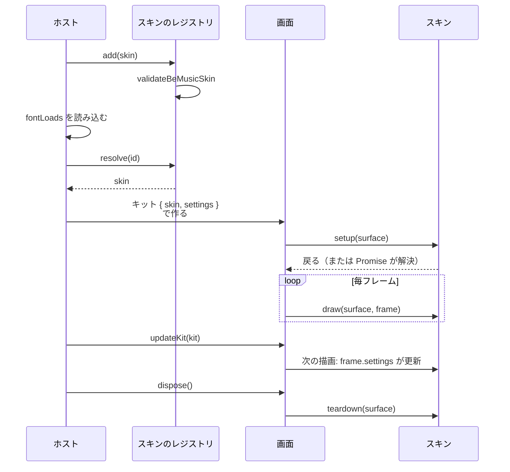

[English version](./be-music-skin.md)

# Be-Music Skin の作り方

ブラウザープレイヤーの組み込みファミリー向けスキンは、`@be-music/player-skin-sdk` で作ります。Synesthesia と Plain は Canvas に描画します。Native は DOM で画面を組み、プレイフィールドの部品ごとに担当範囲と同じ大きさの Canvas を使います。DOM 部品は `@be-music/player-ui` から再利用できます。

画面を描くのはスキンです。入力、タイミング、音声、判定、レーン配置、ノートの位置はプレイヤーが管理します。Canvas の譜面一覧ではクリック位置もプレイヤーが判定します。DOM の一覧は操作を受け取り、プレイヤーから渡されたアクションを呼び出します。

<details>
<summary>目次</summary>

- [関連ページ](#関連ページ)
- [描画フレームワークはスキンが持ち込む](#描画フレームワークはスキンが持ち込む)
- [Canvas と DOM を組み合わせる](#canvas-と-dom-を組み合わせる)
- [クイックスタート: Canvas 2D スキン](#クイックスタート-canvas-2d-スキン)
- [フレームワークを使う](#フレームワークを使う)

</details>

## 関連ページ

- [スキン API と画面の仕様](./be-music-skin-api.ja.md)
  - <a name="画面"></a>[画面](./be-music-skin-api.ja.md#画面)
  - <a name="曲の画像"></a>[譜面の画像](./be-music-skin-api.ja.md#譜面の画像)
- [パフォーマンスと配布](./be-music-skin-release.ja.md)
  - <a name="パッケージングと読み込み"></a>[パッケージングと読み込み](./be-music-skin-release.ja.md#パッケージングと読み込み)

## 描画フレームワークはスキンが持ち込む

SDK 自体は描画を行わず、描画フレームワークも import しません。キャンバスは、スキンに合ったもので描いてください。

| 描画手段                      | `context`                           | 方法                                                                               | 作例                                                                        |
| ----------------------------- | ----------------------------------- | ---------------------------------------------------------------------------------- | --------------------------------------------------------------------------- |
| Canvas 2D API                 | `'2d'`                              | そのまま描く。キャンバスはクリア済みで、デザインピクセルにスケール済み             | Plain（`packages/player-browser/src/skins/plain/`）                         |
| PixiJS                        | `'webgl2'`                          | `setup` でキャンバス上に Pixi レンダラーを作り、シーングラフを組んで `draw` で描画 | Synesthesia（`packages/player-browser/src/skins/`、`skins/pixi-kit/` 経由） |
| three.js、素の WebGL / WebGPU | `'webgl'` / `'webgl2'` / `'webgpu'` | `setup` でレンダラーやパイプラインを作り、`draw` で描画し、`teardown` で解放       | —                                                                           |

フレームワークは、スキン自身の依存として同梱します。Plain は意図的に小さく読みやすく作ってあるので、出発点としてコピーして使えます。縦向きの画面への対応の仕方も示しています（[縦向きに対応する](./be-music-skin-api.ja.md#縦向きに対応する)を参照）。

## Canvas と DOM を組み合わせる

`BeMusicSkin.dom` の `select`・`decide`・`result` は、対応する Canvas 画面を置き換えます。`gameplay` は Canvas のレーン・BGA・即時の判定表示と共存します。各 factory は `(container, actions)` を受け取り、`update(frame)` と `dispose()`、選曲画面では任意の `focusSearch()` を返します。

ゲームプレイ画面はプレイフィールドも描画できます。`gameplay.drawsOnDOM` を設定し、`dom.gameplay` から `drawPlayfield(frame)` を返すと、ホストは毎フレーム一度、完全な `BeMusicGameplayFrame`（レーン・ノート・ロングノート・地雷・小節線・ボム）を渡してこれを呼び、ゲームプレイ用の Canvas surface を作りません。`gameplay.draw` は DOM 画面を持たないホスト向けの代替として残ります。このときプレイヤーが描くものは表示されない（ブラウザープレイヤーは canvas をページから外す）ため、このスキンは `drawsBGA`・`drawsMines`・`drawsLaneCover`・`drawsMeasureLines` も設定します。Native はこの方法で `@be-music/player-ui` の `be-music-playfield` を HUD の下に配置します。

ゲームプレイの操作は `pause()`・`restart()`・`quit()`・`seek(seconds)` です。`seek` は AUTO プレイまたはリプレイを譜面の指定した秒数へ動かし、そこから再生を続けます（一時停止中のプレイは一時停止したままです）。frame が `seekable` でないときは何もしません。frame の `layout` は、ステージとレーンの範囲に加えて BGA の範囲（`bga`）も持ちます。埋め込みのプレビュー用スキン（`packages/app-play/src/embed/preview-skin.ts`）は、これらを `be-music-preview-hud` と組み合わせて使います。

DOM は factory が呼ばれた時点で作ります。`update` は既存の要素を更新してフォーカスや IME の状態を保ち、`dispose` はイベントと要素を解放します。画面を一時的に離れるとマウントは保持され、再入場で使われます。独自の React / Vue 画面をマウントする場合も、同じ契約からフレームを渡し、`dispose` でフレームワークの root を解放します。

次の factory は既存のリザルト部品をスキンに接続します。返した factory をスキンの `dom.result` に設定してください。

```ts
import { defineBeMusicElements } from '@be-music/player-ui';
import { basecoatTheme } from '@be-music/player-ui/themes/basecoat';
import type { BeMusicDOMFactory, BeMusicDOMResultFrame, BeMusicDOMResultActions } from '@be-music/player-skin-sdk';

export const mountResult: BeMusicDOMFactory<BeMusicDOMResultFrame, BeMusicDOMResultActions> = (container, actions) => {
  defineBeMusicElements(undefined, { theme: basecoatTheme });
  const element = document.createElement('be-music-result-screen');
  const onContinue = () => actions.continue();
  const onRetry = () => actions.retry();
  element.addEventListener('continue-request', onContinue);
  element.addEventListener('retry-request', onRetry);
  container.append(element);
  return {
    update(frame) {
      element.frame = frame;
    },
    dispose() {
      element.removeEventListener('continue-request', onContinue);
      element.removeEventListener('retry-request', onRetry);
      element.remove();
    },
  };
};
```

要素は headless なので、見た目は登録時のテーマ（ここでは Basecoat）か、スキン自身のカスタムプロパティと `::part` ルールで与えます。独自の DOM UI には Lit は必須ではありません。共通部品を利用する場合は [Player UI ガイド](../packages/player-ui/README.ja.md) にタグ一覧、JavaScript property、操作イベント、React / Vue ラッパー、CSS 変数・parts・slots をまとめています。ホストと controller の接続、描画更新の頻度、DOM を含まない Canvas 録画の制約は [ブラウザープレイヤー](./player-web-integration.ja.md#dom-スキンと独立した-controller) を参照してください。

## クイックスタート: Canvas 2D スキン

```ts
import { BE_MUSIC_SKIN_API_VERSION, defineBeMusicSkin, resolveLaneRuns } from '@be-music/player-skin-sdk';

export default defineBeMusicSkin({
  apiVersion: BE_MUSIC_SKIN_API_VERSION,
  id: 'my-skin',
  label: 'My Skin',
  version: '1.0.0',
  author: { name: 'Your Name', url: 'https://example.com' },
  fontLoads: ['700 12px "M PLUS 1p"'],
  context: '2d',
  gameplay: {
    draw({ context: ctx, width, height }, frame) {
      ctx.fillStyle = '#000';
      ctx.fillRect(0, 0, width, height);
      // BGA 動画はキャンバスの背後で再生される。上から塗らず、矩形をくり抜く。
      const bga = frame.layout.bga;
      if (bga && frame.runtime.hasBGA) ctx.clearRect(bga.x, bga.y, bga.w, bga.h);
      for (const lane of frame.lanes) {
        ctx.fillStyle = lane.kind === 'scratch' ? '#311' : '#111';
        ctx.fillRect(lane.x, lane.top, lane.w, lane.bottom - lane.top);
      }
      ctx.fillStyle = '#fff';
      for (const note of frame.notes) ctx.fillRect(note.x, note.y - 6, note.w, 6);
      // 判定ラインはプレイサイドごとに 1 本。DP の隙間をまたがない。
      ctx.fillStyle = '#f33';
      for (const run of resolveLaneRuns(frame.lanes)) {
        ctx.fillRect(run.left, frame.layout.playfield.judgementY, run.right - run.left, 2);
      }
    },
  },
  select: {
    layout: { listX: 322, listTop: 56, listBottomInset: 28, rowHeight: 28 },
    draw({ context: ctx, width, height }, frame) {
      ctx.fillStyle = '#000';
      ctx.fillRect(0, 0, width, height);
      // frame.entries[frame.firstVisibleIndex …] の行を描き、ボタンをクリック可能にする:
      frame.hit(16, 400, 120, 32, frame.actions.play);
    },
  },
  result: {
    draw({ context: ctx, width, height }, frame) {
      ctx.fillStyle = '#000';
      ctx.fillRect(0, 0, width, height);
    },
  },
});
```

## フレームワークを使う

`setup` でサーフェスのキャンバス上にフレームワークのレンダラーを作り、`teardown` で解放します。`setup` はサーフェスごとに最初の描画前に 1 回呼ばれ、Promise を返すとプレイヤーはその完了を待ちます。サーフェスは画面ごとにあります（ゲームプレイ 1 つ、選曲画面ごと 1 つ、決定画面ごと 1 つ、リザルト画面ごと 1 つ）。

スキンの登録から画面の終わりまでの、1 つのサーフェスの一生です（`@be-music/player-browser` の `skin/be-music/registry.ts` と `binding.ts`）。



```ts
import { WebGLRenderer, Container } from 'pixi.js';
import { BE_MUSIC_SKIN_API_VERSION, defineBeMusicSkin } from '@be-music/player-skin-sdk';

const renderers = new WeakMap<HTMLCanvasElement, WebGLRenderer>();

export default defineBeMusicSkin({
  // …メタデータ…
  context: 'webgl2',
  // マスクにはステンシルバッファが必要。キャンバスは BGA の上に重なるのでアルファを保つ。プレイヤーは描いた
  // フレームのうちにキャンバスを取り込むので、描画バッファを保つ必要はない。
  contextAttributes: {
    alpha: true,
    premultipliedAlpha: true,
    antialias: true,
    stencil: true,
    preserveDrawingBuffer: false,
  },
  async setup(surface) {
    const renderer = new WebGLRenderer();
    await renderer.init({
      canvas: surface.canvas,
      context: surface.context,
      width: surface.width,
      height: surface.height,
      resolution: surface.pixelRatio,
      backgroundAlpha: 0,
    });
    renderers.set(surface.canvas, renderer);
  },
  teardown(surface) {
    renderers.get(surface.canvas)?.destroy();
    renderers.delete(surface.canvas);
  },
  gameplay: {
    draw(surface, frame) {
      const renderer = renderers.get(surface.canvas)!;
      const stage = buildGameplayStage(frame); // このフレームのシーングラフ
      renderer.render({ container: stage, clear: true });
    },
  },
  // select, result …
});
```

組み込みの Pixi スキンは、`skins/pixi-kit/define-pixi-skin.ts` を通してまさにこれを行っています。このファイルは、プレイヤーのフレームデータを保持型の Pixi シーンに流し込む作例として読めます。選曲シーンを保持しておき、`frame.revision` が変わったときだけ作り直す方法も示しています。ブラウザプレイヤー自身も Pixi で描画しているため、プレイヤー内ではこのキットのスキンは自前のレンダラーを使いません。プレイヤーのレンダラーでシーンをテクスチャに描かせるので、別の canvas からフレームをコピーすることがありません。この近道は組み込みキット専用で、独自のスキンは上のとおり canvas に描きます。
