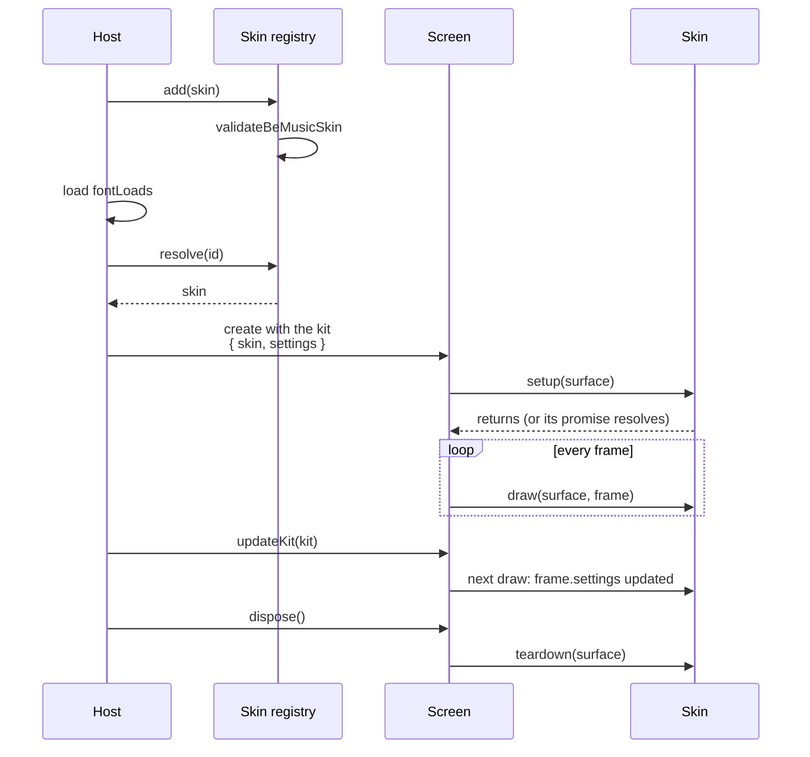
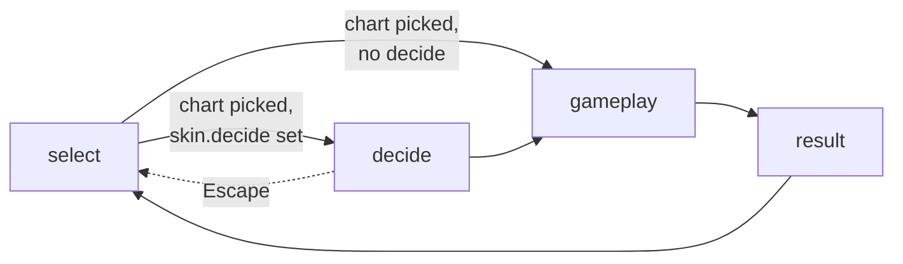

[Japanese version](./be-music-skin.ja.md)

# Writing a be-music skin

Skins for the browser player's built-in family use the `@be-music/player-skin-sdk` contract. Synesthesia and Plain use Canvas; Native combines DOM screens with a playfield of canvas components, each drawing on a canvas the size of its part of the stage. Native's presentation components are also available independently from `@be-music/player-ui`.

A be-music skin is code, not a data file. LR2 and beatoraja themes are interpreted by a scene; a be-music skin draws every screen itself. The player keeps ownership of everything else:

- input, timing, audio, and judging;
- the lane layout and note positions;
- Canvas select-list hit-testing; DOM screens handle their own elements and forward actions.

Canvas drawing receives a surface and per-frame data. DOM presentation receives a mount container, presentation frames and actions. The skin owns appearance while scene sessions share behavior.

## Bring your own renderer

The SDK does not draw and imports no rendering framework. Draw the canvas with whatever suits your skin:

| Renderer                     | `context`                            | How                                                                                       | Example                                                                       |
| ---------------------------- | ------------------------------------ | ----------------------------------------------------------------------------------------- | ----------------------------------------------------------------------------- |
| Canvas 2D API                | `'2d'`                               | Draw directly; the canvas comes cleared and scaled to design pixels                       | Plain (`packages/player-browser/src/skins/plain/`)                            |
| PixiJS                       | `'webgl2'`                           | Create a Pixi renderer on the canvas in `setup`, build a scene graph, render it in `draw` | Synesthesia (`packages/player-browser/src/skins/`, through `skins/pixi-kit/`) |
| three.js, raw WebGL / WebGPU | `'webgl'`, `'webgl2'`, or `'webgpu'` | Create the renderer or pipelines in `setup`, render in `draw`, release them in `teardown` | —                                                                             |

Your skin bundles its own framework as a dependency. Plain is deliberately small and readable; copy it as a starting point. It also shows how to support portrait screens; see [Supporting portrait](#supporting-portrait).

## Combine Canvas and DOM

`BeMusicSkin.dom.select`, `.decide` and `.result` replace the corresponding Canvas screens. `.gameplay` accompanies Canvas lanes, BGA and immediate judgment feedback. Each factory receives `(container, actions)` and returns `update(frame)`, `dispose()` and, optionally for select screens, `focusSearch()`.

A gameplay screen can also draw the playfield. Set `gameplay.drawsOnDOM` and return `drawPlayfield(frame)` from `dom.gameplay`: the host then calls it once per frame with the full `BeMusicGameplayFrame` (lanes, notes, long notes, mines, measure lines and bombs) and creates no Canvas surface for gameplay. `gameplay.draw` remains the fallback for hosts without DOM screens. Nothing the player draws shows then (the browser player takes its canvas out of the page), so such a skin also sets `drawsBGA`, `drawsMines`, `drawsLaneCover` and `drawsMeasureLines`. Native places `be-music-playfield` from `@be-music/player-ui` under its HUD this way.

Gameplay actions are `pause()`, `restart()`, `quit()` and `seek(seconds)`. `seek` moves an AUTO play or replay to a chart second and plays on from there (a paused play stays paused there); it does nothing unless the frame is `seekable`. The frame's `layout` carries the BGA rect (`bga`) with the stage and lane bounds. The embed's preview skin (`packages/app-play/src/embed/preview-skin.ts`) combines both with `be-music-preview-hud`.

Create DOM when the factory is called. Update existing elements to preserve focus and IME state, and release listeners and elements in `dispose`. Leaving a screen temporarily preserves its mount for re-entry. A custom React or Vue screen can use the same contract: deliver frames through its framework and unmount its root on disposal.

This factory connects the existing result component to a skin. Assign it to the skin's `dom.result` property.

```ts
import { defineBeMusicElements } from '@be-music/player-ui';
import { basecoatTheme } from '@be-music/player-ui/themes/basecoat';
import type { BeMusicDOMFactory, BeMusicDOMResultFrame, BeMusicDOMResultActions } from '@be-music/player-skin-sdk';

export const mountResult: BeMusicDOMFactory<BeMusicDOMResultFrame, BeMusicDOMResultActions> = (container, actions) => {
  defineBeMusicElements(undefined, { theme: basecoatTheme });
  const element = document.createElement('be-music-result-screen');
  const onContinue = () => actions.continue();
  const onRetry = () => actions.retry();
  element.addEventListener('continue-request', onContinue);
  element.addEventListener('retry-request', onRetry);
  container.append(element);
  return {
    update(frame) {
      element.frame = frame;
    },
    dispose() {
      element.removeEventListener('continue-request', onContinue);
      element.removeEventListener('retry-request', onRetry);
      element.remove();
    },
  };
};
```

The elements are headless: the look comes from the theme passed when registering (Basecoat here) or from the skin's own custom properties and `::part` rules. Lit is optional for custom DOM screens. The [Player UI guide](../packages/player-ui/README.md) lists reusable tags, JavaScript properties, request events, React/Vue wrappers, and CSS variables, parts and slots. See the [browser player](./player-web.md#native-dom-skins-and-standalone-controllers) for host/controller integration, update cadence and the limitation that Canvas recordings exclude DOM.

## Quick start: a Canvas 2D skin

```ts
import { BE_MUSIC_SKIN_API_VERSION, defineBeMusicSkin, resolveLaneRuns } from '@be-music/player-skin-sdk';

export default defineBeMusicSkin({
  apiVersion: BE_MUSIC_SKIN_API_VERSION,
  id: 'my-skin',
  label: 'My Skin',
  version: '1.0.0',
  author: { name: 'Your Name', url: 'https://example.com' },
  fontLoads: ['700 12px "M PLUS 1p"'],
  context: '2d',
  gameplay: {
    draw({ context: ctx, width, height }, frame) {
      ctx.fillStyle = '#000';
      ctx.fillRect(0, 0, width, height);
      // The BGA video plays behind the canvas: cut its rect out instead of painting over it.
      const bga = frame.layout.bga;
      if (bga && frame.runtime.hasBGA) ctx.clearRect(bga.x, bga.y, bga.w, bga.h);
      for (const lane of frame.lanes) {
        ctx.fillStyle = lane.kind === 'scratch' ? '#311' : '#111';
        ctx.fillRect(lane.x, lane.top, lane.w, lane.bottom - lane.top);
      }
      ctx.fillStyle = '#fff';
      for (const note of frame.notes) ctx.fillRect(note.x, note.y - 6, note.w, 6);
      // One judgement line per play side, so it never crosses the double-play gap.
      ctx.fillStyle = '#f33';
      for (const run of resolveLaneRuns(frame.lanes)) {
        ctx.fillRect(run.left, frame.layout.playfield.judgementY, run.right - run.left, 2);
      }
    },
  },
  select: {
    layout: { listX: 322, listTop: 56, listBottomInset: 28, rowHeight: 28 },
    draw({ context: ctx, width, height }, frame) {
      ctx.fillStyle = '#000';
      ctx.fillRect(0, 0, width, height);
      // Draw rows from frame.entries[frame.firstVisibleIndex …] and make buttons clickable:
      frame.hit(16, 400, 120, 32, frame.actions.play);
    },
  },
  result: {
    draw({ context: ctx, width, height }, frame) {
      ctx.fillStyle = '#000';
      ctx.fillRect(0, 0, width, height);
    },
  },
});
```

## Using a framework

Create the framework's renderer on the surface's canvas in `setup`, and release it in `teardown`. The player calls `setup` once per surface, before the first draw, and waits for a returned promise. Each screen gets its own surface: one for gameplay, one per select screen, one per decide screen, and one per result screen.

One surface's life, from registering the skin to the screen ending (`skin/be-music/registry.ts` and `binding.ts` in `@be-music/player-browser`):



```ts
import { WebGLRenderer, Container } from 'pixi.js';
import { BE_MUSIC_SKIN_API_VERSION, defineBeMusicSkin } from '@be-music/player-skin-sdk';

const renderers = new WeakMap<HTMLCanvasElement, WebGLRenderer>();

export default defineBeMusicSkin({
  // …metadata…
  context: 'webgl2',
  // Masks need a stencil buffer; the canvas sits over the BGA, so it keeps alpha. The player uploads the canvas in
  // the frame it is drawn, so the drawing buffer need not be preserved.
  contextAttributes: {
    alpha: true,
    premultipliedAlpha: true,
    antialias: true,
    stencil: true,
    preserveDrawingBuffer: false,
  },
  async setup(surface) {
    const renderer = new WebGLRenderer();
    await renderer.init({
      canvas: surface.canvas,
      context: surface.context,
      width: surface.width,
      height: surface.height,
      resolution: surface.pixelRatio,
      backgroundAlpha: 0,
    });
    renderers.set(surface.canvas, renderer);
  },
  teardown(surface) {
    renderers.get(surface.canvas)?.destroy();
    renderers.delete(surface.canvas);
  },
  gameplay: {
    draw(surface, frame) {
      const renderer = renderers.get(surface.canvas)!;
      const stage = buildGameplayStage(frame); // your scene graph for this frame
      renderer.render({ container: stage, clear: true });
    },
  },
  // select, result …
});
```

The built-in Pixi skins do exactly this through `skins/pixi-kit/define-pixi-skin.ts`. That file is a worked example of replaying the player's frame data into a retained Pixi scene. It also shows how to keep a select scene and rebuild it only when `frame.revision` changes. Inside the browser player, which renders with Pixi itself, the kit's skins skip their own renderer: the player has them draw their scene through its renderer into a texture, so a frame is never copied from a second canvas. That shortcut is private to the built-in kit; your skin draws on its canvas as above.

## Surfaces

- **When `draw` runs:**
  - Gameplay draws once per frame, right before the player renders.
  - Select and result draw every frame while they are shown.
- **`'2d'` surfaces** come cleared and scaled, so you draw in design pixels (854×480 on the default stage).
- **WebGL and WebGPU surfaces** are entirely yours. `surface.pixelRatio` gives the canvas pixels per design pixel; resize your renderer when it changes.
- **Dot by dot:** each canvas is sized to the device pixels the stage covers on screen (viewport scale × `devicePixelRatio`) and shown with nearest sampling. Your pixels map one to one onto the screen, up to 4096 canvas pixels on the long side (larger displays are scaled up from that cap).
- **Stage changes:** a skin with a `portraitStage` can be switched between its two stages while a screen is shown (the device rotates). The next draw then comes on a surface of the other size, with `surface.orientation` (`'landscape'` or `'portrait'`) saying which, so size anything you build from `surface.width` / `surface.height` (or the frame's `designWidth` / `designHeight`, `layout.stage`) rather than once at setup.
- **Transparency:** the canvas is composited over the BGA video. Leave the BGA rect transparent wherever the video should show.
- **`contextAttributes`:** passed through to `canvas.getContext`.

## Skin metadata

Every skin declares these fields. `defineBeMusicSkin` checks the rules it can test (the API version, the id, label, version, author and URLs, `fontLoads`, the context, each screen's `draw`, `decide` and `settings`) and throws when one is broken, so a broken skin fails where it is defined.

| Field                                    | Required | Rule                                                                                                                                  |
| ---------------------------------------- | -------- | ------------------------------------------------------------------------------------------------------------------------------------- |
| `apiVersion`                             | yes      | `BE_MUSIC_SKIN_API_VERSION` from the SDK you build against. The player refuses skins written for an API revision it does not support. |
| `id`                                     | yes      | Lowercase letters, digits, and hyphens (`my-skin`). Hosts persist it, so keep it stable across releases.                              |
| `label`                                  | yes      | Name shown in pickers.                                                                                                                |
| `version`                                | yes      | Your skin's own release as a semantic version (`1.2.0`).                                                                              |
| `author`                                 | yes      | `{ name, url? }`. `url` must be http(s).                                                                                              |
| `description`                            | no       | One or two sentences for pickers.                                                                                                     |
| `homepage`                               | no       | http(s) URL of the project page or repository.                                                                                        |
| `license`                                | no       | SPDX identifier of the skin's code and assets (`MIT`).                                                                                |
| `fontLoads`                              | yes      | CSS font shorthands the skin draws with (`'400 24px "Anton"'`). It may be empty.                                                      |
| `context`                                | yes      | `'2d'`, `'webgl'`, `'webgl2'`, or `'webgpu'`.                                                                                         |
| `contextAttributes`, `setup`, `teardown` | no       | See [Surfaces](#surfaces) and [Using a framework](#using-a-framework).                                                                |
| `stage`                                  | no       | Design canvas; defaults to `wideStage`. See [Stage and layout](#stage-and-layout).                                                    |
| `portraitStage`                          | no       | Design canvas for portrait screens, e.g. `tallStage`. See [Stage and layout](#stage-and-layout).                                      |
| `gameplay`, `select`, `result`           | yes      | Each screen's `draw` function; see [Screens](#screens).                                                                               |
| `decide`                                 | no       | The decide screen between select and play; see [Decide](#decide).                                                                     |
| `settings`                               | no       | Options the player can tune for the skin; see [Skin settings](#skin-settings).                                                        |

`validateBeMusicSkin(skin)` returns the same problems as a list of messages without throwing, also for a skin written in plain JavaScript that leaves a required field out. A host checks an added skin with it (the be-music skin registry does), so a skin module without `fontLoads`, say, is refused with the reason instead of breaking the page.

## Stage and layout

- **Stage:** the stage is the design canvas a skin draws on. `wideStage` is the 16:9 stage the built-in skins use (854×480), and the default.
- **Portrait stage:** a skin may also declare a `portraitStage`, the canvas it draws on while the screen is taller than wide. `tallStage` is the built-in one: 480×854 (9:16), `wideStage` turned on its side, so type keeps its size; a phone browser's viewport (about 9:16 to 9:19.5 once its toolbars take their share) letterboxes a little and a 3:4 tablet pillarboxes. Hosts pick the stage per frame with `resolveBeMusicStage(skin, screen, chart?)`: the portrait stage when the skin has one and the screen is portrait, otherwise `stage`. Gameplay stays on `stage` for charts too wide for a portrait playfield: only single play up to 9 lanes (5 / 7 KEY, 9 KEY) goes portrait (`supportsPortraitLayout`); double play (10 / 14 KEY) and the keyboard modes (24 / 48 KEY) are drawn on the landscape stage, scaled down (the player asks a phone to rotate). A skin without a `portraitStage` is always drawn on `stage`.
- **Fluid stage:** a stage may declare `resize(size)` to follow the screen instead of being letterboxed into it. `resolveBeMusicStage` then sizes it with `resolveFluidStageSize`, keeping its short side (480 px for the built-in stages) and giving the long side the screen's aspect ratio (640×480 on 4:3, 1138×480 on 21:9), and draws on the stage `resize` returns for that size. Lay everything out from that stage (`layout.stage`), not from fixed coordinates. A stage turned the other way from the screen keeps its size. The built-in, LR2 and beatoraja stages are fixed; the embed preview's is fluid. See [ADR 0021](./adr/0021-fluid-stage.md).
- **BGA placement:** `BeMusicStage.resolveBGARect(playfieldRight)` decides where the gameplay BGA goes. The player composites the video there, and your skin frames the same rect. `wideStage` grows the BGA beside a single-play field and shrinks it next to wide double-play or keyboard fields.
- **Layout per frame:** each gameplay frame comes with `layout` (`BeMusicGameplayLayout`), resolved by the host:
  - `mode`: `'standard'` or `'touch'` (optional; absent means `'standard'`). See the touch layout below.
  - `orientation`: `'landscape'` or `'portrait'` (optional; absent means `'landscape'`). See the portrait layout below.
  - `stage`: width and height.
  - `lanes`: every lane, with its channel, kind (`white` / `black` / `scratch`, or `wheel-up` / `wheel-down` for the 24 / 48 KEY wheel lanes on each side's outer edge), side, x, and width. The full layout of the chart's play variant (5 / 7 / 9 / 10 / 14 / 24 / 48 KEY) is always present, even for lanes the chart never uses.
  - `playfield`: `left`, `right`, `centerX`, `top`, `judgementY`, and `sides` (the horizontal extent of 1P and, in double play, 2P).
  - `bga`: the BGA rect, or `undefined` when the playfield leaves no room.
- **Placing chrome:** place your chrome from these values instead of hard-coding geometry. Host-side layout changes (double play, keyboard modes, new aspect ratios) then reach your skin for free.
- **Double-play gap:** the 1P and 2P banks stand 60 px apart in the standard layout (`_____DP_SIDE_GAP`) and 24 px apart in the touch layout (`TOUCH_PLAYFIELD.sideGap`); don't hard-code either value. `resolveLaneRuns(lanes)` returns one `{ left, right }` run per contiguous bank. Draw the judgement line and lane grid per run so nothing crosses the gap.
- **Lane widths:** lane widths are fixed by the player. Skins colour lanes, but never resize or move them.
- **Touch layout:** on touch screens the host may resolve the layout with `layoutMode: 'touch'` (`resolveGameplayLayout` input). The lanes then spread across the stage from its left margin to the judgement tally's column (`TOUCH_PLAYFIELD`): every key one width (at most 72 px) and a scratch 1.4 keys wide, the lanes run from y 48 (below the header band) to the judgement line at y 330 (above the bottom HUD band), and `bga` is `undefined`. The 24 / 48 KEY modes keep the standard layout (`supportsTouchLayout`). A skin that places its chrome from `layout` needs no change; read `layout.mode` only to restyle something for touch play. Keep chrome that sits beside the lanes in the standard layout (anything placed from the BGA rect) working when `bga` is `undefined`.
- **Portrait layout:** on a portrait stage the lanes span the stage's width in its lower part, in both modes (`PORTRAIT_PLAYFIELD`, scaled to the stage from the 480×854 `tallStage`): they run from y 300 down to a low judgement line, and the BGA and HUD go in the band above them (`tallStage` puts the BGA in a 206 px square at the top left, under a 40 px header band). `'touch'` gives every key one width (a scratch 1.4 keys wide) across the stage between 12 px margins, with the judgement line at y 740, leaving a band under it for the thumbs; `'standard'` keeps the cabinet's key widths (7 KEY 374 px wide), centred, with the judgement line at y 786. `bga` comes from the portrait stage's `resolveBGARect` in both modes. `resolvePortraitLaneLayout` returns the lane rects for a portrait stage.

### Supporting portrait

Portrait support is opt-in. Plain (`packages/player-browser/src/skins/plain/`) is the worked example: `index.ts` opts in, `layout.ts` works out the portrait geometry as plain, tested functions, and each screen file switches on the surface's orientation.

```ts
import { defineBeMusicSkin, resolveStageOrientation, tallStage } from '@be-music/player-skin-sdk';

export default defineBeMusicSkin({
  // …metadata…
  portraitStage: tallStage, // 480×854 while the screen is taller than wide
  select: {
    layout: { listX: 322, listTop: 56, listBottomInset: 28, rowHeight: 28 },
    // The host hit-tests the portrait list with these numbers: full width, under a focused-song card.
    portraitLayout: { listX: 16, listTop: 304, listBottomInset: 30, rowHeight: 40 },
    draw(surface, frame) {
      // The stage can change between two draws (the device rotates), so check it on every draw.
      if (resolveStageOrientation(surface) === 'portrait') drawPortraitSelect(surface, frame);
      else drawLandscapeSelect(surface, frame);
    },
  },
  gameplay: {
    draw(surface, frame) {
      drawLanesAndNotes(surface, frame); // placed by frame.layout in either orientation
      // Portrait: the lanes fill the lower part, so the HUD goes in the band above layout.playfield.top.
      if (frame.layout.orientation === 'portrait') drawHudAbove(surface, frame.layout);
      else drawHudAround(surface, frame.layout);
    },
  },
  // result: stack the landscape panels on a portrait surface …
});
```

- **What changes:** only the chrome. Lanes, notes, the judgement line and the BGA rect come placed in `frame.layout` for either stage; Plain draws them with the same code in both.
- **Place from the layout:** put portrait chrome in the band above `layout.playfield.top`, beside or under `layout.bga`, and size it from `surface.width` / `surface.height` rather than 480×854, so another portrait stage works too.
- **Corners and type:** keep the top corners of the play header free for a host's touch controls (Plain leaves 52 px), and set nothing below 10 design px: a phone shows the 480 px wide stage at about 0.8 CSS px per design px.
- **Landscape stays:** a skin without `portraitStage` is simply scaled down on portrait screens, and charts that need the landscape stage (double play, 24 / 48 KEY) are drawn on `stage` even when the skin has a portrait one.

## Screens

A host shows the screens in this order; the decide screen only when the skin has one. [Browser player — Scene lifecycle](./player-web.md#scene-lifecycle) covers how the be-music player hands one screen over to the next.



### Gameplay

`gameplay.draw(surface, frame)` receives a `BeMusicGameplayFrame`:

- `layout`: see [Stage and layout](#stage-and-layout).
- `lanes`: each lane's rect (`x`, `w`, `top`, `bottom` at the judgement line), `kind`, and `beam`, the key-beam intensity (1 while held, then decaying). `pressedAtMs` / `releasedAtMs` are the play-clock times of the lane's last press and release; `holding` and `holdStartedAtMs` tell whether a long note in the lane is being held, and since when.
- `notes`: tap notes as `{ kind, x, w, y }`, where `y` is the note's bottom edge. `autoplay` is set on notes autoplay or auto-scratch will hit. As in LR2, a note the player has not hit yet waits on the judgement line (`y` at the lane's `bottom`) until it is judged a miss, and a note hit early is still handed over until its time.
- `longNotes`: long notes as `{ kind, x, w, top, bottom }`. `top` is the tail; `bottom` is the head, held on the judgement line once its time has passed. `mode` (`'ln'` / `'cn'` / `'hcn'`) says how the note judges, `state` (`'pending'` / `'held'` / `'dropped'` / `'done'`) where it is in its life, and `autoplay` whether autoplay plays it. LR2 and the built-in skins draw a `'dropped'` long note (missed at the head or let go early) at half alpha until it goes.
- `mines`: mine notes as `{ kind, x, w, y }`, where `y` is the bottom edge. A mine that explodes (its lane held as it crosses the judgement line, or under the LR2 ruleset also pressed within the PGREAT window) drains the gauge; it is not a judgement. Empty unless the skin sets `gameplay.drawsMines` (below).
- `bombs`: live hit effects with `elapsedMs`, a stable `seed`, and the `judge` that set them off.
- `measureLines`: measure lines as `{ side, x, w, y }`, one per lane run they cross. Empty unless the skin sets `gameplay.drawsMeasureLines`.
- `bga`: the BGA layers to composite (`{ base?, layer?, poor?, poorActive, poorOverlays? }`). `undefined` unless the skin sets `gameplay.drawsBGA`.
- `runtime`: the HUD values (below).
- `beatPhase`, `nowMs`, `effects`, and `audio`.
- `settings` and `chartImage`: see [Skin settings](#skin-settings) and [Song images](#chart-images).

In a chart with a negative `#SCROLL`, a note, mine, long note or measure line that is still ahead can sit below the judgement line, down to the bottom of the stage, because the player draws such charts the way beatoraja does, where other charts never go below the line (see [Browser player — Note visibility](./player-web.md#note-visibility)). Draw it where it is, or clip to the lane's `bottom` if the skin wants nothing below the line.

`gameplay.bombDurationMs` (default 300) sets how long a hit effect lives.

#### Drawing it yourself

By default the player draws a few things over (or behind) your canvas, so a skin that ignores them still shows them. Set the matching flag on `gameplay` to draw them yourself instead:

| Flag                | You draw from        | Without it                                                              |
| ------------------- | -------------------- | ----------------------------------------------------------------------- |
| `drawsMines`        | `frame.mines`        | The player draws red bars with yellow caution stripes over your canvas. |
| `drawsLaneCover`    | `runtime.laneCovers` | The player draws its SUDDEN+ / HIDDEN+ covers over your canvas.         |
| `drawsMeasureLines` | `frame.measureLines` | The player draws its own measure lines.                                 |
| `drawsBGA`          | `frame.bga`          | The player shows the BGA behind your canvas, in `layout.bga`.           |

Every flag defaults to `false`, and the frame field it unlocks stays empty (or `undefined`) until you set it, so existing skins keep their look. With `drawsBGA`, the `layer` image arrives with pure black already turned transparent (the BMS layer convention) while `base` and `poor` retain black pixels: draw them with plain alpha blending, and while `poorActive`, draw `poor` over the normal layers when `poorOverlays` is true (`#POORBGA 1`), otherwise replace them. Mode 2 supplies no POOR image. A bmson layer (its spec keeps black opaque) and a video layer arrive as authored. The images are `ImageBitmap`s or, for a video BGA, the playing `<video>` element; a `#BGA` sub-region arrives as its own cropped image (missing for the first frame or two while it is cut). The player still picks the frame of a `#SWBGA` animation, but leaves a slot's `#ARGB` tint and opacity to you.

`runtime` (`BeMusicGameplayRuntime`) carries:

- **Song and score:**
  - `chartTitle`, `chartArtist`, `chartGenre`, `bpm` (the BPM at the playhead, following tempo changes), `hiSpeed`
  - `score`, `exScore`, `exScoreMax`, `combo`, `maxCombo`
  - judgement counts (`perfect` … `poor`, `fast`, `slow`)
  - `rank`, `totalNotes`
- **Gauge:** `gauge`, `clearThreshold`, `gaugeLabel`, `gaugeSurvival`
- **Judgements:** `lastJudge` and `judgeSides` (the latest judgement and combo per side)
- **Play state:** `rulesetLabel` (the active compat ruleset: `lr2` / `beatoraja` / `____`), `autoplay`, `hasBGA`, `loading` (show NOW LOADING while audio decodes or a BGA transcodes), `progressRatio`, `chartMs`, `beatPhase`, `nowMs`
- **Event timestamps:** `judgeAtMs`, `impulseAtMs`, `impulseKind` (the last judgement and key press, for punch and impulse effects)
- **Comfort and sound:** `effects`, `audio`
- **Chart:** `song` (the `LibraryChart` being played; level, difficulty, `#RANK`, and `#TOTAL` are in `song.chart.metadata`), `minBPM`, `maxBPM`, `mainBPM` (the BPM the most notes sit at, the one HS-FIX `AVERAGE` and the replay use), `playVariant` (5 / 7 / 9 / 10 / 14 / 24 / 48 KEY), `laneCount`, and `laneChannels` (the lane channels in display order)
- **Timing:** `lastJudgeDeltaMs` and `judgeTimings` (the last 64 timed judgements, oldest first); see [Judgement timing](#judgement-timing). `judgeWindows` gives the ruleset's windows in ms per note class (`note`, `scratch`, `longNoteEnd`), resolved from `#RANK` when the play starts (a later `#EXRANK` change is not reflected).
- **Lane cover:** `laneCovers` (per side: `sudden`, `hidden`, `lift` as fractions of the lane height), `visibleMs` (how long a note is on screen at the current BPM, hi-speed and `#SCROLL` × `#SPEED`; 0 while the chart scrolls backwards or stands still, as in beatoraja), and `greenNumber` (`visibleMs × 0.6`)
- **Song clock:** `songLengthMs` and `songElapsedMs`, on the audio clock: it starts at 0 with the song and stops while paused, so the remaining time is `songLengthMs - songElapsedMs`. `chartMs` differs: it is measured from the chart's first beat and runs negative through the count-in.
- **Once-per-play moments:** `failedAtMs` (the gauge failed mid-play), `allNotesDoneAtMs` (the last playable note was judged), `outroAtMs` (the chart ended), `gaugeRiseAtMs` (the gauge first rose), and `gaugeMaxAtMs` (it first reached its maximum). Each is a play-clock time latched when the moment happens, `undefined` before.
- **Histories:** `scoreHistory` and `gaugeHistory`, the samples the result screen receives. They are the host's live arrays: read them, never mutate them.

Every runtime field is optional. A host that can't provide one leaves it `undefined`, so draw a sensible fallback.

### Select

- **`select.layout`:** `listX`, `listTop`, `listBottomInset`, and `rowHeight`. The scene hit-tests rows with these numbers, so the rows you draw must match them.
- **`select.portraitLayout`:** the same numbers on the skin's `portraitStage` (optional; defaults to `layout`). `resolveBeMusicSelectLayout(select, stage)` picks the one for a stage.
- **`select.outroMs`:** length of the launch outro. After a chart is picked, the screen keeps drawing with `frame.launchAt` set until it ends, and ignores input meanwhile.
- **`select.draw(surface, frame)`** receives a `BeMusicSelectFrame`:
  - `entries`, `selectedIndex`, `firstVisibleIndex`, `visibleRows`, `focusedChart` (the chart bar under the cursor) and `focusedCourse`
  - Each of `entries` is a `LibraryEntry` (`@be-music/player-scene-model`'s, re-exported by the SDK with `LibraryChart`, `LibraryFolder`, `LibraryCourse`, `LibraryCourseStage` and `ChartSourceKind`): `{ kind: 'folder', folder }` (a chart folder lists `folder.charts`, a course folder `folder.courses`), `{ kind: 'chart', chart }`, or `{ kind: 'course', course }` (each of `course.stages` names the local `chart` it resolved to, if any). `browseEntryTitle`, `browseEntryCount` and `browseEntryBadge` give a row's text, and `describeCourseCard` a focused course's card.
  - Moving from an earlier SDK: a chart bar's kind was `'song'` and is `'chart'`; read `entry.chart` for `entry.song`, `folder.charts` for `folder.songs` and `stage.chart` for `stage.song`. The `Browser*` type aliases are gone: `BrowserSongEntry` is `LibraryChart`, `BrowserFolderNode` `LibraryFolder`, `BrowserCourseEntry` `LibraryCourse`, `BrowserCourseStage` `LibraryCourseStage`, `BrowserBrowseEntry` `LibraryEntry` and `BrowserSongSourceKind` `ChartSourceKind`.
  - `listScroll`: how far the list is pulled toward later entries, in design pixels, under one row. It is non-zero while a finger drags the list, while the list glides after a swipe, or mid-trackpad-scroll, and 0 at rest and at the list's ends. Lay the rows out with `selectListRows(frame, rowHeight)` and the list follows the finger: it gives each row's fractional `slot` (top at `listTop + slot * rowHeight`) and an `alpha` that fades rows sliding past the window's edge. A skin that ignores it scrolls one row at a time.
  - `folderLabel`, `searchQuery`, `searchEditing` (the player is typing in the host's text field over the search box: draw the box but not its text), `totalCharts`
  - `actions`: `play`, `autoPlay`, `activateSearch`, `setPlayOption(key, value)`, `cyclePlayOption(key, step?)` (step 1 or -1, wrapping), and `toggleReadme()` (opens or closes the focused song's `.txt`)
  - `playOptions` (`BeMusicPlayOptions`: hi-speed, random, gauge, HIDDEN / SUDDEN, lane cover, BGA, list filters, …) and `playOptionChoices`, the values each enum or on / off option can take. Values outside the choices are ignored; `hiSpeed` and `shutter` take any number and are clamped to their range, and `cyclePlayOption` leaves them alone.
  - `chartBestRecord(song)`: the player's best record on a chart under the judge ruleset the host plays on (`BeMusicChartBestRecord`, the `BestRecord` of `@be-music/player-engine/records`: `{ lamp, exScore?, maxCombo?, missCount?, playCount? }`), or `undefined` when the host keeps none. `lamp` is a `BeMusicClearLamp` (the `ClearLamp` of `@be-music/player-engine/ruleset`), worst first: `NO_PLAY`, `FAILED`, `ASSIST_EASY`, `EASY`, `NORMAL`, `HARD`, `EX_HARD`, `FULL_COMBO`, `PERFECT`, `MAX`
  - `courseBestRecord?(course)`: the player's best record on a course bar (`BeMusicCourseBestRecord`: a `BeMusicChartBestRecord` plus `trophy?`, the best trophy the bests earn), or `undefined` for a course never played, a random course or a NEW COURSE bar. Hosts that predate it leave it out. `describeCourseCard(course, record)` adds the best lamp and trophy to a course card's detail line
  - `pointer`: the pointer in design pixels, or `undefined`
  - `settings` and `chartImage`: see [Skin settings](#skin-settings) and [Song images](#chart-images)
  - `revision`, which increases whenever the select state changes (cursor, folder, search, list contents, play options, the readme opening or closing). A retained scene graph can be rebuilt only when it moves.
  - `sceneStartedAt` and `cursorChangedAt` for entrance and focus transitions
  - `nowMs`, `effects`, `launchAt`, and `audio`
  - `hit(x, y, w, h, action, cursor?)`: makes a rect clickable for this frame and returns whether the pointer is over it, for hover states. Declare your hit areas on every draw.

### Result

`result.draw(surface, frame)` receives a `BeMusicResultFrame`:

- `result` (`BeMusicResultData`): scores, judgement counts, gauge and score history, and the replay. When the host provides them, also `lamp` (the clear lamp: `FAILED`, the gauge it was cleared on, `FULL_COMBO`, `PERFECT`, `MAX`), `gaugeType`, `judgeRuleset`, `fast` / `slow`, `judgeTimings` (every timed judgement of the play), `run` (`'single'`, `'stage'` for a course stage, `'course'` for a whole EXPERT / GRADE course with the stages summed, or `'nonstop'`), `course` (the course a stage or run belongs to) and `courseRun` (a course run's stages played and trophy).
- `rankLabel` (That-Which-Must-Not-Be-Named DJ level) and `ratePercent`.
- `elapsedMs` since the scene mounted, or `Infinity` once the player skipped the entrance.
- `nowMs` and `effects`.
- `settings` and `chartImage`: see [Skin settings](#skin-settings) and [Song images](#chart-images).

`resolveResultVerdict` (`STAGE CLEAR` / `FAILED`, or `COURSE CLEAR` / `COURSE FAILED` for a course run), `resolveResultLamp` and `resolveResultTrackRows` give the headline, clear lamp (the one clear-lamp rule, on beatoraja's lamps) and track rows the built-in skins show. `binJudgmentTimings(result.judgeTimings, binMs, rangeMs?)` turns the timings into a histogram.

### Decide

A skin may add a decide screen, shown between picking a chart and the play. Hosts mount it only when `skin.decide` exists and go straight to the play otherwise.

- **`decide.durationMs`:** how long the screen shows (default 2000). The player can skip ahead with Enter, Space, or a click, or go back to select with Escape.
- **`decide.draw(surface, frame)`** receives a `BeMusicDecideFrame`: `song`, `playOptions`, `elapsedMs` since the screen mounted, `nowMs`, `effects`, `audio`, `settings`, and `chartImage`. The be-music player currently passes `audio` as `undefined` on this screen.

## Judgement timing

Timing offsets are signed milliseconds with the engine's convention: **positive is late (SLOW), negative is early (FAST)**, 0 is dead on.

- `runtime.lastJudgeDeltaMs` is the most recent offset, and `runtime.judgeTimings` the last 64 as `{ atMs, deltaMs, judge, channel? }`, oldest first.
- `result.judgeTimings` holds every timed judgement of the play.
- Only judgements with a press carry a timing. Autoplay hits, mine explosions, and missed notes (a POOR without a press) are left out.
- `binJudgmentTimings(timings, binMs = 1, rangeMs?)` returns `{ binMs, originMs, counts }`, a histogram whose bin edges sit on multiples of `binMs`. Pass `rangeMs` to cover `-rangeMs..rangeMs` whatever the timings, so histograms of different plays line up.

## Skin settings

A skin can declare options the player tunes, such as a colour theme, a judge-text offset, or an effect toggle:

```ts
settings: [
  {
    kind: 'choice',
    id: 'theme',
    label: 'Theme',
    options: [
      { value: 'neon', label: 'Neon' },
      { value: 'mono', label: 'Mono' },
    ],
    default: 'neon',
  },
  { kind: 'number', id: 'judgeOffset', label: 'Judgment offset', min: -40, max: 40, step: 2, default: 0, unit: 'px' },
  { kind: 'toggle', id: 'glow', label: 'Glow', default: true },
],
```

- **Kinds:** `choice` (one of `options`), `number` (`min..max`, with an optional `step` and `unit` of `'px'`, `'ms'`, or `'%'`), and `toggle`.
- **Validation:** `validateBeMusicSkin` checks the schema. Ids must be unique, labels must not be empty, and every `default` must be one of the options or lie in its range. Choice option values must be unique, a number's `step` must be positive, and its `unit` must be one of the three above.
- **Values:** every frame carries `settings`, the player's values keyed by id. Hosts persist the values per skin and resolve them with `resolveBeMusicSkinSettings(skin, stored)`, which falls back to the default for anything missing, stale, or mistyped, clamps numbers into their range, and drops ids the skin no longer declares. You can rely on every declared id being present with the right type.
- **Live changes:** the player may change a value while a screen is showing; the next frame carries it, and on select `revision` moves too. Read `frame.settings` every frame (or key anything you derive from it on `revision`) rather than caching it from the first frame.
- **In the be-music player:** hosts pass the stored values in the built-in kit (`{ family: 'built-in', skin, settings }`) and hand a showing scene a new kit with `scene.updateKit(kit)` when they change. The player builds a "Skin settings" folder in its Debug Menu from the schema (a dropdown per `choice`, a slider per `number` with the unit in its name, a checkbox per `toggle`), hides it for a skin that declares none, and saves the values per skin id in the browser.

## Song images

`chartImage(song, kind)` is on every frame (select, decide, gameplay, and result). It returns the song's `'stageFile'`, `'banner'`, or `'backBMP'` as an `ImageBitmap`, ready for `drawImage` or a texture upload.

- Images load lazily. The first calls return `undefined` while an image decodes; the screen is redrawn once it is ready (on select, `revision` moves).
- It also returns `undefined` when the song has no such image or the host doesn't provide images, so always draw a fallback.
- Don't close or transfer the bitmap: the host caches it.
- Look the image up on every draw rather than keeping the bitmap (or a texture made from it) across frames. The host keeps a bounded number of images and closes the least recently used one to make room.

## SDK helpers

| Area          | Helpers                                                                                                                                                                                                                                                                                                                                                                      |
| ------------- | ---------------------------------------------------------------------------------------------------------------------------------------------------------------------------------------------------------------------------------------------------------------------------------------------------------------------------------------------------------------------------- |
| Stage         | `wideStage`, `resolveStageBGARect`, `STAGE_WIDTH`, `STAGE_HEIGHT`, `STAGE_MARGIN`, `STAGE_SIDE_COLUMN`, `STAGE_BGA_BAND`, `tallStage`, `TALL_STAGE_WIDTH`, `TALL_STAGE_HEIGHT`, `TALL_STAGE_BGA`, `resolveBeMusicStage`, `resolveStageOrientation`                                                                                                                           |
| Layout        | `resolveGameplayLayout`, `resolveLaneRuns`, `resolveMilestoneArea` (landscape stages only: it assumes a 480 px tall stage), `MILESTONE_MIN_WIDTH`, `PLAYFIELD`, `resolveGameplayLaneGeometry`, `resolveTouchLaneLayout`, `supportsTouchLayout`, `TOUCH_PLAYFIELD`, `resolvePortraitLaneLayout`, `supportsPortraitLayout`, `PORTRAIT_PLAYFIELD`, `resolveBeMusicSelectLayout` |
| Judgements    | `judgeDisplayWord` (a PERFECT prints as GREAT), `isFlashingGreat`, `flashingGreatColor`, `FLASHING_GREAT_STEP_MS`                                                                                                                                                                                                                                                            |
| Moments       | `trackMoments` / `createMomentState` + `updateMoments` (every 100 combo, clear line, full combo, combo break; for the count-in, check whether `runtime.chartMs` is negative), `COMBO_MILESTONE`, `COMBO_BREAK_MIN`, `comboTier`, `momentProgress`, `impulse`, `punchScale`, `effectProfile`                                                                                  |
| Hold effects  | `holdSparks`, `holdSeed` (the sparks of a held long note)                                                                                                                                                                                                                                                                                                                    |
| Loading       | `LOADING_WORD`, `loadingDots(nowMs)`, `LOADING_DOT_MS`                                                                                                                                                                                                                                                                                                                       |
| Select list   | `selectListRows`, `browseEntryTitle`, `browseEntryCount`, `browseEntryBadge`, `describeCourseCard`                                                                                                                                                                                                                                                                           |
| Sound         | `audioDrive`, `bandAt`, `bandLevel`, `AUDIO_BAND_COUNT`, `SILENT_AUDIO`; see [Reacting to the music](#reacting-to-the-music)                                                                                                                                                                                                                                                 |
| Result        | `resolveResultVerdict`, `resolveResultLamp`, `resolveResultTrackRows`                                                                                                                                                                                                                                                                                                        |
| Timing        | `binJudgmentTimings`; see [Judgement timing](#judgement-timing)                                                                                                                                                                                                                                                                                                              |
| Settings      | `resolveBeMusicSkinSettings`, `validateBeMusicSkinSettings`; see [Skin settings](#skin-settings)                                                                                                                                                                                                                                                                             |
| Song facts    | `resolveChartRowFacts`, `resolveChartStats`, `resolveChartTags`, `formatChartLength`, `formatBPMRange`, `formatPlayVariantLabel`                                                                                                                                                                                                                                             |
| Text          | `DEFAULT_TEXT_FONT`, `layoutTabularRun` (tabular figures)                                                                                                                                                                                                                                                                                                                    |
| Motion        | `easeOutCubic`, `easeOutBack`, `stageProgress`, `rollUpValue`, `hash01` (deterministic jitter)                                                                                                                                                                                                                                                                               |
| Skin          | `defineBeMusicSkin`, `validateBeMusicSkin`, `BE_MUSIC_SKIN_API_VERSION`, `isSupportedBeMusicSkinAPIVersion`                                                                                                                                                                                                                                                                  |
| Lane geometry | The player's own skinless lane geometry: `_____LANE_WIDTHS`, `_____DP_SIDE_GAP`, `resolveSkinlessLaneLayout`, `resolveFallbackLaneLayout`, `resolveFallbackPlayfieldSpan`, `uses____LaneWidths`, `isScratchLaneForVariant`, `shouldPreserveFallbackSideWidth`, `resolveBeMusicLaneKind`. Skins normally read `layout.lanes` instead.                                         |

The SDK also exports the types its frames and helpers use, for example `BeMusicClearLamp`, `BeMusicChartBestRecord`, `BeMusicJudgeWindows`, `BeMusicLaneCover`, `GameplayLayoutMode`, `BeMusicPlayOptionChoices`, `AudioDrive`, `MomentInput` / `MomentState`, `MilestoneArea`, `LaneRun`, `GameplayLaneGeometry`, `PortraitLaneGeometry`, `ChartStats`, `ChartRowFacts`, `ResultLamp`, and `ResultTrackRow`.

## Reacting to the music

Gameplay and select receive `audio` (`BeMusicAudioFrame`), a live analysis sampled once per frame. Gameplay analyses the whole mix; select analyses the BGM and the chart preview. It is `undefined` when the host has no Web Audio. The result frame has no `audio`, and the decide frame's `audio` is currently always `undefined`.

- **Loudness:** `level`, `peak` (0..1), and `db` (dBFS).
- **Energy:** `bass`, `mid`, and `high`.
- **Spectrum:** `bands`, 16 log-spaced bands from about 30 Hz to 14 kHz.
- **Onsets:** `onset`, which jumps to 1 on each transient and decays over about 150 ms; `onsetAtMs` is the time of the last one.

The bands and the bass / mid / high energies are placed within the range they covered over the last few seconds. As a result, they swing between hits even in a loud, compressed mix instead of resting at the top.

Pass the frame through `audioDrive(audio, effects)` before using it. It scales the levels, energies, bands and onset by the effects level (half at `'reduced'`, silent at `'off'`; `db` and `onsetAtMs` pass through), so your reactions respect the player's comfort setting automatically. `bandLevel(drive.bands, index, count)` resamples the bands to your bar count, ready for a spectrum.

Make reactions large enough to read: a pulse of a few percent is invisible at 60 fps. The built-in skins scale shapes by roughly 0.8 to 1.6 with the bass.

## Effects level

`effects` (`'full'` / `'reduced'` / `'off'`) is the player's comfort setting:

- `'full'`: everything.
- `'reduced'`: no screen shake or full-screen flashes, and lighter particle counts.
- `'off'`: static chrome and a plain hit flash only.

`effectProfile(level)` turns it into the amounts the built-in skins use. Respect it: some players need it.

## Performance

A skin shares each frame with the player's judging, audio scheduling, and BGA decoding. At 120 Hz a whole frame is about 8 ms, so aim to keep your `draw` well under half of that on a mid-range laptop. Rhythm games feel a dropped frame more than most apps do.

### General techniques

- **Measure first.** Record a play in the browser's Performance panel, or wrap your `draw` in `performance.now()` calls. Test on a dense chart, at the highest refresh rate you can, at a high `devicePixelRatio`, and with `effects: 'full'`.
- **Draw only what changed.**
  - Static layers can be rendered once and reused: backgrounds, frames, labels, lane beds, and anything else that depends only on the layout. Keep them in an offscreen canvas or texture.
  - Rebuild them only when their inputs change: `layout` changes with the chart's lanes, and select state changes with `frame.revision`.
- **Don't allocate in the hot path.** New arrays, objects, closures, and strings every frame feed the garbage collector, and its pauses show up as hitches. Instead:
  - Reuse buffers and pools.
  - Precompute colour strings and lookup tables.
  - Keep per-hit randomness deterministic with `hash01` and a seed instead of storing particle objects.
- **Batch by state.** Group everything that shares a colour, texture, blend mode, or shader, and draw each group in one go. Changing state between every note is usually the biggest cost.
- **Treat text as an image.** Rasterizing text is expensive.
  - Render a label once and redraw it only when its value changes.
  - Build numbers from a digit atlas. `layoutTabularRun` gives you the glyph positions.
- **Budget effects.**
  - Cap particle counts, and share one budget across overlapping hits instead of giving each hit its own.
  - Scale with `effectProfile(effects)`.
  - Drop the decorative layers first under `'reduced'` and `'off'`.
- **Mind the fill rate.** The surface is dot by dot, so at `devicePixelRatio` 3 there are nine times as many pixels as at 1. Full-screen gradients, large translucent overlays, and blurs all scale with that. Render costly soft layers at a lower resolution and scale them up, or replace them with pre-rendered sprites.
- **Never read pixels back.** `getImageData`, `readPixels`, and buffer `mapAsync` stall the pipeline.
- **Prepare in `setup`.**
  - Decode images (`createImageBitmap`, `await image.decode()`), build atlases, and compile shaders there, never in the first draw.
  - List your fonts in `fontLoads`.

### Canvas 2D

- **Group by fill.** Set `fillStyle` once per colour group rather than once per shape; sort notes by kind if that helps.
- **Batch paths.**
  - Use `fillRect` for rectangles.
  - For many shapes of one style, call `beginPath()` once, add every `rect()` / `arc()`, and `fill()` once.
- **Avoid `shadowBlur` and `filter`.** Both are very slow per draw call. Fake glows with a pre-rendered glow sprite drawn with `drawImage`, using `globalCompositeOperation = 'lighter'` for additive light.
- **Stamp repeated shapes.** Draw a note, bomb frame, or glyph once into an `OffscreenCanvas` and stamp it with `drawImage`. That is far cheaper than rebuilding the path.
- **Snap to whole pixels.** Rounding coordinates (`Math.round`) avoids anti-aliasing work and keeps edges crisp on the dot-by-dot surface.
- **Avoid needless state changes.** Changing `font`, `globalAlpha`, or the composite mode costs; cache `measureText` results.
- **Don't clear twice.** The surface comes cleared every frame.

### WebGL / WebGL 2

- **Cut draw calls.**
  - Draw all notes (or all particles) in one call with instancing: `drawArraysInstanced` in WebGL 2, or `ANGLE_instanced_arrays` in WebGL 1.
  - Pack images into texture atlases.
  - Use vertex array objects to skip per-draw attribute setup.
- **Keep GPU resources alive.**
  - Allocate buffers and textures in `setup`.
  - Update them each frame with `bufferSubData` into a preallocated `DYNAMIC_DRAW` buffer; never create or delete them per frame.
- **Avoid synchronous calls.**
  - Look up uniform and attribute locations once.
  - Keep `getError`, `getParameter`, and `readPixels` out of the hot path; each forces the CPU to wait for the GPU.
- **Sort by state.** Order draws by program, then texture, then blend mode.
- **Composite correctly.** The canvas is composited over the BGA, so output premultiplied colour and blend with `blendFunc(ONE, ONE_MINUS_SRC_ALPHA)`. Request `{ alpha: true, premultipliedAlpha: true }` in `contextAttributes`.
- **Weigh anti-aliasing.** MSAA (`antialias: true`) multiplies fill cost at high density. Pixel-precise skins can turn it off.
- **Handle context loss.** Listen for `webglcontextlost` / `webglcontextrestored` on the canvas and rebuild your resources.

### WebGPU

- **Build everything up front.** Create pipelines (`createRenderPipelineAsync`), bind group layouts, bind groups, and buffers in `setup`; cache bind groups instead of recreating them per frame.
- **Configure for the BGA.** Configure the context once with `format: navigator.gpu.getPreferredCanvasFormat()` and `alphaMode: 'premultiplied'`, so the BGA shows through transparent pixels.
- **Encode lean frames.**
  - Use one command encoder and as few render passes as possible.
  - Upload per-frame data with `queue.writeBuffer` into persistent buffers.
  - Draw notes and particles instanced.
- **No readback.** Avoid `mapAsync` in the frame loop.
- **Handle device loss.** Watch `device.lost` and recreate the device and resources.

### With a framework

- **Retain the scene graph.**
  - Rebuild the select scene only when `frame.revision` changes.
  - Pool per-frame display objects instead of creating and destroying them. `skins/pixi-kit` shows both, with `ChildPool` and `definePixiSkin`.
- **PixiJS specifics:**
  - Reuse `Text` objects and `TextStyle` instances so texts keep their textures.
  - Use `ParticleContainer` for thousands of sprites.
  - Set `eventMode = 'none'`; the player handles input.
- **three.js specifics:**
  - Use `InstancedMesh` for notes and particles, and merge static geometry.
  - Reuse materials.
  - `dispose()` everything in `teardown`.

## Fonts

List every face you draw with in `fontLoads`. The host loads them with `document.fonts.load` (the web player waits for its registered skins' faces at start-up and loads an added skin's in the background), so the first frame does not rasterize with a fallback face. Make sure the host can obtain the face itself, either from a font service or bundled with your skin.

## Packaging and loading

- **Install:** add `@be-music/player-skin-sdk` as a dependency of your skin (`npm install @be-music/player-skin-sdk`), along with the rendering framework you use. You don't need `@be-music/player-browser`.
- **Imports:** a skin module imports `@be-music/player-skin-sdk`, the rendering framework it chooses, and its own files. The built-in skins are held to this rule by a test, so anything they use from the player is available to you.
- **Export:** export the skin as the module's default export.
- **Hosts:** a host registers skins in a registry:

  ```ts
  import { createPlayScene } from '@be-music/player-browser/host';
  import { BUILT_IN_BE_MUSIC_SKINS, createBeMusicSkinRegistry } from '@be-music/player-browser/skin';
  import mySkin from 'my-be-music-skin';

  const skins = createBeMusicSkinRegistry(BUILT_IN_BE_MUSIC_SKINS);
  const problems = skins.add(mySkin); // [] when added; otherwise why it was refused
  const skin = skins.resolve('my-skin'); // falls back to the first skin for unknown ids
  // Pass it to the built-in scenes in their kit: createPlayScene({ family: 'built-in', skin, settings }, { … })
  ```

  - `add` validates the skin. A skin with an id that is already registered replaces the old one, which is handy while developing.
  - `subscribe(listener)` reports additions so a picker can refresh.
  - Skins that fail validation, for example because of an unsupported `apiVersion`, are left out instead of breaking the host.

- **Built-in skins:** `BUILT_IN_BE_MUSIC_SKINS` contains Synesthesia (the default), Plain, and Native.
- **Player:** the player's Debug Menu can add a skin from a module URL (_Skin & display_ → _Add skin_ → _Skin module URL_). A skin runs with the page's full access, so the player asks for confirmation first. Only load skins you trust. The player currently hides _Add skin_ while `ADD_SKIN_ENABLED` is off (`services/built-in-skins.ts`).

## Versioning

- **When to bump `version`:** whenever you release the skin. Follow semantic versioning from the player's point of view: a new look is a minor version, a fix is a patch.
- **`apiVersion`:** set it to the SDK constant you built against. The skin API is still being defined: its revision is `0`, and it may change incompatibly without the number moving, so rebuild your skin against each new SDK. The first stable revision will be `1`; from then on, an incompatible change raises `BE_MUSIC_SKIN_API_VERSION`, and skins written for an older revision are refused until they are rebuilt. Skins that declared `1` before the API was marked unstable still run.
- **Keep `id` stable:** hosts persist the selected skin by its `id`.

## Checklist

- [ ] Metadata passes `validateBeMusicSkin`.
- [ ] Framework resources created in `setup` are released in `teardown`.
- [ ] Chrome is placed from `layout`, and the judgement line is drawn per lane run.
- [ ] The BGA rect is left transparent when `runtime.hasBGA`.
- [ ] NOW LOADING is shown while `runtime.loading`.
- [ ] Select rows line up with `select.layout`, and buttons are declared with `frame.hit` on every draw.
- [ ] Every `draws*` flag you set is matched by drawing that element yourself.
- [ ] Optional runtime fields and `chartImage` lookups that come back `undefined` have a fallback.
- [ ] Timing displays treat positive `deltaMs` as late (SLOW) and negative as early (FAST).
- [ ] `settings` ids are unique and every default is valid.
- [ ] Audio reactions go through `audioDrive`, and `effects` is respected.
- [ ] Every face is listed in `fontLoads`.
- [ ] `draw` stays well under half a frame on a dense chart at high density, with no per-frame allocations or pixel readback.
- [ ] Checked in single play, double play, 5 / 7 / 9 / 10 / 14 / 24 / 48 KEY, and with and without a BGA.
- [ ] With a `portraitStage`: checked held upright on a phone and a tablet, and rotated mid-play.
