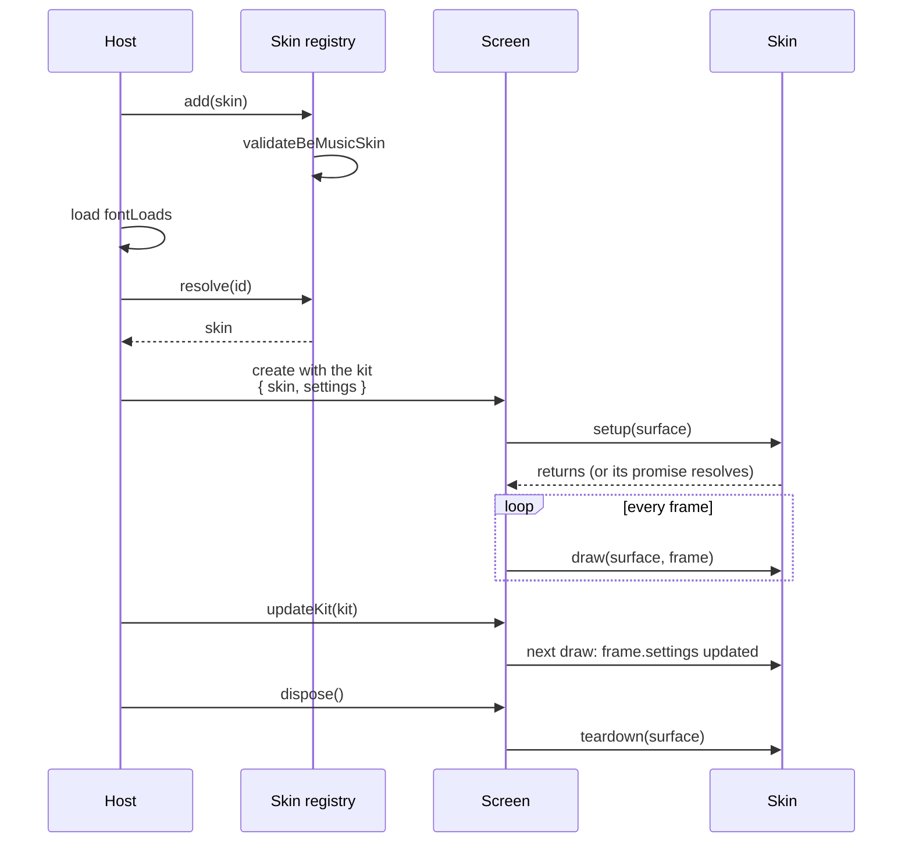

[Japanese version](./be-music-skin.ja.md)

# Writing a Be-Music Skin

Use `@be-music/player-skin-sdk` to write a Be-Music Skin for the browser player’s built-in family. Synesthesia and Plain draw on Canvas. Native uses DOM screens and sizes each playfield canvas to the part of the stage it draws. You can reuse its DOM components through `@be-music/player-ui`.

A skin draws the screens. The player handles input, timing, audio, judgment, lane layout and note positions. The player also handles hit testing for the Canvas chart list. A DOM chart list handles its own controls and calls the actions the player provides.

<details>
<summary>Table of contents</summary>

- [Related pages](#related-pages)
- [Bring your own renderer](#bring-your-own-renderer)
- [Combine Canvas and DOM](#combine-canvas-and-dom)
- [Quick start: a Canvas 2D skin](#quick-start-a-canvas-2d-skin)
- [Using a framework](#using-a-framework)

</details>

## Related pages

- [Skin API and screen contracts](./be-music-skin-api.md)
  - <a name="screens"></a>[Screens](./be-music-skin-api.md#screens)
  - <a name="chart-images"></a>[Chart images](./be-music-skin-api.md#chart-images)
- [Performance and distribution](./be-music-skin-release.md)
  - <a name="packaging-and-loading"></a>[Packaging and loading](./be-music-skin-release.md#packaging-and-loading)

## Bring your own renderer

The SDK does not draw and imports no rendering framework. Draw the canvas with whatever suits your skin:

| Renderer                     | `context`                            | How                                                                                       | Example                                                                       |
| ---------------------------- | ------------------------------------ | ----------------------------------------------------------------------------------------- | ----------------------------------------------------------------------------- |
| Canvas 2D API                | `'2d'`                               | Draw directly; the canvas comes cleared and scaled to design pixels                       | Plain (`packages/player-browser/src/skins/plain/`)                            |
| PixiJS                       | `'webgl2'`                           | Create a Pixi renderer on the canvas in `setup`, build a scene graph, render it in `draw` | Synesthesia (`packages/player-browser/src/skins/`, through `skins/pixi-kit/`) |
| three.js, raw WebGL / WebGPU | `'webgl'`, `'webgl2'`, or `'webgpu'` | Create the renderer or pipelines in `setup`, render in `draw`, release them in `teardown` | —                                                                             |

Your skin bundles its own framework as a dependency. Plain is deliberately small and readable; copy it as a starting point. It also shows how to support portrait screens; see [Supporting portrait](./be-music-skin-api.md#supporting-portrait).

## Combine Canvas and DOM

`BeMusicSkin.dom.select`, `.decide` and `.result` replace the corresponding Canvas screens. `.gameplay` accompanies Canvas lanes, BGA and immediate judgment feedback. Each factory receives `(container, actions)` and returns `update(frame)`, `dispose()` and, optionally for select screens, `focusSearch()`.

A gameplay screen can also draw the playfield. Set `gameplay.drawsOnDOM` and return `drawPlayfield(frame)` from `dom.gameplay`: the host then calls it once per frame with the full `BeMusicGameplayFrame` (lanes, notes, long notes, mines, measure lines and bombs) and creates no Canvas surface for gameplay. `gameplay.draw` remains the fallback for hosts without DOM screens. Nothing the player draws shows then (the browser player takes its canvas out of the page), so such a skin also sets `drawsBGA`, `drawsMines`, `drawsLaneCover` and `drawsMeasureLines`. Native places `be-music-playfield` from `@be-music/player-ui` under its HUD this way.

Gameplay actions are `pause()`, `restart()`, `quit()` and `seek(seconds)`. `seek` moves an AUTO play or replay to a chart second and plays on from there (a paused play stays paused there); it does nothing unless the frame is `seekable`. The frame's `layout` carries the BGA rect (`bga`) with the stage and lane bounds. The embed's preview skin (`packages/app-play/src/embed/preview-skin.ts`) combines both with `be-music-preview-hud`.

Create DOM when the factory is called. Update existing elements to preserve focus and IME state, and release listeners and elements in `dispose`. Leaving a screen temporarily preserves its mount for re-entry. A custom React or Vue screen can use the same contract: deliver frames through its framework and unmount its root on disposal.

This factory connects the existing result component to a skin. Assign it to the skin's `dom.result` property.

```ts
import { defineBeMusicElements } from '@be-music/player-ui';
import { basecoatTheme } from '@be-music/player-ui/themes/basecoat';
import type { BeMusicDOMFactory, BeMusicDOMResultFrame, BeMusicDOMResultActions } from '@be-music/player-skin-sdk';

export const mountResult: BeMusicDOMFactory<BeMusicDOMResultFrame, BeMusicDOMResultActions> = (container, actions) => {
  defineBeMusicElements(undefined, { theme: basecoatTheme });
  const element = document.createElement('be-music-result-screen');
  const onContinue = () => actions.continue();
  const onRetry = () => actions.retry();
  element.addEventListener('continue-request', onContinue);
  element.addEventListener('retry-request', onRetry);
  container.append(element);
  return {
    update(frame) {
      element.frame = frame;
    },
    dispose() {
      element.removeEventListener('continue-request', onContinue);
      element.removeEventListener('retry-request', onRetry);
      element.remove();
    },
  };
};
```

The elements are headless: the look comes from the theme passed when registering (Basecoat here) or from the skin's own custom properties and `::part` rules. Lit is optional for custom DOM screens. The [Player UI guide](../packages/player-ui/README.md) lists reusable tags, JavaScript properties, request events, React/Vue wrappers, and CSS variables, parts and slots. See the [browser player](./player-web-integration.md#native-dom-skins-and-standalone-controllers) for host/controller integration, update cadence and the limitation that Canvas recordings exclude DOM.

## Quick start: a Canvas 2D skin

```ts
import { BE_MUSIC_SKIN_API_VERSION, defineBeMusicSkin, resolveLaneRuns } from '@be-music/player-skin-sdk';

export default defineBeMusicSkin({
  apiVersion: BE_MUSIC_SKIN_API_VERSION,
  id: 'my-skin',
  label: 'My Skin',
  version: '1.0.0',
  author: { name: 'Your Name', url: 'https://example.com' },
  fontLoads: ['700 12px "M PLUS 1p"'],
  context: '2d',
  gameplay: {
    draw({ context: ctx, width, height }, frame) {
      ctx.fillStyle = '#000';
      ctx.fillRect(0, 0, width, height);
      // The BGA video plays behind the canvas: cut its rect out instead of painting over it.
      const bga = frame.layout.bga;
      if (bga && frame.runtime.hasBGA) ctx.clearRect(bga.x, bga.y, bga.w, bga.h);
      for (const lane of frame.lanes) {
        ctx.fillStyle = lane.kind === 'scratch' ? '#311' : '#111';
        ctx.fillRect(lane.x, lane.top, lane.w, lane.bottom - lane.top);
      }
      ctx.fillStyle = '#fff';
      for (const note of frame.notes) ctx.fillRect(note.x, note.y - 6, note.w, 6);
      // One judgement line per play side, so it never crosses the double-play gap.
      ctx.fillStyle = '#f33';
      for (const run of resolveLaneRuns(frame.lanes)) {
        ctx.fillRect(run.left, frame.layout.playfield.judgementY, run.right - run.left, 2);
      }
    },
  },
  select: {
    layout: { listX: 322, listTop: 56, listBottomInset: 28, rowHeight: 28 },
    draw({ context: ctx, width, height }, frame) {
      ctx.fillStyle = '#000';
      ctx.fillRect(0, 0, width, height);
      // Draw rows from frame.entries[frame.firstVisibleIndex …] and make buttons clickable:
      frame.hit(16, 400, 120, 32, frame.actions.play);
    },
  },
  result: {
    draw({ context: ctx, width, height }, frame) {
      ctx.fillStyle = '#000';
      ctx.fillRect(0, 0, width, height);
    },
  },
});
```

## Using a framework

Create the framework's renderer on the surface's canvas in `setup`, and release it in `teardown`. The player calls `setup` once per surface, before the first draw, and waits for a returned promise. Each screen gets its own surface: one for gameplay, one per select screen, one per decide screen, and one per result screen.

One surface's life, from registering the skin to the screen ending (`skin/be-music/registry.ts` and `binding.ts` in `@be-music/player-browser`):



```ts
import { WebGLRenderer, Container } from 'pixi.js';
import { BE_MUSIC_SKIN_API_VERSION, defineBeMusicSkin } from '@be-music/player-skin-sdk';

const renderers = new WeakMap<HTMLCanvasElement, WebGLRenderer>();

export default defineBeMusicSkin({
  // …metadata…
  context: 'webgl2',
  // Masks need a stencil buffer; the canvas sits over the BGA, so it keeps alpha. The player uploads the canvas in
  // the frame it is drawn, so the drawing buffer need not be preserved.
  contextAttributes: {
    alpha: true,
    premultipliedAlpha: true,
    antialias: true,
    stencil: true,
    preserveDrawingBuffer: false,
  },
  async setup(surface) {
    const renderer = new WebGLRenderer();
    await renderer.init({
      canvas: surface.canvas,
      context: surface.context,
      width: surface.width,
      height: surface.height,
      resolution: surface.pixelRatio,
      backgroundAlpha: 0,
    });
    renderers.set(surface.canvas, renderer);
  },
  teardown(surface) {
    renderers.get(surface.canvas)?.destroy();
    renderers.delete(surface.canvas);
  },
  gameplay: {
    draw(surface, frame) {
      const renderer = renderers.get(surface.canvas)!;
      const stage = buildGameplayStage(frame); // your scene graph for this frame
      renderer.render({ container: stage, clear: true });
    },
  },
  // select, result …
});
```

The built-in Pixi skins do exactly this through `skins/pixi-kit/define-pixi-skin.ts`. That file is a worked example of replaying the player's frame data into a retained Pixi scene. It also shows how to keep a select scene and rebuild it only when `frame.revision` changes. Inside the browser player, which renders with Pixi itself, the kit's skins skip their own renderer: the player has them draw their scene through its renderer into a texture, so a frame is never copied from a second canvas. That shortcut is private to the built-in kit; your skin draws on its canvas as above.
