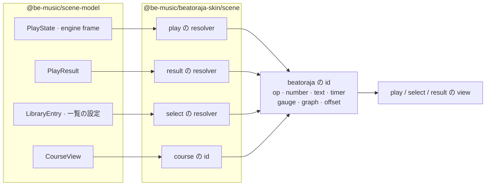
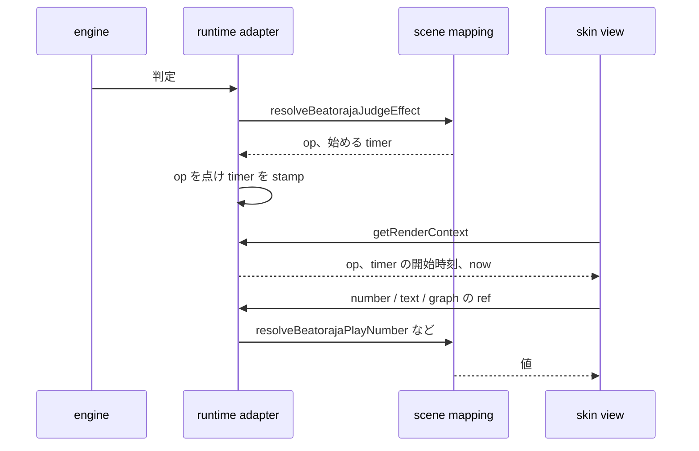

[English version](./beatoraja-skin.md)

# beatoraja skin 実装メモ

この文書は、現在の `@be-music/beatoraja-skin` 実装をまとめます。
この package は beatoraja の JSON skin と Lua skin theme を renderer 非依存の data structure に parse します。
PixiJS rendering は `@be-music/player-web` の責務です。CLI/TUI render path は beatoraja skin を読み込みません。

## 対象範囲

- `@be-music/beatoraja-skin` は play、select、decide、result、course-result scene の `*.json` / `*.luaskin` entry を読み込みます。
- dropped folder や in-memory file map から theme asset を解決します。entry script の directory に対して path を normalize し、`*` wildcard (`play/background/*.png` 等) と case-insensitive lookup に対応します。
- beatoraja の Lua 2-phase 評価契約を honor します。entry を `skin_config = nil` で 1 度評価し header (`property[]`、`filepath[]`、custom `offset[]` schema) を取得、次に user の選択を inject して `main()` 経由で完全な skin table を得ます。
- package は plain TypeScript object のみを返します。PixiJS object、WebAudio node、browser DOM UI は作成しません。

## Skin formats

beatoraja theme は 2 種類の interchangeable な entry format を持ちます。

| 拡張子                     | format                                          | discovery                      |
| -------------------------- | ----------------------------------------------- | ------------------------------ |
| `*.json`                   | static JSON skin tree (trailing comma 含む)     | `JSON.parse` で eager に parse |
| `*.luaskin` + 兄弟 `*.lua` | `require()` で兄弟 module を読む Lua 5.3 script | Fengari で評価 (下記参照)      |

どちらも `BeatorajaSkin` (full) / `BeatorajaSkinHeader` (selector UI summary) と一致する value を返します。

## Skin type

各 skin の `type` 数値 field は beatoraja 本家の `SkinType` enum に対応します。
package は `BEATORAJA_SKIN_TYPE` 定数と `playVariantForSkinType` / `sceneForSkinType` helper を export します。

| code | label                | scene                            |
| ---- | -------------------- | -------------------------------- |
| 0    | `PLAY_7KEYS`         | play (`'7'`)                     |
| 1    | `PLAY_5KEYS`         | play (`'5'`)                     |
| 2    | `PLAY_14KEYS`        | play (`'14'`)                    |
| 3    | `PLAY_10KEYS`        | play (`'10'`)                    |
| 4    | `PLAY_9KEYS`         | play (`'9'`)                     |
| 5    | `MUSIC_SELECT`       | select                           |
| 6    | `DECIDE`             | decide                           |
| 7    | `RESULT`             | result                           |
| 8    | `KEY_CONFIG`         | other                            |
| 9    | `SKIN_SELECT`        | other                            |
| 10   | `SOUND_SET`          | other                            |
| 11   | `THEME`              | other                            |
| 12   | `PLAY_7KEYS_BATTLE`  | play (unsupported battle layout) |
| 13   | `PLAY_5KEYS_BATTLE`  | play (unsupported battle layout) |
| 14   | `PLAY_9KEYS_BATTLE`  | play (unsupported battle layout) |
| 15   | `COURSE_RESULT`      | course-result                    |
| 16   | `PLAY_24KEYS`        | play (`'24'`)                    |
| 17   | `PLAY_24KEYS_DOUBLE` | play (`'24d'`)                   |
| 18   | `PLAY_24KEYS_BATTLE` | play (unsupported battle layout) |

## Lua sandbox

`evaluateBeatorajaLuaSkin()` は Fengari の上に手作りした sandbox で entry script を実行します。
default theme が実際に使う `base` / `table` / `string` / `math` のみ expose し、`package` / `io` / `os` / `debug` は除外します。
`coroutine` も除外します。`loadfile` / `load` / `loadstring` / `collectgarbage` は nil 化し、`dofile` は theme bundle 内のファイルだけを解決する実装（例: `dofile(skin_config.get_path("Play/lua/sp/info.lua"))`）に置き換えて、悪意ある skin が theme 外に到達できないようにします。

`require()` は事前登録した module source registry の上に再実装しています。
host は entry script と同一 directory および 1 階層上 (beatoraja theme は `play_parts.lua` を共通化していることがあります) の `.lua` を全て登録します。
module は cache されるので、後続の `require()` は同じ table を返します。
beatoraja の `timer_util` / `event_util` helper module は組み込みで用意しており、theme に同梱しなくても `require()` できます。

2-phase 契約:

```lua
local t = require("play24main")
if skin_config then
  return t.main()
else
  return t.header
end
```

第 1 phase は `skinConfig: undefined`、第 2 phase は populated な `BeatorajaSkinConfig` を渡します。

## 条件 group

各 element list 内の `if`/`values`、`if`/`value` block は `flattenBeatorajaElements()` で flat な element stream に展開できます。
正規化 entry は active な `if` op-code を保持し、renderer は `isElementVisible()` で runtime に visibility を制御します。
負数 op は negation 扱い (op が active で**ない**ことを要求) です。

## Element normalization

package は読み込んだ skin tree を upstream に近い形で保持しつつ、renderer 向けには型付き normalizer を expose します。
normalizer は `src/elements/` 配下にあり、image、imageset、value、float-value、text、slider、note、judge、judge graph、gauge、gauge graph、BPM graph、timing visualizer、timing distribution graph、song list、custom event、direction（graph と slider element の `angle`）、destination、PM character、generic graph element を扱います。

destination normalization は keyframe、offset、op gate、interpolation data を renderer 非依存の object に変換します。
value / image helper は `divx` / `divy` cell math、frame の carry-forward、loop wrapping を解決するため、renderer は source JSON / Lua table を再解釈せずに現在 frame を sample できます。

## Asset 解決

`resolveBeatorajaPath()` は entry skin file からの相対 path を解決します。
`..` segment、slash の normalize、case-insensitive lookup を honor します。
Windows で作成された beatoraja theme では、skin file 内 path と実 file の casing が違うことが多いためです。

`expandBeatorajaWildcard()` は `source[]` / `filepath[]` で使われる `*` pattern を展開します。
user の `filepath[]` 選択がある場合はそれが wildcard より優先されます。
それ以外は sort した最初の match が決定論的に選ばれます。

## Theme discovery

`discoverBeatorajaTheme()` は file map を walk し、scene 別 entry を持つ `BeatorajaTheme` を生成します。
play skin は variant ごと (`'7' / '5' / '9' / '10' / '14' / '24' / '24d'`) に group 化します。
複数 entry が同じ slot を cover する場合は、JSON entry、`skin/default/`、辞書順の順で優先します。
個別 skin の error は `BeatorajaThemeDiscoveryWarning[]` に集約され、theme 全体の discovery を中断しません。

`pickBeatorajaPlaySkin(playSkins, desired)` は chart の variant に対する fallback chain を解決します。

## Scene mapping

`@be-music/beatoraja-skin/scene` は、`@be-music/scene-model` の skin family に依存しない scene model を beatoraja skin の語彙に写します。
どの op が点くか、各 number と text が何を読むか、どの timer が始まり止まるか、gauge、graph、live offset です（[ADR 0002](./adr/0002-scene-model-package.ja.md)）。
以前は `@be-music/player-web` の renderer のそばにあった beatoraja の state 解決で、今は play、select、result scene が読み、P4 では runtime adapter の代わりに beatoraja の family view が読みます。



mapping は純粋で決定的です。
clock を読まず、呼び出しの間に state を持ちません。chart time、wall clock、起動からの時間、frame rate は入力として受け取り、判定や frame が始める timer は data として返します。
いくつかの結果は入力 object ごとに保持します（graph の配列ごとの polyline、library course ごとの course view、timing の list ごとの early / late 数）。同じ frame で再度問い合わせても同じ配列が返ります。
`pnpm run check` はこの subpath を runtime-neutral と決定性の lint rule で検査し、test は Lua VM と skin parser を読み込まないことを確かめます。

| 画面   | 読むもの                                                             | resolver                                                                                                                                                                                                                                                                                                                                     |
| ------ | -------------------------------------------------------------------- | -------------------------------------------------------------------------------------------------------------------------------------------------------------------------------------------------------------------------------------------------------------------------------------------------------------------------------------------- |
| Play   | play state、engine の最新 frame、chart の情報、clock                 | `resolveBeatorajaPlayNumber`（number の表）、`resolveBeatorajaPlayText`、`resolveBeatorajaPlayStartOps` / `ScoreOps` / `CoverOps`、`resolveBeatorajaJudgeEffect`、`resolveBeatorajaLaneTimers`、`resolveBeatorajaFrameTimers`、`resolveBeatorajaGaugeState`、graph・slider・judge graph・judge state の resolver、`writeBeatorajaPlayOffset` |
| Result | `PlayResult`、最終 gauge、chart の `#TOTAL` と note の種類           | `resolveBeatorajaResultNumber`、`resolveBeatorajaResultOps`、`resolveBeatorajaResultText`、result の gauge と graph の resolver                                                                                                                                                                                                              |
| Select | フォーカス中の `LibraryEntry` とその chart の情報、一覧の設定、clock | `resolveBeatorajaSelectBarOps`、`resolveBeatorajaSelectNumber`、`resolveBeatorajaSelectText`、`resolveBeatorajaSelectRefValue`、`resolveBeatorajaSelectSliderValue`                                                                                                                                                                          |
| Course | `LibraryCourse`（bar）か `CourseView`（進行中の course）             | `resolveBeatorajaCourseBarOps`、`resolveBeatorajaCourseStageOps`、`resolveBeatorajaCourseText`                                                                                                                                                                                                                                               |
| Sound  | theme の file map                                                    | `discoverBeatorajaSystemSoundPaths`、`discoverBeatorajaSelectBgmPath`、`pickBeatorajaThemeBgmPaths`                                                                                                                                                                                                                                          |

number の表は 1 つの score の表（`resolveBeatorajaScoreNumber`）を共有します。score とその rate、combo、判定数とその early / late の内訳、gauge、chart の TOTAL です。
play は hi-speed、lane cover、白数字と緑数字（`resolveWhiteNumber`）、playhead の BPM、時間、clock を加えます。
result は timing の平均と標準偏差を加え、扱わない number はすべて 0 とします。
select はフォーカス中の chart の情報を読み、play の live な number は 0 とします。

### Timer を data で返す

play の変化は、始める timer と止める timer を返します（`BeatorajaTimerChanges`）。
`start` はその場で（再）開始し、`startOnce` は play 中にまだ始まっていなければ開始し（失敗、各 side の note 終了、フルコンボ、gauge の満タン）、`stop` は止めて、それで gate された要素を隠します。
呼び出し側が自分の clock で stamp し、1 回だけの timer の集合を持ちます。今は runtime adapter がそうします。



### 振る舞いの注記

- op 230-240 は 1P gauge の 10 % 刻みの範囲（240 は満タン）で、1240 は gauge がクリアできる間（0 より大きく border 以上）点きます。beatoraja の `GaugeDrawCondition` / `Gauge.isQualified` と LR2 の読み方です（#430）。
- number 101（`SCORE2`）は EX score です。beatoraja の `createScoreProperty` と LR2 の 101 の読み方です。100（`POINT`）は表示用の score です（#430）。
- rate は beatoraja の `ScoreDataProperty` のとおりです。play 中の 102 / 103 はそれまでに判定した note に対する EX score（最初の note の前は 100 %）、115 / 116 は全 note に対する EX score です。result はどちらも全 note に対して読みます。いずれも 1/100 % 未満を切り捨てます。
- engine には MISS 判定（beatoraja の空 POOR）がありません。number 420 は POOR の数を読み、その early / late（421 / 422）は play 中は 0、result では POOR のものを読みます。
- result は max combo を combo（104）としても読み、75 は 0（LR2 の自己ベストの max combo）とします。play は 75 で max combo を読みます。
- play 中の 1P のランクの op（200-207）とその「now」の写し（340-347）は、それまでに判定した note に対する EX score のランクです。最初の note の前は 100 % なので、play は AAA から始まります。beatoraja の `createNowRank` が `ScoreDataProperty.nowrate` を読むとおりで、note のない譜面ではどれも点きません（#430）。
- beatoraja にとって別の意味を持つ LR2 の番号がいくつかあります（`IntegerPropertyFactory`、`BooleanPropertyFactory`、`StringPropertyFactory`）。number 92 はメイン BPM（LR2 ではインターネットランキングの順位）、op 400 は CONSTANT のオプション（LR2 ではキーコンフィグのページ）です。beatoraja には number 38-41・93-94、text 17-29、op 34 がないので、何も読みません（#430）。

### 既知の未対応

- 自己ベストとターゲットはまだ mapping に届いていません。number 150-158（ペースメーカーのスコア、それとの差、それに対するレート、27 分の 1 刻みの次のランクまでの差 `DIFF_NEXTRANK`）、自己ベストの number（71-89）、自己ベストとターゲットのランクの op は 0 か何も読みません。
- 汎用のランクの op（220-227）は EX score のランク 1 つだけを点けます。beatoraja の `qualifyRank` は EX score が届いたランクをすべて点けます（AAA なら 8 つすべて）。`computeGenericRankOp` は op を 1 つ返すので、すべて点けるには新しい入口が要ります。
- op 400（CONSTANT）は点きません。be-music には CONSTANT のオプションがありません。

## Browser player への配線

`@be-music/player-web` は `loadBeatorajaThemeFromFiles()` を提供し、dropped browser `File[]` を `BeatorajaThemeBundle` に wrap します。
host はその bundle から、この package の `loadBeatorajaSkin()` / `loadBeatorajaPlaySkin()`、`source[]` 向けの `bundleBeatorajaSources()`、Pixi texture 向けの `loadBeatorajaTexturesFromBundle()`、CSS / bitmap font 向けの `loadBeatorajaFonts()` を呼びます。
state は LR2 theme state と並列に保持されるため、demo は両方の theme format を同時に保持できます。

browser renderer は select、decide、gameplay、result skin の共有 view として `BeatorajaPlaySkinView` を使います。
scene は `TEXT`、`NUM`、`OPTION`、timer、gauge、graph を [scene mapping](#scene-mapping) から読み、chart image、note layer、BGA layer、audio、result history など runtime 固有の部分を自分で提供します。
gameplay は `BeatorajaRuntimeAdapter` を橋渡しに使います。engine UI signal の間の play の state を持ち、frame、判定、レーン操作ごとに mapping が解決した op と timer を適用します。

browser gameplay path は parser が discovery する chart variant `5`、`7`、`9`、`10`、`14`、`24`、`24d` をすべて mount します。
keyboard mode のレーンは、upstream の `play24main.lua` が使う `1000` 番台 timer base (`bomb_1p_key10 = 1010` など) で参照します。これらは `runtime-ids.ts` に実装済みです。

## 互換性の境界

parser は意図的に permissive です。

- 未知の skin type は `'other'` として surface し error にしません。
- JSON の trailing comma (`,]`/`,}`) は parse 前に strip します。
- 整数 key と string key が混在する Lua table は record (string-keyed object) として返します。array vs record の判定は「全 key が 1..N の integer かつ `#t == N`」という厳密 rule で行います。
- `value` / `values` を持たない条件 group (`if` だけ) は silent に drop します (default theme でも no-op です)。

package は beatoraja 本家の `SkinObject` registry を実行しません。
raw skin tree と、その上に PixiJS scene を組むのに必要な helper 群のみを expose します。
