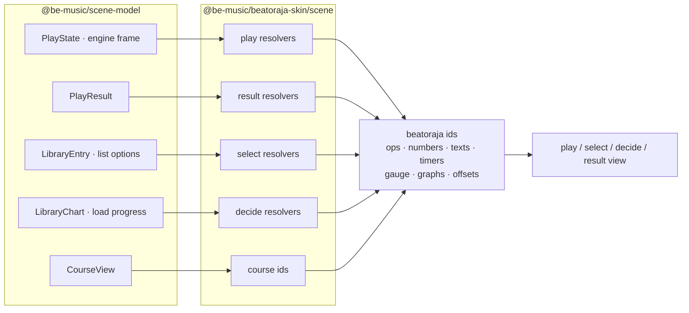
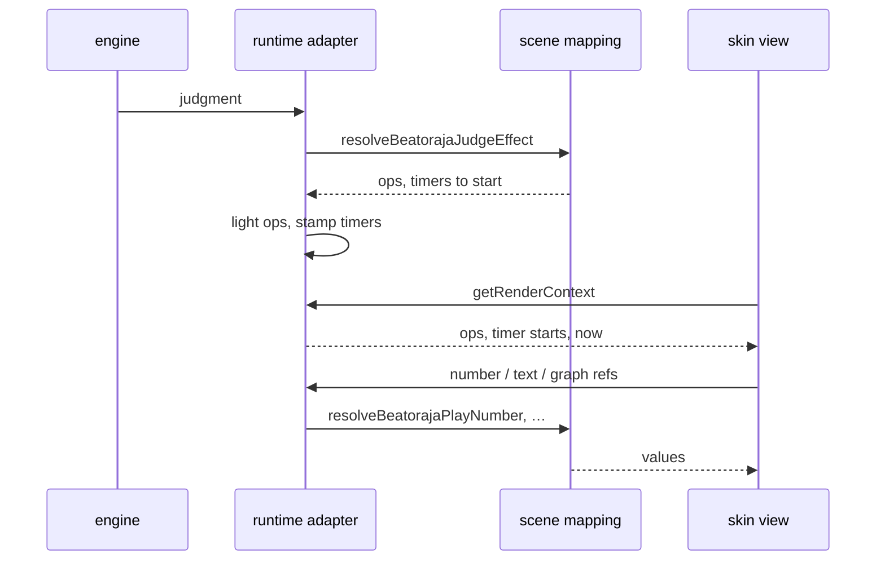

[Japanese version](./beatoraja-skin.ja.md)

# beatoraja skin implementation notes

This document summarizes the current `@be-music/beatoraja-skin` implementation. The package parses beatoraja JSON
and Lua skin themes into renderer-independent data structures. PixiJS rendering is the responsibility of
`@be-music/player-web`; CLI / TUI render paths do not load beatoraja skins.

## Scope

- `@be-music/beatoraja-skin` reads `*.json` and `*.luaskin` entries for the play, select, decide, result, and
  course-result scenes.
- Theme assets are resolved from a dropped folder or in-memory file map. Paths are normalized against the entry
  script's directory; `*` wildcards (e.g. `play/background/*.png`) and case-insensitive lookup are supported.
- The 2-phase Lua evaluation contract used by beatoraja is honored: the entry runs once with `skin_config = nil` to
  return a header (`property[]`, `filepath[]`, and custom `offset[]` schemas) and a second time with the user's picks
  injected to return the full skin table.
- The package returns plain TypeScript objects. It does not create PixiJS objects, WebAudio nodes, or browser DOM UI.

## Skin formats

beatoraja themes ship two interchangeable entry formats:

| extension                     | format                                                                         | discovery                       |
| ----------------------------- | ------------------------------------------------------------------------------ | ------------------------------- |
| `*.json`                      | static JSON skin tree (with optional trailing commas, which we strip)          | parsed eagerly via `JSON.parse` |
| `*.luaskin` + sibling `*.lua` | Lua 5.3 script that returns a skin table; uses `require()` for sibling modules | evaluated by Fengari, see below |

Both formats produce values matching `BeatorajaSkin` (full) and `BeatorajaSkinHeader` (selector-UI summary).

## Skin types

The numeric `type` field on every skin matches beatoraja's upstream `SkinType` enum. The package exports
`BEATORAJA_SKIN_TYPE` and the helpers `playVariantForSkinType` / `sceneForSkinType` so consumers can route entries
without hard-coding integer literals.

| code | label                | scene                            |
| ---- | -------------------- | -------------------------------- |
| 0    | `PLAY_7KEYS`         | play (`'7'`)                     |
| 1    | `PLAY_5KEYS`         | play (`'5'`)                     |
| 2    | `PLAY_14KEYS`        | play (`'14'`)                    |
| 3    | `PLAY_10KEYS`        | play (`'10'`)                    |
| 4    | `PLAY_9KEYS`         | play (`'9'`)                     |
| 5    | `MUSIC_SELECT`       | select                           |
| 6    | `DECIDE`             | decide                           |
| 7    | `RESULT`             | result                           |
| 8    | `KEY_CONFIG`         | other                            |
| 9    | `SKIN_SELECT`        | other                            |
| 10   | `SOUND_SET`          | other                            |
| 11   | `THEME`              | other                            |
| 12   | `PLAY_7KEYS_BATTLE`  | play (unsupported battle layout) |
| 13   | `PLAY_5KEYS_BATTLE`  | play (unsupported battle layout) |
| 14   | `PLAY_9KEYS_BATTLE`  | play (unsupported battle layout) |
| 15   | `COURSE_RESULT`      | course-result                    |
| 16   | `PLAY_24KEYS`        | play (`'24'`)                    |
| 17   | `PLAY_24KEYS_DOUBLE` | play (`'24d'`)                   |
| 18   | `PLAY_24KEYS_BATTLE` | play (unsupported battle layout) |

## Lua sandbox

`evaluateBeatorajaLuaSkin()` runs the entry script under a hand-built sandbox built on Fengari. Only the standard
libraries actually used by the reference theme (`base`, `table`, `string`, `math`) are exposed; `package`, `io`,
`os`, `debug`, and `coroutine` are left out. `loadfile`, `load`, `loadstring`, and `collectgarbage` are nilled out, and
`dofile` is replaced by a version that only resolves files inside the theme bundle (for example
`dofile(skin_config.get_path("Play/lua/sp/info.lua"))`), so a malicious skin can't reach beyond its own theme files.

`require()` is reimplemented on top of a registry of preloaded module sources. The host registers every `.lua`
neighboring the entry script (and one level up — beatoraja themes occasionally split helpers into a parent
`play_parts.lua`). Modules are cached so a `require()` call always returns the same table on subsequent invocations.
beatoraja's `timer_util` / `event_util` helper modules are built in and can be required without shipping them.

The two-phase contract:

```lua
local t = require("play24main")
if skin_config then
  return t.main()
else
  return t.header
end
```

Pass `skinConfig: undefined` for the first phase and a populated `BeatorajaSkinConfig` for the second.

## Conditional groups

`if`/`values` and `if`/`value` blocks inside any element list can be flattened to a flat element stream with
`flattenBeatorajaElements()`. Each normalized entry carries the active `if` op-codes so the renderer can gate
visibility at runtime via `isElementVisible()`. Negative codes are treated as negation (the op must NOT be active).

## Element normalization

The package keeps the loaded skin tree close to upstream, then exposes typed normalizers for renderer work.
Normalizers live under `src/elements/` and cover image, imageset, value, float-value, text, slider, note, judge,
judge graph, gauge, gauge graph, BPM graph, timing visualizer, timing distribution graph, song list, custom event,
direction (the `angle` of graph and slider elements), destination, PM character, and generic graph elements.

Destination normalization carries keyframes, offsets, op gates, and interpolation data in renderer-independent
objects. Value and image helpers resolve `divx` / `divy` cell math, carry-forward frames, and loop wrapping so a
renderer can sample the current frame without reinterpreting the source JSON or Lua tables.

## Asset resolution

`resolveBeatorajaPath()` resolves a `path` field relative to its entry skin file. `..` segments are honored, slashes
are normalized, and lookup is case-insensitive — beatoraja themes shipped from Windows often differ in casing from
the strings authored in skin files.

`expandBeatorajaWildcard()` expands `*` patterns used in `source[]` / `filepath[]`. The user's `filepath[]`
selection (when present) overrides the wildcard; otherwise the first sorted match is picked deterministically.

## Theme discovery

`discoverBeatorajaTheme()` walks a file map and produces a `BeatorajaTheme` whose fields point at the per-scene
entries. Play skins are grouped by variant (`'7' / '5' / '9' / '10' / '14' / '24' / '24d'`). When multiple entries
cover the same slot, JSON entries win over Lua entries, `skin/default/` wins over community skins, and lexicographic
order resolves the final tie. Errors are collected as `BeatorajaThemeDiscoveryWarning[]` instead of aborting
discovery so a single bad skin can't break the whole theme.

`pickBeatorajaPlaySkin(playSkins, desired)` resolves a chart's variant against a fallback chain.

## Scene mapping

`@be-music/beatoraja-skin/scene` maps the family-neutral scene models of `@be-music/scene-model` to a beatoraja
skin's vocabulary: which ops are lit, what each number and text reads, which timers start and stop, the gauge, the
graphs and the live offsets ([ADR 0002](./adr/0002-scene-model-package.md)). It is the beatoraja state resolution that
used to live next to the renderer in `@be-music/player-web`; the play scene and the select, decide and result family
views read it today, and the beatoraja play view will in place of the runtime adapter.



The mapping is pure and deterministic. It reads no clock and keeps no state between calls: the chart time, the wall
clock, the time the player has run and the frame rate come in as inputs, and a judgment's or a frame's timers come
back as data. A few results are kept per input object (a polyline per graph array, the course view per library course,
the early / late counts per timing list), so a frame that asks again gets the same array. `pnpm run check` holds the
subpath to the runtime-neutral and deterministic lint rules, and a test checks that it loads neither the Lua VM nor the
skin parser.

| Screen | Reads                                                                         | Resolvers                                                                                                                                                                                                                                                                                                                                             |
| ------ | ----------------------------------------------------------------------------- | ----------------------------------------------------------------------------------------------------------------------------------------------------------------------------------------------------------------------------------------------------------------------------------------------------------------------------------------------------- |
| Play   | The play state, the engine's latest frame, the chart's facts, the clock       | `resolveBeatorajaPlayNumber` (the number table), `resolveBeatorajaPlayText`, `resolveBeatorajaPlayStartOps` / `ScoreOps` / `CoverOps`, `resolveBeatorajaJudgeEffect`, `resolveBeatorajaLaneTimers`, `resolveBeatorajaFrameTimers`, `resolveBeatorajaGaugeState`, the graph, slider, judge-graph and judge-state resolvers, `writeBeatorajaPlayOffset` |
| Result | A `PlayResult`, the final gauge, the chart's `#TOTAL` and note kinds          | `resolveBeatorajaResultNumber`, `resolveBeatorajaResultOps`, `resolveBeatorajaResultText`, the result gauge and graph resolvers                                                                                                                                                                                                                       |
| Select | The focused `LibraryEntry` and its chart's facts, the list options, the clock | `resolveBeatorajaSelectBarOps`, `resolveBeatorajaSelectNumber`, `resolveBeatorajaSelectText`, `resolveBeatorajaSelectRefValue`, `resolveBeatorajaSelectSliderValue`                                                                                                                                                                                   |
| Decide | The `LibraryChart` about to be played, the play's loading progress            | `resolveBeatorajaDecideOps`, `resolveBeatorajaDecideNumber`, `resolveBeatorajaDecideGraphValue`                                                                                                                                                                                                                                                       |
| Course | A `LibraryCourse` (a bar) or a `CourseView` (a running course)                | `resolveBeatorajaCourseBarOps`, `resolveBeatorajaCourseStageOps`, `resolveBeatorajaCourseText`                                                                                                                                                                                                                                                        |
| Sounds | The theme's file map                                                          | `discoverBeatorajaSystemSoundPaths`, `discoverBeatorajaSelectBgmPath`, `pickBeatorajaThemeBgmPaths`                                                                                                                                                                                                                                                   |

The number tables share one score table (`resolveBeatorajaScoreNumber`): the score and its rates, the combo, the
judgment counts and their early / late split, the gauge and the chart TOTAL. The play adds the hi-speed, the lane
covers, the white and green numbers (`resolveWhiteNumber`), the BPM at the playhead, time and the clock; the result adds
the timing mean and deviation and reads every number it does not cover as 0; the select screen reads the focused
chart's facts and 0 for the play's live numbers. The decide screen does not use the score table: it reads the chart's
`#PLAYLEVEL`, its listed BPM on the BPM numbers and the loading progress (165), and 0 for every other number.

### Timers as data

A change of the play returns the timers it starts and stops (`BeatorajaTimerChanges`): `start` restarts each timer
now, `startOnce` starts each unless it already started during the play (the failure, each side's end of notes, the full
combo, the full gauge), and `stop` turns each off so what is gated on it hides. The caller stamps them on its own clock
and keeps the once-only set; the runtime adapter does this today.



### Behaviour notes

- Ops 230-240 are the 1P gauge's tenth (240 a full gauge) and 1240 is lit while the gauge would clear (above 0 and at
  its border or more), as beatoraja's `GaugeDrawCondition` / `Gauge.isQualified` and LR2 read them (#430).
- Number 101 (`SCORE2`) is the EX score, as beatoraja's `createScoreProperty` and LR2's 101 read it; 100 (`POINT`) is the
  displayed score (#430).
- The rates are beatoraja's `ScoreDataProperty`: 102 / 103 the EX score over the notes judged so far during a play (100 %
  before the first), 115 / 116 over every note; a result reads both over every note. Each is truncated to hundredths.
- The engine has no MISS judgment (beatoraja's empty POOR): number 420 reads the POOR count; its early / late rows
  (421 / 422) read 0 during a play and POOR's on a result.
- A result reads its max combo as the combo (104) too, and 75 as 0 (LR2's best-record max combo); the play reads the
  max combo on 75.
- During a play, the 1P rank ops (200-207) and their "now" copies (340-347) rank the EX score over the notes judged so
  far, which is 100 % before the first note, so a play starts on AAA, as beatoraja's `createNowRank` reads
  `ScoreDataProperty.nowrate`; a chart without notes lights none (#430).
- A few LR2 ids mean something else to beatoraja (`IntegerPropertyFactory`, `BooleanPropertyFactory`,
  `StringPropertyFactory`): number 92 is the main BPM (LR2's internet-ranking place), op 400 the CONSTANT option (LR2's
  key-config page), and beatoraja defines no numbers 38-41 or 93-94, no texts 17-29 and no op 34, so they read nothing
  (#430).

### Known gaps

- The best record and the target do not reach the mapping yet: numbers 150-158 (the pacemaker scores, the differences
  from them, the rates over them and `DIFF_NEXTRANK`, the distance to the next rank on 27ths), the best record's
  numbers (71-89) and the best and target rank ops read 0 or nothing.
- The generic rank ops (220-227) light one rank, the EX score's; beatoraja's `qualifyRank` lights every rank the EX
  score reaches (AAA lights all eight). `computeGenericRankOp` returns one op, so lighting them all needs a new entry.
- Op 400 (CONSTANT) is never lit: be-music has no CONSTANT option.

## Browser player wiring

`@be-music/player-web` ships `loadBeatorajaThemeFromFiles()` to wrap dropped browser `File[]` objects into a
`BeatorajaThemeBundle`. Hosts then load each scene's skin entry with player-web's `loadBeatorajaSceneKit()`
([player-web.md](./player-web.md#beatoraja-skin-and-theme-support)), which calls `loadBeatorajaSkin()` from this
package twice (a header pass, then the skin with the player's options), `bundleBeatorajaSources()` for `source[]`,
`loadBeatorajaTexturesFromBundle()` for Pixi textures and `loadBeatorajaFonts()` for CSS or bitmap fonts, and keeps
them per entry. The state lives in parallel with LR2 theme state, so the demo can hold both theme formats at once.

The browser renderer uses `BeatorajaPlaySkinView` as the shared view for select, decide, gameplay, and result
skins. The scenes read `TEXT`, `NUM`, `OPTION`, timers, gauges and graphs from the [scene mapping](#scene-mapping) and
provide the runtime-specific parts themselves: chart images, note layers, BGA layers, audio and the result histories.
The select, decide and result screens are player-web's beatoraja family views, made with `createSelectScene`,
`createDecideScene` and `createResultScene` ([player-web.md](./player-web.md#the-select-screen)): they draw the
sessions' frames through the select, decide and result resolvers, the result view reading a `PlayResult` directly, and
read beatoraja's scene timers off each frame. The select view reads the browse position's list options for the MODE and
SORT image sets (`BEATORAJA_KEYS_FILTERS` and `BEATORAJA_SORTS` give their order, `beatorajaKeysFilterIndex` and
`beatorajaSortIndex` an option's place) and keeps the LNMODE choice itself (`lnMode` of the select input, else the
chart's `#LNMODE` through `beatorajaLnModeIndex`); its buttons come back to the select session as intents.
Gameplay uses `BeatorajaRuntimeAdapter` as the bridge: it keeps the play's state between engine UI signals and applies
the ops and timers the mapping resolves for each frame, judgment and lane action.

The browser gameplay path mounts every chart variant the parser discovers — `5`, `7`, `9`, `10`, `14`, `24`, and
`24d`. The keyboard modes address their lanes through the `1000`-block timer bases upstream's `play24main.lua` uses
(`bomb_1p_key10 = 1010`, …), which `runtime-ids.ts` already exposes.

## Compatibility boundary

The parser is intentionally permissive:

- Unknown skin types are surfaced as `'other'` and don't trigger an error.
- JSON trailing commas (`,]`/`,}`) are stripped before parsing.
- Lua tables that mix integer and string keys are returned as records (string-keyed objects); the array-vs-record
  decision uses the strict "all keys are 1..N integers and `#t == N`" rule.
- Conditional groups (`if`/`value(s)`) without `value` or `values` are dropped silently (they're no-ops in the
  reference theme).

The package does not run beatoraja's own `SkinObject` registry — it just exposes the raw skin tree and the
helpers a renderer needs to build PixiJS scenes on top.
