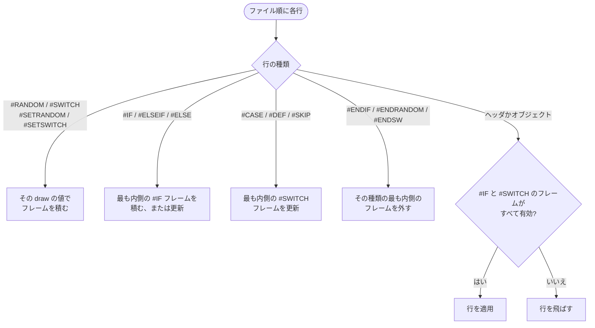

[English version](./bms-spec.md)

# BMS 実装仕様

この文書は、`packages/chart-parser` / `packages/chart-writer` / `packages/player-engine` が BMS をどう扱うかを定義します。

## 一次参照

- コマンド仕様 (日本語): https://hitkey.nekokan.dyndns.info/cmdsJP.htm
- コマンド仕様 (英語): https://hitkey.nekokan.dyndns.info/cmds.htm
- BMS Format Specification (1998-11-26): http://bm98.yaneu.com/bm98/bmsformat.html
- Bms:Spec (wiki.bms.ms, Wayback 2009-02-13): https://web.archive.org/web/20090213050609/http://wiki.bms.ms/Bms:Spec
- Basic specification of BML (RDM): https://nvyu.net/rdm/rby_ex.php
- STOP Sequence (`#STOPxx` / `#STP`): https://hitkey.nekokan.dyndns.info/exstop.htm
- Extended BPM (`#BPMxx` / `#EXBPM`): https://hitkey.nekokan.dyndns.info/exbpm-object.htm
- `#OPTION` / `#CHANGEOPTION` 仕様: https://hitkey.nekokan.dyndns.info/option.htm
- Sonorous 提案拡張 (補助一次参照): https://hitkey.nekokan.dyndns.info/bmsexts-ja.htm
- Obj Tech Lovers | Guidance chapter3-2（`#WAV00` / 休符解釈 / 地雷挙動に関する補助一次参照）: https://nekokan.dyndns.info/~otlovers/guidance/guidance_3a_txt.html
- Obj Tech Lovers | Guidance chapter4-7（地雷ダメージ解釈に関する補助一次参照）: https://nekokan.dyndns.info/~otlovers/guidance/guidance_4b.html
- Bemuse BMS Extensions (補助一次参照): https://bemuse.ninja/project/docs/bms-extensions
- beatoraja 楽曲製作者向け資料: https://github.com/exch-bms2/beatoraja/wiki/%E6%A5%BD%E6%9B%B2%E8%A3%BD%E4%BD%9C%E8%80%85%E5%90%91%E3%81%91%E8%B3%87%E6%96%99

## 参考資料

- `bms benchmark` (実装比較): https://hitkey.nekokan.dyndns.info/bmsbench.shtml
- `bmsplayer data` (互換性調査): https://hitkey.nekokan.dyndns.info/bmsplayer_data2010.shtml
- Numuther: BMS Scroll ギミック解説（SCROLL/BPM/STOP 実例）: https://note.com/numuther/n/n57bf895e7969
- LR2・beatoraja など他のプレイヤーが同じコマンドをどう扱うか、be-music がどこで異なるか: [BMS / bmson 互換性ノート](./format-compat.ja.md)

## 対応状況の要約

- 対応レベル: 部分対応
- 方針: 仕様全域の完全再現ではなく、主要な譜面再生要素を優先して実装

## 対応 (構文受理)

- [x] オブジェクトデータ行 `#mmmcc:data` を受理
- [x] ヘッダ行 `#COMMAND value` を受理
- [x] `#` で始まらない行を無視
- [x] 行終端として `LF` を受理
- [x] 行末 `CR` を除去することで `CRLF` を受理
- [x] 末尾改行なしファイルでも EOF を 1 行終端として受理
- [x] `CR` 単独改行を行終端として受理
- [x] 未知ヘッダを `metadata.extras` に保持
- [x] 既知/未知を問わず `#mmmcc` をイベントとして保持
- [x] 各行の前後の空白を除去するので、行頭インデント付きコマンドも受理
- [x] 制御構文の別表記 `#ELSE IF n` / `#END IF` / 値なし `#END` を `#ELSEIF n` / `#ENDIF` として受理（保存・出力時は正規形へ正規化、`#END <他の値>` は未知ヘッダのまま）

### 行終端

現実装の `chart-parser` は、BMS テキストを `LF` / `CRLF` / `CR` のいずれでも区切ります。
`CRLF` は 1 つの行終端として扱い、`CR` 単独改行も `LF` と同様に受理します。

入力末尾に改行がなくても、EOF を最終行の終端として扱います。
ただし `CRLF` と `LF` が混在するファイルに対する制御構文互換の厳密仕様は、後述の未対応項目のままです。

## 対応 (意味解釈)

- [x] メタヘッダ `#TITLE` を解釈
- [x] メタヘッダ `#SUBTITLE` を解釈
- [x] メタヘッダ `#ARTIST` を解釈
- [x] メタヘッダ `#GENRE` を解釈
- [x] メタヘッダ `#COMMENT` を解釈
- [x] `#SUBARTIST` を `metadata.extras.SUBARTIST` として保持し、プレイヤーの選曲画面 metadata に使用
- [x] `#BACKBMP` を browser LR2 special graphic 向けに `metadata.backBMP` として保持
- [x] `#BANNER` を `metadata.banner` として保持し、プレイヤーの選曲画面 banner に使用
- [x] メタヘッダ `#STAGEFILE` を解釈
- [x] `#STAGEFILE` を選曲後の loading screen 専用画像として表示
- [x] メタヘッダ `#PLAYLEVEL` を解釈
- [x] player: BMS で `#PLAYLEVEL` 未指定時は表示用既定値 `3` を選曲画面・TUI・結果表示へ反映
- [x] `#PLAYLEVEL 0` を保持
- [x] 文字列 `#PLAYLEVEL` を保持
- [x] メタヘッダ `#RANK` を解釈
- [x] `#RANK 0-4` を判定難易度指定として保持
- [x] メタヘッダ `#TOTAL` を解釈
- [x] メタヘッダ `#DIFFICULTY` を解釈
- [x] player: `#DIFFICULTY 1-5` を選曲一覧の表示・ソート・フィルタに使用
- [x] メタヘッダ `#BPM` を解釈
- [x] BMS で `#BPM` 未指定時は互換既定値 `130` を適用（IR 既定値も `130` に統一）
- [x] リソースヘッダ `#WAVxx` を解釈
- [x] リソースヘッダ `#BMPxx` を解釈
- [x] リソースヘッダ `#BPMxx` を解釈
- [x] リソースヘッダ `#STOPxx` を解釈
- [x] リソースヘッダ `#TEXTxx` を解釈
- [x] チャンネル `02` (小節長: `#mmm02:length`) を解釈
- [x] チャンネル `03` (16進直値 BPM) を解釈
- [x] チャンネル `08` (`#BPMxx` 参照 BPM) を解釈
- [x] チャンネル `09` (`#STOPxx` 参照 STOP) を解釈
- [x] チャンネル `01` (背景音) を解釈
- [x] チャンネル `1x` (演奏) を解釈
- [x] チャンネル `2x` (演奏) を解釈
- [x] チャンネル `17` / `27` を FREE ZONE として解釈 (9KEY / 24KEY 以外)
- [x] 9KEY 判定時はチャンネル `17` を通常レーンノートとして解釈
- [x] `#PLAYER=1` は SINGLE メタ情報として保持し、レーン判定はチャンネル構成を優先
- [x] `#PLAYER=2`（COUPLE）を保持し、明示的な CHART HEADER（AUTO）で LR2 の作者指定側ごとの独立プレイを選択する。互換性のため既定値は OFF を維持する。
- [x] `#PLAYER=3` は `17` チャンネルが存在する場合のみ 9KEY 判定ヒントとして使用
- [x] `#PLAYER=4`（BATTLE）を保持し、明示的な CHART HEADER で LR2 の TWO-PLAYER を選択する。SP は複製し、二側配置は保持する。優先順位・実譜面の根拠・replay 方針は [ADR 0028](./adr/0028-player-header-selection.ja.md) を参照。
- [x] チャンネル `D1-D9` (地雷) を解釈
- [x] チャンネル `E1-E9` (地雷) を解釈
- [x] LR2beta3 の地雷は早い側の GREAT 境界の手前の押下、または押したままの通過で爆発。beatoraja の通過時のみのモデルと、暫定 名前を言ってはいけないあのゲームの左右対称 PGREAT モデルを維持。
- [x] 地雷ダメージを直接適用し、コンボと EX-SCORE を維持。LR2 は被弾ごとに POOR/BP を1回加算し、beatoraja と暫定 名前を言ってはいけないあのゲームはゲージのみを変更。
- [x] 地雷のオブジェクト値が 2 文字の大文字 base36 ID でない場合や `00` の場合は既定ダメージ `4%` にフォールバック（`#BASE 62` の小文字の値もこの既定値になる）
- [x] `#WAV00` が定義されている場合、MANUAL モードの地雷ヒットで爆発音として使用
- [x] 地雷を `TOTAL` / `EX-SCORE` の対象ノート数から除外

#### 地雷ダメージの根拠

地雷ダメージは BM98 時代の基礎 BMS 仕様には含まれていないため、現実装では後年公開された地雷拡張系の資料と LR2 互換実装を根拠にしています。

- #141 が根拠とした `history.txt` の2008年1月14日の告知より、互換対象である LR2beta3 本体を優先します。[ProcSinglenote](https://github.com/GOMazk/OpenLR2/blob/583a38503555e59c4bafa49d60b9d0714c9007c2/LR2f.cpp#L7434-L7460) と VA 0x4188ad–0x4188d2 は GREAT の早い側の厳密な境界を使います。[ApplyJudgeMine](https://github.com/GOMazk/OpenLR2/blob/583a38503555e59c4bafa49d60b9d0714c9007c2/LR2f.cpp#L2043-L2060) を VA 0x40659c–0x4065bd と照合すると POOR は1回加算です。転記にある2回目の加算はバイナリにはありません。[#590](https://github.com/nulltask/be-music/issues/590) で修正。
- 「ダメージ = 指定値そのまま（10進換算%）」は losak の資料の LR2 実機検証に従います。beatoraja（jbms-parser `Section.java` / `JudgeManager`）も生値をダメージとして直接適用しており一致します。
- Hitkey command memo の `value / 2` は nanasi 系統の仕様であり、LR2 の実挙動とは異なるため採用していません。
- `#WAV00` を地雷リアクション専用とする扱いは Hitkey memo / Obj Tech Lovers chapter3-2 / chapter4-7 で補強しています。
- `ZZ`（= 1295%）は survival 系ゲージ（HARD / DEATH）では即 FAILED、`2-100%` の GROOVE / EASY ではゲージ下限 `2%` への clamp になります（losak の「EASY / GROOVE なら 2% になるだけ」と一致）。
- [x] チャンネル `SC` を `#SCROLLxx` 参照イベントとして保持
- [x] チャンネル `SC` を音声トリガー対象から除外
- [x] チャンネル `SC` のスクロール速度を player 描画へ反映
- [x] チャンネル `SP` を `#SPEEDxx` 参照イベントとして保持
- [x] チャンネル `SP` を音声トリガー対象から除外
- [x] チャンネル `SP` の視覚間隔補間を player 描画へ反映
- [x] チャンネル `04` を BGA base として表示に使用
- [x] チャンネル `07` を BGA layer として表示に使用
- [x] チャンネル `0A` を BGA layer2 として表示に使用
- [x] `04` / `07` / `0A` を合成表示（優先順位: `04` < `07` < `0A`）
- ブラウザーの Native・Canvas・LR2・beatoraja は、クリア命令と NONSTOP のステージ別表示も含め、`07` と `0A` を独立して保持します。スキンのフレームには `layer` と `layer2` として渡します。複数の面で同じ動画 BMP を使う場合も動画の再生位置を分け、一時停止・再開・シークに両方のオーバーレイを含めます。
- [x] layer (`07`) で黒 (`#000000`) を透過色として扱う
- [x] layer2 (`0A`) でも layer (`07`) と同じ透過ルールを適用
- [x] BGA 画像を 256x256 キャンバス前提で扱う
- [x] BGA 画像を通常は拡大縮小しない
- [x] 256x256 未満の画像を X 軸中央 / Y 軸上詰めで配置
- [x] 256x256 を超える画像（長辺が 256 超）と動画は、LR2・beatoraja と同じく BGA 枠いっぱいに引き伸ばす
- [x] 小さい画像の周りのベース / POOR キャンバスは黒（1x1 の黒 `#BMPxx` で BGA を暗転できる）。レイヤーのキャンバスは透過
- [x] `#BGAxx` の切り抜きは 256x256 キャンバスの `dx dy` に配置（ブラウザプレイヤー）
- [x] `04` / `07` / `0A` で未定義 `#BMPxx` 参照時は 256x256 黒として扱う
- [x] BGA 動画を描画で再生 (`mpeg1video` / `h264` / `mjpeg`, 音声は無視)
- [x] 制御構文 `#RANDOM` を保持して実行時評価
- [x] 制御構文 `#SETRANDOM` を保持して実行時評価
- [x] 制御構文 `#ENDRANDOM` を保持して実行時評価
- [x] 制御構文 `#IF` を保持して実行時評価
- [x] 制御構文 `#ELSEIF` を保持して実行時評価
- [x] 制御構文 `#ELSE` を保持して実行時評価
- [x] 制御構文 `#ENDIF` を保持して実行時評価
- [x] 制御構文 `#SWITCH` を保持して実行時評価
- [x] 制御構文 `#SETSWITCH` を保持して実行時評価
- [x] 制御構文 `#CASE` を保持して実行時評価
- [x] 制御構文 `#DEF` を保持して実行時評価
- [x] 制御構文 `#SKIP` を保持して実行時評価
- [x] 制御構文 `#ENDSW` を保持して実行時評価
- [x] 拡張ヘッダ `#PREVIEW` を `bms` 拡張領域へ保持
- [x] 拡張ヘッダ `#LNTYPE` を `bms` 拡張領域へ保持
- [x] 拡張ヘッダ `#LNMODE` を `bms` 拡張領域へ保持（`1` = LN、`2` = CN、`3` = HCN）
- [x] player は `beatoraja` ルールセットで `#LNMODE 2` / `3` のロングノートを CN / HCN として処理する。`____` はすべてのロングノートを CN（`#LNMODE 3` なら HCN）、`lr2` はすべて LN として処理する
- [x] 初期 `#OPTION charatbeatHDX:LONGMODE 0` / `1` は、分岐選択後に CN・HCN を指定する。有効な明示的 `#LNMODE`、最後の有効な HDX 宣言、ユーザーの既定値の順で優先する。時刻付き A6 の LONGMODE は診断し、ノートを変更しない。fingerprint・replay・bmson 変換・NONSTOP stitch バージョン3も実効モードを保持する。[ADR 0027](./adr/0027-hdx-long-note-modes.ja.md) を参照。
- [x] 拡張ヘッダ `#LNOBJ` を `bms` 拡張領域へ保持
- [x] 拡張ヘッダ `#VOLWAV` を `bms` 拡張領域へ保持
- [x] 拡張ヘッダ `#DEFEXRANK` を `bms` 拡張領域へ保持
- [x] 拡張ヘッダ `#EXRANKxx` を `bms` 拡張領域へ保持
- [x] 拡張ヘッダ `#ARGBxx` を `bms` 拡張領域へ保持
- [x] 拡張ヘッダ `#PLAYER` を `bms` 拡張領域へ保持
- [x] 拡張ヘッダ `#PATH_WAV` を `bms` 拡張領域へ保持
- [x] Node の演奏用サンプルと診断用の音声長読み込みに `#PATH_WAV` を適用し、共通リゾルバーで接頭辞付きパスを優先して、見つからなければ元のパスを探索する
- [x] 拡張ヘッダ `#BASEBPM` を `bms` 拡張領域へ保持
- [x] 拡張ヘッダ `#STP` を `bms` 拡張領域へ保持
- [x] 拡張ヘッダ `#OPTION` を `bms` 拡張領域へ保持
- [x] 拡張ヘッダ `#CHANGEOPTIONxx` を `bms` 拡張領域へ保持
- [x] 拡張ヘッダ `#WAVCMD` を `bms` 拡張領域へ保持
- [x] 拡張ヘッダ `#EXWAVxx` を `bms` 拡張領域へ保持
- [x] 拡張ヘッダ `#EXBMPxx` を `bms` 拡張領域へ保持
- [x] 拡張ヘッダ `#BGAxx` を `bms` 拡張領域へ保持
- [x] 拡張ヘッダ `#SCROLLxx` を `bms` 拡張領域へ保持
- [x] 拡張ヘッダ `#SPEEDxx` を `bms` 拡張領域へ保持
- [x] 拡張ヘッダ `#POORBGA` を `bms` 拡張領域へ保持
- [x] 拡張ヘッダ `#SWBGAxx` を `bms` 拡張領域へ保持
- [x] 拡張ヘッダ `#VIDEOFILE` を `bms` 拡張領域へ保持
- [x] 拡張ヘッダ `#MIDIFILE` を `bms` 拡張領域へ保持
- [x] 拡張ヘッダ `#MATERIALS` を `bms` 拡張領域へ保持
- [x] 拡張ヘッダ `#DIVIDEPROP` を `bms` 拡張領域へ保持
- [x] 拡張ヘッダ `#CHARSET` を `bms` 拡張領域へ保持
- [x] 拡張ヘッダ `#BASE 62` (beatoraja 互換 base-62 拡張) を `bms.base` に保持し、 `#WAVxx` などの索引付きヘッダおよびチャンネルストリームトークンの大文字小文字を区別する
- [x] 単一値ヘッダ・索引付きヘッダ・`#mmm02` の重複定義は EOF 側を採用
- [x] `#STP` / `#LNOBJ` / 制御構文は重複行を宣言順で保持
- [x] `#PREVIEW` を選曲画面プレビュー再生で優先的に使用
- [x] `#VOLWAV` を player / chart-audio-renderer の再生ゲインに反映
- [x] `#xxx97` を BGM 側の動的音量変更として解釈
- [x] `#xxx98` を playable/key 側の動的音量変更として解釈
- [x] `#EXRANKxx` と `#xxxA0` を プレイヤーの動的判定幅変更として解釈
- [x] `#BPMxx` による LR2 100001倍 BPM 系ギミックを時刻解決でサポート
- [x] nanasi の `#EXBPMxx` を `#BPMxx` の別名として読む。`#BPMxx` として保存・書き出しするため、同じ番号では後の行が勝つ（[cmds](https://hitkey.nekokan.dyndns.info/cmds.htm#EXBPMXX)）
- [x] すべての `#WAVCMD` 行を `bms.wavCmds` に保持し、browser・Node・オフライン再生で `01` の百分率音量を反映
- [x] `#EXWAVxx` を parse し、`v` volume parameter を browser・Node・オフライン再生で反映

`#EXWAVxx` は nanasigroove の空白区切りパラメーターをフラグ順に受け付けます。例は `pvf 0 -600 44100 sample.wav` です。従来の Be-Music のカンマ区切りも引き続き受け付けます。ファイル名はすべてのパラメーターの後から始まり、空白を含められます。有効な EXWAV は WAV がなくても読み込み、同じスロットに WAV がある場合も EXWAV のファイル名を優先します。不正な EXWAV は WAV を上書きしません。これは Be-Music の優先規則です。browser のデコード・再生、Node の再生・診断、オフライン描画で同じ解決関数を使います。NONSTOP は EXWAV のファイル名と WAVCMD のパラメーターをステージごとに変換します。browser・Node・オフラインは共通の[拡張音声規則](./adr/0024-extended-bms-audio.ja.md)でピッチ・発音時間の上限・pan/frequency を実行します。

- [x] `#BASEBPM` を `@be-music/chart-model` 経由で browser HS-FIX calibration の reference BPM として使用
- [x] Browser player は `#BGAxx` sub-region BGA を描画する。SWBGA はキー入力連動の A5 エンジン状態だけで描画し、以前のキュー駆動ヘルパーは削除した。 静止画の多段参照は定義順に依存せず解決し、各段の配置位置を 256×256 キャンバス上で合成して、切り出し元と配置先の端を切り取る。完全に画面外となるベース／POOR は黒、オーバーレイは透明になる。明示的な BMP／EXBMP 定義は、その画像を読み込めない場合も同じ ID の BGA 参照より優先する。
- [x] Terminal の BMP／PNG／JPEG 静止画 EXBMP は、切り出し・縮小の前に透明色を適用する。RGB は各成分 ±8、アルファ付き画像のアルファ値は完全一致とし、アルファなし画像は指定との比較に 0 を使う。全ゼロ指定は色透過を無効にする。対象外の色と黒を残し、色の乗算はしない。異なる透明色のキャッシュを分け、暗黙の POOR と NONSTOP の参照先にも適用する。透過対象外の元画像アルファは、次項の合成に渡す。[実測に基づく仕様](https://bms.ms/~hitkey/diary1811.php)。共通 API は `resolveBMSExBMPColorKey` と `applyBMSColorKey`。
- [x] Terminal の ANSI／Kitty は、PNG とアルファ付き BMP の半透明を、EXBMP の透過色処理、元座標の部分領域、nearest／Lanczos の縮小、ワーカーのフレーム転送まで保持する。元画像アルファと面の透明度を掛け合わせ、元の色に RGB tint を適用する。source-over 合成中はアルファを保持し、最終出力で黒い表示領域へ合成する。縮小はアルファを乗算した RGB とアルファを一緒にフィルターに通し、透明画素の隠れた色が縁に混ざることを防ぐ。二値画像は従来の軽いマスク表現を使い、必要な画像だけ中間のアルファ値を持つ。POOR の置換・重ね合わせ、SWBGA、シーク・リサイズ、NONSTOP のリソース読み込みも同じ経路を使う。[source-over の計算](https://www.w3.org/TR/compositing-1/#simplealphacompositing)に従う。アルファ付き動画のデコードと実機プレイヤーとの厳密な画素一致は未検証。
- [x] Browser の Native・Canvas・LR2・beatoraja は、別名参照と NONSTOP を含む静止画に EXBMP 透過色を適用する。PNG は Canvas の乗算済みアルファへの変換前に処理し、パレット・低ビットグレースケール・Adam7・元の `tRNS` に対応する。TGA/DDS は元の RGBA、BMP/JPEG はファイルのアルファ情報を使う。透過対象外の画素は色とアルファを保ち、ベース面の透過部分には BGA 領域の黒地が見える。EXBMP を tint や全体の透明度として扱わない。`@be-music/shared-utils/png` のランタイム非依存 API `decodePNGToRGBA8` を terminal と共有する。DirectX のアルファ・乗算処理との厳密な一致は未検証。
- [x] Browser の Native／Canvas／LR2／beatoraja と terminal の ANSI／Kitty は、不透明な動画フレームにも EXBMP の透過色を適用する。Be-Music はデコーダーが補ったアルファをアルファなしの画像として扱い、比較アルファを 0 とする。元の画素を切り出しや縮小の前に処理し、後続フレームでも部分領域を更新する。指定されていない黒を保持し、全成分ゼロは透過処理をせず、各面の再生位置を分け、透過したベースの下には黒い表示領域が見える。これは共通の透過色方針を動画へ適用する Be-Music の動作であり、アルファ付き動画と nanasigroove の動画動作との厳密な一致は未検証。不透明動画の透過処理だけでは、アルファ付き動画のデコード互換性は確定しない。
- [x] `A1`〜`A4` は、base/layer/layer2/POOR ごとに十進数の `#ARGBxx a,r,g,b` 定義を選択する。RGB は元の色に乗算し、A は面の不透明度を置き換える。`0B`〜`0E` は RGB を保って同じアルファ値を置き換える。EXBMP の色透過とは別の処理で、[BGAEncAdvance の公開ソース](https://yaruki0.net/programs/bgaencadv.html)（`source/main.d`）の描画計算に従う。Browser の Native・Canvas・LR2・beatoraja と terminal の ANSI/Kitty に適用し、スキン・クロスフェードの透明度との積、シーク時の状態復元、NONSTOP 各ステージ独立の色履歴に対応する。Canvas スキンには色を適用した画像を渡す。BMP と同じ ID でも、選択されていない定義は描画に影響しない。`00`・未定義・不正な十進数・範囲外の値は現在の状態を保つ。同時刻の競合はイベント配列の順序（BMS のパース後はチャネル・値の正規順序）で後の指定を優先する。[実測資料](https://bms.ms/~hitkey/diary1811.php) でも競合時の優先順位は実装依存とされている。`buildBGAOpacityTimelines` が作る RGB 状態は `pickBGATint`、共有するアルファ値は既存の `pickBGAOpacity` で取得する。
- [x] 標準 SWBGA の構文とエンジン状態：`parseBMSKeyBoundBGA` は `fr:time:line:loop:a,r,g,b pattern` を読み、時間をミリ秒、パターンを BMP 系 ID の連続したペアとして扱う。`00` も実フレームとなる。`buildKeyBoundBGATimeline` が有効な `A5` 選択を時刻に変換し、`pickKeyBoundBGAFrame` がループ・最終フレーム保持・指定時間での終了を処理する。決定的な `KeyBoundBGAController` は対象キーの新しい押下で開始し、時間ゼロなら離上まで、有限時間なら離上後も指定時間まで表示する。新しい対象入力のアニメーションだけが表示され、定義を選択しただけでは開始しない。疎な表示フレームや時刻の巻き戻しに対応し、手動シークではライブ入力履歴を消去、リプレイ／AUTO の履歴は再現する。エンジンの `PlayerUIFramePayload.keyBoundBGA` は有効な定義・BMP ID・フレーム開始時刻・未解釈の ARGB 値を渡す。AUTO／AUTO SCRATCH はタップを 100 ms、LN を終端まで仮想的に保持し、判定や記録入力は変更しない。既定プレイヤーの描画と NONSTOP への配置は次項を参照。[実測を含むコマンド資料](https://hitkey.bms.ms/cmds#SWBGAXX)を参照。
- [x] `A0`〜`A6` の制御値と同じ ID の WAV があっても、制御命令でサンプルを再生しない。
- [x] Browser の Native／Canvas／LR2／beatoraja と terminal の ANSI／Kitty は、`A5` で選択したキー入力連動 SWBGA を描画する。BMP00、EXBMP のみのリソース、配置付きの部分領域、動く動画の切り出しにも対応する。通常の BGA と POOR の上に重ね、離上または期限で消す。定義ごとに透過処理済みリソースと動画の再生位置を分け、新しい押下で選択中の動画フレームを最初から再生する。透過色はデコード後の RGBA と比較し、不透明な RGB 画像／動画の比較アルファは 255 とする。RGB は ±8、アルファは完全一致、全成分ゼロは透過処理なしとし、EXBMP の透過処理を先に行う。動画は各デコードフレームを切り出す前に処理する。この照合方針は EXBMP の実測モデルを再利用しており、nanasigroove／DirectX との厳密な一致は未検証。NONSTOP 対応は次項を参照。
- [x] NONSTOP は SWBGA 定義と全画像の依存先をステージ別の名前空間へ変換する。`NonstopStitchMap.keyBoundBGA` はフレームを配列で持ち、bmson 混在コースの 2 文字を超える内部 ID も保持する。冒頭を切り詰めるステージは直前の有効な A5 選択を初期状態とし、ステージ所有区間の外の選択を捨て、逆走後は選択を固定する。FIT はフレーム間隔と有限の表示時間を変換し、キューとフレームの `playbackRate` が動画の時計も変換する。キューの `endSeconds` は、長い有限時間やステージをまたぐ押しっぱなしでも、ステージ境界で選択と表示を終了させる。設定のないステージは選択を引き継がず、次の開始には新しい押下が必要。LR2 は標準 SWBGA を実装しないため、これは Be-Music の連結規則となる。Browser はマップを自動的に渡す。他のホストは `map.keyBoundBGA` を `PlayerOptions.keyBoundBGACues`、`LoadPlayBGAOptions.keyBoundBGACues`、`BgaANSIOptions.keyBoundBGACues` へ渡し、Node UI アダプターも同じ情報を転送する。リプレイの再連結が元ステージからこの表示状態を再構築する。
- [x] Browser の Native・Canvas・LR2・beatoraja と terminal の ANSI/Kitty は透明度チャンネル `0B` / `0C` / `0D` / `0E` を base / layer / layer2 / POOR に適用する。非ゼロの16進バイト値を `value / 255` の透明度として扱い、`00` は休符、初期値は不透明とする。譜面の時刻に従って次の指定まで値を保持し、シークでは以前の状態を復元する。置換型 POOR は黒地に、重ねる POOR は通常の BGA に合成する。NONSTOP は透明度イベントと各ステージの有効な初期値を引き継ぎ、クロスフェード用にステージ別の履歴も公開する。Browser の NONSTOP 描画は各ステージの履歴にクロスフェード率とスキンの透明度を掛けて使う。上記の ARGB チャンネルと不透明度の状態を共有する。
- [x] Browser の動画切り出しは元動画の座標を保ち、多段参照でも各面の動画再生位置につなげ、指定位置で表示して同じキューの再発火で再開する。ベース、2 枚のオーバーレイ、POOR が同じ動画を参照しても再生位置を分け、POOR も pause／resume する。Canvas スキンには先頭フレームを固定したビットマップではなく、現在のフレームを切り出すキャンバスを渡す。切り出し元の動画では変換時の解像度上限を無効にし、指定座標を保つ。
- [x] Native／Canvas／LR2／beatoraja は、NONSTOP クロスフェード中に見える全ステージの動画を同期する。各動画はそれぞれのキュー時刻を使い、主となるステージが切り替わっても再開せず、表示を終えたステージの動画は停止する。逆方向や停止中の seek は表示中の全ステージを復元し、resume もすべてのアクティブなステージを対象にする。開始待ち中は再生せず、キュー時刻が凍結しても選択済みの動画は再生クロックで進める。
- [x] NONSTOP は EXBMP のみのファイル名と BGA 切り出しの依存先を変換し、ステージ別の ID・切り出し座標・配置を保持する。bmson 混在出力では内部の長い ID も保持する。Canvas と beatoraja のプレイ画面には、切り出した画像に加えて配置情報も渡す。
- [x] Browser と terminal は `#EXBMPxx a,r,g,b filename` のみで定義したファイル名を、暗黙の POOR スロット `00` も含めて読み込む。明示的な `#BMPxx` のファイル名を優先する。ファイル名前の区切りがカンマの記法も引き続き受け付ける。標準 A5 SWBGA は前述の描画経路を使う。
- [x] Terminal は base・両オーバーレイ・POOR で `#BGAxx` の切り出しを描画し、暗黙のスロット `00` にも対応する。座標はリサイズや動画の黒枠除去前の画像・動画を基準とし、`dx dy` で 256×256 キャンバスに配置して領域外を切る。base と置換型 POOR の周囲は黒、オーバーレイの周囲は透過にする。再生中に届く動画フレームにも同じ処理を適用する。明示的な BMP/EXBMP リソースを BGA 別名より優先し、未定義・循環する別名は欠落リソース用フレームにする。
- [x] チャンネル `51-59` / `61-69`（拡張の `5A-5O` / `6A-6O` を含む）をロングノートとして解釈。`#LNTYPE` 省略時の既定である `#LNTYPE 1` はオブジェクトを始点 / 終点の組にし、`#LNTYPE 2`（MGQ）は `00` 以外が連続するセルの並びを 1 本のロングノートにする
- [x] `#LNOBJ`: すべての宣言が有効で、宣言順に `bms.lnObjs` へ保持する。このオブジェクトは同じレーンの直前のノートから始まるロングノートを終わらせ、発音しない（HDX の Keyup 発音は採用しない）。直前にノートのない `#LNOBJ` オブジェクトは通常ノートになる
- [x] `51-69` と `#LNOBJ` のロングノートが同じレーン・同じ位置から始まる場合は `51-69` を優先
- [x] player はレーン・位置ごとに 1 ノートだけを残す。ロングノートがタップより優先し、それ以外は最小のオブジェクト ID を採用する。残りのノートのキー音は BGM として鳴らす（[player 仕様 — 重複ノート](./player-spec.ja.md#重複ノート)）
- [x] チャンネル `06` を POOR BGA として再生する。ミス時に表示し、表示中は `04` / `07` / `0A` より優先する
- [x] `#POORBGA` が `2` でなければ、最初の `06` オブジェクトまで `#BMP00` を POOR 画像として使う（`#POORBGA` がない、整数として読めない、0..2 の範囲外のときは `0` とみなす）
- [x] `#STP xxx[.yyy] zzzz`（`.000` として読む省略形 `xxx zzzz` を含む）を時刻解決で `zzzz` ms の停止として反映し、同じ位置の停止は加算する

### 負の BPM（channel 08 経由の `#BPMxx`）の根拠

LR2 を基準とします（issue #134。OpenLR2 による LR2 beta3 100201 の再構成 — ブランチ `LR2Beta3-v100201` の `583a385`、`LR2f.cpp` — と LR2body.exe の対応コード、hitkey command memo、LR2 同梱 `history.txt` で検証）。

- **タイミング。** LR2 は `#BPMxx` を符号付きのままパースし、ロード時のタイミング事前計算では **|BPM|** で積分します（`LR2_bmsload.cpp:2841-2843`）— 時間軸は決して逆行しません。timing resolver（`@be-music/chart-model` の `timing.ts`）も同じく `Math.abs(bpm)` で積分し、最初に反転を起こすイベントの位置を `TimingResolver.reversal`（beat と seconds）として公開します。Resolved Chart はこれを `ResolvedChart.reversal` として持ちます。
- **切り捨て。** LR2 は `< 0` 判定の前に BPM を int へ変換します（LR2body.exe 0x42b960 `__ftol`）。反転するのは `trunc(BPM) < 0` のときだけで、`-1 < BPM < 0` は反転せず |BPM| で這うように進むだけです。負の値の NOWBPM は `|trunc(BPM)|`（`-0.5` なら 0、`-65.5` なら 65）を表示し、タイミングは |BPM| をそのまま使います（`TempoPoint.displayBPM`、`TimingResolver.displayBPMAtBeat`）。
- **イベントポンプ。** 負の BPM が発火すると LR2 のイベントポンプは以後ずっと凍結します。後続の BGM キー音・BGA キュー・BPM・STOP イベントは一切発火せず、オートプレイも止まり、NOWBPM は `|trunc(BPM)|` のままです。反転と同じティックでは、LR2 はイベントを op 順に並べます（`CMP_NotesByRealTimingOp`、`LR2f.cpp:24013`）。BGM（op 1）・BPM（op 3）・BGA レイヤー（op 4 / 6 / 7）は負の BPM（op 8）より**前に**発火し、そのティックの STOP（op 9）・レーン音（10〜29）・不可視オブジェクト（30 以降）は凍結します。エンジン・オフラインレンダラー・選曲プレビューは `firesBeforeTempoReversal` で絞り込みます（`0A` は BGA レイヤー扱い）。再生中の動画 BGA はそのまま流れ続け、止まるのはキューの切り替えだけです。
- **表示。** LR2 は時刻ではなく譜面の**位置**を鏡映します。反転点 R 以降は `2·pos(R) − pos(now)` で描画し、`pos(now)` は |BPM| のテンポマップに沿って前進し続けます（`LR2f.cpp:2185-2188`、LR2body.exe 0x406d81）。そのため逆スクロールの速さは反転前のテンポをなぞるのではなく反転後のテンポに従い、負の値の |BPM| で進み、タイミングテーブル上の後続の BPM 変化に追従し、反転後の STOP では止まります。エンジンは UI フレームに `displayBeat = 2·beat(R) − beat(now)`（`mirrorBeatAtTempoReversal`）を載せ、TUI グリッド・beatoraja レイヤー・web シーンの `currentBeat` はこれでスクロールします。be-music には時刻ベース（「constant」）の HS-FIX スクロールがないため、時刻空間の鏡映はどこにも要りません。LR2 のノート描画規則は反転後も続きます。LR2 の `draw_count` は戻らないため、反転前に消えたノート・地雷・小節線はスクロールが戻っても消えたままで、反転より後に置かれた判定されないノートは判定ラインから上へ遠ざかります。beatoraja の描画規則（SCROLL や SPEED を含む譜面）では、オブジェクトの時刻を鏡映した判定クロックと比べます（`resolveReversedDrawClock`）。
- **判定。** LR2 は鏡映クロック `t' = 2R − now` で押下を判定し続けます（`LR2f.cpp:12624`、`:12931`、LR2body.exe 0x42c25b / 0x42c788）。R ± BAD 窓程度にあるノートは R 直後も叩けます。レーンの次のノートが `t'` から届く範囲（LR2 の早押し 1 秒）にある間は押下で空 POOR が出るため、R の後およそ 1 秒は空 POOR が発生します。`t'` は R を超えないので、R 以降のノートがミスとして処理されることはありません。R を跨ぐ LN は離した時点で BAD になり（`LR2f.cpp:7613-7616`）、離さなければ開いたままです。エンジンの判定コアは反転を譜面のデータ（`reversalSeconds`）として受け取り、押下・解放・ホールド判定をこの鏡映クロックで行い（ログ・ゲージ履歴・UI 合図は実時刻のまま）、リプレイ・シミュレータも反転後の入力を同じく鏡映するので、リプレイと再シミュレーションは同じ結果を再現します。地雷は反転点で凍結します。
- **リザルト。** 反転後の LR2 はステージを自力では終えず、離脱（ESC など）したとき未判定のスコア対象ノートが残っていれば HP = 0 にします（`LR2f.cpp:12980-12982`、LR2body.exe 0x42c525）。そのためこうしたプレイは必ず FAILED です。be-music は事前計算した曲の終わりで終了しますが（下の逸脱 1）、結果は同じにします。反転したプレイがスコア対象ノート（開いたままのホールドを含む）を残して終わると、ゲージ 0・未クリアで終わります。マニュアルプレイ・オートプレイ・シミュレータのいずれも同じです。
- **LR2 からの意図的な逸脱**（いずれも退化ケース）: (1) ステージは ESC 待ちで進行不能にならず、譜面の事前計算された末尾で終了する。(2) `#BPMxx 0` は従来どおりドロップ（直前テンポ継続）— 実機 LR2 はゼロ除算で退化（時刻テーブルに +inf、スクロール停止）。(3) 未定義 `#BPMxx` 参照は従来どおりドロップ — 実機 LR2 はスロットのセンチネル `-1.0` を踏み「`#BPMxx -1`」と同一挙動（1 BPM で逆走）。(4) 負の `#BPM` ヘッダはデフォルト 130 にフォールバック — 実機 LR2 は無ガードでタイミングテーブルが退化。(5) 鏡映表示がチャート先頭まで巻き戻った後は先頭で固定 — 実機 LR2 は負の位置へ後退し続ける。(6) 反転点は負のイベントの譜面時刻ちょうど — 実機 LR2 はポンプがそのイベントに到達したフレームで反転を起動する。
- **ルールセットの適用範囲:** この LR2 モデルは判定ルールセット（`lr2` / `beatoraja` / `____`）に関わらず常に適用します（意図的）。負の `#BPMxx` は LR2 固有の作法で、これを使う譜面（Sofa $15 → $1、U9 など）は LR2 の逆スクロールを前提に作られ調整されています。beatoraja 本体はパース時に負の `#BPMxx` 定義を拒否し（`BMSDecoder`:「#negative BPMはサポートされていません」）、ギミックは単なるテンポ継続になってしまいますが、本実装は譜面が想定する事実上の挙動を優先します。判定ルールセットが選ぶのは判定幅・ゲージ・スコアリングのみで、譜面タイミングの解釈・鏡映判定クロック・FAILED のリザルトは共通です。ルールセットを持たないオフラインレンダラーと選曲プレビューもゲームプレイと一致します。
- channel 03（inline hex `01`–`FF`）はゼロも負も表現できません。`00` ペアは休符です。

フィクスチャ: [`test/fixtures/negative-bpm-reverse.bms`](../test/fixtures/negative-bpm-reverse.bms)、[`negative-bpm-zero.bms`](../test/fixtures/negative-bpm-zero.bms)、[`negative-bpm-undefined-slot.bms`](../test/fixtures/negative-bpm-undefined-slot.bms)

### `#BASE`

`#BASE` は、BMS object ID の基数を選ぶ beatoraja 互換拡張です。
既定値は `36` で、`0-9A-Z` を使い、ASCII 小文字は大文字へ畳み込みます。
`#BASE 62` は indexed header と object stream token を case-sensitive な `0-9A-Za-z` として扱い、`0a` と `0A` を別 ID にします。

parser は通常 parse の前に BMS source を pre-scan し、`#BASE 36` / `#BASE 62` を探します。
scan は beatoraja と同じくファイル全体を対象にするため、`#BASE` は object data の後ろを含めてどこに書いてもよく、制御構文のブロックもこの scan では評価しません。
`#BASE 36` / `#BASE 62` の行が複数ある場合は最後の行を採用します。
未対応値は無視します。

runtime と round-trip の扱い:

- `chart-parser` は有効な base を `bms.base` に保持します。`#BASE 36` は既定値と同じなので、出力時に明示する必要はありません。
- `chart-writer` は `bms.base` が `62` の場合に `#BASE 62` を出力します。
- `#WAVxx`, `#BMPxx`, `#BPMxx`, `#STOPxx`, `#TEXTxx`, `#LNOBJ`, BGA 系 indexed map、object stream value は有効な base で正規化します。
- 制御構文 (`#RANDOM` / `#IF` / `#SWITCH` block) の内側も通常行と同じ base を使うため、branch 内の小文字 ID も parse と branch resolution を通して保持します。
- `player-engine`, `chart-audio-renderer`, `chart-model`, `player-browser` は sample、BGA、BPM/STOP、LN、地雷、timing 参照を `resolveBMSBase()` 経由で解決し、base-62 の小文字 ID を runtime でも区別します。

例:

```bms
#BASE 62
#WAV0a lower.wav
#WAV0A upper.wav
#00111:0a0A
```

この場合、`lower.wav` と `upper.wav` は別々の sample reference として鳴ります。
`#BASE 62` が無い場合、両方の key は同じ base-36 ID に畳み込まれ、後勝ちの定義になります。

### `#VOLWAV`

`chart-parser` は `#VOLWAV` を非負の数値として `bms.volWAV` に保持します。
`chart-writer` は `bms.volWAV` が存在する場合、その値を `#VOLWAV n` としてそのまま出力します。

再生時とレンダリング時は、`#VOLWAV` を譜面全体へ掛かる線形 gain として扱います。
省略時は `100` を既定値とします。`0 < n < 200` の値では実効倍率が `n / 100` になり、それ以外の値では原音量で鳴らします。

- `#VOLWAV 100`: 原音量
- `#VOLWAV 50`: 原音量の半分
- `#VOLWAV 150`: 原音量の `1.5` 倍
- `#VOLWAV 0`、`#VOLWAV 200` 以上: 原音量

この範囲は beatoraja に合わせたものです（beatoraja は `0 < n < 200` のときだけ `#VOLWAV` を適用します）。LR2 は `#VOLWAV` を無視します。beatoraja に合わせることで、`#VOLWAV 0` で譜面が無音になったり、大きな値で増幅されて音割れしたりすることを防ぎます。この規則は `@be-music/chart-model` の `volWAVToLinearGain` が実装しています。

この倍率は `player-engine` のリアルタイム再生、選曲画面プレビュー、`chart-audio-renderer` の `renderJSON()` / `renderChartFile()` に適用します。
各 player やハードウェア固有の音量差は再現せず、現実装では単純な gain 倍率としてのみ扱います。

### `#xxx97` / `#xxx98`

`chart-parser` / `chart-writer` は `97` / `98` を通常の object channel として保持します。
`00` は通常どおり空トークンとして扱い、`01-FF` の非ゼロ値だけがイベントになります。

再生時とレンダリング時は、`97` を BGM 側、`98` を playable/key 側の動的 bus volume として扱います。
値は 16 進整数 `1-255` を `value / 255` の gain へ変換し、その時点以降に適用します。

- `#xxx97`: `01` / BGM の最小音量から `FF` / 原音量までを切り替える
- `#xxx98`: `01` / KEY SOUND の最小音量から `FF` / 原音量までを切り替える
- `00`: 休符なのでイベント化されず、音量変更も発生しない

現実装では、これらの channel 自体は sample trigger としては扱いません。
また、音量変更はその時点以後に新しく鳴る音の初期 gain にだけ反映し、すでに再生中の同系統 voice には反映しません。

## 譜面テキストのモデル

[TEXT 命令の観測資料](https://hitkey.nekokan.dyndns.info/cmdsJP.htm#TEXTXX)では、チャンネル `99` はテキストの選択、nanasigroove の TEXT00 はミス時のテキストです。`buildChartTextTimeline` は BPM・STOP を含む譜面時刻で選択を解決し、`pickChartText` は seek・restart に使える状態を持たない検索を行います。最初の選択前は空であり、TEXT00 を初期表示しません。空の定義と未定義参照は直前の選択を消去します。オブジェクト `00` は休符です。同時刻の選択は正規化済み IR 順の最後を使います。

表示値は対応する外側の二重引用符を一組だけ外し、内部の空白と文字はそのまま残します。元の定義は IR と BMS・JSON の往復で変更しません。チャンネル `99` は同じリソース ID の WAV を鳴らしません。engine は `PlayerUIFramePayload.chartText` を公開し、native・Canvas・LR2・beatoraja・terminal が表示します。[ADR 0025](./adr/0025-chart-text-playback.ja.md) に、Be-Music の 0.5 譜面秒のミス上書き、pause・seek・restart・反転の規則、最後の命令から 1 秒の表示時間を定義します。NONSTOP のホストはステージごとの `NonstopStitchMap.chartText` を `chartTextStages` に渡します。FIT・先頭の切り詰め・空ステージでの消去・ステージごとの TEXT00 も、同じ元譜面の時計で解決します。browser は自動で接続します。

## 譜面からのオプション宣言

複数の `#OPTION` 行は、ベンダー固有の宣言全体を組み合わせます。パーサは `bms.options` に順序を保持し、`bms.option` は最後の値を表す legacy 互換フィールドとして残します。charatbeatHDX の命令には数値引数があるため、空白では分割しません。制御構文のある譜面では、無条件の OPTION 行も含む完全なプログラムを分岐命令とともに保持します。選んだ分岐を解決するときに有効な宣言を再構築し、無条件の行を重複追加しません。canonical BMS と Be-Music JSON は、未知の ID を含めて順序と値を維持します。

`buildChartOptionTimeline` は RANDOM・SWITCH 解決後の初期宣言と、チャンネル `A6` の時刻付き参照を収集します。BPM・STOP、有効な base-62 ID、同時刻での正規化済み IR 順を維持し、未定義参照は後の診断用に残します。オブジェクト `00` は休符です。タイムラインは宣言全体を収集します。`compileChartOptions` が対応する実効操作と診断に変換し、`resolveChartOptionsAt` が譜面マイクロ秒で状態を持たずに検索します。HI-SPEED は engine・browser・terminal で譜面指定の 0.25–100 を実行し、小数第2位と初期指定の数値 HSP 別名を保持します。[ADR 0026](./adr/0026-chart-authored-display-options.ja.md)に、強制指定の優先順位、同時刻の IR 順、replay プロファイル、解除・seek・反転、記録可否が変わらない方針を定義します。NONSTOP は FIT 時刻・切り詰めた先頭・空ステージでの解除を含むステージ固有の実効プログラムを `NonstopStitchMap.chartOptions` に保持し、browser が自動で接続します。他の系列は効果なしで診断します。[対応範囲](./research/chart-authored-options.ja.md#対応範囲決定)を参照してください。

## 実行時の対応範囲

構文を保持することと、プレイヤーで実行することは別です。`#MIDIFILE` は `bms.midiFile` に保持しますが再生しません。`#WAVCMD` はピッチ・百分率音量・発音時間の上限を反映します。`#EXWAVxx` は音量・左右バランス・元レートに対する周波数を反映します。合成規則は [ADR 0024](./adr/0024-extended-bms-audio.ja.md) に定義します。[MacBeat の原仕様](http://harinezumi.s14.xrea.com/download/mbm.txt)では、ピッチの基準は 60、音量の基準は 100、コマンド `02` は 0.5 ms 単位の発音時間です。0 は原音の終端まで再生し、ループ指定ではありません。Be-Music は WAVCMD の百分率音量、EXWAV の減衰、VOLWAV、動的バス音量を掛け合わせます。WAVCMD の重複はスロット・パラメーターごとの後勝ちです。MacBeat が重複を定義していないため、これは Be-Music の規則です。EXWAV の再生音量は -10000..0 に制限し、-10000 は無音です。`BMSExWAV.volumeMillibels` と `exWAVVolumeMillibelsToLinearGain` の単位はミリベル（1/100 dB）です。`#TEXTxx` は上記の譜面テキスト表示に反映します。`#CHANGEOPTIONxx` は対応する HI-SPEED 操作を実行します。他の系列は現時点で診断だけを出します。

ヘッダーとオブジェクトの解釈は上の対応表と本書の制御構文の節に従います。アセットの探索は[互換仕様](./format-compat.ja.md)、ブラウザー固有の描画は[ブラウザープレイヤー仕様](./player-web.ja.md)、ターミナル固有の描画と音声は[ターミナルプレイヤー仕様](./player-tui.ja.md)を参照してください。

## player 固有挙動

- 使用チャンネルからレーンモードを自動判定 (`5 KEY SP`, `5 KEY DP`, `7 KEY SP`, `14 KEY DP`, `9 KEY`, `24 KEY SP`, `48 KEY DP`)
- すべての host（engine、CLI、Web player）は、host が variant を明示しない限り、共通ルール `@be-music/chart-model` の `resolveChartPlayVariant` ひとつでレーンモードを決めます。演奏時は `#RANDOM` / `#SWITCH` 解決後の譜面に対して判定するため、選ばれた分岐が追加するレーンも数えます
- レーン使用は `1x` / `2x` のレーンチャンネルと、対応レーンに割り当てた `5x` / `6x` の `#LNTYPE` ロングノートチャンネルで数えます（同じ譜面の `#LNOBJ` 表記と `#LNTYPE` 表記で結果が一致します）。地雷 (`Dx` / `Ex`) と不可視オブジェ (`3x` / `4x`) はレーンモードの判定に使いません
- 拡張レーンチャンネル (`1A..1O` / `2A..2O`) は他のどのルールよりも優先して `24 KEY SP` / `48 KEY DP` を選びます
- be-music 独自: チャンネル `1P` / `1Q`（2P 側は `2P` / `2Q`）は 24 / 48 KEY のホイールの上 / 下で、bmson `keyboard-24k` のホイールレーン（`x` = 25 / 26）の BMS 表記です。ほかの BMS プレイヤーはこれらのチャンネルを定義していません。拡張レーンとして数えるため、これらもキーボードモードを選びます
- `.pms` 譜面はチャンネルにかかわらず `9 KEY` です。この判定は拡張レーンの次、内容による判定より前に行います
- `9 KEY` は内容からも判定します: `#PLAYER 3` でチャンネル `17` を使う譜面（名前を言ってはいけないあのゲームの 2P 側 `21` / `26..29` がない場合。ある場合は FREE ZONE 付きの 名前を言ってはいけないあのゲーム DP 譜面）、`11..19` をすべて使う 1P 譜面、`21` / `26..29` を使わずに `22..25` を使う譜面（`.bms` / `.bme` で書かれた PMS-STD）
- それ以外は 名前を言ってはいけないあのゲーム 系として判定します: 6 / 7 鍵の列 (`18` / `19` / `28` / `29`) があれば `7 KEY SP` / `14 KEY DP`、なければ `5 KEY SP` / `5 KEY DP` です。拡張子にかかわらず使われているレーンで決め、6 / 7 鍵の列がない `.bme` 譜面も beatoraja と同じく `5 KEY SP` / `5 KEY DP` です（be-music の判断。[format-compat §5](./format-compat.ja.md#5-be-music-の判断のまとめ) を参照）
- `.pms` 譜面の 9KEY は標準配列 (`PMS-STD`) / 互換配列 (`PMS-COMPAT`) をチャンネル分布から推定し、`LANE` 表示に反映
- FREE ZONE (`17` / `27`) は独立レーンを作らずスクラッチレーン (`16` / `26`) 上に描画。`9 KEY` と `24 KEY` / `48 KEY` の keyboard mode では通常レーンとして扱う
- FREE ZONE ノート長は 4 分音符固定
- FREE ZONE は判定対象外 (`TOTAL` / `EX-SCORE` / `SCORE` に含めない)
- BGA ビューポート背景は黒を使用（透明領域・BGA 未表示中も黒）
- 制御構文を含む譜面では、選択された `#RANDOM` パターンを `RANDOM 現在/総数` 形式で表示
- プレイ中に `Shift+R` で演奏を最初から再開し、`#RANDOM` は再抽選する
- 名前を言ってはいけないあのゲーム 系の既定キーボード配置は、1P を `Z S X D C F V`、2P を `B H N J M K ,` とする
- キー入力は kitty keyboard protocol を自動オプトインし、1P/2P スクラッチに左/右 `Shift`、reverse scratch に左/右 `Ctrl` を利用する
- macOS では reverse scratch に左/右 `Ctrl` の代わりに左/右 `Option` を利用する
- kitty 非対応端末では既存入力へフォールバックし、reverse scratch の side-specific 入力は保証しない
- HIGH-SPEED 操作は `Alt/Option` + レーン入力（奇数レーンで減速、偶数レーンで加速）で行う
- 選曲画面プレビューは `#PREVIEW` を優先し、未指定時は譜面先頭発音からフォールバック生成する
- 選曲画面プレビューのレンダリングはフォーカス移動時に中断するが、同一 `#PREVIEW`（同一実ファイル）または同一フォールバックシグネチャの場合は継続再生する（フォールバックは演奏チャンネル配置差分を無視）
- 単曲モード（および譜面1件ディレクトリ）では、リザルトを `Enter` / `Esc` 待ちにし、`r` でリプレイできる
- リザルト遷移は固定待機時間ではなく、再生中音声のドレイン完了を待って実行する

### player 判定/音声ルール

- FAST/SLOW は `GREAT` / `GOOD` のみで加算し、`PERFECT` では加算しない
- ロングノートは終端時刻で判定し、終端オブジェクトの発音は行わない
- `AUTO` / `AUTO SCRATCH` / `MANUAL` のいずれでも、再生音声はリアルタイムトリガ方式を使用する
- `--play-volume` は演奏レーン系、`--bgm-volume` は非演奏レーン系へ適用する
- `SC` / 地雷 / `LNOBJ` 終端抑止対象イベントは音声トリガ対象から除外する
- 未定義・ファイル欠落・デコード失敗の `#WAVxx` 参照は無音として扱う（デバッグ用に `missingSampleToneSeconds` オプションで代替トーンを有効化できる）

### SCROLL/BPM/STOP 互換ポリシー

- `SCROLL 0` で同一レーン・同一描画セルに複数ノートが重なる場合、先行ノートを基準位置に置き、後続ノートは判定ラインから遠ざかる側（上方向）へ順に積み上げる
- Web プレイヤー: `SCROLL < 0` は beatoraja と同じくノートを逆向きに動かす。判定ラインより下に来た、時刻がまだ先のノートはステージの下端までその位置に描く（[ブラウザプレイヤー — ノートの表示範囲](./player-web.ja.md#ノートの表示範囲)）
- terminal player: `SCROLL < 0` は「逆走表示の忠実再現」ではなく「ノート接近表示の維持」を優先し、描画距離は `abs(distance)` で扱う
- `SCROLL` の可視探索は `MAX_SCROLL_LOOKAHEAD_BEATS`（`4 * 64` beat、`packages/player-terminal/src/tui/tui.ts`）で上限を設ける
- beatoraja の `LaneRenderer` と同じく、可視探索は譜面が最初にレーン上端を越えた位置で打ち切る。後の負の `SCROLL` でレーン内に戻ってくるノートは、判定ラインの位置がそこへ進むまで描かない（Web プレイヤー と terminal player。[ブラウザプレイヤー — ノートの表示範囲](./player-web.ja.md#ノートの表示範囲)）
- BPM×`100001` + `STOP` 補正を含むギミックでも、BPM 表示は内部時刻計算で使用する値をそのまま採用する
- beatoraja 固有の描画バグ依存譜面は互換対象外とし、現時点では再現モードを実装しない
- 上記ポリシーの回帰は `packages/player-terminal/src/tui/lane-stacking.test.ts`・`packages/chart-model/src/timelines.test.ts`・`packages/player-terminal/src/bga.test.ts` で検証する

## イベント位置の扱い

- `data` は 2文字単位で分割し、`00` は空イベント
- `data` は最初の空白文字で打ち切り、それ以降の文字列は無視する
- ID の文字種に含まれない文字は枠を消費せずに読み飛ばし、奇数個目の末尾の 1 文字は捨てる
- 位置は `position: [numerator, denominator]` として保持
- `denominator = トークン数`
- `numerator = トークンの0始まりインデックス`

## 文字コード

- BOM 付き UTF-8 / UTF-16LE / UTF-16BE を最優先で採用
- BOM がない場合は `#CHARSET` 宣言を解決（対応エンコーディングに正規化できた場合のみ）
- ASCII のみのファイルは UTF-8 として扱う
- 厳密 UTF-8 検証（マルチバイト列を含み fatal デコードに成功）を通れば UTF-8 とみなす
- 非 ASCII のバイトがすべて KS X 1001 の 2 バイトの組（先頭・後続とも `0xA1`〜`0xFE`。beatoraja の EUC-KR 判定と同じ）になり、非 ASCII の文字の 90 % 以上がハングル音節なら韓国語の `euc-kr`
- 上記以外は `shift_jis`, `utf8`, `euc-jp`, `latin1` をスコアリングして推測
- この判定は `@be-music/chart-parser` の `decodeBMSText` に一本化されており、CLI / TUI / Web のすべてが同じ結果になる

## chart-writer ルール

- `position` の分母情報から小節内解像度を決定
- 同一小節・同一チャンネルでは分母の最小公倍数を採用
- `--maxResolution` 指定時は上限で打ち切り
- bmson から読んだ譜面は、BMS で書き方が異なる部分を変換する: ロングノートは `5x` / `6x` 上の `#LNTYPE 1` のペアにして `ln_type` / `t` から `#LNMODE` を出力し、地雷の値は base36 のダメージに（サンプルは `#WAV00` に）、`judge_rank` は `#DEFEXRANK` にし、百分率の `total` は `#TOTAL` として出力しない。詳細は [bmson 仕様 — BMS と bmson の相互変換](./bmson-spec.ja.md#bms-と-bmson-の相互変換)

## 制御構文の評価ルール

- `chart-parser` は制御構文を `bms.controlFlow` として保持し、パース時には分岐を確定しない
- 分岐はプレイごとに 1 回、明示的な draws（`drawRandomOutcomes` で引いた `RandomDraws`）で決める。評価器は `@be-music/chart-model` の `evaluateControlFlow` だけで、parser の `resolveBMSControlFlowWithDraws` が有効ブロックを展開し、`bms.controlFlow` を持たない解決済みの譜面を作る。ホストは再生や描画の前に解決し、解決済みの譜面と draws をエンジンに渡す（[プレイヤー仕様 — 制御構文の扱い](./player-spec.ja.md#制御構文の扱い)）
- `#RANDOM n` / `#SWITCH n` は `1..n` の整数を生成して選択値にする
- `#SETRANDOM n` / `#SETSWITCH n` は選択値を固定する
- `#IF` チェーンは現在の RANDOM 選択値で分岐し、`#ELSEIF` / `#ELSE` は先に成立した枝がある場合は無効
- `#SWITCH` チェーンは `#CASE` / `#DEF` を評価し、`#SKIP` で `#ENDSW` まで打ち切る
- `#SWITCH` では `#SKIP` がない場合、後続 `#CASE` / `#DEF` にフォールスルーする
- ヘッダ行は LR2 や beatoraja と同じくファイル順に適用する。選ばれた分岐内の定義は、前にある同じヘッダのトップレベル行に勝ち、後にあるものに負ける。パーサは後のトップレベル行に上書きされる分岐内のヘッダに印（`overriddenByLaterHeader`）を付け、解決時にはそれを適用しない。繰り返せるヘッダ（`#STP`、`#WAVCMD`、`#LNOBJ`）は加算する

`evaluateControlFlow` は `#RANDOM` / `#IF` / `#SWITCH` のフレームを積む 1 本のスタックで、`bms.controlFlow` を 1 行ずつ 1 回たどります。各行は次のように扱います。


