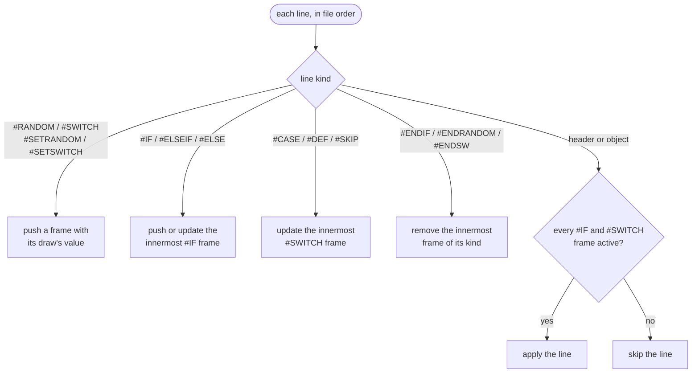

[Japanese version](./bms-spec.ja.md)

# BMS implementation specification

This document defines how `packages/chart-parser` / `packages/chart-writer` / `packages/player-engine` handles BMS.

## Primary References

- Command specifications (Japanese): https://hitkey.nekokan.dyndns.info/cmdsJP.htm
- Command specifications (English): https://hitkey.nekokan.dyndns.info/cmds.htm
- BMS Format Specification (1998-11-26): http://bm98.yaneu.com/bm98/bmsformat.html
- Bms:Spec (wiki.bms.ms, Wayback 2009-02-13): https://web.archive.org/web/20090213050609/http://wiki.bms.ms/Bms:Spec
- Basic specification of BML (RDM): https://nvyu.net/rdm/rby_ex.php
- STOP Sequence (`#STOPxx` / `#STP`): https://hitkey.nekokan.dyndns.info/exstop.htm
- Extended BPM (`#BPMxx` / `#EXBPM`): https://hitkey.nekokan.dyndns.info/exbpm-object.htm
- `#OPTION` / `#CHANGEOPTION` Specification: https://hitkey.nekokan.dyndns.info/option.htm
- Sonorous Proposal Extension (Supplementary Primary Reference): https://hitkey.nekokan.dyndns.info/bmsexts-ja.htm
- Obj Tech Lovers | Guidance chapter3-2 (Supplementary Primary Reference for `#WAV00` / rest semantics / landmine behavior): https://nekokan.dyndns.info/~otlovers/guidance/guidance_3a_txt.html
- Obj Tech Lovers | Guidance chapter4-7 (Supplementary Primary Reference for landmine damage semantics): https://nekokan.dyndns.info/~otlovers/guidance/guidance_4b.html
- Bemuse BMS Extensions (auxiliary primary reference): https://bemuse.ninja/project/docs/bms-extensions
- beatoraja Materials for music producers: https://github.com/exch-bms2/beatoraja/wiki/%E6%A5%BD%E6%9B%B2%E8%A3%BD%E4%BD%9C%E8%80%85%E5%90%91%E3%81%91%E8%B3%87%E6%96%99

## Reference materials

- `bms benchmark` (implementation comparison): https://hitkey.nekokan.dyndns.info/bmsbench.shtml
- `bmsplayer data` (compatibility check): https://hitkey.nekokan.dyndns.info/bmsplayer_data2010.shtml
- Numuther: BMS Scroll gimmick explanation (SCROLL/BPM/STOP example): https://note.com/numuther/n/n57bf895e7969
- How LR2, beatoraja and other players treat the same commands, and where be-music departs from them: [BMS / bmson compatibility notes](./format-compat.md)

## Compliance Status Summary

- Compatibility level: Partial compliance
- Policy: Rather than fully reproducing the entire specification, prioritize implementation of major score playback elements

## Supported (syntax accepted)

- [x] Accept object data line `#mmmcc:data`
- [x] Accept header line `#COMMAND value`
- [x] Ignore lines that do not start with `#`
- [x] Accept `LF` as line terminator
- [x] Accept `CRLF` by removing `CR` at the end of the line
- [x] Accept EOF as end of line even in files without trailing newline
- [x] `CR` Accept single newline as line end
- [x] Keep unknown header in `metadata.extras`
- [x] Keep `#mmmcc` as an event, whether known or unknown
- [x] Trim leading and trailing whitespace from every line, so indented commands are accepted
- [x] Accept the alternative spellings `#ELSE IF n` / `#END IF` / bare `#END` as `#ELSEIF n` / `#ENDIF` (normalized to the canonical form on save / output; `#END <other value>` remains an unknown header)

### line end

The actual `chart-parser` separates the BMS text as either `LF` / `CRLF` / `CR`.
`CRLF` is treated as a single line terminator, and `CR` single line breaks are accepted as well as `LF`.

Treats EOF as the end of the last line even if there is no newline at the end of the input.
However, the exact specification of control syntax compatibility for files containing a mixture of `CRLF` and `LF` remains an unsupported item, which will be discussed later.

## Supported Semantics

- [x] Interpret meta header `#TITLE`
- [x] Interpret meta header `#SUBTITLE`
- [x] Interpret meta header `#ARTIST`
- [x] Interpret meta header `#GENRE`
- [x] Interpret meta header `#COMMENT`
- [x] Keep `#SUBARTIST` as `metadata.extras.SUBARTIST` and use it for player's music selection screen metadata
- [x] Keep `#BACKBMP` as `metadata.backBMP` for browser LR2 special graphics
- [x] Keep `#BANNER` as `metadata.banner` and use it for the player's song selection screen banner
- [x] Interpret meta header `#STAGEFILE`
- [x] Display `#STAGEFILE` as a loading screen exclusive image after song selection
- [x] Interpret meta header `#PLAYLEVEL`
- [x] player: When `#PLAYLEVEL` is not specified in BMS, the display default value `3` is reflected on the song selection screen, TUI, and result display.
- [x] Keep `#PLAYLEVEL 0`
- [x] Hold string `#PLAYLEVEL`
- [x] Interpret meta header `#RANK`
- [x] Keep `#RANK 0-4` as judgment difficulty level specification
- [x] Interpret meta header `#TOTAL`
- [x] Interpret meta header `#DIFFICULTY`
- [x] player: Use `#DIFFICULTY 1-5` to display, sort, and filter the song selection list
- [x] Interpret meta header `#BPM`
- [x] When `#BPM` is not specified in BMS, the compatible default value `130` is applied (IR default value is also unified to `130`)
- [x] Interpret resource header `#WAVxx`
- [x] Interpret resource header `#BMPxx`
- [x] Interpret resource header `#BPMxx`
- [x] Interpret resource header `#STOPxx`
- [x] Interpret resource header `#TEXTxx`
- [x] Interpret channel `02` (bar length: `#mmm02:length`)
- [x] Interpret channel `03` (hexadecimal direct value BPM)
- [x] Interpret channel `08` (`#BPMxx` reference BPM)
- [x] Interpret channel `09` (`#STOPxx` reference STOP)
- [x] Interpret channel `01` (background sound)
- [x] Interpret channel `1x` (play)
- [x] Interpret channel `2x` (play)
- [x] Interpret channels `17` / `27` as FREE ZONE (other than 9KEY / 24KEY)
- [x] When judging 9KEY, channel `17` is interpreted as a normal lane note.
- [x] `#PLAYER=1` is retained as SINGLE meta information, and lane determination prioritizes channel configuration.
- [x] `#PLAYER=2` (COUPLE) is retained as meta information, and dedicated 1P/2P separation play is not currently implemented.
- [x] `#PLAYER=3` is used as a 9KEY determination hint only when `17` channel exists
- [x] `#PLAYER=4` (BATTLE) will be retained as meta information, and dedicated two-player competitive play will not be implemented at this time.
- [x] Interpret channel `D1-D9` (mine)
- [x] Interpret channel `E1-E9` (mine)
- [x] Detonate LR2beta3 mines on a key-down strictly inside ahead-only GREAT, or a held crossing; retain hold-only beatoraja and the provisional That-Which-Must-Not-Be-Named symmetric-PGREAT model.
- [x] Apply mine damage directly, preserving combo and EX-SCORE. LR2 also counts one POOR/BP per hit; beatoraja and provisional That-Which-Must-Not-Be-Named keep gauge-only accounting.
- [x] Fall back to a default damage of `4%` when the mine object value is not a two-character upper-case base36 ID or is `00` (under `#BASE 62`, lower-case values also take this default)
- [x] When `#WAV00` is defined, use it as the landmine explosion sound on manual mine hit
- [x] Exclude landmines from the number of target notes for `TOTAL` / `EX-SCORE`

#### Landmine damage basis

The original BM98-era core BMS specifications do not define landmine damage as part of the base format, so this implementation follows later public extension references and LR2-compatible implementations.

- LR2beta3 executable behavior supersedes the 2008-01-14 `history.txt` announcement used by #141: [ProcSinglenote](https://github.com/GOMazk/OpenLR2/blob/583a38503555e59c4bafa49d60b9d0714c9007c2/LR2f.cpp#L7434-L7460), corroborated by VA 0x4188ad–0x4188d2, reads GREAT with a strict ahead-only boundary. [ApplyJudgeMine](https://github.com/GOMazk/OpenLR2/blob/583a38503555e59c4bafa49d60b9d0714c9007c2/LR2f.cpp#L2043-L2060), reconciled with VA 0x40659c–0x4065bd, adds POOR once. The transcription's second counter increment is not in the binary. Fixed in [#590](https://github.com/nulltask/be-music/issues/590).
- "Damage = the value itself (as a decimal percentage)" follows losak's writeup, verified against the real LR2. beatoraja (jbms-parser `Section.java` / `JudgeManager`) applies the raw value directly as damage, matching this.
- Hitkey command memo's `value / 2` is the nanasi-lineage rule and differs from LR2's actual behavior, so it is not adopted.
- `#WAV00` as the dedicated landmine reaction sound is corroborated by Hitkey's memo and Obj Tech Lovers chapter3-2 / chapter4-7.
- `ZZ` (= 1295 %) instantly FAILs survival gauges (HARD / DEATH); on the `2-100%` GROOVE / EASY gauges it clamps to the `2%` floor (matching losak's "EASY / GROOVE just drop to 2%").
- [x] Keep channel `SC` as `#SCROLLxx` reference event
- [x] Exclude channel `SC` from audio triggering
- [x] Reflect scroll speed of channel `SC` to player drawing
- [x] Keep channel `SP` as `#SPEEDxx` reference event
- [x] Exclude channel `SP` from audio triggering
- [x] Reflect visual interval interpolation of channel `SP` to player drawing
- [x] Use channel `04` as BGA base for display
- [x] Channel `07` is used for display as BGA layer
- [x] Use channel `0A` for display as BGA layer2
- [x] Combine display of `04` / `07` / `0A` (priority: `04` < `07` < `0A`)
- Browser Native, Canvas, LR2 and beatoraja scenes keep `07` and `0A` independent, including their clear cues and NONSTOP stage stacks. The skin frame exposes them as `layer` and `layer2`. A video BMP reused on multiple tracks receives separate video playheads, and pause/resume and seek include both overlays.
- [x] Treat black (`#000000`) as a transparent color in layer (`07`)
- [x] Apply the same transparency rules to layer2 (`0A`) as layer (`07`)
- [x] Handle BGA images assuming a 256x256 canvas
- [x] Do not normally scale BGA images
- [x] Images smaller than 256x256 aligned on the center of the X axis / top aligned on the Y axis
- [x] Images larger than 256x256 (long edge over 256) and videos are stretched over the BGA frame, as in LR2 and beatoraja
- [x] The base / POOR canvas around a smaller image is black (a 1x1 black `#BMPxx` blanks the BGA); the layer canvas is transparent
- [x] `#BGAxx` crops are placed at their `dx dy` on the 256x256 canvas (browser player)
- [x] Undefined in `04` / `07` / `0A` Treated as 256x256 black when referencing `#BMPxx`
- [x] Play BGA video by drawing (`mpeg1video` / `h264` / `mjpeg`, ignore audio)
- [x] Preserve control construct `#RANDOM` and evaluate at runtime
- [x] Preserve control construct `#SETRANDOM` and evaluate at runtime
- [x] Preserve control construct `#ENDRANDOM` and evaluate at runtime
- [x] Preserve control construct `#IF` and evaluate at runtime
- [x] Preserve control construct `#ELSEIF` and evaluate at runtime
- [x] Preserve control construct `#ELSE` and evaluate at runtime
- [x] Preserve control construct `#ENDIF` and evaluate at runtime
- [x] Preserve control construct `#SWITCH` and evaluate at runtime
- [x] Preserve control construct `#SETSWITCH` and evaluate at runtime
- [x] Preserve control construct `#CASE` and evaluate at runtime
- [x] Preserve control construct `#DEF` and evaluate at runtime
- [x] Preserve control construct `#SKIP` and evaluate at runtime
- [x] Preserve control construct `#ENDSW` and evaluate at runtime
- [x] Keep extension header `#PREVIEW` in `bms` extension area
- [x] Keep extension header `#LNTYPE` in `bms` extension area
- [x] Keep extension header `#LNMODE` in `bms` extension area (`1` = LN, `2` = CN, `3` = HCN)
- [x] The player plays `#LNMODE 2` / `3` long notes as CN / HCN under the `beatoraja` ruleset; `____` plays every long note as CN (HCN for `#LNMODE 3`), and `lr2` plays every long note as LN
- [x] Keep extension header `#LNOBJ` in `bms` extension area
- [x] Keep extension header `#VOLWAV` in `bms` extension area
- [x] Keep extension header `#DEFEXRANK` in `bms` extension area
- [x] Keep extension header `#EXRANKxx` in `bms` extension area
- [x] Keep extension header `#ARGBxx` in `bms` extension area
- [x] Keep extension header `#PLAYER` in `bms` extension area
- [x] Keep extension header `#PATH_WAV` in `bms` extension area
- [x] Apply `#PATH_WAV` when loading Node gameplay samples and diagnostic durations, using the shared prefix-first / bare-path fallback resolver
- [x] Keep extension header `#BASEBPM` in `bms` extension area
- [x] Keep extension header `#STP` in `bms` extension area
- [x] Keep extension header `#OPTION` in `bms` extension area
- [x] Keep extension header `#CHANGEOPTIONxx` in `bms` extension area
- [x] Keep extension header `#WAVCMD` in `bms` extension area
- [x] Keep extension header `#EXWAVxx` in `bms` extension area
- [x] Keep extension header `#EXBMPxx` in `bms` extension area
- [x] Keep extension header `#BGAxx` in `bms` extension area
- [x] Keep extension header `#SCROLLxx` in `bms` extension area
- [x] Keep extension header `#SPEEDxx` in `bms` extension area
- [x] Keep extension header `#POORBGA` in `bms` extension area
- [x] Keep extension header `#SWBGAxx` in `bms` extension area
- [x] Keep extension header `#VIDEOFILE` in `bms` extension area
- [x] Keep extension header `#MIDIFILE` in `bms` extension area
- [x] Keep extension header `#MATERIALS` in `bms` extension area
- [x] Keep extension header `#DIVIDEPROP` in `bms` extension area
- [x] Keep extension header `#CHARSET` in `bms` extension area
- [x] Keep extension header `#BASE 62` (beatoraja-compatible base-62 ID extension) in `bms.base`; with `#BASE 62`, indexed-header keys (`#WAVxx`, `#BMPxx`, …) and channel-stream tokens are treated as case-sensitive (lowercase `a-z` is a separate ID space)
- [x] Adopt EOF side for single value header, indexed header, and duplicate definition of `#mmm02`
- [x] `#STP` / `#LNOBJ` / Control constructs keep duplicate lines in declaration order
- [x] `#PREVIEW` is used preferentially in song selection screen preview playback
- [x] Reflect `#VOLWAV` to player / chart-audio-renderer playback gain
- [x] Interpret `#xxx97` as dynamic volume change on BGM side
- [x] Interpret `#xxx98` as dynamic volume change on playable/key side
- [x] Interpret `#EXRANKxx` and `#xxxA0` as dynamic decision width changes of player
- [x] Supports LR2 100001x BPM gimmick by `#BPMxx` with time resolution
- [x] Keep every `#WAVCMD` line in `bms.wavCmds`; chart-audio-renderer and browser WebAudio apply the `01` volume parameter
- [x] Parse `#EXWAVxx` and apply its `v` volume parameter in chart-audio-renderer and browser WebAudio
- [x] Use `#BASEBPM` as the chart reference BPM for browser HS-FIX calibration through `@be-music/chart-model`
- [x] Browser player renders `#BGAxx` sub-region BGA. Its current SWBGA animation and per-slot ARGB/EXBMP tint follow a Be-Music-specific interpretation; they do not implement nanasi compatibility.
- [ ] Implement nanasi EXBMP transparent-color keying, channel-scoped ARGB (`A1`–`A4`), and key-bound SWBGA (`A5`). The [command reference](https://hitkey.nekokan.dyndns.info/cmds.htm#EXBMPXX) distinguishes these semantics from image tinting.
- [x] Browser Native, Canvas, LR2 and beatoraja, and terminal ANSI/Kitty output apply opacity channels `0B` / `0C` / `0D` / `0E` to base / layer / layer2 / POOR. A nonzero hexadecimal byte sets opacity to `value / 255`; `00` is a rest, and the default is opaque. Changes use chart timing, retain the last value until replaced, and restore prior state on seek. Replacement POOR dims over black; overlay POOR blends over the normal BGA. NONSTOP stitching retains opacity events, restores each stage's effective initial values, and exposes stage-owned histories for crossfades. Browser NONSTOP rendering uses each stage's own histories, multiplied by its crossfade and the skin opacity. Coordination with channel-scoped ARGB remains pending.
- [x] Browser and terminal load filenames declared only by `#EXBMPxx a,r,g,b filename`, including implicit POOR slot `00`; an explicit `#BMPxx` filename takes precedence. The comma-before-filename spelling remains accepted. The nanasi rendering features above remain pending.
- [x] Terminal renders `#BGAxx` sub-regions on base, both overlays and POOR, including implicit slot `00`. Crop coordinates refer to the original image or video before resizing or video-border trimming; `dx dy` places the crop on the 256×256 canvas, clipped at its edges. Base/replacement POOR uses black outside the crop; overlays retain transparency. Streamed video frames keep the same transform. Explicit BMP/EXBMP resources take precedence over a BGA alias; missing or cyclic aliases use the missing-resource frame.
- [x] Interpret channels `51-59` / `61-69` (and the extended `5A-5O` / `6A-6O`) as long notes. `#LNTYPE 1`, the default when `#LNTYPE` is omitted, pairs objects as start / end; `#LNTYPE 2` (MGQ) makes a run of consecutive non-`00` cells one long note
- [x] `#LNOBJ`: every declaration is active and kept in declaration order in `bms.lnObjs`; the object ends the long note started by the previous note on its lane and is not sounded (the HDX key-up sound is not adopted). A `#LNOBJ` object with no note before it becomes an ordinary note
- [x] Where `51-69` and `#LNOBJ` long notes start on the same lane and position, the `51-69` long note wins
- [x] The player keeps one note per lane and position: a long note wins over a tap, otherwise the lowest object ID; the other notes' keysounds play as background ([player spec — Duplicate notes](./player-spec.md#duplicate-notes))
- [x] Play channel `06` as the POOR BGA: it is shown on a miss and takes priority over `04` / `07` / `0A` while shown
- [x] Unless `#POORBGA` is `2`, use `#BMP00` as the POOR image until the first `06` object (a missing, unparsable or out-of-range `#POORBGA` is `0`)
- [x] Apply `#STP xxx[.yyy] zzzz` (and the short form `xxx zzzz`, read as `.000`) as a `zzzz` ms stop in timing; stops at one position add up

### Negative BPM (`#BPMxx` via channel 08) basis

LR2 is the baseline (issue #134; verified against OpenLR2's reconstruction of LR2 beta3 100201 — branch `LR2Beta3-v100201` at `583a385`, `LR2f.cpp` — and the matching code in LR2body.exe, plus hitkey's command memo and LR2's own `history.txt`):

- **Timing.** LR2 parses `#BPMxx` sign-preserving and integrates note times at **|BPM|** when it precomputes timing at load (`LR2_bmsload.cpp:2841-2843`) — the timeline never runs backwards. The timing resolver (`@be-music/chart-model`, `timing.ts`) does the same: it integrates `Math.abs(bpm)` and exposes the first reversing event's position as `TimingResolver.reversal` (beat and seconds), which the Resolved Chart carries as `ResolvedChart.reversal`.
- **Truncation.** LR2 converts the BPM to int before its `< 0` check (LR2body.exe 0x42b960 `__ftol`): only `trunc(BPM) < 0` arms the reversal, so `-1 < BPM < 0` never reverses — it just crawls at |BPM|. NOWBPM shows `|trunc(BPM)|` for a negative value (0 for `-0.5`, 65 for `-65.5`) while timing keeps the full |BPM| (`TempoPoint.displayBPM`, `TimingResolver.displayBPMAtBeat`).
- **Event pump.** When the negative BPM fires, LR2's event pump freezes for good: no later BGM keysound, BGA cue, BPM, or STOP event fires, autoplay stops, and NOWBPM holds `|trunc(BPM)|`. On the reversal tick itself LR2 orders events by op (`CMP_NotesByRealTimingOp`, `LR2f.cpp:24013`): BGM (op 1), BPM (op 3) and the BGA layers (ops 4 / 6 / 7) fire **before** the negative BPM (op 8); STOP (op 9), lane sounds (10–29) and invisible objects (30+) on that tick are frozen. The engine, the offline renderer and the select-scene preview filter with `firesBeforeTempoReversal` (`0A` is grouped with the BGA layers). A movie BGA that is already playing keeps running; only cue changes stop.
- **Display.** LR2 mirrors the chart **position**, not the clock: past the reversal R it draws from `2·pos(R) − pos(now)`, where `pos(now)` keeps advancing through the |BPM| tempo map (`LR2f.cpp:2185-2188`; LR2body.exe 0x406d81). The reverse scroll therefore runs at the post-reversal tempo — at the |BPM| of the negative value, following later BPM changes in the timing table, and pausing during post-reversal STOPs — rather than retracing the pre-reversal tempo. The engine publishes `displayBeat = 2·beat(R) − beat(now)` on the UI frame (`mirrorBeatAtTempoReversal`); the TUI grid, the beatoraja layers and the web scene's `currentBeat` scroll from it. be-music has no time-based ("constant") HS-FIX scroll, so no time-space mirror is needed anywhere. LR2's note-drawing rules carry on through the reversal: its `draw_count` never moves back, so a note, mine or bar line that went before the reversal stays gone as the scroll recedes, while the notes charted after the reversal, never judged, rise away from the line; under beatoraja's drawing rules (charts with SCROLL or SPEED) object times are compared with the mirrored judge clock (`resolveReversedDrawClock`).
- **Judging.** LR2 keeps judging presses on the mirrored clock `t' = 2R − now` (`LR2f.cpp:12624`, `:12931`; LR2body.exe 0x42c25b / 0x42c788). Notes within roughly R ± the BAD window stay hittable just after R, a press still fires an empty POOR while the lane's next note is within reach of `t'` (LR2's 1 s early reach, so for about a second past R), and because `t'` never passes R nothing is swept into a miss past it. An LN spanning R BADs when released (`LR2f.cpp:7613-7616`) and stays open if it never is. The engine's judge core gets the reversal as chart data (`reversalSeconds`) and judges presses, releases, and hold checks on that mirrored clock (logs, gauge history, and UI cues keep the true time), and the replay simulator mirrors post-reversal inputs the same way, so replays and re-simulations reproduce the run. Mines freeze at the reversal.
- **Result.** LR2 never ends the stage on its own after a reversal; leaving it (ESC etc.) sets HP = 0 whenever a scorable note is still unjudged (`LR2f.cpp:12980-12982`; LR2body.exe 0x42c525), so such a run is always FAILED. be-music ends the song at its precomputed end (deviation 1 below) and reports the same result: a reversed run that leaves scorable notes outstanding — open holds included — ends with the gauge at 0 and not cleared, in manual play, autoplay, and the simulator.
- **Deliberate deviations from LR2**, all in the degenerate corners: (1) the run ends at the chart's precomputed end instead of soft-locking until ESC; (2) `#BPMxx 0` stays dropped (previous tempo continues) — real LR2 divides by zero and degenerates (+inf times, scroll stops); (3) an undefined `#BPMxx` reference stays dropped — real LR2 hits its `-1.0` slot sentinel and behaves as if `#BPMxx -1` were defined (reverse at 1 BPM); (4) a negative initial `#BPM` header falls back to the 130 default — real LR2 leaves it unguarded and its timing table degenerates; (5) the mirrored display pins at the chart head once it rewinds past the start — real LR2 keeps receding into negative positions; (6) the reversal sits exactly at the negative event's chart time, whereas LR2 arms it at the frame its pump reaches the event.
- **Ruleset scope:** the LR2 model applies under every judge ruleset (`lr2` / `beatoraja` / `____`), deliberately. Negative `#BPMxx` is an LR2-ism — the charts that use it (Sofa $15 → $1, U9, …) were authored and tuned against LR2's reverse scroll, so that is the presentation their authors intended. beatoraja itself rejects negative `#BPMxx` definitions at parse time (`BMSDecoder`: "#negative BPMはサポートされていません"), which would silently turn the gimmick into a plain tempo-continuation; we prefer the de facto behavior the charts were made for over that. The judge ruleset only picks windows, gauge, and scoring — chart timing interpretation, the mirrored judge clock, and the FAILED result are shared, and the offline renderer and the select-scene preview (which have no ruleset) agree with gameplay.
- Channel 03 (inline hex `01`–`FF`) can express neither zero nor negative values; a `00` pair is a rest.

Fixtures: [`test/fixtures/negative-bpm-reverse.bms`](../test/fixtures/negative-bpm-reverse.bms), [`negative-bpm-zero.bms`](../test/fixtures/negative-bpm-zero.bms), [`negative-bpm-undefined-slot.bms`](../test/fixtures/negative-bpm-undefined-slot.bms).

- [x] Timing interpretation of `#STP` format `xxx[.yyy] zzzz` and abbreviation `xxx zzzz`
- [x] Browser player: `#BGAxx` interpretation of sub-region cutting and placement parameters

### `#BASE`

`#BASE` is a beatoraja-compatible extension that selects the radix for BMS object IDs.
The default is `36`, which uses `0-9A-Z` and folds lowercase ASCII letters to uppercase.
`#BASE 62` switches indexed headers and object-stream tokens to case-sensitive `0-9A-Za-z`, so `0a` and `0A` are different IDs.

The parser pre-scans the BMS source for `#BASE 36` / `#BASE 62` before normal parsing starts.
The scan covers the whole file, as beatoraja's does, so `#BASE` may appear anywhere, even after object data, and control-flow blocks are not evaluated for it.
When the file has several `#BASE 36` / `#BASE 62` lines, the last one wins.
Unsupported values are ignored.

Runtime and round-trip behavior:

- `chart-parser` stores the active base in `bms.base`; `#BASE 36` is equivalent to the default and does not need to be emitted.
- `chart-writer` emits `#BASE 62` when `bms.base` is `62`.
- `#WAVxx`, `#BMPxx`, `#BPMxx`, `#STOPxx`, `#TEXTxx`, `#LNOBJ`, BGA-related indexed maps, and object-stream values are normalized with the active base.
- Control-flow contents (`#RANDOM` / `#IF` / `#SWITCH` blocks) use the same base as normal lines, so lowercase IDs inside branches survive parsing and branch resolution.
- `player-engine`, `chart-audio-renderer`, `chart-model`, and `player-browser` resolve sample, BGA, BPM/STOP, LN, mine, and timing references through `resolveBMSBase()` so base-62 lowercase IDs remain distinct at runtime.

Example:

```bms
#BASE 62
#WAV0a lower.wav
#WAV0A upper.wav
#00111:0a0A
```

This plays `lower.wav` and `upper.wav` as two different sample references.
Without `#BASE 62`, both keys fold into the same base-36 ID and the later definition wins.

### `#VOLWAV`

`chart-parser` holds `#VOLWAV` as a non-negative number in `bms.volWAV`.
`chart-writer` outputs the value of `bms.volWAV` as is if it exists, as `#VOLWAV n`.

During playback and rendering, `#VOLWAV` is treated as a linear gain applied to the entire score.
If omitted, the default value is `100`. A value with `0 < n < 200` gives the magnification `n / 100`; any other value plays at the original volume.

- `#VOLWAV 100`: Original volume
- `#VOLWAV 50`: Half the original volume
- `#VOLWAV 150`: `1.5` times the original volume
- `#VOLWAV 0`, `#VOLWAV 200` or above: Original volume

The range is beatoraja's (it applies `#VOLWAV` only for `0 < n < 200`); LR2 ignores `#VOLWAV`. Following beatoraja keeps `#VOLWAV 0` from muting a chart and large values from amplifying it into clipping. `@be-music/chart-model`'s `volWAVToLinearGain` implements the rule.

This magnification applies to real-time playback of `player-engine`, song selection screen preview, and `renderJSON()` / `renderChartFile()` of `chart-audio-renderer`.
It does not reproduce player- or hardware-specific volume differences, and is treated as a simple gain multiplication factor in actual equipment.

### `#xxx97` / `#xxx98`

`chart-parser` / `chart-writer` keep `97` / `98` as regular object channels.
`00` is treated as an empty token as usual, and only non-zero values ​​of `01-FF` are events.

During playback and rendering, `97` is treated as a dynamic bus volume on the BGM side and `98` on the playable/key side.
The value converts the hex integer `1-255` to the gain of `value / 255` and applies it from that point forward.

- `#xxx97`: Switch from `01` / BGM minimum volume to `FF` / original volume
- `#xxx98`: Switch from the minimum volume of `01` / KEY SOUND to the original volume of `FF` /
- `00`: Since it is a rest, it is not turned into an event, and the volume does not change.

In actual implementation, these channels themselves are not treated as sample triggers.
Also, volume changes will only be reflected in the initial gain of new sounds that are played after that point, and will not be reflected in the voices of the same type that are already playing.

## Runtime support boundary

Preserving syntax does not imply player execution. `#MIDIFILE` is retained in `bms.midiFile` but not played. `#WAVCMD` applies volume parameter `01`; pitch and loop parameters are not executed. `#TEXTxx` and `#CHANGEOPTIONxx` are retained in the IR but do not drive gameplay text or option changes.

Header and object interpretation follows the support tables above and this document’s control-flow rules. Asset lookup is defined in [format compatibility](./format-compat.md), browser-specific rendering in the [browser player specification](./player-web.md), and terminal rendering and audio in the [terminal player specification](./player-tui.md).

## Player-Specific Behavior

- Automatically determine lane mode from used channel (`5 KEY SP`, `5 KEY DP`, `7 KEY SP`, `14 KEY DP`, `9 KEY`, `24 KEY SP`, `48 KEY DP`)
- Every host (the engine, the CLI, and the web player) decides the lane mode with one shared rule, `resolveChartPlayVariant` in `@be-music/chart-model`, unless the host declares the variant explicitly. For a play it runs over the chart after `#RANDOM` / `#SWITCH` are resolved, so lanes a chosen branch adds count
- Lane usage counts the `1x` / `2x` lane channels and the `5x` / `6x` `#LNTYPE` long-note channels on the lanes they map to (so `#LNOBJ` and `#LNTYPE` spellings of a chart agree). Mines (`Dx` / `Ex`) and invisible objects (`3x` / `4x`) never decide the lane mode
- Extended lane channels (`1A..1O` / `2A..2O`) select `24 KEY SP` / `48 KEY DP` ahead of every other rule
- be-music-specific: channels `1P` / `1Q` (`2P` / `2Q` on the 2P side) are the 24 / 48 KEY wheel, up / down — the BMS spelling of the bmson `keyboard-24k` wheel lanes (`x` = 25 / 26). Other BMS players do not define these channels. They count as extended lanes, so they select the keyboard modes too
- A `.pms` chart is `9 KEY` regardless of its channels; this is checked right after the extended-lane rule, before the content rules
- `9 KEY` is also detected from content: `#PLAYER 3` with channel `17` (when the That-Which-Must-Not-Be-Named 2P side `21` / `26..29` is absent; with it the chart is That-Which-Must-Not-Be-Named DP with a FREE ZONE), a 1P chart that uses every channel `11..19`, and a chart that uses `22..25` without `21` / `26..29` (PMS-STD written as `.bms` / `.bme`)
- Otherwise the That-Which-Must-Not-Be-Named families apply: a 6 / 7 key column (`18` / `19` / `28` / `29`) means `7 KEY SP` / `14 KEY DP`, otherwise `5 KEY SP` / `5 KEY DP`. The lanes in use decide, whatever the extension: a `.bme` chart without a 6 / 7 key column is `5 KEY SP` / `5 KEY DP`, as in beatoraja (be-music decision; see [format-compat §5](./format-compat.md#5-be-music-decisions-in-short))
- `.pms` The 9KEY of the musical score is estimated from the standard array (`PMS-STD`) / compatible array (`PMS-COMPAT`) from the channel distribution and reflected in the `LANE` display.
- FREE ZONE (`17` / `27`) does not create an independent lane and draws on the scratch lane (`16` / `26`); under `9 KEY` and the `24 KEY` / `48 KEY` keyboard modes those channels are ordinary lanes instead
- FREE ZONE Note length is fixed at quarter note
- FREE ZONE is not subject to judgment (not included in `TOTAL` / `EX-SCORE` / `SCORE`)
- BGA viewport background uses black (black even when transparent area/BGA is not displayed)
- For scores containing control syntax, the selected `#RANDOM` pattern is displayed in `RANDOM current/total` format.
- During play, `Shift+R` will restart the performance from the beginning, and `#RANDOM` will be redrawn.
- The default keyboard layout for That-Which-Must-Not-Be-Named series is `Z S X D C F V` for 1P and `B H N J M K ,` for 2P.
- Automatically opt-in to kitty keyboard protocol for key input, use left/right `Shift` for 1P/2P scratch, left/right `Ctrl` for reverse scratch
- On macOS, use left/right `Option` instead of left/right `Ctrl` for reverse scratch
- On terminals that do not support kitty, fall back to existing input, and side-specific input of reverse scratch is not guaranteed.
- HIGH-SPEED operation is performed with `Alt/Option` + lane input (decelerate on odd lanes, accelerate on even lanes)
- The song selection screen preview gives priority to `#PREVIEW`, and if it is not specified, it will generate a fallback from the first pronunciation of the score.
- Rendering of the song selection screen preview is interrupted when the focus moves, but if it is the same `#PREVIEW` (same real file) or the same fallback signature, it will continue playing (fallback ignores performance channel arrangement differences)
- In single song mode (and one score directory), you can wait for the result in `Enter` / `Esc` and replay it in `r`.
- Result transition is executed after waiting for the draining of the audio being played, instead of a fixed waiting time.

### player judgment/audio rules

- FAST/SLOW adds only `GREAT` / `GOOD`, not `PERFECT`
- Long notes are determined by the end time, and the end object is not sounded.
- Playback audio uses real-time trigger method for any of `AUTO` / `AUTO SCRATCH` / `MANUAL`
- `--play-volume` applies to performance lanes, `--bgm-volume` applies to non-performance lanes.
- `SC` / Landmine / `LNOBJ` Exclude terminal suppression target events from audio trigger targets
- Undefined, missing, or undecodable `#WAVxx` references are treated as silence (a substitute debug tone can be enabled with the `missingSampleToneSeconds` option)

### SCROLL/BPM/STOP compatibility policy

- In `SCROLL 0`, when multiple notes overlap in the same lane and same drawing cell, the preceding note is placed at the reference position, and the subsequent notes are stacked in order toward the side (upward) away from the judgment line.
- Web player: `SCROLL < 0` runs notes backwards as beatoraja does; a note still ahead that ends up below the judgement line is drawn there, down to the bottom of the stage ([Browser player — Note visibility](./player-web.md#note-visibility))
- Terminal player: `SCROLL < 0` prioritizes "maintaining note approach display" rather than "faithful reproduction of backward running display", and drawing distance is handled by `abs(distance)`
- Visible search for `SCROLL` is capped at `MAX_SCROLL_LOOKAHEAD_BEATS` (`4 * 64` beat, in `packages/player-terminal/src/tui/tui.ts`)
- As in beatoraja's `LaneRenderer`, the search ends at the first point where the chart runs past the top of the lane: notes a later negative `SCROLL` brings back into the lane are not drawn until the playhead reaches them (web player and terminal player; see [Browser player — Note visibility](./player-web.md#note-visibility))
- Even with gimmicks that include BPM×`100001` + `STOP` correction, the BPM display uses the value used in internal time calculation as is.
- Beatoraja-specific drawing bug-dependent scores are not compatible, and a reproduction mode is not implemented at this time.
- Verify regression of the above policy with `packages/player-terminal/src/tui/lane-stacking.test.ts`, `packages/chart-model/src/timelines.test.ts`, `packages/player-terminal/src/bga.test.ts`

## Handling of event location

- `data` splits by two characters, `00` is empty event
- `data` is truncated at the first whitespace character; everything after it is ignored
- Characters outside the object ID alphabet are skipped without taking a slot, and a trailing odd character is dropped
- Position is kept as `position: [numerator, denominator]`
- `denominator = number of tokens`
- `numerator = zero-based token index`

## Character Encoding

- Adopt UTF-8 / UTF-16LE / UTF-16BE with BOM first
- If there is no BOM, resolve the `#CHARSET` declaration (only when it canonicalizes to a supported encoding)
- ASCII-only files are treated as UTF-8
- A buffer that passes strict UTF-8 validation (fatal decode succeeds with multibyte sequences present) is UTF-8
- A buffer whose every non-ASCII byte pairs up as KS X 1001 (`0xA1`–`0xFE` lead and trail, beatoraja's EUC-KR probe) and whose non-ASCII text is at least 90 % Hangul syllables is Korean `euc-kr`
- Otherwise infer by scoring `shift_jis`, `utf8`, `euc-jp`, `latin1`
- This detection is unified in `@be-music/chart-parser`'s `decodeBMSText`, so CLI / TUI / Web all produce the same result

## chart-writer rules

- Determine intra-measure resolution from denominator information of `position`
- For the same measure and same channel, the least common multiple of the denominator is used.
- If `--maxResolution` is specified, it will be aborted at the upper limit.
- A chart read from bmson is converted where BMS spells things differently: long notes become `#LNTYPE 1` pairs on `5x` / `6x` with `#LNMODE` from `ln_type` / `t`, a mine's value becomes its damage in base 36 (its sample becomes `#WAV00`), `judge_rank` becomes `#DEFEXRANK`, and the percentage `total` is not written as `#TOTAL`. Details: [bmson spec — Converting between BMS and bmson](./bmson-spec.md#converting-between-bms-and-bmson)

## Evaluation rules for control constructs

- `chart-parser` retains control syntax as `bms.controlFlow` and does not commit branches when parsing
- Branches are decided once per play by explicit draws (`RandomDraws`, drawn with `drawRandomOutcomes`); `evaluateControlFlow` in `@be-music/chart-model` is the only evaluator, and the parser's `resolveBMSControlFlowWithDraws` expands the active blocks into a resolved chart without `bms.controlFlow`. Hosts resolve before playback or rendering and hand the engine the resolved chart with its draws ([Player spec — Handling control syntax](./player-spec.md#handling-control-syntax))
- `#RANDOM n` / `#SWITCH n` generate integers of `1..n` and use them as selection values
- `#SETRANDOM n` / `#SETSWITCH n` fix the selection value
- `#IF` chain branches at the current RANDOM selection value, `#ELSEIF` / `#ELSE` are invalid if there is a previously established branch
- `#SWITCH` chain evaluates `#CASE` / `#DEF` and aborts at `#SKIP` until `#ENDSW`
- `#SWITCH` falls through to subsequent `#CASE` / `#DEF` if `#SKIP` is missing
- Header lines apply in file order, as in LR2 and beatoraja: a definition in a taken branch beats an earlier top-level line of the same header and loses to a later one. The parser marks a branch header that a later top-level line overrides (`overriddenByLaterHeader`) and resolution skips it; repeatable headers (`#STP`, `#WAVCMD`, `#LNOBJ`) add up

`evaluateControlFlow` walks `bms.controlFlow` once, line by line, over one stack of `#RANDOM` / `#IF` / `#SWITCH` frames. Each line is handled like this:


