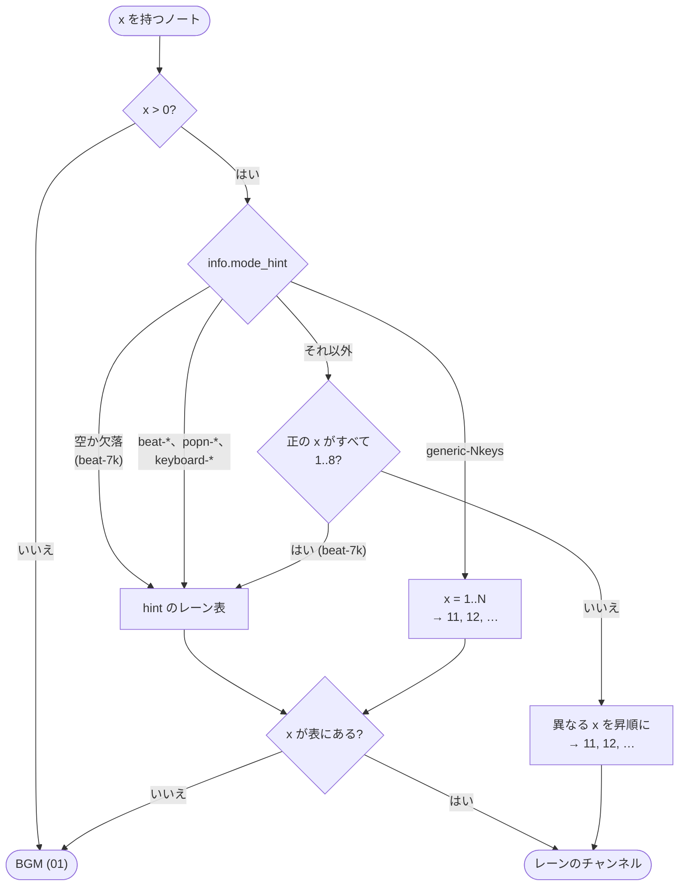

[English version](./bmson-spec.md)

# bmson 実装仕様

この文書は、`packages/chart-parser` / `packages/chart-writer` が bmson をどう扱うかを定義します。
beatoraja など他のプレイヤーが同じフィールドをどう読むかは [BMS / bmson 互換性ノート](./format-compat.ja.md) で比較しています。

## 一次参照

- 公式サイト: https://bmson.nekokan.dyndns.info/
- 公式 documents: https://bmson.nekokan.dyndns.info/documents/
- bmson format and specs v1.0 (Read the Docs): http://bmson-spec.readthedocs.org/en/master/doc/index.html
- Google Docs 仕様: https://docs.google.com/document/d/1ZDjfjWud8UG3RPjyhN-dd1rVjPaactcMT3PIODTap9s/mobilebasic?pli=1

## 対応状況の要約

- 対応レベル: 部分対応
- 方針: bmson 全仕様ではなく、BMS 相互変換と再生に必要な最小集合を優先

## 対応チェックリスト

### parser (bmson -> `@be-music/chart-source`)

- [x] ルート: `version`
- [x] ルート: `info`
- [x] ルート: `lines`
- [x] ルート互換: `resolution` (`info.resolution` 未指定時のフォールバック)
- [x] ルート: `sound_channels`
- [x] ルート: `bpm_events`
- [x] ルート: `stop_events`
- [x] ルート: `scroll_events`（beatoraja 拡張）を BMS の `#SCROLL`（チャンネル `SC`）として読む
- [x] ルート: `bga`
- [x] `info` 拡張項目: `subartists`
- [x] `info` 拡張項目: `chart_name`
- [x] `info` 拡張項目: `mode_hint`
- [x] `info` 拡張項目: `judge_rank`
- [x] `info` 拡張項目: `total`
- [x] beatoraja 拡張 `info.ln_type` と note 単位 `t`（1: LN / 2: CN / 3: HCN）を IR に保持し、プレイヤーの LN モード解決と chart-writer 出力に使用
- [x] `info` 拡張項目: `back_image`
- [x] `info` 拡張項目: `eyecatch_image`
- [x] `info` 拡張項目: `banner_image`
- [x] `info` 拡張項目: `preview_music`
- [x] `sound_channels[].notes[]` の `x`
- [x] `sound_channels[].notes[]` の `y`
- [x] `sound_channels[].notes[]` の `l`
- [x] `sound_channels[].notes[]` の `c`
- [x] `lines` を使った `measure` / `position` 解決
- [x] `x <= 0` または `x` 未指定の note を BGM (`01`) として解釈
- [x] beatoraja 拡張を beatoraja と同じく読む: `mine_channels` は note ごとの `damage` を保持した landmine channel、`key_channels` は隠し（不可視）ノート
- [x] `info.back_image`, `info.banner_image`, `info.eyecatch_image` を unified `metadata.backBMP`, `metadata.banner`, `metadata.stageFile` へ mirror
- [x] 明示的な `lines: []` を barline suppression として扱い、`bmson.barlinesSuppressed` に保持
- [x] `lines` 欠落時は bmson 既定の 4/4 model として扱う
- [x] `info.total` 欠落・非数は bmson 既定値 `100`、負値は仕様どおり絶対値、`0` はそのまま保持として扱う
- [x] `info.init_bpm` 欠落、0、負値、非数値は parse error として扱う
- [x] `mode_hint` のレーン表にない `x` の note を、beatoraja と同じく BGM (`01`) として解釈
- [ ] `version` の妥当性検証（`null` のエラー化、未指定時の legacy 扱い方針）
- [ ] `version` の互換判定を SemVer で行う方針の明文化
- [ ] `info.title` / `artist` / `genre` など必須情報の欠損時エラー方針
- [ ] `sound_channels[].name` の拡張子フォールバック探索（`.wav`/`.ogg`/`.m4a`）
- [ ] `sound_channels[].name` のパス正規化（`\` と `/`）およびディレクトリトラバーサル防止
- [ ] `sound_channels[].notes[]` 同一 pulse で `c=true/false` が混在する場合の優先規則
- [ ] `bpm_events` 同一 `y` 多重定義時の「末尾優先」正規化
- [ ] `stop_events` 同一 `y` 多重定義時の「加算」正規化
- [ ] `bga.bga_header` の同一 `id` 多重定義時に後勝ちで解釈
- [ ] `info.title_image` の受理と IR への保持
- [x] `subartists` の `key:value` 形式（`music:`/`chart:` 等）の保持規則
- [ ] 未知ルートキーの透過保持

### chart-writer (`@be-music/chart-source` -> bmson)

- [x] `version` 出力 (`bmson.version`, 未指定時 `1.0.0`)
- [x] `info.resolution` 出力 (未指定時 `240`)
- [x] `info` 拡張項目 `subartists` の出力
- [x] `info` 拡張項目 `chart_name` の出力
- [x] `info` 拡張項目 `mode_hint` の出力
- [x] `info` 拡張項目 `judge_rank` の出力
- [x] `info` 拡張項目 `total` の出力
- [x] `info` 拡張項目 `back_image` の出力
- [x] `info` 拡張項目 `eyecatch_image` の出力
- [x] `info` 拡張項目 `banner_image` の出力
- [x] `info` 拡張項目 `preview_music` の出力
- [x] `lines` 出力 (`preservation.bmson.lines` 優先)
- [x] `lines` 自動生成 (IR 小節長ベース)
- [x] `sound_channels` 出力
- [x] `bpm_events` 出力 (`03` / `08` 由来)
- [x] `stop_events` 出力 (`09` 由来)
- [x] `scroll_events` 出力（beatoraja 拡張、`SC` と `#SCROLLxx` 由来）
- [x] `notes.l` 出力 (未指定時 `l=0`)
- [x] `notes.c` 出力 (未指定時 `c=false`)
- [x] `notes.t` 出力 (beatoraja 拡張、ロングノートのみ)
- [x] `info.ln_type` 出力 (beatoraja 拡張)
- [x] `bga.bga_header` 出力
- [x] `bga.bga_events` 出力
- [x] `bga.layer_events` 出力
- [x] `bga.poor_events` 出力
- [x] `bmson.barlinesSuppressed` により明示的な `lines: []` を保持
- [ ] `bpm_events` 同一 `y` のイベントを「末尾優先」へ正規化して出力
- [ ] `stop_events` 同一 `y` のイベントを加算正規化して出力
- [ ] `info.title_image` の出力
- [ ] `sound_channels[].name` のパス区切り正規化と危険パス除去
- [ ] 未知ルートキーの透過再出力
- [~] `notes.x` の元値を厳密保持 (IR で lanes を再割当するため完全同一は保証しない)

### player / chart-audio-renderer (bmson 再生挙動)

- [x] bmson 入力再生 (`parseChartFile` 経由)
- [x] `info.banner_image` を プレイヤーの選曲画面 banner に使用
- [x] `info.preview_music` を プレイヤーの選曲画面 preview に使用
- [x] `lines` を使った時刻解決
- [x] `resolution` を使った時刻解決
- [x] `bpm_events` を使った時刻解決
- [x] `stop_events` を使った時刻解決
- [x] `scroll_events`（beatoraja 拡張）によるスクロール速度。BMS の SCROLL の仕組みをそのまま使う
- [x] `notes.c` によるサンプル継続オフセット解釈
- [x] `notes.l` を使ったロングノート終端解釈
- [x] `bga.bga_events` の shared BGA timeline 抽出
- [x] `bga.layer_events` の shared BGA timeline 抽出
- [x] `bga.poor_events` の shared BGA timeline 抽出
- [x] Browser player は shared BGA timeline 経由で bmson BGA の still / video asset を描画
- [x] CLI/TUI の bmson header filename 向け BGA resource loading
- [ ] 同一 pulse の処理順（Note/BGA → BPM → STOP）を仕様通りに固定
- [ ] 同一 `y` の `bpm_events` を末尾優先で適用
- [ ] 同一 `y` の `stop_events` を加算して適用
- [x] sound channel スライス規則（`c` と restart）に基づく再生
- [x] 同じ sound channel 内で playable ノートと BGM ノートが同じ `y` にある場合の BGM 破棄（parse 時に BGM ノートを捨てる）
- [x] レイヤーノート（複数の sound channel が同じ `x` と `y` にノートを持つ場合）は、beatoraja と同じく player では最初の sound channel のノート 1 つとして判定し、ほかの sound channel もその時刻に鳴らす（[player 仕様 — 重複ノート](./player-spec.ja.md#重複ノート)）
- [ ] 異なる sound channel の同一 `(x,y)` ノートを Layered Note として合成再生

各 sound channel は異なる pulse ごとに独立したスライスへ切り出す。`c=true` は直前の再始動からの音源オフセットを継続し、ノートの発音を省略する指定ではない。同一 pulse のノートは一つのスライスを共有し、`c` が混在する場合は再始動する。異なるスライスは手動入力で独立して発音でき、後続ノートを見逃しても先行スライスがその音を鳴らし続けることはない。browser、Node、オフラインレンダラーでこの規則を共有する。

## 実装が読み込むフィールド (parser)

- ルート: `version`, `lines`, `resolution`(互換), `info`, `sound_channels`, `key_channels` / `mine_channels` / `scroll_events` (beatoraja 拡張), `bpm_events`, `stop_events`, `bga`
- `scroll_events[]`: `y`, `rate`
- `info`: `title`, `subtitle`, `artist`, `genre`, `subartists`, `chart_name`, `level`, `init_bpm`, `resolution`, `mode_hint`, `judge_rank`, `total`, `back_image`, `eyecatch_image`, `banner_image`, `preview_music`, `ln_type` (beatoraja extension)
- `sound_channels[].notes[]`: `x`, `y`, `l`, `c`, `t` (beatoraja extension)
- `key_channels[].notes[]`: `x`, `y`
- `mine_channels[].notes[]`: `x`, `y`, `damage`
- `bga`: `bga_header`, `bga_events`, `layer_events`, `poor_events`

## bmson -> BMS/bmson 中間表現 (`@be-music/chart-source`) 変換

読み込みと書き出しの全体の向きは [JSON 仕様 — 変換規則](./json-spec.ja.md#変換規則) にあります。ノートの `x` は、下の一覧の `mode_hint` の規則でレーンを決めます。

- `version` を `bmson.version` に保持
- `lines[].y` を `preservation.bmson.lines` に保持
- `info.resolution` を `bmson.info.resolution` に保持
- 互換としてルート `resolution` も読み取り、`info.resolution` がなければ採用
- resolution が `0` や `null` なら既定値 `240` を使い、負の値は仕様のとおり絶対値として読む（beatoraja は `0` 以下の値をすべて `240` として扱う）。整数でない値は切り捨てる
- `info.init_bpm` が欠落、または正の有限数ではない場合は document を reject
- `info.total` が有限数なら使い（負値は仕様どおり絶対値へ正規化）、それ以外は bmson 既定値 `100` を適用
- `info.total` はプレイヤー既定 TOTAL に対する百分率で、絶対 TOTAL ではない。プレイヤーの全ルールセット（`lr2`、`beatoraja`、`____`）はこれを各ルールセット自身の既定 TOTAL の `total / 100 ×` として扱い、0 以下は 100 % とみなす（beatoraja の `BMSPlayerRule.validate` と同じ）。仕様では `0` はライフバーが増えない意味だが、`total: 0` でもゲージは止まらない。詳細は [player-spec](./player-spec.ja.md#初期値と既定値lr2) を参照
- `info.back_image`, `info.banner_image`, `info.eyecatch_image` を normalized metadata image field に mirror
- `sound_channels[i].name` を `resources.wav[key]` に登録
- サウンドチャンネルごとに 2 文字の WAV キーを割り当てる。番号はチャンネル順（`sound_channels`、`key_channels`、`mine_channels`）に `01` から
- `notes[].y` を分数位置へ変換してイベント化
- `notes[].l/c` は `events[].bmson.l/c` として保持
- `notes[].t`（1 = LN、2 = CN、3 = HCN）はロングノート（`l > 0`）のとき `events[].bmson.t` として保持し、`info.ln_type` は `bmson.info.lnType` に保持
- `lines` が存在する場合、`lines` 区間を小節として `measure` と `position` を算出
- `notes[].x` は `info.mode_hint` に従って次の順で BMS チャンネルへ写像
  1. `mode_hint` が空または未指定なら `beat-7k`（bmson 1.0.0 の既定値）として扱う
  2. `beat-5k`、`beat-7k`、`beat-10k`、`beat-14k`、`popn-5k`、`popn-9k`、`keyboard-24k`、`keyboard-24k-double` は固定のレーン表を使う（たとえば `beat-7k` は `x` 1〜5 を `11`〜`15`、6〜7 を `18`〜`19`、8 をスクラッチ `16` へ。キーボードの表は後述）。bmson 仕様の正式な一覧や beatoraja と同じく、`beat-5k` もスクラッチを `x` 8 に置いて `x` 6 / 7 にはレーンを割り当てず、`beat-10k` は 2P の鍵を `x` 9〜13、2P のスクラッチを `x` 16 に置く。表は `@be-music/chart-model` の `BMSON_MODE_HINT_LAYOUTS` で、プレイモード表から作る（[Player 仕様 — プレイモード表](./player-spec.ja.md#プレイモード表) を参照）
  3. `generic-Nkeys` は `x = 1..N` を左から順に `11` からの連続チャンネルへ写像
  4. それ以外の hint は未知の hint とする。`sound_channels`・`key_channels`・`mine_channels` の正の `x` がすべて `beat-7k` の表（1〜8）に収まれば、beatoraja（警告つき）、Qwilight、Bemuse と同じく `beat-7k` として読む。収まらなければ正の `x` のユニーク値を昇順に `11` からの連続チャンネルへ採番する。beatoraja では `x` 8 より先のレーンが BGM になるが、残すのが作者の意図だからである（be-music の判断）
- `x` が未指定、または `x <= 0` のノートは BGM (`01`)
- キーボード系 hint（beatoraja が読む Keyboardmania 風の 24 鍵 + ホイール）はすべての `x` に固定のレーンを与えるため、使わない鍵がある譜面でも別の鍵へずれない

  | `mode_hint`           | `x`     | チャンネル            | レーン                     |
  | --------------------- | ------- | --------------------- | -------------------------- |
  | `keyboard-24k`        | 1〜9    | `11`〜`19`            | 鍵 1〜9（C から）          |
  |                       | 10〜24  | `1A`〜`1O`            | 鍵 10〜24（B まで）        |
  |                       | 25 / 26 | `1P` / `1Q`           | ホイール上 / ホイール下    |
  | `keyboard-24k-double` | 1〜26   | `keyboard-24k` と同じ | 1P の鍵とホイール          |
  |                       | 27〜35  | `21`〜`29`            | 2P 鍵 1〜9                 |
  |                       | 36〜50  | `2A`〜`2O`            | 2P 鍵 10〜24               |
  |                       | 51 / 52 | `2P` / `2Q`           | 2P ホイール上 / ホイール下 |

  `keyboard-24k` / `keyboard-24k-double` の譜面は、使うレーンにかかわらず `24 KEY SP` / `48 KEY DP` として遊ぶ（プレイヤー仕様を参照）。BmsONE の `keyboard-48k` は 1 人用の 48 鍵レイアウトで 2 人用の `keyboard-24k-double` とは別物のため別名扱いせず、ほかの未知の hint と同じく手順 4 に従う

- 固定レーン表の hint や `generic-Nkeys` で、レーン表にない正の `x` は BGM ノート (`01`) になる。音は鳴るが、どのレーンにもノートは置かない。beatoraja も hint の鍵盤表にない `x` を同じく扱う。手順 4 ではすべての正の `x` にレーンがあるため、表にない `x` は生じない
- 表にないノートが同じ sound channel の playable ノートと同じ `y` にある場合は、`x = 0` のノートと同じく捨てる
- `bpm_events` は `resources.bpm` + チャンネル `08` へ変換
- `stop_events` は `resources.stop` + チャンネル `09` へ変換
- BPM と STOP の値には、異なる値ごとに初出順で 1 つのキーを割り当てる。数千の変化が少数の値を繰り返すギミック譜面でもキーは数個で済む。2 文字のキーは base 36 で 1,295 個（`01`〜`ZZ`）。WAV チャンネルか 1 つの表の異なる値がそれを超える譜面は base 62 のキー（`bms.base = 62`、3,843 個）に切り替え、キーが一周して前の値を上書きすることはない。3,843 を超えた BPM / STOP の値は、キーを持つ最も近い値のキーを使い、それ以上の WAV チャンネルは捨てる。beatoraja にはこの上限がないが、そこまで達する既知の譜面はない
- `bpm_events` の元配列は `preservation.bmson.bpmEvents` に保持
- `stop_events` の元配列は `preservation.bmson.stopEvents` に保持
- beatoraja 拡張の `scroll_events` は `bms.scroll`（`#SCROLLxx` の表。異なる `rate` ごとに 1 キー）+ チャンネル `SC` へ変換し、BMS の SCROLL の仕組み（スクロールのタイムライン、レーン上の距離、緑数字）でそのまま再生する。速度は `#SCROLL` と同じく次のスクロールイベントまで続く。同じ `y` に複数あれば、beatoraja と同じくリストの最後のものが勝つ。有限の `rate` は 0 や負の値も含めて保持し、`y` か `rate` が有限数でない要素は読み飛ばす。元配列は `preservation.bmson.scrollEvents` に保持する（ない場合は省く）
- beatoraja の bmson デコーダーは、後のオブジェクトのために作るタイムラインのスクロールを現在の速度ではなく 1.0 にする（`BMSONDecoder.getTimeLine`、L588-606）。そのため beatoraja では、次のスクロールイベントより前の次のノートで速度が 1.0 に戻ることがある。be-music は BMS 譜面と拡張の意図に合わせ、次のスクロールイベントまで速度を保つ。確認したギミック譜面（safe_state）では、2 つの解釈で描画に違いはなかった
- `sound_channels` の元配列は `preservation.bmson.soundChannels` に保持
- beatoraja 拡張は jbms-parser（beatoraja）と同じく読む。どちらも `sound_channels` と同じ `mode_hint` lane map を通り、`x` に対応するレーンがないノートは捨てる。WAV は `sound_channels` の後に `key_channels`、`mine_channels` の順で登録する
  - `key_channels` は隠しノート: 各ノートは BMS 不可視オブジェクト（`3x` / `4x`。拡張の `3A`〜`3Q` / `4A`〜`4Q` を含む）になり、チャンネルのサンプルをそのレーンの keysound として鳴らし、判定はしない。読むのは `x` と `y` だけ
  - `mine_channels` は地雷: 各ノートは BMS 地雷（`Dx` / `Ex`）になり、`damage` を `events[].bmson.damage` に保持。event の値は mine channel 用に登録した WAV スロットなので player はダメージとして読まず、`damage` のない地雷は既定の `4`（%）を与える（不正な BMS 地雷値と同じフォールバック）
  - beatoraja はロングノート内やノートのある位置の地雷を捨てるが、be-music は LR2 が BMS のそうした地雷を残すのと同じく残す（[BMS / bmson 互換性ノート §2.6](./format-compat.ja.md#26-地雷) を参照）
- `bga` は `bmson.bga` へ保持

## BMS/bmson 中間表現 -> bmson 変換 (chart-writer)

- `@be-music/chart-model` の `eventToBeat` 相当の beat 解決から `y = round(beat * resolution)` を生成
- `bmson.version` を `version` に出力 (未指定時は `1.0.0`)
- `bmson.info.resolution` を `info.resolution` に出力 (未指定時は `240`)
- `bmson.info` の拡張項目 (`subartists`, `chart_name`, `judge_rank`, `total`, 画像/プレビュー系など) を出力
- `info.total` は `bmson.info.total`、bmson ソースなら `metadata.total` から出力する。BMS / JSON 譜面の `metadata.total` はゲージの絶対 TOTAL であり、bmson の `total` はプレイヤー既定 TOTAL（ノーツ数とルールセットに依存）に対する百分率なので出力せず、bmson 既定値 `100` に委ねる
- `info.judge_rank` は `bmson.info.judge_rank`、bmson ソースなら `metadata.rank` から出力する。BMS / JSON 譜面では、bmson の `judge_rank` が `#DEFEXRANK` と同じ単位（`100` = NORMAL）なので正の `#DEFEXRANK` をそのまま出力し、なければ整数の `#RANK 0`〜`4`（`metadata.rank`、ランク番号）を `33` / `67` / `100` / `133` / `167`（そのランクと同じ判定幅になる `#DEFEXRANK` 値。VERY EASY は beatoraja の judgerank `125` に合わせる。LR2 は NORMAL 扱い）へ変換する。それ以外の `#RANK`（範囲外や小数）は NORMAL 判定なので出力せず、bmson 既定値 `100` に委ねる。be-music の ruleset では、名前を言ってはいけないあのゲームの判定幅は一致し、LR2 は NORMAL と `#DEFEXRANK` で一致（`#RANK 0`・`1`・`3` は `0.4ms` 以内、`#RANK 4` は広くなる）、beatoraja は bmson の `judge_rank` を `#DEFEXRANK` のように換算せず judgerank として直接使うため、どのランクも約 4/3 倍広くなる
- `preservation.bmson.lines` があれば `lines[].y` として出力
- `preservation.bmson.lines` がない場合は IR の小節長から `lines` を自動生成
- `bmson.barlinesSuppressed` が `true` の場合は `lines: []` を出力
- `sound_channels` は `wav` キー単位で出力
- `info.mode_hint` は `bmson.info.modeHint` があればそれを、なければ `24 KEY SP` / `48 KEY DP` の譜面は `keyboard-24k` / `keyboard-24k-double`、使用レーンがすべてプレイ種別の hint（`beat-5k` / `beat-7k` / `beat-10k` / `beat-14k` / `popn-9k`）の表に収まればその hint、それ以外は仕様の左から右へ並べる `generic-<レーン数>keys` を出力（`beat-<レーン数>k` のような独自の hint は未知の hint となり、ほかのプレイヤーは `beat-7k` として読む）
- 上の表にある hint（キーボード系とホイールを含む）では各レーンに表の固定 `x` を与えるため、再パースで同じレーンに戻る。表にないレーンはその後ろに続け、どの正式な hint にも収まらない配置は `generic-<レーン数>keys` として使っているレーンを `x = 1` から採番
- `03` / `08` チャンネルから `bpm_events` を生成
- `09` チャンネルから `stop_events` を生成
- `SC` オブジェクトとその `#SCROLLxx` の速度から `scroll_events` を生成する（譜面にない場合は省く）。BMS から bmson へ変換しても、beatoraja で SCROLL のギミックが残る
- `events[].bmson.l/c` を `sound_channels.notes[].l/c` へ反映 (未指定時は `l=0`, `c=false`)
- BMS のロングノート（`#LNOBJ` のペア、または `5x` / `6x` のロングノート。`#LNTYPE 1` / `2`、`#LNTYPE` がなければ Web プレイヤーと同じく推定）は、演奏レーン上の 1 つのノートとして終端までの `l` 付きで出力し、終端オブジェクト（と `#LNTYPE 2` の継続）はノートとして出力しない。終端のない `5x` / `6x` の始点はそのレーンの通常ノートのまま
- ロングノートの `events[].bmson.t` を `notes[].t` へ、`bmson.info.lnType`（なければ BMS の `#LNMODE` `1`〜`3`。LN / CN / HCN の番号は同じ）を `info.ln_type` へ反映
- 地雷（`Dx` / `Ex`）は `events[].bmson.damage` を `damage` として保ったまま（ない場合、BMS / JSON の地雷はオブジェクト値を base36 で読んだ値。値が大文字 base36 のダメージでなければ出力せず、どちらでも既定の `4` になる） `mine_channels` へ出力。BMS の地雷はすべて `#WAV00` で爆発するため、その名前の 1 チャンネルにまとめる（`#WAV00` がなければ名前は空）。bmson の地雷はそれぞれのサンプルを保つ。不可視オブジェクト（`3x` / `4x`）は WAV キーごとにまとめて `key_channels` へ出力。どちらの配列も各ノートを載っているレーンの `x` で出力し、該当オブジェクトがなければ出力しない
- 地雷や不可視オブジェクトを含む譜面は、保持配列がそれらを持たないため常に正規化出力を使う
- `preservation.bmson.bpmEvents` / `stopEvents` / `scrollEvents` / `soundChannels` が現在の IR と整合する場合は、それらの配列構造を優先して再出力
- `bmson.bga` が存在すれば `bga` を出力

### BMS と bmson の相互変換

`stringifyBMS` は bmson 由来の譜面を次のように変換して出力します（通常の BMS 譜面はそのまま出力します）。

| bmson                | BMS                                                                                                                                                                                                                                                                                                        |
| -------------------- | ---------------------------------------------------------------------------------------------------------------------------------------------------------------------------------------------------------------------------------------------------------------------------------------------------------- |
| `l > 0` のノート     | `5x` / `6x` 上の `#LNTYPE 1` のペア（ノート自身の WAV を持つ始点と終点）。`#LNTYPE` がなければ `#LNTYPE 1` を出力。`#LNOBJ` は使わない: すべてのロングノートで共有する終端オブジェクトのスロットが必要で、終端をそのレーンの直前のノートと組にしてしまうが、`5x` / `6x` のペアは自分自身としか組にならない |
| `t` / `info.ln_type` | ロングノートの種別（`t`、なければ `info.ln_type`）がすべて同じならそれを、そうでなければ `info.ln_type` を `#LNMODE` に出力。それと異なるノート単位の種別は BMS で表せず失われる                                                                                                                           |
| 地雷の `damage`      | 地雷のオブジェクト値（base36）。整数に丸め、`01`〜`ZZ` に収める（`00` はオブジェクトなしなので `0` は `01` = 1 %、`1295` 超は `ZZ`）。`damage` のない地雷は be-music の既定値 `04`。`#WAV00` がなければ最初の地雷のサンプルを爆発音 `#WAV00` にする                                                        |
| `judge_rank`         | 正の値なら同じ値の `#DEFEXRANK`（単位が同じで `100` = NORMAL）。`#RANK` は出力しない                                                                                                                                                                                                                       |
| `total`              | 出力しない。bmson の `total` はプレイヤー既定 TOTAL（ノーツ数とプレイヤーに依存）に対する百分率で、正確な絶対値の `#TOTAL` はないため。BMS の既定値が適用され、これは bmson の既定値 `100` の意味と同じ                                                                                                    |
| `scroll_events`      | `#SCROLLxx`（異なる速度ごとに 1 つ）と `SC` オブジェクト                                                                                                                                                                                                                                                   |
| `c`、`up`            | 失われる: BMS にはサンプルの分割や LN 終端音がない                                                                                                                                                                                                                                                         |

逆方向（BMS → bmson）は上の一覧のとおりです。ロングノートは `l` に、`#LNMODE` は `info.ln_type` に、地雷の base36 値は `damage` になり、`#TOTAL` は出力しません。BMS → bmson → BMS と変換した譜面は、ロングノート（`#LNTYPE 1` のペアとして）と地雷のダメージを保ちます。

### プレイヤーと変換ツールでの `judge_rank` の扱い

bmson 仕様は `judge_rank` の判定幅をプレイヤーに委ねています（既定値 `100` = プレイヤー自身の既定の判定幅）。仕様の説明例は LR2 の `#RANK 2`（NORMAL）の判定幅を使っています。プレイヤーと変換ツールの解釈は 2 つに割れており、どのプレイヤーでも同じ判定幅になる値はありません。

| `judge_rank: 100` の解釈          | プレイヤー                                                                                                                                                                                                                                                                                                                                                                                                                                                                                              |
| --------------------------------- | ------------------------------------------------------------------------------------------------------------------------------------------------------------------------------------------------------------------------------------------------------------------------------------------------------------------------------------------------------------------------------------------------------------------------------------------------------------------------------------------------------- |
| NORMAL（`#RANK 2`）               | [Bemuse](https://github.com/bemusic/bemuse/blob/4bf3e7d98a44841b323741cc403ecb7b41618ade/packages/bemuse-notechart/src/loader/BmsonNotechartLoader.ts#L35-L43)、[Qwilight](https://github.com/thenist/Qwilight/blob/6d3887f6688a1f97c1fbe2bffd28feaedc9920b6/Qwilight/Compiler/BMSONCompiler.cs#L375)、[raindrop](https://github.com/zardoru/raindrop/blob/662dd11f05994f6f36493575b04ecb64b04dcd7b/src/NoteLoaderBMSON.cpp#L200-L215)、be-music の LR2 / 名前を言ってはいけないあのゲーム ルールセット |
| EASY（`#RANK 3`。NORMAL は `75`） | [beatoraja](https://github.com/exch-bms2/beatoraja/blob/8320241d8481e0826c703878c3eba01cd81ca3e4/src/bms/player/beatoraja/play/BMSPlayerRule.java#L59-L66)（`judge_rank` を judgerank の割合としてそのまま使う。`#DEFEXRANK` は 0.7.3 から `100` = NORMAL になるよう換算している）、LR2oraja、bmz-player、be-music の beatoraja ルールセット                                                                                                                                                            |

| 変換ツール（BMS → bmson）                                                                                                                  | `#RANK 0`〜`4` の書き出し                                     |
| ------------------------------------------------------------------------------------------------------------------------------------------ | ------------------------------------------------------------- |
| [BmsONE](https://github.com/excln/BmsONE/blob/bb3406eeb8f45d79350241f09bb897dd229ce3af/src/document/DocumentInfo.cpp#L119-L135)            | `40` / `60` / `80` / `100` / `120`（`#DEFEXRANK` は読まない） |
| [bms2bmson-python](https://github.com/bemusicscript/bms2bmson-python/blob/c83df681b6cd9d28f5dfccc9ee302e389e417b7b/bmx2bmson.py#L108-L122) | 書き出さない（既定値 `100`）                                  |
| be-music（`stringifyBmson`）                                                                                                               | `33` / `67` / `100` / `133` / `167`。`#DEFEXRANK` はそのまま  |

be-music は NORMAL の解釈（`100` = NORMAL）に従います。仕様の説明例と多くのプレイヤーに沿い、be-music で bmson に変換して読み直したときに判定幅が保たれるためです。その代わり、変換した譜面は beatoraja では約 4/3 倍広い判定になります。配布されている bmson 譜面は、ほぼすべて既定値 `100` のままです。

## 一次参照に対する未対応/非互換

- 未対応: bmson で未使用の未知ルートキーの透過保持

## y -> position 変換規則

- `lines` が 2 本以上ある場合:
  - `measure = y` が属する `lines` 区間のインデックス
  - `position = [y - lineStart, lineEnd - lineStart]`
  - 最後の小節線より後は、そこから 4/4 の小節（各 `resolution * 4` tick）として延長
- `lines` がない、または 1 本以下の場合:
  - `beat = y / resolution`
  - `measure = floor(beat / 4)`
  - `position = [round(y) % (resolution * 4), resolution * 4]`
