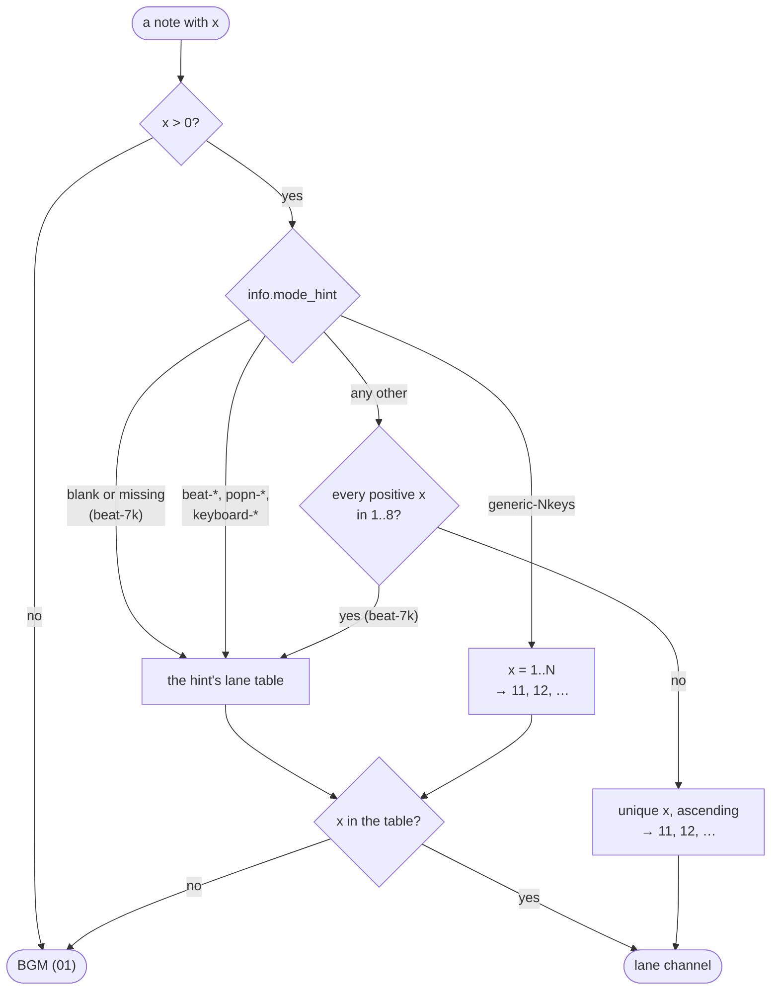

[Japanese version](./bmson-spec.ja.md)

# bmson implementation specification

This document defines how `packages/chart-parser` / `packages/chart-writer` handles bmson.
How beatoraja and other players read the same fields is compared in [BMS / bmson compatibility notes](./format-compat.md).

## Primary reference

- Official website: https://bmson.nekokan.dyndns.info/
- Official documents: https://bmson.nekokan.dyndns.info/documents/
- bmson format and specs v1.0 (Read the Docs): http://bmson-spec.readthedocs.org/en/master/doc/index.html
- Google Docs spec: https://docs.google.com/document/d/1ZDjfjWud8UG3RPjyhN-dd1rVjPaactcMT3PIODTap9s/mobilebasic?pli=1

## Compliance status summary

- Compatibility level: Partial compliance
- Policy: Prioritize the minimum set required for BMS interconversion and playback, rather than the full bmson specification.

## Compatibility checklist

### parser (bmson -> `@be-music/chart-source`)

- [x] Root: `version`
- [x] Root: `info`
- [x] Root: `lines`
- [x] Route compatibility: `resolution` (fallback when `info.resolution` is not specified)
- [x] Root: `sound_channels`
- [x] Root: `bpm_events`
- [x] Root: `stop_events`
- [x] Root: `scroll_events` (beatoraja extension), read as BMS `#SCROLL` (channel `SC`)
- [x] Root: `bga`
- [x] `info` extended item: `subartists`
- [x] `info` extended item: `chart_name`
- [x] `info` extended item: `mode_hint`
- [x] `info` extended item: `judge_rank`
- [x] `info` extended item: `total`
- [x] Preserve the beatoraja extensions `info.ln_type` and per-note `t` (1: LN / 2: CN / 3: HCN) in the IR, used for the player's LN mode resolution and chart-writer output
- [x] `info` extended item: `back_image`
- [x] `info` extended item: `eyecatch_image`
- [x] `info` extended item: `banner_image`
- [x] `info` extended item: `preview_music`
- [x] `x` in `sound_channels[].notes[]`
- [x] `y` in `sound_channels[].notes[]`
- [x] `l` in `sound_channels[].notes[]`
- [x] `c` in `sound_channels[].notes[]`
- [x] `measure` / `position` resolution using `lines`
- [x] Interpret `x <= 0` or omitted `x` as background music (`01`)
- [x] Read the beatoraja extensions as beatoraja does: `mine_channels` as landmine channels keeping per-note `damage`, and `key_channels` as hidden (invisible) notes
- [x] Mirror `info.back_image`, `info.banner_image`, and `info.eyecatch_image` into unified `metadata.backBMP`, `metadata.banner`, and `metadata.stageFile`
- [x] Treat an explicit `lines: []` as barline suppression and keep it in `bmson.barlinesSuppressed`
- [x] Treat missing `lines` as the bmson 4/4 default model
- [x] Treat missing / non-numeric `info.total` as the bmson default `100`, take the absolute value of a negative one, and keep `0` as written
- [x] Treat missing, zero, negative, or non-numeric `info.init_bpm` as a parse error
- [x] Interpret an `x` outside the `mode_hint` lane table as background music (`01`), as beatoraja does
- [ ] Validation of `version` (turning `null` into an error, treating legacy as unspecified)
- [ ] Clarification of policy for determining compatibility of `version` with SemVer
- [ ] Error policy when required information such as `info.title` / `artist` / `genre` is missing
- [ ] `sound_channels[].name` extension fallback search (`.wav`/`.ogg`/`.m4a`)
- [ ] `sound_channels[].name` path normalization (`\` and `/`) and directory traversal prevention
- [ ] `sound_channels[].notes[]` Priority rules when `c=true/false` are mixed in the same pulse
- [ ] `bpm_events` Same `y` Normalization of “last priority” when overloading
- [ ] `stop_events` Same `y` "Addition" normalization when overloaded
- [ ] When the same `id` of `bga.bga_header` is defined multiple times, it is interpreted as the winner.
- [ ] Acceptance of `info.title_image` and retention in IR
- [x] Retention rules for `key:value` format (`music:`/`chart:` etc.) of `subartists`
- [ ] Transparent preservation of unknown root keys

### chart-writer (`@be-music/chart-source` -> bmson)

- [x] `version` output (`bmson.version`, `1.0.0` if not specified)
- [x] `info.resolution` output (`240` if not specified)
- [x] `info` Extended item `subartists` output
- [x] `info` Extended item `chart_name` output
- [x] `info` Extended item `mode_hint` output
- [x] `info` Extended item `judge_rank` output
- [x] `info` Extended item `total` output
- [x] `info` Extended item `back_image` output
- [x] `info` Extended item `eyecatch_image` output
- [x] `info` Extended item `banner_image` output
- [x] `info` Extended item `preview_music` output
- [x] `lines` output (prioritizes `preservation.bmson.lines`)
- [x] `lines` automatic generation (IR bar length based)
- [x] `sound_channels` output
- [x] `bpm_events` output (from `03` / `08`)
- [x] `stop_events` output (from `09`)
- [x] `scroll_events` output (beatoraja extension, from `SC` and `#SCROLLxx`)
- [x] `notes.l` output (`l=0` if not specified)
- [x] `notes.c` output (`c=false` if not specified)
- [x] `notes.t` output (beatoraja extension, long notes only)
- [x] `info.ln_type` output (beatoraja extension)
- [x] `bga.bga_header` output
- [x] `bga.bga_events` output
- [x] `bga.layer_events` output
- [x] `bga.poor_events` output
- [x] Preserve explicit `lines: []` through `bmson.barlinesSuppressed`
- [ ] `bpm_events` Normalize and output events with the same `y` to "last priority"
- [ ] `stop_events` Add and normalize events of the same `y` and output
- [ ] Output of `info.title_image`
- [ ] Path-separated normalization and dangerous path removal for `sound_channels[].name`
- [ ] Transparent reoutput of unknown root key
- [~] Strictly maintain the original value of `notes.x` (exact identity is not guaranteed as lanes are reallocated in IR)

### player / chart-audio-renderer (bmson playback behavior)

- [x] bmson input playback (via `parseChartFile`)
- [x] Use `info.banner_image` for player's song selection screen banner
- [x] Use `info.preview_music` to preview the player's music selection screen
- [x] Time resolution using `lines`
- [x] Time resolution using `resolution`
- [x] Time resolution using `bpm_events`
- [x] Time resolution using `stop_events`
- [x] Scroll speed from `scroll_events` (beatoraja extension), through the BMS SCROLL machinery
- [x] Sample continuation offset interpretation with `notes.c`
- [x] Long note end interpretation using `notes.l`
- [x] Shared BGA timeline extraction for `bga.bga_events`
- [x] Shared BGA timeline extraction for `bga.layer_events`
- [x] Shared BGA timeline extraction for `bga.poor_events`
- [x] Browser player renders bmson BGA still/video assets through the shared BGA timeline
- [ ] CLI/TUI BGA resource loading for bmson header filenames
- [ ] Fixed the processing order of the same pulse (Note/BGA → BPM → STOP) as specified.
- [ ] Apply `bpm_events` of the same `y` with priority to the end
- [ ] Add and apply `stop_events` of the same `y`
- [x] Playback based on sound channel slicing rules (`c` and restart)
- [x] BGM discard when a playable note and a BGM note share the same `y` in one sound channel (applied at parse time; the BGM note is dropped)
- [x] Layered notes (several sound channels with a note on the same `x` and `y`) are one judged note in the player, the first sound channel's, as in beatoraja; the other sound channels still sound at that time ([player spec — Duplicate notes](./player-spec.md#duplicate-notes))
- [ ] Composite playback of the same `(x,y)` notes from different sound channels as Layered Notes

Each sound channel is cut into independently triggered slices at every distinct pulse. `c=true` continues the source offset from the last restart; it does not suppress the note's audio trigger. Notes on one pulse share a slice, and mixed continuation flags restart the source. Different slices may sound independently during manual play, so missing a later note cannot leave its audio playing through the preceding slice. Browser, Node and offline rendering share this rule.

## Fields read by implementation (parser)

- Root: `version`, `lines`, `resolution`(compatible), `info`, `sound_channels`, `key_channels` / `mine_channels` / `scroll_events` (beatoraja extensions), `bpm_events`, `stop_events`, `bga`
- `scroll_events[]`: `y`, `rate`
- `info`: `title`, `subtitle`, `artist`, `genre`, `subartists`, `chart_name`, `level`, `init_bpm`, `resolution`, `mode_hint`, `judge_rank`, `total`, `back_image`, `eyecatch_image`, `banner_image`, `preview_music`, `ln_type` (beatoraja extension)
- `sound_channels[].notes[]`: `x`, `y`, `l`, `c`, `t` (beatoraja extension)
- `key_channels[].notes[]`: `x`, `y`
- `mine_channels[].notes[]`: `x`, `y`, `damage`
- `bga`: `bga_header`, `bga_events`, `layer_events`, `poor_events`

## bmson -> BMS/bmson intermediate representation (`@be-music/chart-source`) conversion

The overall read and write directions are in [JSON spec — Conversion rules](./json-spec.md#conversion-rules). A note's `x` finds its lane by the `mode_hint` rules in the list below:

- Keep `version` in `bmson.version`
- Keep `lines[].y` in `preservation.bmson.lines`
- Keep `info.resolution` in `bmson.info.resolution`
- Also read the root `resolution` for compatibility, and adopt it if `info.resolution` is not present.
- A resolution of `0` or `null` means the default `240`; a negative resolution is read as its absolute value, as the spec says (beatoraja uses `240` for any value `<= 0`). A non-integer is floored.
- Reject the document when `info.init_bpm` is missing or not a positive finite number.
- Use `info.total` when finite (normalizing a negative value to its absolute value per the spec), otherwise apply the bmson default `100`.
- `info.total` is a percentage of the player's default TOTAL, not an absolute TOTAL. Every player ruleset (`lr2`, `beatoraja`, `____`) plays it as `total / 100 ×` its own default TOTAL, and a value ≤ 0 means 100 % — the beatoraja behaviour (`BMSPlayerRule.validate`) — so `total: 0` does not freeze the gauge even though the spec says the lifebar then does not increase. See [player-spec](./player-spec.md#initial-and-default-values-lr2).
- Mirror `info.back_image`, `info.banner_image`, and `info.eyecatch_image` into normalized metadata image fields.
- Register `sound_channels[i].name` in `resources.wav[key]`
- Each sound channel gets its own 2-char WAV key, numbered from `01` in channel order (`sound_channels`, then `key_channels`, then `mine_channels`)
- Convert `notes[].y` to fractional position and turn it into an event
- `notes[].l/c` is kept as `events[].bmson.l/c`
- `notes[].t` (1 = LN, 2 = CN, 3 = HCN) is kept as `events[].bmson.t` on long notes (`l > 0`); `info.ln_type` is kept as `bmson.info.lnType`
- If `lines` exists, calculate `measure` and `position` using the `lines` interval as a measure.
- Map `notes[].x` to BMS channels by `info.mode_hint`, in this order:
  1. A blank or missing `mode_hint` is treated as `beat-7k` (the bmson 1.0.0 default).
  2. `beat-5k`, `beat-7k`, `beat-10k`, `beat-14k`, `popn-5k`, `popn-9k`, `keyboard-24k`, and `keyboard-24k-double` use a fixed lane table (for example `beat-7k` maps `x` 1-5 to `11`-`15`, 6-7 to `18`-`19`, and 8 to the scratch `16`; the keyboard tables are below). As in the bmson spec's canonical list and beatoraja, `beat-5k` keeps the scratch on `x` 8 and leaves `x` 6 / 7 without a lane, and `beat-10k` puts the 2P keys on `x` 9-13 and the 2P scratch on `x` 16. The tables are `BMSON_MODE_HINT_LAYOUTS` in `@be-music/chart-model`, built from the play-mode table (see [Player spec — Play-mode table](./player-spec.md#play-mode-table)).
  3. `generic-Nkeys` maps `x = 1..N` left to right onto consecutive channels from `11`.
  4. Any other hint is unknown. When every positive `x` of `sound_channels`, `key_channels` and `mine_channels` is in the `beat-7k` table (1–8), the chart is read as `beat-7k`, as beatoraja (with a warning), Qwilight and Bemuse read it. Otherwise the unique positive `x` values are numbered in ascending order onto consecutive channels from `11`: beatoraja would turn the lanes past `x` 8 into BGM, and keeping them is what the author meant (be-music decision).
- A note with `x` omitted or `x <= 0` becomes BGM (`01`).
- The keyboard hints (Keyboardmania-style 24 keys plus the wheel, as beatoraja reads them) give every `x` a fixed lane, so a chart that leaves some keys empty never shifts onto the wrong ones:

  | `mode_hint`           | `x`     | Channel           | Lane                     |
  | --------------------- | ------- | ----------------- | ------------------------ |
  | `keyboard-24k`        | 1-9     | `11`-`19`         | keys 1-9 (C up)          |
  |                       | 10-24   | `1A`-`1O`         | keys 10-24 (up to B)     |
  |                       | 25 / 26 | `1P` / `1Q`       | wheel up / wheel down    |
  | `keyboard-24k-double` | 1-26    | as `keyboard-24k` | 1P keys and wheel        |
  |                       | 27-35   | `21`-`29`         | 2P keys 1-9              |
  |                       | 36-50   | `2A`-`2O`         | 2P keys 10-24            |
  |                       | 51 / 52 | `2P` / `2Q`       | 2P wheel up / wheel down |

  `keyboard-24k` / `keyboard-24k-double` charts play as `24 KEY SP` / `48 KEY DP` whatever lanes they use (see the player spec). BmsONE's `keyboard-48k` is a single-player 48-key layout, not the two-player `keyboard-24k-double`, so it is not aliased to it and takes rule 4 like any other unknown hint.

- A positive `x` that the lane table of a fixed-table or `generic-Nkeys` hint does not cover is a BGM note (`01`): its sound plays, but no lane gets a note. beatoraja treats an `x` outside the hint's key table the same way. Under rule 4 every positive `x` gets a lane, so no `x` is outside it.
- An out-of-table note on the same `y` as a playable note of the same sound channel is dropped, like an `x = 0` note.
- `bpm_events` is converted to `resources.bpm` + channel `08`
- `stop_events` is converted to `resources.stop` + channel `09`
- BPM and STOP values get one key per distinct value, in order of first appearance, so a gimmick chart with thousands of changes that repeat a few values needs only a few keys. A 2-char key holds 1,295 slots in base 36 (`01`–`ZZ`); when the WAV channels or the distinct values of one table need more, the chart switches to base-62 keys (`bms.base = 62`, 3,843 slots), so no key wraps round onto an earlier value. Past 3,843, a BPM / STOP value takes the key of the nearest value that has one, and further WAV channels are dropped; beatoraja has no such limit, but no known chart reaches it
- Original array of `bpm_events` is kept in `preservation.bmson.bpmEvents`
- Original array of `stop_events` is kept in `preservation.bmson.stopEvents`
- The beatoraja extension `scroll_events` is converted to `bms.scroll` (the `#SCROLLxx` table, one key per distinct `rate`) + channel `SC`, so it plays through the BMS SCROLL machinery (scroll timeline, lane distances, green number). A rate holds until the next scroll event, as `#SCROLL` does; of several events on one `y` the last one in the list wins, as in beatoraja. Any finite `rate` is kept, zero and negative included; an entry without a finite `y` or `rate` is skipped. The authored array is kept in `preservation.bmson.scrollEvents` (left out when there is none)
- beatoraja's bmson decoder gives the timelines it creates for later objects a scroll of 1.0 instead of the current rate (`BMSONDecoder.getTimeLine`, L588-606), so there a rate can fall back to 1.0 at the next note before the next scroll event. be-music keeps the rate until the next scroll event, as BMS charts and the extension's intent have it; on the gimmick chart checked (safe_state) the two readings drew the same
- Original array of `sound_channels` is kept in `preservation.bmson.soundChannels`
- The beatoraja extensions are read as jbms-parser (beatoraja) reads them. Both go through the same `mode_hint` lane map as `sound_channels`; a note whose `x` has no lane is dropped. Their WAVs are registered after `sound_channels`, `key_channels` first, then `mine_channels`
  - `key_channels` are hidden notes: each note becomes a BMS invisible object (`3x` / `4x`, including the extended `3A`-`3Q` / `4A`-`4Q`) that plays its channel's sample as the lane's keysound and is never judged. Only `x` and `y` are read
  - `mine_channels` are mines: each note becomes a BMS landmine (`Dx` / `Ex`) and keeps `damage` in `events[].bmson.damage`. The event value is the WAV slot registered for the mine channel, so the player never reads it as damage: a mine without `damage` deals the default `4` (%), the same fallback as an invalid BMS mine value
  - beatoraja drops a mine inside a long note or on a position a note already uses; be-music keeps it, as LR2 keeps such BMS mines (see [BMS / bmson compatibility notes §2.6](./format-compat.md#26-mines))
- `bga` is kept in `bmson.bga`

## BMS/bmson intermediate representation -> bmson conversion (chart-writer)

- Generate `y = round(beat * resolution)` from beat resolution equivalent to `eventToBeat` of `@be-music/chart-model`
- Output `bmson.version` to `version` (`1.0.0` if not specified)
- Output `bmson.info.resolution` to `info.resolution` (`240` if not specified)
- Output extended items of `bmson.info` (`subartists`, `chart_name`, `judge_rank`, `total`, image/preview etc.)
- Write `info.total` from `bmson.info.total`, or from `metadata.total` for a bmson source. A BMS / JSON chart's `metadata.total` is an absolute gauge TOTAL while bmson `total` is a percentage of the player's default TOTAL (which depends on the note count and the ruleset), so it is not written and the bmson default `100` applies
- Write `info.judge_rank` from `bmson.info.judge_rank`, or from `metadata.rank` for a bmson source. For a BMS / JSON chart, bmson `judge_rank` shares `#DEFEXRANK`'s unit (`100` = NORMAL), so a positive `#DEFEXRANK` is written verbatim; otherwise an integer `#RANK 0`–`4` (`metadata.rank`, a rank index) maps to `33` / `67` / `100` / `133` / `167` — the `#DEFEXRANK` value that judges like that rank (VERY EASY follows beatoraja's judgerank `125`; LR2 plays it as NORMAL). Any other `#RANK` (out of range or fractional) judges as NORMAL, so `judge_rank` is not written and the bmson default `100` applies. Under be-music's rulesets the conversion keeps That-Which-Must-Not-Be-Named's windows, keeps LR2's for NORMAL and `#DEFEXRANK` (within `0.4ms` for `#RANK 0`, `1`, `3`; `#RANK 4` is wider), and under beatoraja judges about 4/3 wider for every rank, because beatoraja reads bmson `judge_rank` as the judgerank itself rather than scaling it like `#DEFEXRANK`
- If `preservation.bmson.lines` exists, output as `lines[].y`
- If `preservation.bmson.lines` is not present, `lines` will be automatically generated from the bar length of IR.
- If `bmson.barlinesSuppressed` is `true`, output `lines: []`.
- `sound_channels` outputs in `wav` keys
- `info.mode_hint` is `bmson.info.modeHint` when set; otherwise `keyboard-24k` / `keyboard-24k-double` for a `24 KEY SP` / `48 KEY DP` chart, else the play variant's hint (`beat-5k` / `beat-7k` / `beat-10k` / `beat-14k` / `popn-9k`) when every lane in use is in its table, else the spec's left-to-right `generic-<lanes>keys` (a made-up `beat-<lanes>k` would be an unknown hint, which other players read as `beat-7k`)
- Under every hint in the table above (keyboard layouts and wheel included) each lane gets its fixed `x` from that table, so the chart re-parses onto the same lanes; lanes outside the table follow after it, and a layout that no canonical hint fits is written as `generic-<lanes>keys`, numbering the lanes in use from `x = 1`
- Generate `bpm_events` from `03` / `08` channels
- Generate `stop_events` from `09` channel
- Generate `scroll_events` from `SC` objects and their `#SCROLLxx` rate (left out when the chart has none), so BMS SCROLL gimmicks survive a BMS → bmson conversion for beatoraja
- Reflect `events[].bmson.l/c` to `sound_channels.notes[].l/c` (if not specified, `l=0`, `c=false`)
- Write a BMS long note — an `#LNOBJ` pair or a `5x` / `6x` long note (`#LNTYPE 1` / `2`; inferred as the web player does when `#LNTYPE` is missing) — as one note on its playable lane with `l` up to its end; the end object (and `#LNTYPE 2` continuations) is not written as a note. A `5x` / `6x` start without an end stays a short note on its lane
- Reflect `events[].bmson.t` to `notes[].t` on long notes, and `bmson.info.lnType` (else BMS `#LNMODE` `1`–`3`, the same LN / CN / HCN numbering) to `info.ln_type`
- Write mines (`Dx` / `Ex`) to `mine_channels`, keeping `events[].bmson.damage` as `damage` (a BMS / JSON mine's value read in base 36 when it has none; left out when the value is not an upper-case base-36 damage, which deals the same default `4` either way). BMS mines all explode with `#WAV00`, so they share one channel named after it (an empty name when the chart has none); bmson mines keep their own samples. Write invisible objects (`3x` / `4x`) to `key_channels`, grouped by WAV key. Both arrays place each note on the `x` of the lane it sits on, and neither is written when the chart has no such objects
- A chart with mines or invisible objects always takes the canonical output, because the preserved arrays do not hold them
- If `preservation.bmson.bpmEvents` / `stopEvents` / `scrollEvents` / `soundChannels` are consistent with the current IR, re-output them in favor of their array structure.
- Output `bga` if `bmson.bga` exists

### Converting between BMS and bmson

`stringifyBMS` writes a bmson-sourced chart with these conversions (an ordinary BMS chart is written as it is):

| bmson                | BMS                                                                                                                                                                                                                                                                                                                             |
| -------------------- | ------------------------------------------------------------------------------------------------------------------------------------------------------------------------------------------------------------------------------------------------------------------------------------------------------------------------------- |
| A note with `l > 0`  | A `#LNTYPE 1` pair on `5x` / `6x`: a start and an end object with the note's own WAV. `#LNTYPE 1` is written when the chart has none. `#LNOBJ` is not used: it needs one end-object slot shared by every long note and pairs an end with whatever note precedes it on the lane, while a `5x` / `6x` pair only pairs with itself |
| `t` / `info.ln_type` | `#LNMODE` from the long notes' type (`t`, else `info.ln_type`) when they all agree, else from `info.ln_type`. Per-note types that disagree with it cannot be written in BMS and are lost                                                                                                                                        |
| Mine `damage`        | The mine's object value, in base 36: rounded to an integer and clamped to `01`–`ZZ` (`00` is no object, so `0` becomes `01`, 1 %; above `1295` becomes `ZZ`). A mine without `damage` gets `04`, be-music's default. The first mine's sample becomes `#WAV00`, the explosion sound, when the chart has none                     |
| `judge_rank`         | `#DEFEXRANK` with the same value (same unit, `100` = NORMAL), when positive; no `#RANK`                                                                                                                                                                                                                                         |
| `total`              | Not written. bmson `total` is a percentage of the player's default TOTAL, which depends on the note count and the player, so no absolute `#TOTAL` is exact; the BMS default applies, which is what bmson's default `100` means                                                                                                  |
| `scroll_events`      | `#SCROLLxx` (one per distinct rate) and `SC` objects                                                                                                                                                                                                                                                                            |
| `c`, `up`            | Lost: BMS has no sample slicing or LN end sound                                                                                                                                                                                                                                                                                 |

The other direction (BMS → bmson) is in the list above: long notes become `l`, `#LNMODE` becomes `info.ln_type`, a mine's base-36 value becomes `damage`, and `#TOTAL` is not written. A chart converted BMS → bmson → BMS keeps its long notes (as `#LNTYPE 1` pairs) and its mine damage.

### `judge_rank` across players and converters

The bmson spec leaves the window for `judge_rank` to each player (default `100` = the player's own default window); its non-normative example uses LR2's `#RANK 2` (NORMAL) windows. Players and converters split into two readings, so no single value plays the same everywhere:

| Reading of `judge_rank: 100`     | Players                                                                                                                                                                                                                                                                                                                                                                                                                                                                                        |
| -------------------------------- | ---------------------------------------------------------------------------------------------------------------------------------------------------------------------------------------------------------------------------------------------------------------------------------------------------------------------------------------------------------------------------------------------------------------------------------------------------------------------------------------------- |
| NORMAL (`#RANK 2`)               | [Bemuse](https://github.com/bemusic/bemuse/blob/4bf3e7d98a44841b323741cc403ecb7b41618ade/packages/bemuse-notechart/src/loader/BmsonNotechartLoader.ts#L35-L43), [Qwilight](https://github.com/thenist/Qwilight/blob/6d3887f6688a1f97c1fbe2bffd28feaedc9920b6/Qwilight/Compiler/BMSONCompiler.cs#L375), [raindrop](https://github.com/zardoru/raindrop/blob/662dd11f05994f6f36493575b04ecb64b04dcd7b/src/NoteLoaderBMSON.cpp#L200-L215), be-music's LR2 / That-Which-Must-Not-Be-Named rulesets |
| EASY (`#RANK 3`; NORMAL is `75`) | [beatoraja](https://github.com/exch-bms2/beatoraja/blob/8320241d8481e0826c703878c3eba01cd81ca3e4/src/bms/player/beatoraja/play/BMSPlayerRule.java#L59-L66) (uses `judge_rank` as its judgerank percentage, unlike `#DEFEXRANK`, which it scales so that `100` = NORMAL since 0.7.3), LR2oraja, bmz-player, be-music's beatoraja ruleset                                                                                                                                                        |

| Converter (BMS → bmson)                                                                                                                    | `#RANK 0`–`4` written as                                   |
| ------------------------------------------------------------------------------------------------------------------------------------------ | ---------------------------------------------------------- |
| [BmsONE](https://github.com/excln/BmsONE/blob/bb3406eeb8f45d79350241f09bb897dd229ce3af/src/document/DocumentInfo.cpp#L119-L135)            | `40` / `60` / `80` / `100` / `120` (`#DEFEXRANK` not read) |
| [bms2bmson-python](https://github.com/bemusicscript/bms2bmson-python/blob/c83df681b6cd9d28f5dfccc9ee302e389e417b7b/bmx2bmson.py#L108-L122) | not written (default `100`)                                |
| be-music (`stringifyBmson`)                                                                                                                | `33` / `67` / `100` / `133` / `167`; `#DEFEXRANK` verbatim |

be-music follows the NORMAL reading (`100` = NORMAL): it matches the spec's example and most players, and keeps a chart's windows when be-music converts it to bmson and reads it back. The cost is that a converted chart judges about 4/3 wider in beatoraja. Distributed bmson charts almost always carry the default `100`.

## Unsupported/incompatible for primary references

- Not supported: transparent retention of unused unknown root keys in bmson

## y -> position conversion rule

- If `lines` has at least two entries:
  - index of the `lines` interval to which `measure = y` belongs
  - `position = [y - lineStart, lineEnd - lineStart]`
  - After the last line, measures continue as 4/4 measures (`resolution * 4` ticks each) counted from the last line
- If `lines` is missing or has fewer than two entries:
  - `beat = y/resolution`
  - `measure = floor(beat / 4)`
  - `position = [round(y) % (resolution * 4), resolution * 4]`
