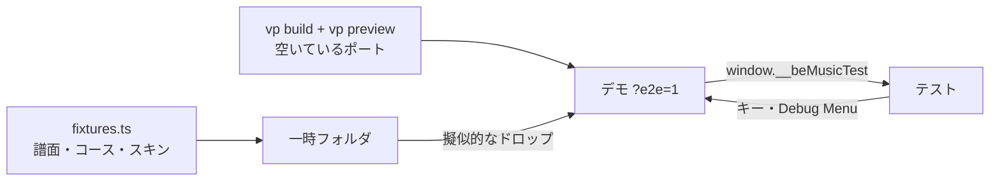

[English version](./course-checklist.md)

# コースのブラウザ確認

Web デモのコース機能を、スキンの種類ごとに確かめる手順です。単体テストでは届かない、シーン、画面の切り替え、音を確かめます。大部分は最小のテスト用スキンで自動で確かめられます（[自動実行](#自動実行)）。コースの流れ、シーン、デモのホストを変えたら、これを実行します。[移行](./architecture.ja.md#移行)の各段階の終わりと、自動実行では見えないところを変えたときは、実在のスキンで全項目を手で確かめ、結果をこのページの最後に記録します。規則そのものは [course.ja.md](./course.ja.md)、シーンは [player-web.ja.md](./player-web.ja.md) にあります。

## 自動実行

`pnpm run test:e2e` はデモをビルドして空いているポートで配信し、[`packages/player-web-demo/e2e`](../packages/player-web-demo/e2e) の Playwright のテスト（全 46 件）をヘッドレスの Chromium で実行します。グローバルセットアップが下のテスト用データを一時フォルダに書き出し、テストはそれを人と同じようにドロップし（[準備](#準備)の擬似的なドロップ）、`code` 付きのキーを押し、Debug Menu を操作して、[テスト用フック](#テスト用フック)の値を確かめます。画素は見ません。プレイは実時間で進むので（3 並列でおよそ 5 分）、`pnpm test` には含めていません。



- **初回の前に**、Playwright の Chromium を一度入れます：`pnpm exec playwright install chromium`。テストは Chromium 本体の新しいヘッドレスモード（`channel: 'chromium'`）で動き、GPU があれば GPU で描きます。
- **オプション。** `E2E_WORKERS` で並列数（既定は 4）、`E2E_PORT` でポートを決められます。ほかの引数は Playwright に渡ります：`pnpm run test:e2e -g NONSTOP`、`pnpm run test:e2e --headed`。失敗したテストは `packages/player-web-demo/e2e-results/` にトレースを残します（`pnpm exec playwright show-trace <trace.zip>`）。
- **テスト用スキン。** `scripts/course-checklist/skins/` に、この確認のために作った、第三者の素材を含まないスキンがあります。LR2 のテーマ（選曲、決定、7 鍵のプレイ、結果、コースの結果のスキンと、`course_clear` / `course_fail` を含む効果音のセット）と、beatoraja の JSON スキン（選曲、決定、7 鍵のプレイ、結果、コースの結果）です。単色の画像と、コースの op で出し分けるコースの文字を描き、PLAY（15）と AUTO（16）のボタンを持ちます（LR2 の選曲スキンはフィルターとソートのボタン 10〜12・91〜96 も、beatoraja の選曲スキンは MODE と SORT のボタン 11・12 も）。画像と音は `fixtures.ts` が書き出します。見た目ではなく流れを確かめるためのものです。

| テスト                                                                          | スキンの種類         | 件数                                     | 項目                                                                                                                                                                                                                                                                                                                                                                                                                                     |
| ------------------------------------------------------------------------------- | -------------------- | ---------------------------------------- | ---------------------------------------------------------------------------------------------------------------------------------------------------------------------------------------------------------------------------------------------------------------------------------------------------------------------------------------------------------------------------------------------------------------------------------------- |
| `course-flow.ts`（`built-in.spec.ts`、`lr2.spec.ts`、`beatoraja.spec.ts` から） | 標準、LR2、beatoraja | 27（種類ごとに 9）                       | 1（フォルダ、バー、曲が欠けたコースの理由を Enter と AUTO で）、2（AUTO と無入力の段位。結果の省略、ゲージの持ち越し、LR2 の段位の設定が戻ること、コース用の曲）、3、4（両方の配置、R、テンポの設定のロック）、5、6、7、8、10、11                                                                                                                                                                                                        |
| `course-maker.spec.ts`                                                          | 標準                 | 1                                        | 9（5 曲の上限、キーモードの規則、制約の編集、Save、Cancel、名前の変更、削除、`.lr2crs` と `.json` への書き出し）                                                                                                                                                                                                                                                                                                                         |
| `playlog.spec.ts`                                                               | 標準                 | 2                                        | 12（ステータス行、その場でのテンポの変更、表示の変更、Replay / ghost の設定のオンとオフでのリプレイ）                                                                                                                                                                                                                                                                                                                                    |
| `select.spec.ts`                                                                | 標準、LR2、beatoraja | 10（種類ごとに 3、beatoraja でさらに 1） | 選曲の一覧：ソートやフィルターを変えてもカーソルの下のバーが残る（標準は Debug Menu、LR2 と beatoraja はスキンのボタンで変える。beatoraja には難易度のフィルターがない）、キーモードフィルターは譜面をそのキーモードの下に並べる、検索は一覧を絞り込み、ルートでは一致する譜面を並べる。beatoraja では、フォーカスのあるバーをクリックするとそれを選び（フォルダなら開き）、ほかのバーをクリックすると譜面を始めずにカーソルがそこへ移る |
| `lane-options.spec.ts`                                                          | 標準、LR2、beatoraja | 3（種類ごとに 1）                        | レーンオプション：Debug Menu の Random 1P を MIRROR にした AUTO のプレイは、Fixture A のキーを左右反転して遊び（スクラッチはそのまま）、どのノートも PGREAT で、プレイログに `randomLane.p1` と遊んだレーンを記録する                                                                                                                                                                                                                    |
| `restart.spec.ts`                                                               | 標準                 | 2                                        | F5 は単曲を同じ遊び方でやり直す：Debug Menu の Auto play を切ったまま Synesthesia スキンの AUTO ボタンで始めた AUTO のプレイは AUTO のまま、リプレイはリプレイのまま                                                                                                                                                                                                                                                                     |
| `transitions.spec.ts`                                                           | 標準                 | 1                                        | 外からの移動は進行中の流れを終わらせる：段位のステージ中にスキンをドロップするとコースは終わってカーソルはそのバーに戻り、次の譜面は単曲として遊ぶ。プレイ中は Debug Menu の skin の項目が無効                                                                                                                                                                                                                                           |
| すべてのテスト                                                                  | すべて               | —                                        | 11：捕まえられなかったエラーや `console.error` があれば失敗します（動いていないリーダーボード API の 502 についてブラウザが出す行は除きます）                                                                                                                                                                                                                                                                                            |

**実在のスキンで手で確かめること**（LR2 の標準のテーマと効果音、ModernChic などの beatoraja のスキン）：画面の見た目、実際に聞こえる音（項目 5 のフェードアウト、結果の曲。テストはどの曲が結果画面に渡ったかを確かめ、鳴ったかは確かめません）、実在のスキンでの PLAY / AUTO のボタンとコースの文字、実際のドラッグ＆ドロップ、LR2 の段位でのほかの設定の変更（HIDDEN / SUDDEN、オートスクラッチ、FLIP、テンポ）、HS-FIX、タッチ端末、beatoraja のコースの結果の PLAY TIME（フックには出ません）。

## テスト用フック

URL に `?e2e=1` を付けるか開発ビルドで動かすと、デモは `window.__beMusicTest`（[`test-hook.ts`](../packages/player-web-demo/src/test-hook.ts)）を置きます。表示しているものを読むだけのもので、読んでも何も始めません（譜面のハッシュを計算することもありません）。バーの自己ベストのランプとトロフィーは、選曲画面と同じく今の判定ルールのものです。ホストが持っている状態と、ホストが渡す結果画面とプレイログの中身を読み、デモを操作することはありません。ファイルはページのドロップの処理から読み込みます。

これは約束事です。シーンルーターとホストの書き直し（P5、[ADR 0006](./adr/0006-scene-router.ja.md)）でも各項目の意味を保ち、意味を変えるときは `version` を上げます。

| メンバー                            | 内容                                                                                                                                                                                                                                                                                                                                                                   |
| ----------------------------------- | ---------------------------------------------------------------------------------------------------------------------------------------------------------------------------------------------------------------------------------------------------------------------------------------------------------------------------------------------------------------------- |
| `version`                           | 約束事の版（1）。                                                                                                                                                                                                                                                                                                                                                      |
| `state().scene`                     | `{ kind, family }`：`select`、`decide`、`play`、`result`、`none`（画面の切り替えの途中）と、描いているスキンの種類（`built-in`、`lr2`、`beatoraja`）。                                                                                                                                                                                                                 |
| `state().status`、`statusLog`       | ステータス行と、これまでに出たすべてのステータス行。                                                                                                                                                                                                                                                                                                                   |
| `state().loading`、`loads`          | ドロップしたファイルを読んでいる最中かどうかと、読み込みを終えたドロップ（とファイルの選択）の数。                                                                                                                                                                                                                                                                     |
| `state().library`                   | 譜面の数とコースのフォルダの名前。                                                                                                                                                                                                                                                                                                                                     |
| `state().cursor`                    | 選曲画面で開いているフォルダとカーソルの下のバー（種類、タイトル。コースなら種類、ステージのタイトル、欠けたステージの数、遊べるかどうか、LR2 の NEW COURSE かどうか。そのバーの自己ベストのランプとトロフィー）。標準と LR2 の画面では一覧の形も（`list`：ソート、キーモードフィルター、難易度フィルターを `@be-music/scene-model` の名前で、検索を入力したままで）。 |
| `state().play`                      | 表示中のプレイ：タイトル、AUTO、リプレイかどうか、テンポ、HIGH-SPEED（LR2 と標準）、譜面の秒数、ここまでの判定とゲージ、コースのステージ（コース名、何曲目か、曲数）。                                                                                                                                                                                                 |
| `state().courseDraft`               | 作っているコースの種類と曲。                                                                                                                                                                                                                                                                                                                                           |
| `state().results`                   | これまでに出た結果画面（古い順）：プレイの種類（`single`、`stage`、`course`、`nonstop`）、スキンの種類、タイトル、ランプ、クリアかどうか、EX スコア、判定、ゲージ、PLAY TIME、結果の曲の出どころ（`lr2:courseClear`、`beatoraja:fail` など）。コースなら、各ステージの判定、持ち越したゲージと最後のゲージ、投げたかどうか、到達したステージの数。                     |
| `state().playlogs`、`lastPlaylog()` | 終わったプレイが記録したプレイログの数と、最後のプレイログ（1 曲のプレイ、コースのステージ、NONSTOP のプレイ）。                                                                                                                                                                                                                                                       |

## 準備

1. **テスト用データ。** `node scripts/course-checklist/fixtures.ts <dir>` で、`<dir>/songs` に小さな BMS ライブラリを作ります。Fixture A〜G（無入力で遊ぶとゲージが尽きる密な Fixture D を含む）と 5 鍵の譜面、`songs/courses/fixture-courses.lr2crs`（FIX GRADE、FIX EXPERT、FIX NONSTOP、FIX GRADE FAIL と、2 曲目がライブラリにない FIX MISSING STAGE）です。5 曲の上限の警告を確かめる `<dir>/seven-stages.lr2crs` と、`<dir>/skins/lr2`・`<dir>/skins/beatoraja` にテスト用スキンも作ります。
2. **スキン。** 標準のスキンは何も要りません。LR2 は標準のテーマと効果音（`LR2files/Theme/LR2` と `LR2files/Sound`）を、beatoraja は任意のスキン（前回は ModernChic）を使います。流れをざっと見るだけならテスト用スキンでも足ります。テーマはドロップすると適用され、Debug Menu の Skin system でスキンの種類を切り替えられます。
3. **開発サーバー。** デモは専用のポートで動かします（`pnpm --filter @be-music/player-web-demo run dev --port 5199 --strictPort`）。既定のポートで遊んでいるセッションに触れないためです。
4. **ファイルのドロップ。** 人が確かめるなら、フォルダをページにドラッグすれば済みます。ブラウザの自動操作ではドロップできないので、`node scripts/course-checklist/serve.ts fixtures=<dir>/songs extra=<dir> lr2theme=<LR2files の親> beatoraja=<スキンのフォルダ>`（ポート 5299）で配信し、ページのコンソールから擬似的にドロップします。

   ```js
   window.fakeDrop = async (root, prefix = '', keep = () => true) => {
     const list = (await (await fetch(`http://127.0.0.1:5299/__list?root=${root}`)).json()).filter(keep);
     const files = await Promise.all(
       list.map(async (rel) => {
         const url = `http://127.0.0.1:5299/__file?root=${root}&path=${encodeURIComponent(rel)}`;
         const path = prefix ? `${prefix}/${rel}` : rel;
         const file = new File([await (await fetch(url)).arrayBuffer()], path.split('/').pop());
         Object.defineProperty(file, 'webkitRelativePath', { value: path });
         return file;
       }),
     );
     const event = new Event('drop', { cancelable: true });
     Object.defineProperty(event, 'dataTransfer', { value: { items: [], files, types: ['Files'] } });
     window.dispatchEvent(event);
     return files.length;
   };
   // await fakeDrop('fixtures', 'fixtures'); await fakeDrop('lr2theme');
   // await fakeDrop('extra', '', (path) => path === 'seven-stages.lr2crs');
   ```

5. **キー。** ブラウザペインのキー操作はレーンに届きません。`window` に `code` 付きの `KeyboardEvent`（`Escape`、`Enter` など）を送ります。落ちる場合の確認は無入力の手動プレイで足り、ほかは AUTO で確かめられます。

## 確認項目

各項目を、標準・LR2・beatoraja のスキンで確かめます。

| #   | 項目                             | 確かめること                                                                                                                                                                                                                                                                                                                                                                                                  |
| --- | -------------------------------- | ------------------------------------------------------------------------------------------------------------------------------------------------------------------------------------------------------------------------------------------------------------------------------------------------------------------------------------------------------------------------------------------------------------- |
| 1   | コースのフォルダとバー           | MY COURSES / MY NONSTOP / MY DAN と、ドロップした `.lr2crs` のフォルダにコースが並ぶ。コースバーにステージが出て、遊んだあとは自己ベストのランプとトロフィーが出る。曲が欠けたコースは、選ぶと理由を表示する。                                                                                                                                                                                                |
| 2   | 段位（AUTO と手動）              | コースのゲージでステージが進み、ゲージを持ち越す。AUTO では LR2 と同じく最後以外のステージの結果を飛ばす。コースの結果がコース用の曲とともに出る。LR2 の段位では配置が OFF に、EASY が GROOVE になり、終わるとプレイヤーの設定に戻る。                                                                                                                                                                        |
| 3   | EXPERT                           | EXPERT のゲージで同じ流れになる。                                                                                                                                                                                                                                                                                                                                                                             |
| 4   | NONSTOP（両方の配置）            | つないだ 1 本の譜面になる。通常の結果画面にクリア / 失敗の曲が流れる。R でつなぎ直して遊び直せる。プレイ中はピッチの扱いと伸縮方式の設定がロックされる。テンポのスライダーも、ピッチを変えるモード以外ではロックされる（ピッチを変えるモードではその場でテンポが変わる）。beatoraja ではテーマのプレイと結果のスキンで遊び、結果を見せる。                                                                    |
| 5   | ステージの途中でゲージが尽きる   | 音と画面がフェードアウトしてから結果が出る。                                                                                                                                                                                                                                                                                                                                                                  |
| 6   | ステージ中の ESC                 | 1 曲目でも、コースは落ちたプレイとしてコースの結果に進み、投げたステージの判定も数える（FIX GRADE FAIL を無入力で遊び、POOR が数個出たら ESC。AUTO で 2 曲目の途中に ESC）。                                                                                                                                                                                                                                  |
| 7   | ステージ中にキャンバスをクリック | ステージがやり直しにならない。                                                                                                                                                                                                                                                                                                                                                                                |
| 8   | 選曲画面に戻る                   | 段位、EXPERT、NONSTOP のあと、カーソルがコースバーにある。                                                                                                                                                                                                                                                                                                                                                    |
| 9   | コース作成                       | NONSTOP / EXPERT / GRADE、5 曲の上限、キーモードを揃える規則、制約の編集、名前の変更、削除、`.lr2crs` と beatoraja の `.json` への書き出し。Save と Cancel は何をしたか表示する。                                                                                                                                                                                                                             |
| 10  | 5 曲の上限の警告                 | `seven-stages.lr2crs` をドロップすると、先頭の 5 ステージとして読んだと表示する。                                                                                                                                                                                                                                                                                                                             |
| 11  | コンソール                       | コースの流れによるエラーがない（手元でリーダーボード API を動かしていなければ 502 が返るのは想定どおり）。                                                                                                                                                                                                                                                                                                    |
| 12  | プレイログとリプレイ             | ステータス行は何を遊んでいるかを表示し、選曲画面に戻るとライブラリの説明に戻る。ピッチを変えるモードではテンポのスライダーでプレイのテンポがその場で変わり、`play.tempoChanges` に記録される。HIGH-SPEED の変更は `play.view` / `viewChanges` に記録される。そのログのリプレイは、Debug Menu の Replay / ghost の設定がオンなら記録どおりのテンポと HIGH-SPEED になり、オフなら見る人自身の設定のままになる。 |

be-music の不具合ではないもの：LR2 標準のコース結果スキン（`courseresult_normal.csv`）は POOR の欄に 113 番（BAD）の数値を読むので、そこの POOR は 0 のままです。

## 実行記録

| 日付       | コミット   | 結果                                                                                                                                                                                                                                                                                                                                                                                                                                                                                                                                                                                                                                                                                                                                                                                                                                                                                                     |
| ---------- | ---------- | -------------------------------------------------------------------------------------------------------------------------------------------------------------------------------------------------------------------------------------------------------------------------------------------------------------------------------------------------------------------------------------------------------------------------------------------------------------------------------------------------------------------------------------------------------------------------------------------------------------------------------------------------------------------------------------------------------------------------------------------------------------------------------------------------------------------------------------------------------------------------------------------------------- |
| 2026-10-16 | `e1bdc6bb` | 1〜5、7、9〜11 は合格。不合格で、その後直したもの：手動で 1 曲目に ESC を押すと結果も記録もなく選曲画面に戻り、投げたステージの判定が抜けた（標準と LR2。シーンがエンジンを中断していなかった）。LR2 のコース結果で `course_clear` / `course_fail` ではなく `clear` / `fail` が流れた。NONSTOP のあと（標準と LR2）と、どのコースのあとも（beatoraja）、カーソルがコースバーに戻らなかった。                                                                                                                                                                                                                                                                                                                                                                                                                                                                                                             |
| 2026-10-16 | `097d44c5` | 1 回目から直ったもの：1 曲目の ESC（全種類）、LR2 のコース結果の曲、NONSTOP のあとのカーソル（標準・LR2）、READY からのコースゲージ、標準のコース結果の表示、ModernChic のクリア曲。LR2 / beatoraja のテーマはドロップで読み込まれる。プレイ中のテンポ変更、表示設定の記録、リプレイは合格。不合格で、その後直したもの：AUTO で記録したログのリプレイがテンポの変化に従わない。譜面を遊び終えたあとや AUTO で投げたステージの PLAY TIME が 0。beatoraja で 5 曲の上限の警告が上書きされ、コースファイルをドロップし直すとフォルダが増える。不合格で修正中のもの：beatoraja でコースのあとのカーソル。曲が欠けたコースの理由が出ない。LR2 / beatoraja の PLAY・AUTO ボタンがコースバーで効かない。beatoraja でバーのタイトル文字のクリックが効かない。                                                                                                                                                    |
| 2026-10-16 | `7991f14b` | `097d44c5` 以降の修正の確認で、すべて合格。曲が欠けたコースは欠けた曲数を表示する（標準・LR2・beatoraja。Enter とスキンのボタン）。スキンの AUTO ボタンと標準の PLAY でコースが始まる。beatoraja で、遊んだコースバーとフォルダ内の曲にカーソルが戻る。beatoraja のバーのタイトル文字をクリックすると選択・フォルダを開ける。beatoraja のコースのステージで段位用のゲージ名が出る。beatoraja のテーマで NONSTOP の結果にそのテーマのクリア曲が流れる。LR2 のハイスピード表示が Debug Menu と矢印キーに合う。プレイログの表示設定の数値が丸められる。AUTO のログのテンポ変化がリプレイされる。譜面を遊び終えたあとに投げたステージと、AUTO で投げたステージの PLAY TIME が数えられる。5 曲の上限の警告が残り、ドロップし直してもフォルダが増えない。プレイのあと選曲画面でライブラリの表示に戻る。未確認：LR2 標準スキンと ModernChic の PLAY ボタン（どちらにもない）、HS-FIX オン、beatoraja の失敗曲。 |
| 2026-10-16 | `c8bcbce5` | 初めての自動実行（`pnpm run test:e2e`、P0b）：30 のテストで、標準のスキンで項目 1〜12、LR2 と beatoraja のテスト用スキンでコースの流れを確かめ、3 回続けて合格（3〜4 並列で各回およそ 4 分半）。                                                                                                                                                                                                                                                                                                                                                                                                                                                                                                                                                                                                                                                                                                         |
